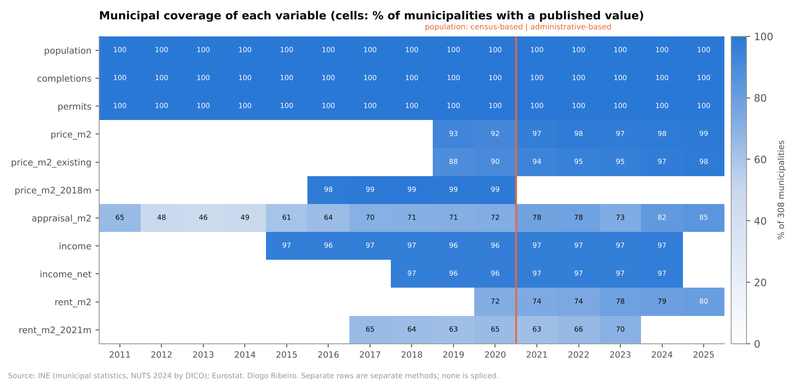
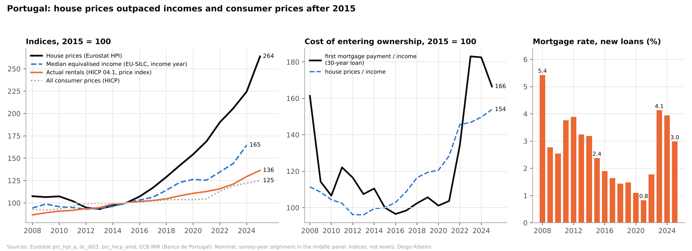
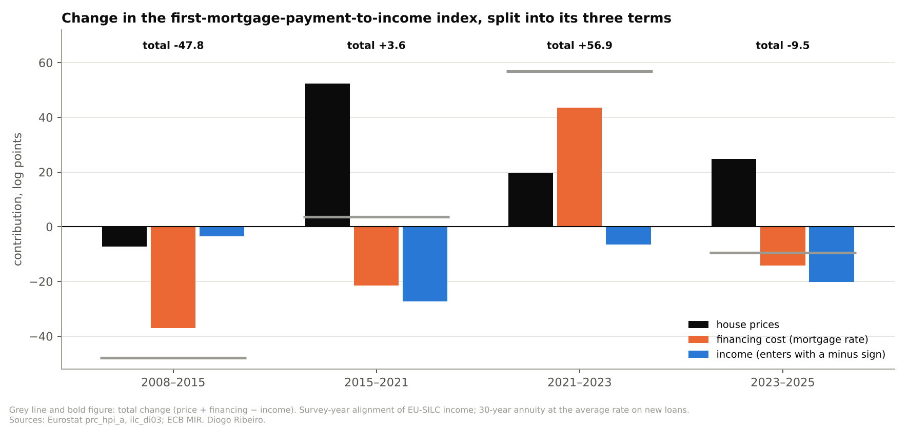
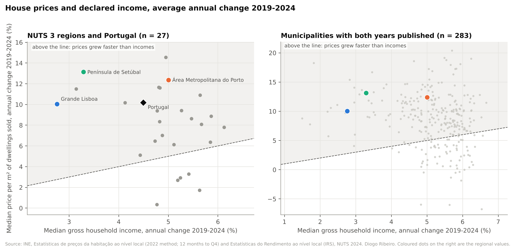
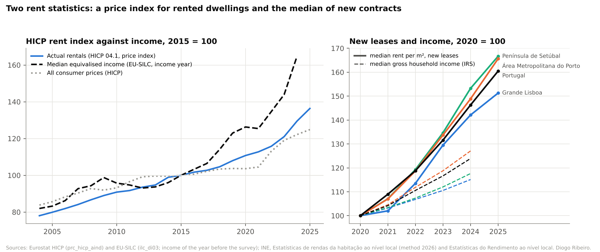
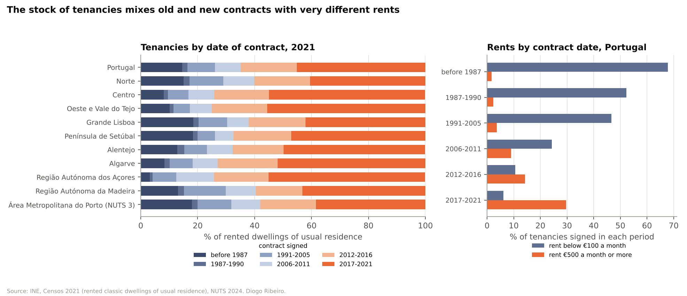
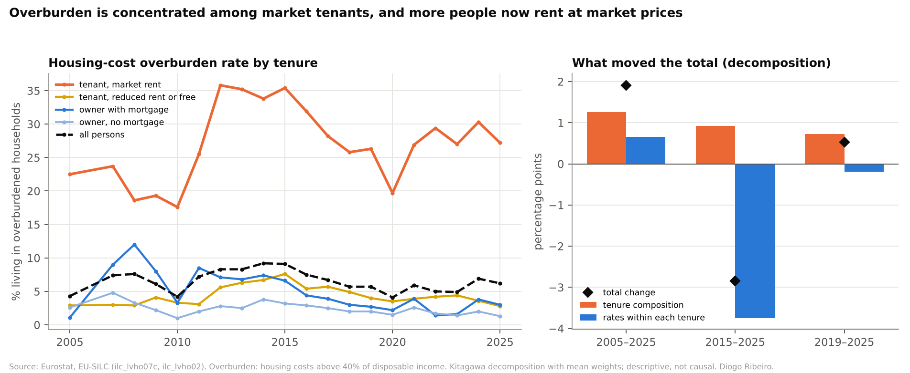
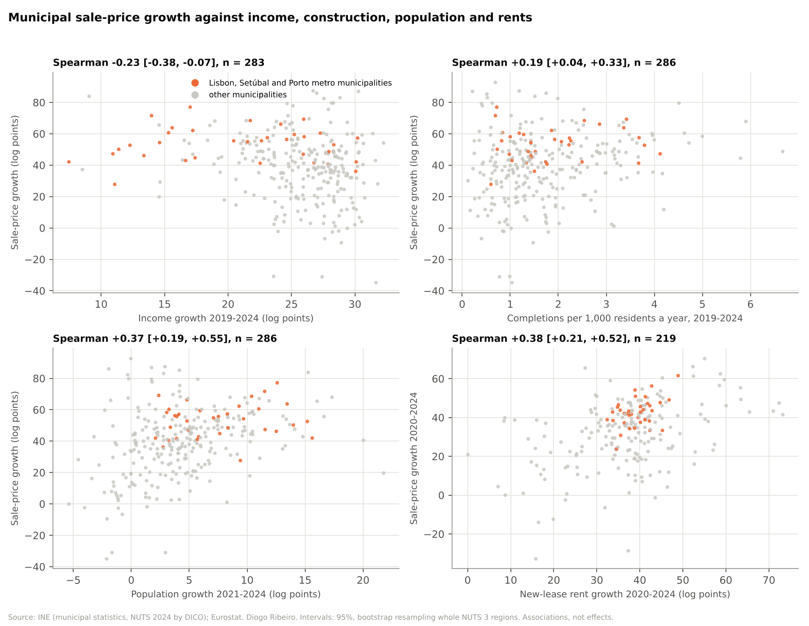
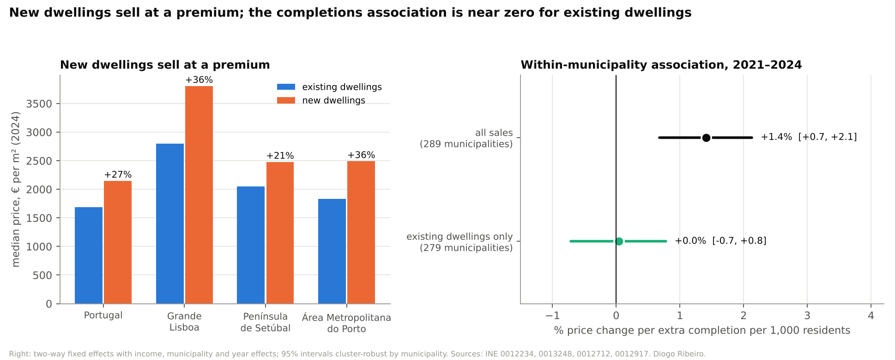
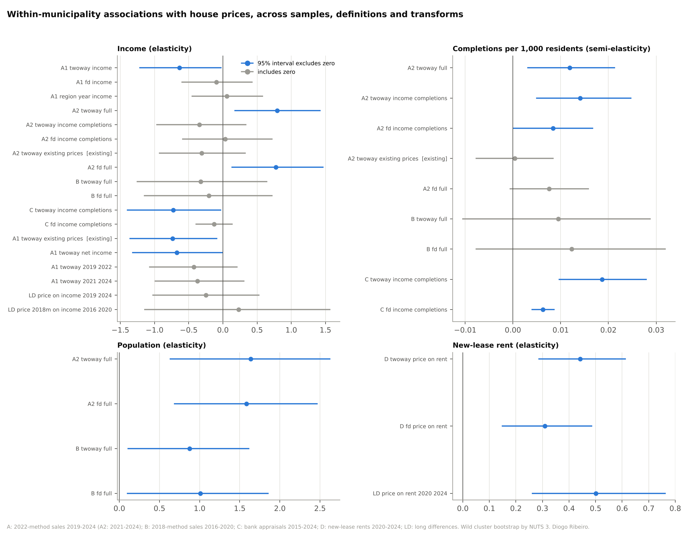

# Portugal's Housing Market, 2008–2025: A Reproducible Analysis of Prices, Incomes, Construction and Rents

*Sixty-three official datasets, five regional panels and a test for every quoted number: what the statistics establish, what they only suggest, and what they cannot answer*

Almost every argument about housing in Portugal arrives with a number attached. House prices have more than doubled. Rents are unaffordable. Young people cannot leave home. Nothing is being built. Tourists, foreign buyers, immigrants, interest rates or the rent law are to blame. Each of these claims can be supported by some official statistic, and many of them can be contradicted by another official statistic. Usually nobody is lying. The two sides are quoting numbers that measure different populations, over different periods, with different methods. Then they argue as if the numbers were interchangeable.

This article is the result of trying to sort that out properly. I assembled the main official statistics on Portuguese housing into one audited body of evidence. The sources are INE, Eurostat and the European Central Bank. The evidence covers house prices and bank appraisals, declared and survey income, completed and permitted dwellings, resident population, rents of new leases, the stock of tenancies, tenure and housing-cost burden. It covers the whole country, its 9 NUTS 2 and 26 NUTS 3 regions and its 308 municipalities, mostly from 2008 to 2025. Every source file is pinned with a checksum. Every number in this article is recomputed from those files by code that runs in continuous integration, and the numbers quoted in the accompanying research report are checked automatically against the results, one by one.

The interesting part is not the volume of data. It is what the data allow you to say. I sort every result into one of three groups, and I try to keep them apart throughout.

The first group is what I call established findings. These are arithmetic on official statistics that holds up when you change the definitions, the periods and the geography. The second is descriptive associations: correlations and conditional associations, reported with their uncertainty and their stability, which tell you how variables move together but not why. The third is unresolved causal questions. These are the things everyone wants to know, such as how much short-term letting or foreign demand raised prices. The data in this project cannot answer them, and I explain why and what would be needed.

That split is the main methodological claim of the article. A large share of the public argument about housing consists of results from the second group being presented as if they belonged to the third. A smaller but real share consists of perfectly solid results from the first group being dismissed because they are inconvenient. Keeping the groups apart is most of the work.

The code, data, tests and a longer technical report are in the [project folder of my Medium-Blog repository](https://github.com/DiogoRibeiro7/Medium-Blog/tree/main/portugal-housing-generations).

## Why the numbers in the housing debate rarely agree

Take three statements that all circulate in Portugal and are all, in a narrow sense, correct.

The first: rents rose about 10% a year between 2020 and 2024. That is the median rent per square metre of new lease contracts registered with the tax authority, as published by INE. The second: rents rose by roughly 2% a year in the decade to 2021. That is the actual-rentals component of the harmonised consumer price index, a price index of the rents paid for a sample of rented dwellings, under new and existing contracts. The third: the average monthly rent in Portugal was €334 in 2021, up from €235 in 2011. That is the census, covering every rented dwelling of usual residence, whatever the date or terms of its contract.

These are three different objects. The first describes the market a household faces when it signs a new contract. The second describes how rents change, on average, across a sample of rented dwellings of constant quality, and it has no level at all. The third averages over the whole stock, in which a 1985 contract under an old rent law sits next to one signed last month. You can build a crisis or a non-crisis out of them depending on which you pick. None of them is wrong. A data scientist's first job here is to say which question each one answers.

The same thing happens with purchase prices. Eurostat's house price index is a quality-adjusted index for the country. INE's median value per square metre of dwellings sold is a median over whatever happened to be sold, and it can move because the mix of dwellings sold changes. Bank appraisals are valuations made for mortgage purposes, and they exist only where banks were asked to value something. Income is no simpler. EU-SILC survey income is equivalised disposable income and refers to the year before the survey. IRS declared income is gross income per tax household, and it covers only households that file. Population changed estimation method in 2021. Construction is counted as permits, which come first, and as completions, which come years later and are revised.

So before any modelling there is a measurement problem. That problem determines which comparisons are even legitimate. Most of the effort in this project went there, and most of the mistakes it prevents are made there.

## Building the evidence base

### Pinning the data

Official statistics are revised. INE re-publishes series when a method changes, Eurostat updates EU-SILC tables when a country sends corrections, and both occasionally restructure a dataset under the same code. An analysis that downloads data at run time can therefore change its answer without anyone changing a line of code. For a one-off chart that may not matter. For a body of evidence meant to be checked, cited and built on, it does.

Every source in this project is stored as a dated snapshot. INE responses from its JSON API are saved as compressed containers together with the request URL, retrieval time, HTTP status, byte count and SHA-256 digest. The readers recompute the digest before using a file. Eurostat and ECB snapshots carry similar retrieval records. A manifest lists all 63 files with their checksums. The analysis scripts never touch the network. Refreshing a source is a separate, manual step on a branch, which produces a reviewed change. That is slower than calling an API inside a notebook. It is also the only way I know to make "this number came from that file" a statement anyone can check.

Two sources needed special handling. The national series of completed dwellings back to 1995 was transcribed from PORDATA's republication of INE data, because the INE endpoint was unavailable when I needed it. A transcription is a risk, so I checked it. For every year from 2011 to 2025 it equals the sum over municipalities of INE's own municipal series. The earliest Eurostat snapshots had dataset update timestamps but no per-request retrieval records. They are now covered by the checksum manifest, and the gap is documented rather than hidden.

### Geography: sums travel, medians do not

Portugal changed its NUTS classification in 2024. The old Área Metropolitana de Lisboa was split into Grande Lisboa and Península de Setúbal, and two municipalities moved between Médio Tejo and Beira Baixa. INE publishes some series on NUTS 2024, some only on NUTS 2013 and the censuses on NUTS 2002. Comparing regions across these tables naively compares different territories under the same name.

The way through is to work at the level that does not change, the municipality, identified by its four-digit DICO code. Every NUTS version is a grouping of the same 308 municipalities. Quantities that add up, such as population, dwellings and households, can be regrouped from municipalities into any version. I checked that the regrouping reproduces each source's own published regional and national totals exactly, and it does.

Medians are another matter. The median price per square metre of Grande Lisboa is not any combination of the medians of its municipalities. You would need the underlying transactions, and only INE has them. So in this project medians are never aggregated, averaged or reweighted across areas. A regional median is used only if INE published it for that region. This sounds like pedantry until you see how often "average of municipal medians" appears in housing commentary as if it were a regional price.

### Breaks that cannot be bridged

Four breaks shape everything that follows.

Population is the most consequential. Up to 2020, INE's municipal population estimates are based on the 2011 census. From 2021 they are administrative-based estimates anchored on the 2021 census. Between 2020 and 2021 the Portugal total rises by 2.0% in a single step, partly through real growth and partly through the change of method, and the two cannot be separated. The two estimates also disagree on levels. From 2021, INE's series sits above Eurostat's 1 January figures by 1.7% in 2021, rising to 5.9% in 2024. I never compute population growth across the break, and every model uses a single population basis. The size of recent population growth is genuinely uncertain, and the article treats it that way.

Sale prices changed method in 2022. INE's 2018 method runs to 2021 and the 2022 method from 2019, with an overlap. In regions whose borders did not change, the two methods differ by a median of 1.2% in the overlap years. In small municipalities, though, they differ by up to 75%. That is enough to manufacture a trend if you splice the series. So I never splice them. The main window for prices is 2019–2024 on the 2022 method. An earlier window, 2016–2020 on the 2018 method, is reported separately as a check.

New-lease rents also changed method. For Portugal as a whole the 2026 method sits 3.2–6.3% above the 2021 method in 2020–2024, and annual growth is 10.0% under the new method against 9.2% under the old. I use only the 2026 method for 2020 onwards.

EU-SILC income refers to the year before the survey. A survey run in 2025 measures 2024 income. When income is compared with prices in the same calendar year, this matters. I report both alignments where it changes the answer.

### What the audit caught

The project has an audit table that records, for every municipal variable, its coverage, unpublished cells, breaks, geography, timing and units.



*Share of Portugal's 308 municipalities with a published value, by variable and year. Rows are separate methods and are never spliced. Source: INE; author's calculations.*

Coverage is a selection problem, not a nuisance. INE suppresses medians where there are too few transactions or contracts. In any given year, 3 to 26 municipalities have no published sale price, 61 to 86 have no published new-lease rent, and bank appraisals exist for only 141 to 261. The municipalities that drop out are small and rural. Anything estimated on the published values speaks mainly for medium and large municipalities. Balanced panels, which require every variable in every year, make that selection explicit rather than letting it vary from year to year.

The audit also found inconsistencies between official tables. For 2025, Eurostat's overburden rate is 6.3% in one table (`ilc_lvho07a`) and 6.2% in another (`ilc_lvho07c`) for exactly the same population. This is a rounding or revision difference. It is harmless once noticed, and it would cause confusion if two analyses quoted different tables. I use each table only for its own breakdown.

One finding of the final review was an error of my own. A variable I had reported as the share of census tenancies with rents "below €100 a month" selected rent bands by their position in INE's list. That selection included the €100–149.99 band. For contracts signed before 1987 I had reported 67.8%; the correct figure is 49.3%. The error surfaced because two published numbers contradicted each other. The median pre-1987 contract was in the €100–150 band, which is impossible if two-thirds of those contracts paid under €100. The code now selects bands by their published bounds, a test pins the behaviour, and the corrected number appears below. I mention it because it is typical of what goes wrong in this kind of work: the arithmetic was right and the label was wrong. Checking every quoted number against the results, line by line, caught several more drafting errors in the report before publication, and those checks now run as tests.

## The national picture: prices, incomes and the cost of entry

### Prices against incomes

Start with the series everyone quotes. Eurostat's house price index for Portugal was 107.5 in 2008, fell to 93.1 in 2013 and stood at 263.9 in 2025, with 2015 = 100. The fall and the recovery from 2014 are documented in detail by Lourenço and Rodrigues for the Banco de Portugal. That is a 164% rise in ten years. Consumer prices rose 25% over the same decade, so the real increase is about 111%.

Income rose too, but much less. Median equivalised disposable income from EU-SILC rose 65% between income years 2015 and 2024. The ratio of the price index to the income index is a relative-change proxy, not a level, and it depends on how income is aligned with the calendar. With income placed in its survey year, as Eurostat publishes it, the index was 153.9 in 2025. With income placed in the year it was earned, it was 136.3 in 2024. Either way the picture is the same. Prices and incomes moved roughly together from 2008 to 2015; the index was 111.4 in 2008 and 100 by construction in 2015. After 2015 prices pulled away by a wide margin.



*Left: house prices, the HICP actual-rentals price index, median income and consumer prices, 2015 = 100. Middle: house prices relative to income, and the first mortgage payment relative to income. Right: average interest rate on new mortgages. Sources: Eurostat prc_hpi_a, ilc_di03, prc_hicp_aind; ECB MIR. Author's calculations.*

### Adding the price of money

A price-to-income ratio ignores what most buyers actually face, which is a monthly payment. Interest rates on new mortgages in Portugal fell from 2.38% in 2015 to 0.83% in 2021, rose to 4.13% in 2023 and averaged 2.99% in 2025. Those swings change the payment on a given loan by more than most of the price movements in the same years.

To capture this I built a first-payment-to-income index. It follows the monthly instalment on a 30-year loan proportional to the house price index, at the average rate on new loans, relative to income:

```
index(t) = 100 × [P(t) / P(2015)] × [a(r_t) / a(r_2015)] / [Y(t) / Y(2015)]

a(r) = m / (1 − (1 + m)^(−360)),   m = r / 12
```

P is the house price index, Y is median income and a(r) is the monthly annuity factor at annual rate r. This is still an index, not an affordability level. It ignores the deposit, which for many first-time buyers is the binding constraint. It assumes a constant loan-to-value ratio and a constant term. Its virtue is that it can be decomposed exactly. Its log change is the sum of a price term and a financing-cost term, minus an income term.



*Change in the first-payment-to-income index in four periods, split into the contributions of house prices, mortgage rates and income. Survey-year alignment of EU-SILC income. Sources: Eurostat; ECB MIR. Author's calculations.*

The decomposition tells a story the price index alone cannot.

Between 2008 and 2015 the index fell by 47.8 log points, mostly because interest rates collapsed: the financing term alone accounts for 37.1 of them. Between 2015 and 2021 house prices rose by 52.4 log points. Over the same years falling rates offset 21.4 of those points and income growth offset most of the rest. The index barely moved and stood at 103.7 in 2021. On this measure, the years in which prices ran fastest were not, for a buyer with a mortgage, the years in which entry became much harder.

That changed abruptly. Between 2021 and 2023 the index rose by 56.9 log points to 183.1, the highest value in the series and above its 2008 level of 161.4. The financing-cost term, at +43.5 log points, was more than twice the price term of +19.8. Most of the deterioration in the cost of entering ownership in those two years came from the price of money, not the price of houses. By 2025 rates had come down and incomes had grown, but prices kept rising. The index fell to 166.5, still 66% above 2015.

The loan term matters for how sharp this looks. Under the alternative income alignment, the 2023 value is 173 with a 25-year loan, 178 with a 30-year loan and 188 with a 40-year loan. Longer loans spread the principal over more payments, so a larger share of each payment is interest. That makes the payment more sensitive to the rate. Banco de Portugal's macroprudential recommendation has capped maturities for new loans since 2018, and its 2022 revision set limits of 40, 37 and 35 years by borrower age. The term assumption in an index like this is therefore not neutral.

The policy reading of this decomposition is worth stating carefully. It is an accounting identity. It says which terms moved, not why they moved, and it does not say what would have happened to prices if rates had stayed low. But it does establish something useful for decision-making. A measure of housing affordability that leaves out financing costs will misdate the worst deterioration in access to ownership in the past fifteen years by about two years. It will also misattribute it.

### Stock measures that move the wrong way

Three survey indicators are often used as evidence that housing has become harder. On their face, they say something more complicated.

Tenure changed modestly. The share of the population living in owner-occupied housing fell from 74.8% in 2015 to 71.2% in 2025, and the share renting at market prices rose from 12.7% to 16.3%.

Housing-cost overburden is the share of people whose housing costs exceed 40% of disposable income. It peaked at 9.2% in 2014 and was 6.3% in 2025. Among people aged 25 to 29 it went from 10.7% in 2015 to 8.4% in 2025. On this measure, housing is less of a burden than it was during the crisis.

Parental co-residence among 18–34-year-olds rose from 62.9% in 2015 to 72.3% in 2021 and fell back to 61.0% in 2025. It does not track house prices.

None of this contradicts the price and payment data. These are measures of the stock, and the price indices are measures of the flow. Overburden is computed on households as they are. A 28-year-old who cannot afford to leave her parents' home is not overburdened; she is invisible to the indicator. A household that bought in 2014 at a low price with a variable-rate loan may have seen its burden fall as its income grew, while the cost of entry for the next buyer rose sharply. Low or falling stock burden is compatible with rising barriers to entry. The two answer different questions. Quoting overburden as evidence that access is easy is one of the comparisons this project explicitly avoids.

The co-residence series has its own problems. The 2020 and 2021 surveys were run under pandemic conditions. The jump from 64.1% in 2019 to 69.8% in 2020 and 72.3% in 2021 coincides with the pandemic, which changed both how the survey was run and where many young adults chose to live, for reasons that may have had little to do with housing costs. A series this sensitive to one shock cannot be read as a housing indicator without a model of everything else that moves it.

### Construction from a very low base

Construction collapsed after 2008 and has recovered only partly. Completed new family dwellings fell from 125,708 in 2002 to 7,148 in 2015 and reached 27,301 in 2025 on preliminary data. Dwellings in new-building permits, which lead completions by a couple of years, fell from 73.9 thousand in 2005 to 8.6 thousand in 2015 and reached 40.9 thousand in 2025. Per 1,000 residents, completions rose from 0.688 in 2015 to 2.540 in 2025.

These are the numbers behind the slogan that "nothing is being built", and the slogan is half right. Construction more than tripled from its 2015 trough. It also remains far below the early 2000s. Whether it is "enough" is not a question these numbers answer. The answer depends on household formation, vacancy, second homes, the age and condition of the stock and where people want to live. Completions per resident are not a measure of housing need. Neither is the ratio of completions to household growth, which compares a flow of dwellings with a change in a stock of households measured with error at both ends.

## Regions: where prices ran ahead of incomes

### Population, measured twice

Population is where the 2021 break bites hardest. Between 2011 and 2020, on census-based estimates, Portugal's population fell by 0.17% a year, and only five of the 26 NUTS 3 regions grew: the Algarve, Península de Setúbal, Grande Lisboa, Cávado and, barely, the Oeste. Between 2021 and 2025, on administrative-based estimates, every NUTS 3 region grew and Portugal grew 1.89% a year. The fastest growth was in the Algarve (3.29% a year), Alentejo Litoral (3.09%) and Península de Setúbal (3.06%). Grande Lisboa grew 2.54% and the Porto metropolitan area 1.37%.

This looks like a reversal, and it probably is one. Portugal has recorded more deaths than births every year since 2009, so growth on this scale has to come from net migration. But the two periods rest on different estimation methods, and INE's recent series sits 1.7–5.9% above Eurostat's for the same dates. So the size of the reversal is uncertain, and comparisons that splice the two periods should not be trusted. For the panel models later in the article this has a practical consequence. Population enters only within a single basis, which leaves very short windows.

Construction per resident varies across regions, but less than one might expect. Over 2021–2025 the mean number of completions per 1,000 residents was 2.07 for Portugal, 1.26 in Grande Lisboa, 2.15 in Península de Setúbal and 2.71 in the Porto metropolitan area. The coefficient of variation across NUTS 3 regions stayed between 0.28 and 0.38 throughout 2011–2025. Grande Lisboa builds less per resident than the country as a whole, which is consistent with scarce land and high density, but also with many other things. Amadora under-reported completions in 2011–2017, and the regional data for 2021–2025 are preliminary or estimated. Neither changes the broad pattern, but both are flagged in the panels.

### Purchase affordability, 2019–2024

The regional affordability analysis compares INE's median sale price per square metre with the median gross income declared per tax household. It uses the longest window in which both series use one method and one geography, which is 2019–2024.

For Portugal, the median price rose from €1,094 to €1,777 per square metre, 10.2% a year. Median declared income rose 4.5% a year. Prices therefore outpaced income by 26.5 log points. A useful way to make that concrete is to divide one by the other. One year of median household income bought 11.4 square metres at the median price in 2019 and 8.8 square metres in 2024.

That quantity needs a warning label. It is a ratio of two medians over two different populations: the dwellings that were sold, and the households that filed tax returns. It is not the number of square metres any household could buy, nor the number of years a household would need to save. It is a proxy for relative change, and it is used only in that sense.

Across regions the result is very general. Prices outpaced income in all 9 NUTS 2 regions, in 21 of the 26 NUTS 3 regions and in 220 of the 283 municipalities with both values published. The five NUTS 3 exceptions are all low-price interior regions: Douro, Terras de Trás-os-Montes, Viseu Dão Lafões, Beira Baixa and Beiras e Serra da Estrela.

The gaps were widest in Península de Setúbal and Madeira. In Península de Setúbal prices rose 13.1% a year against income growth of 3.3%, a gap of 45.5 log points, and the square metres per year of income fell from 12.3 to 7.8. In Madeira prices rose 14.6% a year against 5.0%, a gap of 43.8 log points. Alentejo Litoral, Grande Lisboa and the Porto metropolitan area follow.

Grande Lisboa is distinctive because of its levels rather than its growth. Its median price rose from €1,820 to €2,939 per square metre while declared income grew only 2.8% a year, a gap of 34.3 log points. One year of median income bought 8.0 square metres in 2019 and 5.7 in 2024. Only the Algarve, at 5.0, was lower. In the Porto metropolitan area prices rose 12.4% a year against 5.0%, a gap of 34.0.



*Annual growth of the median sale price per square metre against the median gross income declared per tax household, 2019–2024, NUTS 3 regions and municipalities. Points above the diagonal are places where prices outpaced income. Source: INE; author's calculations.*

### Divergence and sensitivity

Two further facts come out of the regional panel. The first is that regional disparities widened through prices, not incomes. Across NUTS 3 regions the coefficient of variation of the median price per square metre rose from 0.39 in 2019 to 0.50 in 2024. The coefficient of variation of declared income fell from 0.088 to 0.068. Incomes converged slightly, while prices diverged strongly. Whatever drove regional price growth, it was not regional income growth, a point that returns below.

The second is that the result survives every sensitivity check I could construct from the published data. I tried all nine combinations of price definition (all, existing or new dwellings) and income definition (gross or net income per household, or gross income per taxpayer). Prices outpaced income in 19 to 21 of the 26 NUTS 3 regions in every combination. The gaps for Grande Lisboa, Península de Setúbal and the Porto metropolitan area stayed between 28 and 46 log points. Changing the base year of the price/income index between 2019 and 2021 reorders some regions but does not change the conclusion. Replacing transaction prices with bank appraisals gives regional growth rates that correlate 0.82 with the transaction-based ones. The earlier 2016–2020 window, on the 2018 price method, shows prices outpacing income in 24 of 25 NUTS 3 regions.

At this point the claim is robust enough to belong in the first group. Since at least 2016, median sale prices have risen faster than declared household income almost everywhere in Portugal, and by the widest margins around Lisbon and Setúbal, in Madeira and in the Porto area.

## The rental market: one market, three measures

### Why the measures disagree

The three rent measures introduced at the start can now be read properly.



*Left: the HICP actual-rentals price index against median income and consumer prices, 2015 = 100; a comparison of indices of change, not of rent burdens. Right: the median rent per square metre of new leases against median declared household income, 2020 = 100. Sources: Eurostat prc_hicp_aind, ilc_di03; INE. Author's calculations.*

Rents of new leases are the market a household meets when it moves. The median rent per square metre of new contracts in Portugal rose from €5.79 in 2020 to €9.29 in 2025. To 2024, the last year with income data, it grew about 10.0% a year against 5.5% for median declared income, 16.6 log points faster. In the municipality of Lisboa the median new lease went from €11.54 to €16.88 per square metre between 2020 and 2025. In the municipality of Porto it went from €8.97 to €14.13.

The consumer price index measures something else. The HICP actual-rentals index for Portugal rose 2.1% a year in 2011–2021 and 4.9% a year in 2021–2025. Relative to median income, aligned by income year, it fell to 78.6 in 2024 (2015 = 100). It is tempting to read that as rents becoming lighter for people who kept their lease. The index cannot support that reading, and the reason is worth spelling out.

Eurostat's methodological manual defines the target coverage of this index as the rents actually paid under new and existing contracts, for private, public and social rental units (section 12.4 of the 2024 edition). In Portugal the index comes from INE's monthly housing-rent survey. According to INE's methodological note, it follows a panel of rented dwellings, 3,921 in the 2014 design. The panel is stratified by region, rent class and contract date, and it covers free, controlled and social rents. Dwellings that leave the scope are replaced at the end of each year. The stratum indices are geometric means of rent per square metre, combined with stratum weights. Eurostat's guidance also requires rent changes that happen when a dwelling changes tenant to be reflected in the index. It treats renovations as quality changes to be adjusted for.

So the index follows dwellings, not households. When a sampled dwelling is re-let, the new contract's rent enters the comparison, and the tenant who moved out leaves it. Controlled, social and market rents are averaged together, part of the sample is renewed every year, and the index aims at constant quality. Its movement mixes rent updates within ongoing contracts with resets at re-letting, in proportions that depend on how often dwellings change hands. Nothing in it records a tenant's income. Dividing it by median income gives a ratio of two indices with different populations. That ratio says nothing about the rent burden of any group of incumbent tenants. The direct survey measure does not point downwards either. EU-SILC's share of rent in the disposable income of tenant households was 23.1% in 2015, 25.1% in 2024 and 24.0% in 2025. That measure is itself a cross-section of whoever rents in each year, not a cohort. Following the burden of tenants who kept their contracts would need panel data linking each tenancy's rent to the household's income.

The census average sits between the two. The mean monthly rent of rented dwellings of usual residence rose from €235 in 2011 to €334 in 2021, 3.6% a year. That is faster than the index and slower than new leases.

These three facts are consistent, and the census tells you why. In 2021 Portugal had 922,810 rented dwellings of usual residence. Of these, 45% had contracts signed in 2017–2021, and 16% had contracts signed before 1991. The rents are very different across these vintages. Contracts from before 1987 had a median rent band of €100–150 a month, and 49% paid under €100. Contracts from 2017–2021 had a median band of €300–400, and 30% paid €500 or more.



*Rented dwellings of usual residence in 2021 by date of contract, by region (left), and the share paying under €100 or €500 or more a month by contract period, Portugal (right). Source: INE, Censos 2021; author's calculations.*

Why the census average rose faster than the index cannot be settled with these data, but the candidates are clear. A stock average is a level over a changing set of dwellings. It moves when dwellings enter or leave the rental stock, when the mix of locations, sizes and quality shifts, and when old low-rent contracts are replaced by new ones. The index records re-lets only in the dwellings it samples, weights them by stratum and adjusts for quality, so it need not follow those shifts in the same proportions.

The comparison with new-lease medians stays informative, provided it is read as a comparison of two different statistics. They cover different populations: the medians cover contracts registered with the tax authority in the year, the flow of new lettings, while the index covers the rented dwellings in a survey panel, under every kind of contract. They are weighted differently. The median gives each new contract equal weight, so its geography and dwelling mix follow whatever was let that year, while the index combines strata with their own weights. One is a level and the other is not: the median is euros per square metre and moves with the size, location and quality of what was let, while the index has no level and aims at constant quality. And coverage differs: lettings that are not registered with the tax authority are outside the new-lease figures.

Read that way, the two series say something useful together. What households pay when they sign has risen much faster than the average rent change across rented dwellings. That is consistent with a widening gap between rents for new lettings and rents in ongoing contracts, although measuring that gap would need contract-level data. None of the three statistics is "the" rent. A tenant with a 2010 contract and a household signing in 2024 can live in the same city and face very different rents. Policy that targets one of them will not necessarily help the other.

There is a further point for anyone building indicators. Absence of rental support is not the same thing as a market rent. In 2021, 93.1% of tenancies received no rental support of any kind. Many of them were still old contracts, signed under earlier rent laws, with rents well below market. A "market" category defined by the absence of subsidies would overstate how many tenants pay market rents.

### Where new-lease rents rose fastest

New-lease rents rose faster than income in 24 of the 26 NUTS 3 regions and in 190 of the 217 municipalities with complete data. The two exceptions among NUTS 3 regions were the Açores and Alto Tâmega e Barroso. The largest gaps were not in Lisbon. Alentejo Litoral led with 36.5 log points, followed by Madeira (27.7) and Península de Setúbal (26.5). In Grande Lisboa rents grew 9.2% a year against income growth of 3.6%, a gap of 21.1. That is large, but lower than in a band of regions around it, where rents started from lower levels.

The regional pattern hints at a spatial process. Rents rose fastest not in the most expensive core but in places within reach of it, and in some coastal and island regions. I describe that as a hint and not a finding. Showing that households were priced out of the core into the surrounding regions requires data on household moves, which this project does not have. The pattern is consistent with that story, and it is also consistent with others, such as local tourism or new employment centres.

Two checks matter here. The first concerns the change of method: as noted, the 2026 method is a few percent higher than the 2021 method for the same years, and only the 2026 method is used. The second concerns who is in the data. INE also publishes rents for contracts with tenants resident in Portugal. Non-resident tenants account for 3–5% of new contracts a year. Excluding them changes the 2025 median rent by a median of 0.28% across the 60 areas INE publishes in both versions, and by at most 1.24% (in the municipality of Lisboa). Whatever moves new-lease rents, it is not a statistical artefact of contracts signed by non-residents.

### Tenure and the arithmetic of overburden

The share of the population renting at market prices rose from 10.8% in 2004 to 13.2% in 2019 and 16.3% in 2025. Market tenants made up 57% of all tenants by 2025. Over the same years, the share of disposable income that tenants spent on rent, as measured by EU-SILC, rose from 16% in 2004 to 21% in 2019 and 24% in 2025. Below the poverty threshold it was 33%.

Overburden is overwhelmingly a renters' problem. In 2025, 27.2% of market-rent tenants were overburdened, compared with a few percent of owners. Among NUTS 2 regions, the overall rate is highest in Grande Lisboa at 10.0%.

That concentration has a consequence that is easy to misread. Between 2019 and 2025 the national overburden rate rose by 0.53 percentage points. A Kitagawa shift-share decomposition splits that change into two parts. One is the effect of more people being in market-rent tenure, where rates are high. The other is the effect of changes in the rate within each tenure. The composition term is +0.72 points, and the within-tenure term is −0.19 points.



*Housing-cost overburden by tenure, and the decomposition of the change in the national rate into tenure composition and rates within tenure. Source: Eurostat EU-SILC; author's calculations.*

Arithmetically, the whole of the recent rise is accounted for by people moving into market renting, not by rising burdens within tenures. Over the longer run, 2015–2025, the national rate fell by 2.84 points even though composition alone would have raised it by 0.92. Within-tenure rates fell by 3.75 points over that decade. This is an accounting identity, and I want to be precise about what it does and does not say. It does not say why more people are renting. They may be priced out of ownership, they may be young adults who have left home, or they may be recent immigrants. Each of these has a different policy meaning. What it says is that a headline overburden rate can rise because the population is shifting into a high-burden tenure, without any group becoming worse off.

The same data show how fragile some sub-group estimates are. Eurostat publishes overburden for adults by citizenship. For foreign citizens it was 35.3% in 2025, against 4.4% for Portuguese citizens, and the gap is large and persistent. But the foreign-citizen series jumps from 9.6% in 2018 to 22.8% in 2019, and from 6.2% in 2004 to 23.6% in 2005. These are swings that real burdens do not make and small samples do, and Eurostat also flags a break in the series in 2021. A sub-group estimate from a household survey has to be read with its sample size in mind. The level gap is probably real. Year-to-year changes in that series carry almost no information.

## Associations across municipalities

So far everything has been description. The obvious next step is to ask what moves with what. Across the 308 municipalities, do prices rise more where incomes rise more, where more is built, where population grows, or where rents rise?

The tool here is a rank correlation across municipalities, with an important detail in how the uncertainty is computed. Municipalities are not independent observations. Neighbouring municipalities share labour markets, migration flows and shocks. A naive confidence interval that treats 283 municipalities as 283 independent draws is far too narrow. I resample whole NUTS 3 regions, with 1,999 bootstrap replications, so that the interval reflects the dependence within regions.



*Municipal sale-price growth against growth in income, completions per 1,000 residents, population and new-lease rents, with Spearman correlations and 95% intervals from a bootstrap that resamples NUTS 3 regions. Source: INE; author's calculations.*

The results, for 2019–2024 unless stated:

Price growth correlates −0.23 [−0.38, −0.07] with income growth. The sign is negative, and the interval excludes zero. In the earlier window on the 2018 method, the correlation is −0.10 [−0.28, 0.11]. In the bank-appraisal series for 2015–2024, it is −0.34 [−0.57, −0.04]. Across three windows and two price measures, prices did not rise more where incomes rose more. If anything, the reverse.

Price growth correlates +0.37 [0.19, 0.55] with population growth in 2021–2024, on the administrative basis. In the earlier window the correlation is +0.15 [−0.01, 0.28]. In the appraisal series it is +0.62 [0.42, 0.74] against population growth in 2015–2020. Prices rose more where population grew.

Price growth correlates +0.19 [0.04, 0.33] with completions per 1,000 residents in 2019–2024. In the earlier window it is −0.03 [−0.15, 0.08]. Weak, and dependent on the window.

Price growth correlates +0.38 [0.21, 0.52] with growth in new-lease rents in 2020–2024. In 2017–2019 the correlation is +0.37 [0.11, 0.54]. Prices and rents rose together.

In levels the associations are stronger. In 2024 the log median sale price correlates 0.92 [0.85, 0.95] with the log median new-lease rent. It correlates 0.72 [0.57, 0.82] with population growth in 2021–2024, 0.46 [0.30, 0.57] with completions per 1,000 and 0.45 [0.18, 0.66] with log income. Expensive places are places where rents are high, where population is growing and, more weakly, where more is built and incomes are higher.

The ratio of the two prices is the gross rental yield: twelve times the median new-lease rent per square metre, divided by the median sale price per square metre. It fell between 2020 and 2025 in 16 of the 26 NUTS 3 regions. For Portugal it went from 5.84% to 5.37%, and in Grande Lisboa from 5.64% to 4.95%. In those regions sale prices rose faster than rents of new leases. That is a fact about two medians of different dwellings, and it should not be read as a precise return on investment.

Two warnings apply to all of these numbers. First, these are associations between areas, not between people. A negative correlation between municipal price growth and municipal income growth says nothing about whether households with rising incomes faced rising prices. Treating it as if it did is the ecological fallacy in its classic form, as Robinson showed in 1950. Second, the cross-section is not a natural experiment. Municipalities differ in a thousand ways that correlate with all of these variables at once, and the next section tries to deal with that.

## Inside municipalities: what fixed effects can and cannot see

The standard response to "municipalities differ in a thousand ways" is to compare each municipality with itself over time. A two-way fixed-effects model writes the log price of municipality *i* in year *t* as a municipality-specific constant, plus a year-specific constant, plus the effect of the variables of interest, plus an error. The municipality constants absorb everything that does not change over time, such as geography, climate and the historic centre. The year constants absorb everything that hits all municipalities at once, such as interest rates, national policy and the pandemic. What remains is the within-municipality variation: how a municipality's price deviates from its own average and from the national path, against how its income or construction deviates in the same way.

This is the workhorse of applied econometrics, and it is also widely misunderstood. The coefficient it estimates is still a conditional association. It is a causal effect only if, once the two sets of constants are removed, the remaining variation in the regressor is as good as random. With municipal housing data that assumption is rarely plausible, but the model is still informative if one reads it correctly. I estimated it on five balanced samples, each using one price or rent method, one population basis and one geography:

- 272 municipalities, 2019–2024, sale prices against income;
- 289 municipalities, 2021–2024, sale prices against income, completions and population on the administrative basis;
- 295 municipalities, 2016–2020, sale prices on the 2018 method with the census-based population;
- 179 municipalities, 2015–2024, bank appraisals;
- 215 municipalities, 2020–2024, sale prices against new-lease rents.

Around each, I ran the alternatives a referee would ask for: first differences instead of fixed effects, NUTS 2 × year effects to absorb regional shocks, long differences over the whole window, existing-dwelling prices instead of all sales, net instead of gross income, and sub-periods. Then I asked a simple question of every coefficient: does it survive?

### The income coefficient that would not settle

The first diagnostic is how much variation is left. After removing municipality and year effects, log income keeps only 0.9–1.9% of its original variance. Municipal incomes move almost in parallel. The differences between municipalities are large and persistent, and the common national trend is large, but deviations of one municipality from its own average and from the national path are tiny.

A regressor with that little variation has two problems. Its coefficient is estimated imprecisely. Worse, any measurement error in it, such as sampling noise in a median or changes in who files tax returns, is now large relative to the signal. Classical measurement error biases the coefficient towards zero, and with so little signal left the bias can be severe. This is a property of the data, not of the estimator.

It shows. Across 18 specifications the income elasticity ranges from −0.74 to +0.79. It is negative in 13 and positive in 5. In 6 of the 18 the bootstrap interval excludes zero, and they disagree on the sign. The two-way model on 2019–2024 gives −0.63. The same model on 2021–2024 with completions and population added gives +0.79. In the bank-appraisal sample the first-difference estimate is −0.13 [−0.39, 0.13]. A coefficient that flips sign when you change the window or add a control is not a fragile finding. It is no finding at all. The honest summary is that the within-municipality association between income and prices is not identified in these data.

That conclusion and the cross-sectional one fit together. Prices did not rise more where incomes rose more. Within municipalities the data are too thin to say anything about income at all. Neither result supports the claim that regional price growth was driven by regional income growth, and the regional divergence of prices alongside converging incomes points the same way.

### The construction coefficient and the mix of dwellings sold

Construction behaves very differently, and this is the result I find most instructive.

Completions per 1,000 residents keep about 29% of their variance after the fixed effects. Building is lumpy, and municipalities have good and bad years, so there is plenty of within variation to work with. In the 2021–2024 sample, with income and the two sets of fixed effects, one more dwelling completed per 1,000 residents is associated with a 1.4% higher median sale price, with a cluster-robust 95% interval of [0.7%, 2.1%]. It is positive in all nine specifications of the completions coefficient, five of the intervals exclude zero, and it passes every mechanical stability check I set. By the rules of the project it qualifies as "robust".

Taken at face value it says something strange: building more raises prices. A naive reading could support whatever argument one prefers. Developers build where prices are high. Or new construction gentrifies. Or supply does not matter.

There is a much more mundane explanation, which the data support but cannot prove. INE's median price of all dwellings sold includes new dwellings, and new dwellings are dearer. In 2024 the median price per square metre of new dwellings sold was 27% above that of existing dwellings for Portugal as a whole. The premium was 36% in Grande Lisboa and the Porto metropolitan area, and 21% in Península de Setúbal. If a municipality that completes more dwellings also sells more new dwellings, the median of all sales can rise even if no individual dwelling's price changes.

One check is to rerun the same model with the median price of existing dwellings only. Same years, same controls, 279 of the 289 municipalities, because the existing-dwelling median is unpublished in a few. The coefficient falls from +1.4% to 0.0%, with an interval of [−0.7%, 0.8%].



*Left: median price per square metre of new and existing dwellings sold in 2024. Right: within-municipality association between completions per 1,000 residents and the median sale price, for all sales and for existing dwellings only, 2021–2024, with cluster-robust 95% intervals. Source: INE; author's calculations.*

This is what a composition effect would produce, and it is the most plausible reading. It is still a reading, not an identification, and the other explanations have not gone away. Developers may complete more where and when new-dwelling prices are high, so the causality can run from prices to completions, and completions in a year reflect permits granted years before. The all-sales coefficient may partly track how the prices of new dwellings themselves move with completions, through the location or quality of new projects, and not only their share of sales. A near-zero coefficient for existing dwellings does not show that construction leaves their prices alone: a supply effect and the demand shock that prompted the building could cancel out. The two models use slightly different sets of municipalities, and I have not tested the difference between the coefficients formally. And medians do not add up: the median of all sales is not a weighted average of the new and existing medians, so even a decomposition with transaction counts would be approximate.

Pinning the mechanism down would take more data. Counts of new and existing sales by municipality and year would show whether the new-dwelling share of sales actually tracks completions. A joint model of both price series on a common sample would allow a proper test of the difference. Ideally, transaction-level microdata with dwelling characteristics would allow composition-constant indices, hedonic or repeat-sales, and a decomposition of the change in the price distribution into composition and price effects, for instance by the reweighting approach of DiNardo, Fortin and Lemieux. Saying anything about the effect of construction on prices would also need variation in completions that does not come from current prices.

What can be said is narrower and still useful. The estimate says nothing about whether construction raises or lowers the price of a given dwelling, which is the question anyone asking about supply actually cares about. There is a lesson here for any analysis of medians, and I think it generalises well beyond housing. A statistic of a population whose composition can respond to the regressor may pick up a composition effect, and a mechanical stability rule cannot detect that. The completions coefficient passed every check I designed. It took a substantive question about what the median is a median of to see the problem.

The bank-appraisal sample shows the same kind of association, 1.9% per extra dwelling per 1,000. Appraisals also include new dwellings, and INE does not publish an appraisal series for existing dwellings alone. The same caveat applies there, without the means to check it.

### Population and rents

Population has the opposite problem to construction. The association is positive in all four specifications where it can be estimated, with elasticities between 0.9 and 1.6. But log population keeps only 0.01–0.02% of its variance after the fixed effects. Official population estimates are smooth by construction, interpolated between censuses and administrative updates. Within a single estimation basis, almost nothing is left to identify an effect from. The coefficient is consistent in sign, but it rests on almost no independent variation. I classify it as fragile, and I would not quote its size.

Rents are the one within-municipality association that survives everything. In the 2020–2024 sample, a 1% higher median new-lease rent is associated with a 0.44% higher median sale price within the same municipality, with a wild-bootstrap interval of [0.29, 0.61]. The first-difference estimate is 0.31 [0.15, 0.48]. The long difference over the whole window is 0.50 [0.26, 0.76]. The sign holds without any single region, without the two metropolitan areas and without the most influential municipalities. The one caution is that log rent keeps only 1.8% of its variance within municipalities, so measurement error probably attenuates the estimate.

It is still not a causal effect, in either direction. Sale prices and rents are both likely to respond to the same local conditions, such as demand, amenities, credit and expectations, and neither is exogenous to the other. What the result establishes is co-movement within places over time. That is a useful fact for anyone forecasting one from the other, and it says nothing about what would happen to sale prices if rents were capped.



*Within-municipality associations across samples, definitions and transforms, with wild cluster bootstrap intervals. Blue intervals exclude zero. Source: INE; author's calculations.*

### Inference with twenty-six clusters

Getting the uncertainty right in these models took more care than the point estimates did, and the details matter for anyone doing similar work.

Errors are correlated within municipalities over time, so standard errors are clustered by municipality. Cluster-robust standard errors turn out to be 1.0–2.3 times the conventional ones. Errors are also plausibly correlated across neighbouring municipalities, because regional shocks do not respect municipal borders. Clustering by NUTS 3 region handles that, but leaves only 26 clusters. That is too few for the usual asymptotic formulas to be trusted.

The standard remedy is the wild cluster bootstrap, as set out by Cameron, Gelbach and Miller in 2008. Each replication keeps the regressors fixed and flips the sign of each region's residuals at random (Rademacher weights), so that the dependence within each region is preserved. I used 1,999 replications. There are two versions. The unrestricted one resamples residuals from the full model and gives percentile-t confidence intervals. The restricted one first imposes the null hypothesis, re-estimating without the tested regressor, and resamples those residuals. MacKinnon and Webb showed in 2017 that the restricted version gives tests with better size when clusters are few or unequal, as here.

The project reports intervals from the unrestricted version and p-values from the restricted one. To be called robust, an association needs both: the interval must exclude zero and the restricted p-value must be below 0.05. Across all 32 tests, the two p-values differ by at most 0.024, and none falls on different sides of 0.05. That agreement is itself reassuring. It means the conclusions do not depend on which bootstrap one prefers.

Three more diagnostics complete the picture. Wooldridge's test, in the form described by Drukker, regresses first-differenced residuals on their own lag. A slope near −0.5 means the errors in levels are serially uncorrelated and fixed effects are efficient; a slope near 0 means the errors follow a random walk and first differences are better. For the sale-price samples the slopes are −0.42 to −0.46, consistent with fixed effects. For the appraisal sample the slope is −0.19. Appraisal errors are persistent, so there the first-difference estimates are preferred. The stability checks drop each NUTS 3 region in turn, drop the Lisbon and Porto metropolitan municipalities, and drop the 5% of municipalities with the largest influence on the coefficient. They change no sign, except for associations that had already failed the check that the sign must agree across at least 80% of specifications.

The verdict rule is written into the code and applied mechanically to every association. The regressor must keep at least 1% of its variance after the fixed effects. The bootstrap must reject zero. The sign must hold in first differences, without any region and without the metropolitan areas. The sign must agree across at least 80% of specifications. Associations that pass every check are robust. Those where the bootstrap rejects zero but another check fails are fragile, and the rest are not supported. A fixed rule protects against the temptation to call a result robust because one likes it. As the completions case showed, it does not protect against everything.

## Sixteen years is not a time series

At the national level the temptation is to correlate growth rates. Between 2009 and 2024, annual house-price growth moved in the same direction as growth in completions (r = 0.81), median income (0.63) and population (0.61).

Those correlations are much weaker evidence than they look. All of these series are strongly autocorrelated. They trend for years, so consecutive observations carry overlapping information. Correcting for lag-1 autocorrelation, with the effective-sample-size formula used by Bretherton and co-authors, the effective sample sizes are between 3 and 12 years, not 16. On those effective sizes, only one interval excludes zero. That is completions in 2013–2024, with a correlation of 0.83 [0.15, 0.98]. Even that mostly reflects the fact that both series fell into the crisis and rose out of it.

Sixteen annual observations that contain a financial crisis, an adjustment programme, a pandemic and several survey breaks cannot support a vector autoregression, a cointegration analysis or any other dynamic model. I did not fit one. Choosing not to fit a model is a result too. Anyone who reports long-run elasticities from this kind of national series should explain where the identifying variation comes from.

## What a causal design would need

The questions people most want answered are causal. Did short-term letting raise rents in Lisbon and Porto? Did the golden visa or the non-habitual-resident tax regime raise prices? How much did the 2022–2023 rise in interest rates push households from buying into renting? Did the rent law of 2012 or the 2023 cap on rent updates change the supply of rental housing? Would more construction lower prices, and by how much?

Some of these questions have been studied with credible designs elsewhere, and the designs show what is missing here. Garcia-López and co-authors, studying Barcelona, and Barron, Kung and Proserpio, studying the United States, estimated the effect of Airbnb on rents and prices. Franco and Santos did the same for Portugal. They exploited the platform's national growth interacted with each neighbourhood's pre-existing exposure to tourism. That is a shift-share design, in which the timing comes from outside the local market and the cross-sectional variation is determined before the shock. On supply, Saiz showed that geographic constraints on buildable land shape how much prices rise in response to the same demand shock. Glaeser, Gyourko and Saks showed the same for regulatory constraints. These studies work with parcel- or neighbourhood-level data, exogenous shifters and explicit counterfactuals.

The data in this project have none of those. The panels are short, at four to ten years. Income and population barely vary within municipalities once common trends are removed. Medians move with the composition of what is sold or let. Prices, construction and migration are determined jointly. Effects spill across municipal borders, and no source of variation is plausibly exogenous to the local housing market.

Any of the following hypotheses is consistent with the patterns above, and none is established by them:

- that demand from tourism and short-term letting, or from non-residents and new residents, raised prices and rents where supply responds slowly;
- that the 2021–2023 rise in interest rates reduced access to ownership and moved households into renting;
- that changes in rent law, licensing or taxation changed the supply of rental housing.

I state them as conjectures, because that is what they are.

Testing them would need five things.

The first is composition-free prices and rents. That means transaction-level and contract-level data, to build hedonic or repeat-sales indices by municipality, so that a price change is a change in the price of comparable dwellings rather than a change in what was sold.

The second is the timing and geography of policy. Event-study or difference-in-differences designs with proper pre-trend tests need exact dates and boundaries. The relevant ones are the local-accommodation containment areas in Lisbon and Porto, the 2023 *Mais Habitação* licensing changes, the end of real-estate residence permits and of the non-habitual-resident regime, and the 2023 rent-update cap.

The third is demand shifters with pre-determined local exposure, which would allow shift-share designs with balance tests. Examples are foreign buyers by municipality, tourist accommodation capacity, short-term rental registrations and residence permits.

The fourth is measures of supply constraints: land-use and zoning rules, building costs and the time it takes to obtain a permit.

The fifth is household-level data on the incomes of actual buyers and tenants, from linked tax and property records, rather than medians over all tax households.

Several of these exist inside Portuguese institutions. Access to administrative microdata in Portugal is restricted, and that restriction is a real limit on what independent researchers can do. The point of listing them is practical. A policy debate that wants causal answers has to ask for the data that can produce them.

## Comparisons I did not make

Some common comparisons are not in this analysis, on purpose, and the reasons are as informative as the results.

I do not convert price-to-income ratios into "years of income needed to buy a home". The ratios here are indices of relative change, built from medians of different populations, and they do not measure any household's purchasing problem. The floor-area proxy, square metres per year of income, is presented as a proxy and only compared over time.

I do not compare new-lease rents with the HICP rent index or the census average as if one of them were the true rent. They describe different populations, are weighted differently, and one of them has no level at all. Comparing their growth rates is informative. Reading the gap between them as the rent path of incumbent tenants is not, and neither is dividing a rent index by median income and calling the result a rent burden.

I do not divide completions by permits to get a "conversion rate", or completions by household growth to get a "shortage". Permits and completions are different stages, not matched cohorts. A shortage needs a model of household formation, vacancy, second homes and location that these numbers do not provide.

I do not compute population growth across 2020/2021, or compare municipal population levels across the break.

I do not read municipal correlations as descriptions of household behaviour.

And I do not treat a low or falling overburden rate as evidence that housing has become accessible. The people most affected by high entry costs, young adults who have not left home and households excluded from credit, are not counted as overburdened. A stock measure cannot see the people who never entered the stock.

## Reproducibility as part of the result

A body of evidence like this is only as useful as one's ability to check it. Everything above can be reproduced with one command:

```
cd portugal-housing-generations
python reproduce.py
```

The script verifies every data file against the checksum manifest and runs the test suite. It then reruns the five analysis pipelines (national, regional, affordability, rental and integrated) and compares every output with the committed version, byte for byte. With matplotlib installed it redraws the figures. The analysis uses only the Python standard library, including the least-squares solver, the cluster-robust standard errors and the bootstrap, so there are no version drifts in numerical libraries to worry about. Results built on Python 3.10 are byte-identical to those built on 3.13.

The test suite has 113 tests. Some check the estimators against hand-computed values and against simulations with known answers, including the restricted bootstrap under a true effect and under the null. Some check that the pinned snapshots match their retrieval records and that a tampered file is detected. Others pin key results, and a group of wording checks fails if the text overstates what the rent index or the completions coefficient can show. One more test runs 132 checks. It takes each number quoted in the research report, finds the sentence it appears in, and checks that it equals the value recomputed from the results, at the precision quoted. If a sentence is edited, or a result changes, the check fails.

This is not decoration. A reader of a housing analysis cannot usually tell whether a number is a typo, a stale value from an earlier run, an error in a join, or correct. Making every number reproducible, and every quoted number tested, turns that question into one the reader can answer.

## What the evidence supports

Put together, the official statistics support the following.

Established: since 2015, the cost of housing in Portugal has risen far faster than incomes and consumer prices, both for purchase and for new rental contracts, nationally and in almost every region and municipality. Prices rose furthest ahead of incomes around Lisbon and Setúbal, in Madeira, in Alentejo Litoral and in the Porto metropolitan area, and they are highest relative to incomes in the Algarve and Grande Lisboa. The sharpest deterioration in the cost of entering ownership came in 2021–2023, and it was driven more by financing costs than by prices. Regional price levels diverged while regional incomes converged. New-lease rents rose about twice as fast as incomes, while the HICP rent index, which measures average rent change across a sample of rented dwellings, rose more slowly than median income. A larger share of the population rents at market prices than a decade ago, and market tenants carry most of the housing-cost burden.

Associated, but not explained: prices and rents move together, across places and within places over time. Prices rose more where population grew, and did not rise more where incomes grew. The apparent link between construction and prices disappears for existing dwellings, which is consistent with a change in the mix of dwellings sold, though the data cannot confirm that mechanism. The recent rise in the national overburden rate is accounted for, arithmetically, by the shift into market renting.

Unresolved: the role of tourism, foreign demand, immigration, interest rates, regulation and supply in causing any of this. These are serious hypotheses and some of them are probably right in some places. They cannot be settled with annual medians for 308 municipalities, and claims that they have been settled with such data should be treated with suspicion.

For decision-makers the first group is already enough to act on, because it describes what households face, independently of why. The second group helps with forecasting and monitoring. Rents and prices can be tracked together, but the mix of what is sold has to be controlled before a price series is read as a price change. The third group sets an agenda: transaction-level indices, policy timing, measures of exposure and access to linked microdata. Producing those is where the next unit of research effort would buy the most.

The data, code and full technical report are in the [repository](https://github.com/DiogoRibeiro7/Medium-Blog/tree/main/portugal-housing-generations). Every number can be checked, and I would like to hear about any that do not reproduce.

## References

Banco de Portugal (2022). Recommendation within the scope of new credit agreements for consumers (amended version, applicable from 1 April 2022). [bportugal.pt](https://www.bportugal.pt/sites/default/files/documents/2024-01/31012022_Recomendacao_versao_alteradora_EN.pdf)

Barron, K., Kung, E. and Proserpio, D. (2021). The effect of home-sharing on house prices and rents: Evidence from Airbnb. *Marketing Science*, 40(1), 23–47.

Bretherton, C. S., Widmann, M., Dymnikov, V. P., Wallace, J. M. and Bladé, I. (1999). The effective number of spatial degrees of freedom of a time-varying field. *Journal of Climate*, 12(7), 1990–2009.

Cameron, A. C., Gelbach, J. B. and Miller, D. L. (2008). Bootstrap-based improvements for inference with clustered errors. *Review of Economics and Statistics*, 90(3), 414–427.

DiNardo, J., Fortin, N. M. and Lemieux, T. (1996). Labor market institutions and the distribution of wages, 1973–1992: A semiparametric approach. *Econometrica*, 64(5), 1001–1044.

Drukker, D. M. (2003). Testing for serial correlation in linear panel-data models. *Stata Journal*, 3(2), 168–177.

European Central Bank. Bank interest rate statistics (MIR): methodology. [data.ecb.europa.eu](https://data.ecb.europa.eu/methodology/bank-interest-rates)

Eurostat (2015). HPI-HICP recommendations on the treatment of rents. [ec.europa.eu](https://ec.europa.eu/eurostat/documents/272892/7048317/HPI-HICP+Recommendations+on+the+treatment+of+rents+-+June+2015)

Eurostat (2024). *Harmonised Index of Consumer Prices (HICP) Methodological Manual — 2024 edition*, KS-GQ-24-003, section 12.4 (Actual rentals). [ec.europa.eu](https://ec.europa.eu/eurostat/documents/3859598/18594110/KS-GQ-24-003-EN-N.pdf)

Eurostat. Glossary: Housing cost overburden rate. [ec.europa.eu](https://ec.europa.eu/eurostat/statistics-explained/index.php?title=Glossary:Housing_cost_overburden_rate)

Franco, S. F. and Santos, C. D. (2021). The impact of Airbnb on residential property values and rents: Evidence from Portugal. *Regional Science and Urban Economics*, 88. [ideas.repec.org](https://ideas.repec.org/a/eee/regeco/v88y2021ics0166046221000272.html)

Garcia-López, M.-À., Jofre-Monseny, J., Martínez-Mazza, R. and Segú, M. (2020). Do short-term rental platforms affect housing markets? Evidence from Airbnb in Barcelona. *Journal of Urban Economics*, 119, 103278.

Glaeser, E. L., Gyourko, J. and Saks, R. (2005). Why is Manhattan so expensive? Regulation and the rise in housing prices. *Journal of Law and Economics*, 48(2), 331–369.

INE, Instituto Nacional de Estatística (2014). Inquérito às Rendas de Habitação (IRH): documento metodológico, version 2.1. [ine.pt](https://www.ine.pt/ngt_server/attachfileu.jsp?look_parentBoui=262060895&att_display=n&att_download=y)

INE, Instituto Nacional de Estatística. Indicator metadata for each source code, at `https://www.ine.pt/bddXplorer/htdocs/minfo.jsp?var_cd=<code>&lingua=PT`.

Kitagawa, E. M. (1955). Components of a difference between two rates. *Journal of the American Statistical Association*, 50(272), 1168–1194.

Lourenço, R. F. and Rodrigues, P. M. M. (2017). House prices in Portugal — what happened since the crisis? *Banco de Portugal Economic Studies*. [bportugal.pt](https://www.bportugal.pt/sites/default/files/anexos/papers/re201713_e.pdf)

MacKinnon, J. G. and Webb, M. D. (2017). Wild bootstrap inference for wildly different cluster sizes. *Journal of Applied Econometrics*, 32(2), 233–254.

Robinson, W. S. (1950). Ecological correlations and the behavior of individuals. *American Sociological Review*, 15(3), 351–357.

Saiz, A. (2010). The geographic determinants of housing supply. *Quarterly Journal of Economics*, 125(3), 1253–1296.

Wooldridge, J. M. (2010). *Econometric Analysis of Cross Section and Panel Data* (2nd ed.). MIT Press.
