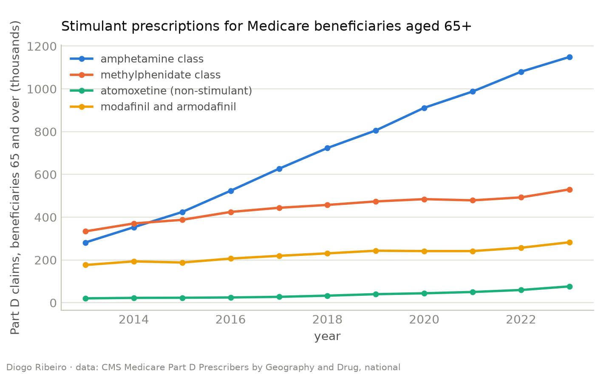
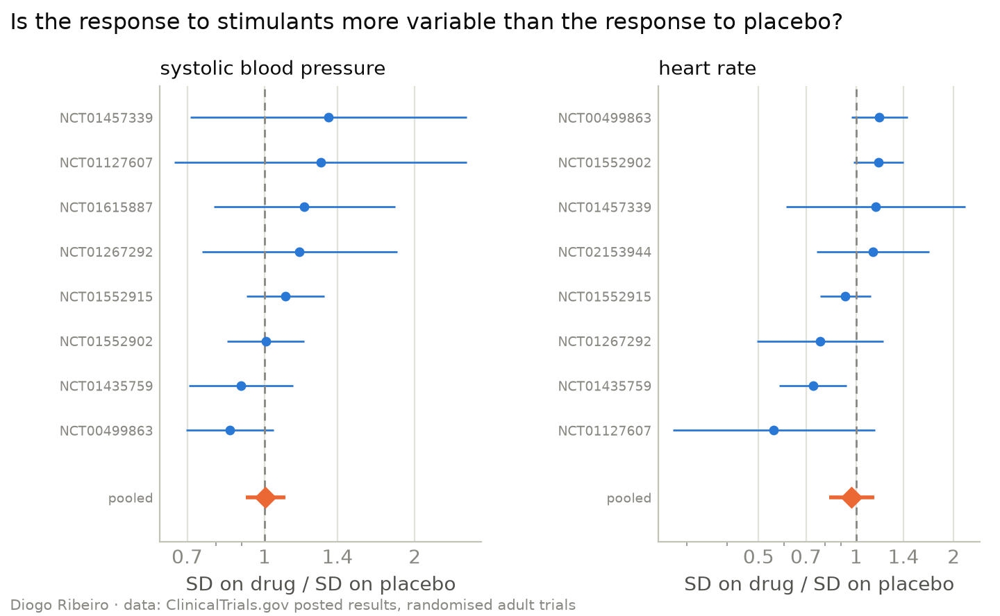
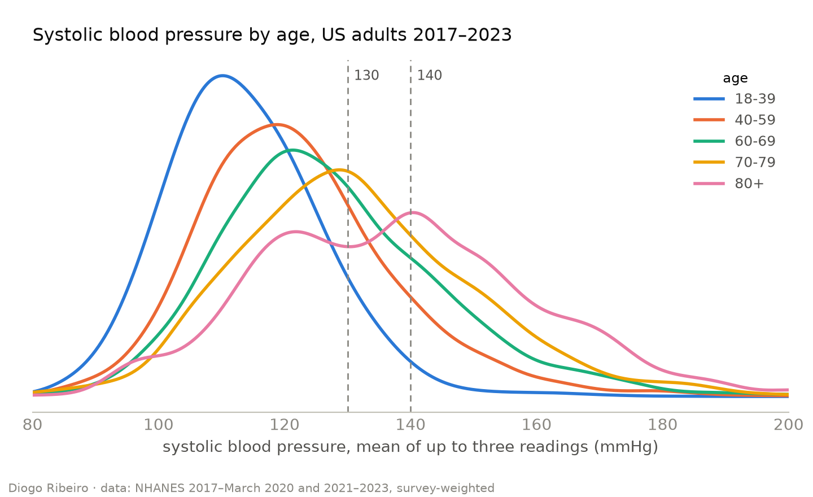
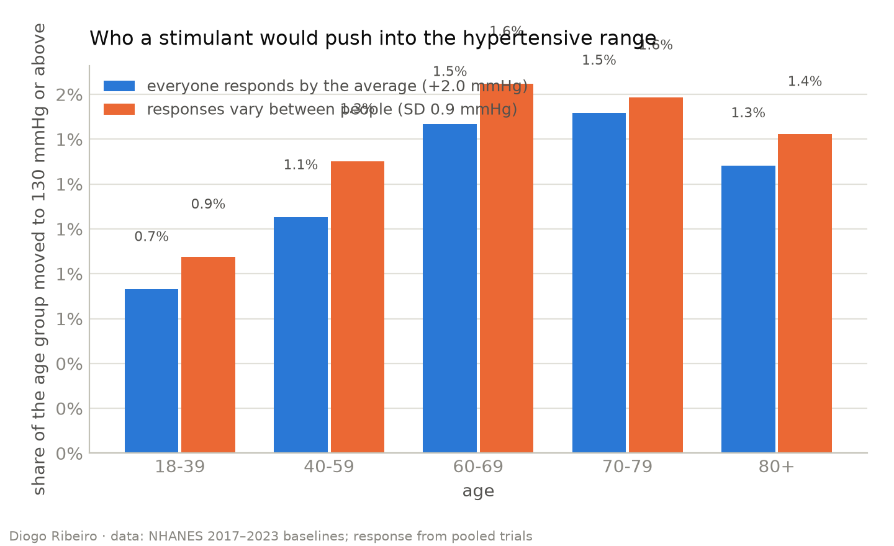
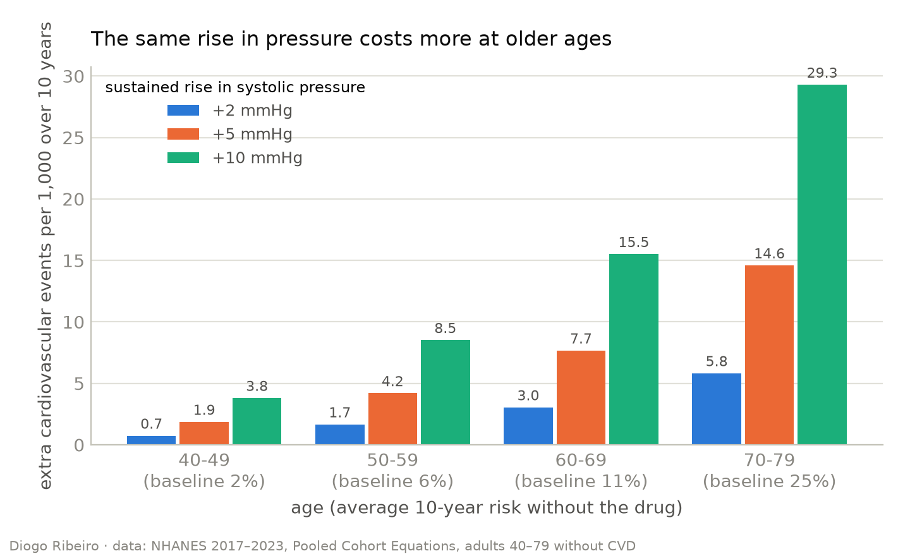
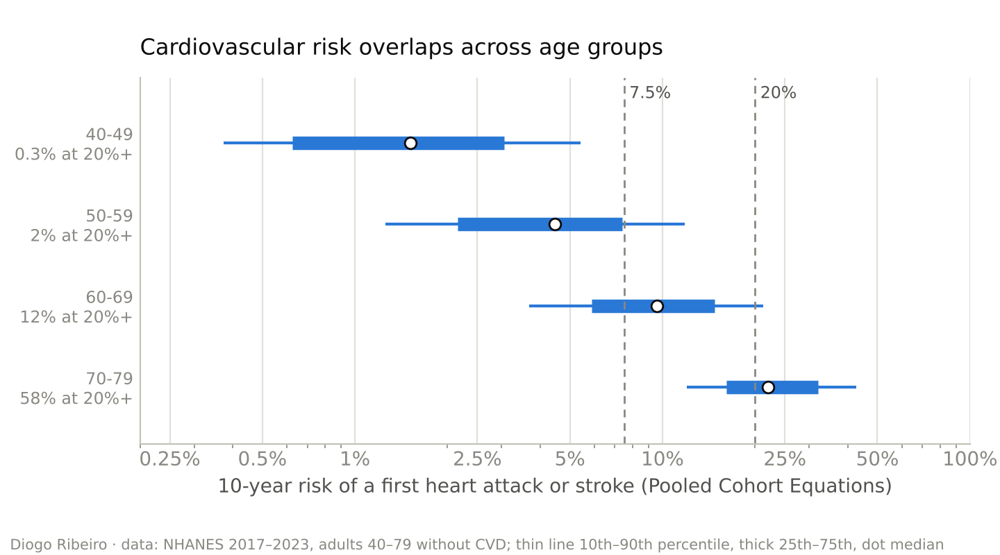
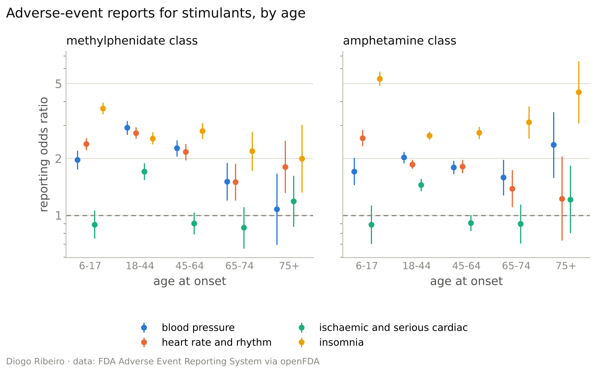
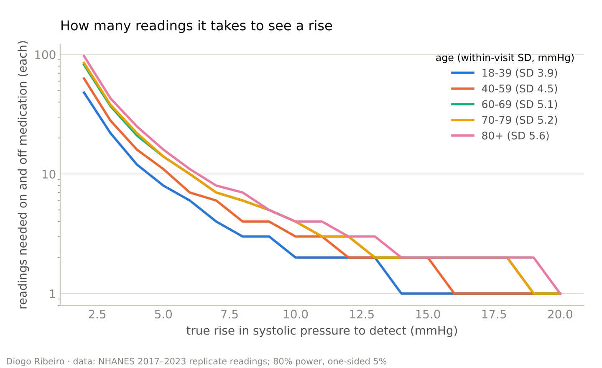
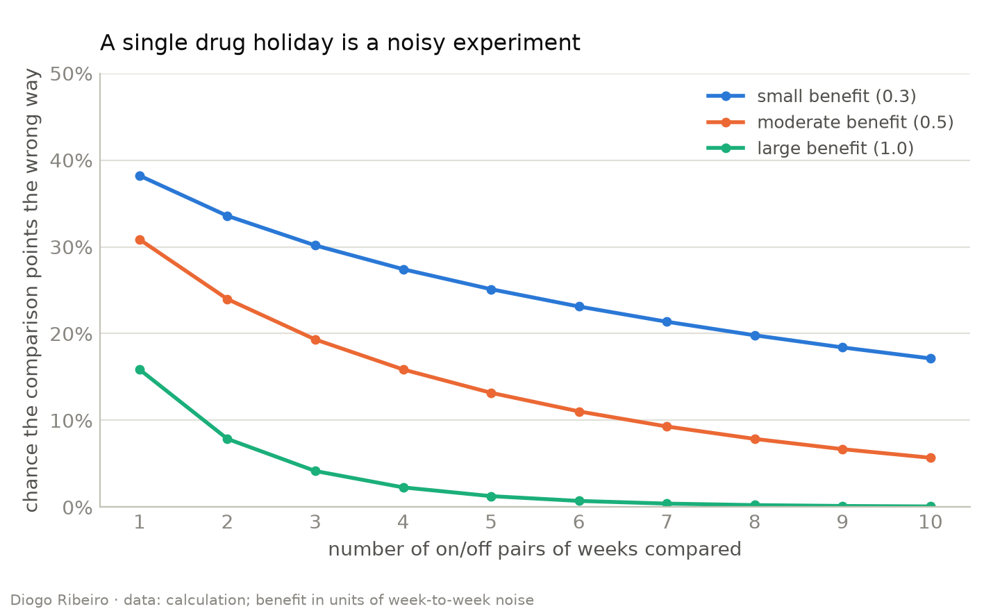

# Prescribing for a Patient, Not an Age Group: ADHD Medication After 65 in Four Public Datasets

*Trial registries, a national health survey, FDA adverse-event reports and ten years of Medicare claims, used to test whether age on its own should decide who gets a stimulant*

The psychiatrist John Kruse recently wrote in this publication about a patient he calls Martha. Stimulant medication had served her well for twenty years. Well into her seventies she was running her own PR firm and playing tennis at her local club, with no discernible problems from the Adderall she took for ADHD. When Kruse moved out of state, her new doctor told her to stop it because she was "too old" for it. Kruse's [argument against that decision](https://medium.com/invisible-illness/dont-ban-adhd-meds-for-older-adults-18f25bc22d84) is clinical, and it ends with a sentence that is also a statement about statistics: prescriptions are written for individuals, not demographics.

I agree with the sentence, but agreement is not evidence. So I treated it as a hypothesis and tested it against the public data I could get. A rule such as "no stimulants after a certain age" is a decision rule, and decision rules can be judged the way any classifier is judged: by the information they use, the information they throw away and the errors they make. If age is a good stand-in for the things that make stimulants risky, a cutoff is defensible. If it is a poor one, the cutoff harms the people it wrongly excludes and fails to protect the people it wrongly lets through.

Four sources went into the analysis:

- **ClinicalTrials.gov**: every trial of an amphetamine or methylphenidate medication with posted results, 256 in all, for ADHD and every other indication, including the age limits, the ages of the people actually enrolled, blood pressure and heart rate by arm, and side effects by arm.
- **NHANES**, the US National Health and Nutrition Examination Survey: 32,576 adults examined between 2011 and 2023, with measured blood pressure, cholesterol, smoking, diabetes and prescription medicines, weighted to represent the US population.
- **The FDA Adverse Event Reporting System**, through openFDA: 20.7 million reports, broken down by the patient's age.
- **Medicare Part D**: national prescription claims for stimulants and related drugs from 2013 to 2023, with the share filled by people aged 65 and over.

The short version of what came out is this. The trial evidence for ADHD medication stops at 65, so neither a ban nor a blanket permission rests on direct evidence. The trials that exist do not show the hidden minority of extreme responders that is often invoked for caution. The same rise in blood pressure does carry several times more absolute cardiovascular risk at 75 than at 45, so age genuinely matters. But it matters through a person's baseline risk, and baseline risk varies so much within each age group that a cutoff at 70 would exclude a group of whom four in ten are not at high cardiovascular risk, while letting through a third of those who are. The rest of this piece shows how each of those statements was reached, and where the data do not support Kruse as well as where they do.

All the code, the extracted data and the numbers quoted here are in a [public repository](https://github.com/DiogoRibeiro7/medium-blog/tree/main/prescribing-individuals), and the whole analysis reruns from the raw public sources with one command.

## How many older adults this concerns

The question would be academic if few older people took these drugs. They are a minority, but a fast-growing one.

Medicare Part D covers most Americans aged 65 and over who have drug coverage. In 2013 it paid for 281,677 prescriptions of amphetamine-class stimulants (Adderall, Vyvanse and their generics) filled by beneficiaries aged 65 or older. In 2023 it paid for 1,149,216, a little over four times as many. Methylphenidate-class prescriptions (Ritalin, Concerta and their relatives) for the same age group rose more slowly, from 333,683 to 529,903. Over the same decade, the share of all Medicare amphetamine-class claims filled by people aged 65 or older doubled, from 22 to 44 per cent, because claims for younger beneficiaries (those on Medicare through disability) grew only by half.

*Figure 1. Medicare Part D claims filled by beneficiaries aged 65 and over, by drug class. Source: CMS Medicare Part D Prescribers by Geography and Drug, national rows.*

Population growth explains only a small part of this. The number of Medicare beneficiaries aged 65 and over [grew by about 31 per cent between 2013 and 2022](https://www2.ccwdata.org/documents/10280/19096644/ccw-website-table-a1a.pdf). Claims are not people, though. In 2023 the data record about 212,000 beneficiaries aged 65 and over with amphetamine-class claims and about 105,000 with methylphenidate-class claims, but these counts are summed across products, so someone who switched from one brand to another is counted twice. The data also carry no diagnosis. Methylphenidate and modafinil are prescribed to older people for apathy, fatigue and depression as well as for ADHD, which is probably part of why people aged 65 and over filled 54 per cent of Medicare's methylphenidate claims and 62 per cent of its modafinil claims in 2023, against 44 per cent of its amphetamine claims.

The national survey gives the other side of the picture. Across the NHANES cycles with prescription data (2011 to March 2020, 26,239 adults), 2.2 per cent of adults aged 18 to 39 were taking a prescription stimulant, against 0.39 per cent of those aged 60 to 69 and 0.29 per cent of those aged 70 to 79. These estimates rest on small numbers of people: 13 users aged 60 to 69, six aged 70 to 79 and a single one aged 80 or over, whose estimate I will not use. Use falls with age, but it does not fall to zero, and the Medicare series says it is rising.

The underlying need is not small either. A Dutch population study found that [2.8 per cent of people aged 60 to 94 met full criteria for ADHD](https://www.cambridge.org/core/journals/the-british-journal-of-psychiatry/article/prevalence-of-attentiondeficit-hyperactivity-disorder-in-olderadults-in-the-netherlands/8142088678FA964BEE75AB7FA32A9CB7), and 4.2 per cent had clinically relevant symptoms. Many people in that generation were never assessed as children, because adult ADHD was barely recognised when they were young.

## The trial evidence stops at 65

If older adults are taking these drugs in growing numbers, the natural question is what the randomised evidence says about them. The answer from the registry is short: almost nothing, and for ADHD, nothing at all.

Of the 256 stimulant trials with posted results, 145 were for ADHD. Restricting to the 152 trials that enrolled adults only, 48 were for ADHD. Every one of those 48 had an upper age limit, and none of the limits was above 65. Across all indications, 99 adult trials stopped below 65, 28 stopped at exactly 65, 9 allowed older participants and 16 stated no upper limit.

Enrolment tells the same story. Seventy-two adult trials reported how many participants were 65 or older: 257 of 3,831. For the 24 adult ADHD trials that reported it, the figure was three participants out of 2,079, and since none of those trials admitted anyone over 65, those three were, by construction, exactly 65. Among the 120 adult trials that reported their participants' mean age, the median trial's average participant was 38.

There are trials of stimulants in older people, eight of them with posted results by my definition (a minimum age of 50 or more, or an average participant aged 60 or more), with 416 participants between them. None is about ADHD. All eight test methylphenidate for something else: apathy in Alzheimer's disease and other dementias, falls and cognition in dementia, walking problems in Parkinson's disease, depression in older adults and in palliative care, and post-traumatic stress after a stroke. Their side-effect data are too thin to use: one trial with 29 people per arm reported anxiety and appetite, and two trials with 40 people per arm between them reported insomnia, far too few to estimate anything.

I did not code the trials' exclusion criteria, so I cannot count how many also excluded people with hypertension or heart disease. To the extent that they did, as stimulant trials commonly do, the evidence is narrower still.

The consequence is easy to state. A doctor who stops Martha's prescription because she is too old is extrapolating beyond the evidence, and so is a doctor who continues it on the grounds that it is safe. Neither decision is evidence-based in the sense of resting on trials of people like her. What remains is indirect evidence: what the trials show in younger people, how the bodies of older people differ, and what can be measured in the patient in front of you. The rest of the analysis is about those three.

## Does anyone respond much more than average?

The case for caution with stimulants usually begins with blood pressure and heart rate. The averages are modest. A meta-analysis of placebo-controlled trials in adults found that stimulants raise heart rate by [about 5.7 beats per minute and systolic blood pressure by about 2.0 mmHg](https://www.themednet.org/publications/meta-analysis-of-increased-heart-rate-and-blood-pressure-associated-with-cns-stimulant-treatment-of-adhd-in-adults) on average. Two points of blood pressure is clinically small for almost anyone.

The usual reply, and one I was prepared to make before I looked at the data, is that an average can hide a minority who respond badly. A Dutch clinic study of [113 patients aged 55 to 79](https://doi.org/10.1177/1087054720925884) treated with low-dose stimulants is often read that way: systolic pressure rose by 10 mmHg or more in 10 of the 64 patients with measurements, including two who rose by 20 or more, while it fell in five. If some people respond far more than others, the average is the wrong number for an individual decision.

That claim can be tested, and the test is simple enough to describe without formulas. In a randomised trial, the people on placebo and the people on the drug are alike at the start. Their blood pressure changes during the trial for all the ordinary reasons: measurement error, the season, stress, regression towards their usual level. Those sources of variation are the same in both arms. If the drug also adds its own effect, and that effect differs from person to person, then the spread of changes in the drug arm must be wider than in the placebo arm, because it contains one extra source of variation. If everyone responds by about the same amount, the two spreads are equal. The ratio of the standard deviations in the two arms is therefore a direct measure of how much people differ in their response. If each person's response is unrelated to the rest of their variation, the arithmetic is exact: the variance on the drug equals the variance on placebo plus the variance of individual responses.

From the registry I found eight randomised, placebo-controlled trials that posted systolic blood pressure with a mean and standard deviation in both arms, with 659 people on a stimulant and 377 on placebo. Five reported the change from baseline and three reported final values; both work for this test. They are not the trials one would choose. Three are of adolescents with ADHD, and as the largest they carry most of the weight; the others are of adults with ADHD, depression, schizophrenia, cocaine dependence and multiple sclerosis. None included anyone over 65. They are, however, all the trials in the registry whose posted results allow the test.

*Figure 2. Ratio of the standard deviation of systolic blood pressure (left) and heart rate (right) on a stimulant to that on placebo, with 95% confidence intervals, and the random-effects pooled estimate. A ratio above 1 would mean people differ in how much the drug moves them. Source: ClinicalTrials.gov posted results.*

The pooled average effect on systolic pressure was 1.98 mmHg (95% confidence interval 0.73 to 3.24), almost exactly the figure from the published meta-analysis, which is a useful check that the extraction worked. The pooled ratio of standard deviations was 1.00 (0.92 to 1.10), with no measurable inconsistency between trials. In plain terms, blood pressure was no more spread out on a stimulant than on placebo. The implied standard deviation of individual responses is 0.9 mmHg, with an upper 95% limit of 4.6 mmHg.

That upper limit is the useful number, because it bounds the hidden minority. If individual responses were spread around the 2 mmHg average with a standard deviation of 4.6 mmHg, the largest the data allow, about 4 per cent of people would have a true drug-induced rise of 10 mmHg or more. At the central estimate, essentially nobody would.

Heart rate leaves more room. The average rise was 3.7 beats per minute (1.1 to 6.3), the ratio of standard deviations was 0.97 (0.83 to 1.14), and at the upper limit up to 14 per cent of people could have a true rise of 10 beats or more. Restricting the blood-pressure analysis to the five trials of adults also widens the range: the ratio is 1.04 (0.87 to 1.24), and at its upper limit up to 12 per cent could have a true rise of 10 mmHg or more. The adult data alone cannot rule out meaningful variation in response. What they show is no positive evidence of it.

Then where does the Dutch clinic's one in six come from? From noise, mostly. In the placebo arms of the trials that reported changes, the standard deviation of the change in systolic pressure was about 9.8 mmHg. With that much variation, about 13.9 per cent of people on placebo would be expected to show a rise of 10 mmHg or more between two visits, against 19.0 per cent of people on a stimulant. The Dutch figure of 10 in 64 is 15.6 per cent, with a 95% interval of 8 to 27 per cent. It is about what one would see with no drug at all, and older adults' readings are noisier than younger ones' (I come back to this below), which pushes the expected share from noise alone higher still. An uncontrolled series cannot separate people who respond strongly from people whose blood pressure happened to be higher on the second visit.

This result cuts against part of the case I set out to make. It weakens the argument that stimulants are dangerous because some patients spike unpredictably, but it equally weakens the argument that individual prescribing is needed because individual responses differ. In these trials, responses did not detectably differ. If individual assessment matters, it has to matter for a different reason.

Three caveats keep this from being the last word. The trials were short: where the timing was stated, blood pressure was measured between five days and eight weeks into treatment. Their participants were young and, in most cases, screened for cardiovascular problems. And the test assumes that the drug's effect is unrelated to where a person starts; if people with higher pressure responded less, the spreads could look equal while responses still differed. My conjecture is that older adults, whose arteries are stiffer and whose blood pressure is more sensitive to many drugs, might show more varied responses than these trials did. That is a hypothesis these data cannot test.

## What the trials do show: side effects

Blood pressure is not the only cost. Pooling the randomised, placebo-controlled adult trials that reported each side effect in both arms, up to 40 trials depending on the effect, the side effects that patients notice were clearly more common on stimulants than on placebo:

- **Insomnia**: 12.2 per cent on a stimulant against 6.8 per cent on placebo (risk ratio 1.81, 95% interval 1.51 to 2.18, 40 trials), or one extra case for about every 18 people treated.
- **Reduced appetite**: 14.5 against 4.1 per cent (risk ratio 3.11, 34 trials), one extra case for about every 10.
- **Fast heart rate or palpitations**: 6.4 against 1.4 per cent (risk ratio 2.69, 1.38 to 5.26, 18 trials), one extra case for about every 20.
- **Anxiety**: 8.9 against 6.1 per cent (risk ratio 1.52, 27 trials), one extra case for about every 36.
- **Raised blood pressure reported as a side effect**: 2.5 against 0.6 per cent (risk ratio 2.03, 0.94 to 4.40, only 9 trials), with an interval that includes no effect.

These are common, unpleasant and immediately visible to the patient, which matters later: unlike a small change in long-term cardiovascular risk, they can be detected in one person within weeks. They are also adult data from people under 65. For older people the trials are silent here too.

## The same rise has different consequences

So far, age has not appeared as a factor at all, because the trials contain no older people. NHANES is where age enters, and it enters strongly.

The survey measures blood pressure three times at one sitting, and in the two most recent cycles (2017 to March 2020 and 2021 to 2023, 14,032 non-pregnant adults) it used an automated oscillometric device. Average systolic pressure rises from 113.6 mmHg at ages 18 to 39 to 131.4 at 70 to 79 and 137.8 at 80 and over. The share with hypertension, defined as 130/80 or above or taking blood-pressure medication, rises from 23 to 78 and 79 per cent, and the share who report a previous heart attack, coronary heart disease, stroke or heart failure rises from 0.9 to 26 and 34 per cent.

*Figure 3. Survey-weighted distribution of systolic blood pressure by age group, US adults 2017–2023, with the 130 and 140 mmHg thresholds. Source: NHANES.*

A first way to ask what a 2 mmHg rise means for each age group is to count how many people it would move across a diagnostic threshold. Using each person's measured pressure and the response distribution estimated from the trials, I calculated the share of each age group that would be pushed from below 130/80 to above it. The answer is surprisingly flat: 0.9 per cent of people aged 18 to 39, and between 1.3 and 1.6 per cent in every older group. For the older 140/90 threshold, it is 0.4 per cent at 18 to 39 and around 1 per cent after 40. Even at the upper limit of response variability, the share stays below 3 per cent in every group.

*Figure 4. Share of each age group whose blood pressure a stimulant would move across 130/80 or 140/90, assuming responses vary between people as in the pooled trials. Error bars are 95% confidence intervals. Source: NHANES 2017–2023 and ClinicalTrials.gov.*

The reason is that most older people are already above the line. Only 22 per cent of people aged 70 to 79 are below 130/80 and untreated, against 77 per cent of those aged 18 to 39, so there are fewer people near the threshold to push across it. Counting diagnoses is the wrong way to think about the risk.

The right way is continuous. Cardiovascular risk does not jump at 130 mmHg; it rises with every millimetre, and it rises from a higher starting point in older people. To measure this I used the Pooled Cohort Equations, the risk calculator in the American guidelines, which estimates the 10-year risk of a first heart attack or stroke from age, sex, cholesterol, blood pressure, treatment, smoking and diabetes. My implementation reproduces the guideline's published worked example to the third decimal. I applied it to the 7,124 adults aged 40 to 79 in the recent NHANES cycles who had no history of cardiovascular disease and complete measurements, once at their measured blood pressure and once with that pressure raised.

Average 10-year risk without any drug is 2.4 per cent at ages 40 to 49, 5.8 per cent at 50 to 59, 11.5 per cent at 60 to 69 and 25.1 per cent at 70 to 79. A sustained 2 mmHg rise adds 0.74 events per 1,000 people over ten years at 40 to 49 and 5.82 per 1,000 at 70 to 79, almost eight times as many. For a 5 mmHg rise the figures are 1.9 and 14.6 per 1,000, and for 10 mmHg they are 3.8 and 29.3. Put as a number needed to harm, a sustained 2 mmHg rise would cause one extra heart attack or stroke over ten years for about every 1,360 people treated at 40 to 49, and for about every 170 at 70 to 79.

*Figure 5. Extra heart attacks and strokes per 1,000 people over 10 years from a sustained rise in systolic pressure of 2, 5 or 10 mmHg, adults 40–79 without cardiovascular disease. Source: NHANES 2017–2023 and the Pooled Cohort Equations.*

This is the gap between relative and absolute risk, measured rather than illustrated. In relative terms the effect is actually smaller at older ages: a 10 mmHg rise multiplies the 10-year risk by 1.18 at 40 to 49 and by 1.13 at 70 to 79. In absolute terms it is far larger, because it multiplies a much bigger number.

The risk equations describe people whose pressure is naturally higher, which is not the same as a rise caused by a drug. As a cross-check I used the randomised evidence from the other direction: a meta-analysis of 123 trials of blood-pressure lowering found that [each 10 mmHg reduction cut major cardiovascular events by about 20 per cent](https://evidence.nihr.ac.uk/alert/lowering-blood-pressure-reduces-the-risk-of-heart-disease-stroke-and-death/). Applying that effect in reverse to each person's baseline gives 1.1 extra events per 1,000 at 40 to 49 and 11.5 per 1,000 at 70 to 79 for a 2 mmHg rise. The absolute numbers roughly double, partly because "major cardiovascular events" includes heart failure, and the age gradient steepens to about tenfold. Both calculations assume the rise lasts ten years, which is pessimistic for a medication that can be stopped, and neither knows whether a stimulant-induced rise carries the same risk as any other. For long-term exposure, the best observational evidence is a Swedish registry study that found [4 per cent higher odds of cardiovascular disease for each year of ADHD medication use](https://www.hcplive.com/view/long-term-adhd-medication-use-linked-potential-risk-cardiovascular-diseases), mostly hypertension and arterial disease, in people aged 6 to 64. It says nothing about people over 65.

This is where the data are least kind to a simple reading of Kruse's position. Age matters, and it matters a lot: the same small rise in pressure buys several times more harm at 75 than at 45. A prescriber who is more cautious with older patients is not being irrational.

## Age is a proxy, and a leaky one

The question is what age is standing in for. Nobody believes a birthday changes how a body handles amphetamine. Age is used because it is correlated with the things that do, and the one measured in the previous section is baseline cardiovascular risk. If that is the real quantity, a rule based on age can be compared with a rule based on the quantity itself.

The comparison starts with how much risk varies within each age group. Among people aged 70 to 79, 10-year risk runs from 12 per cent at the 10th percentile to 43 per cent at the 90th. Among people aged 60 to 69, it runs from 3.7 to 21 per cent. The distributions overlap: the riskiest tenth of people in their sixties carry more risk than the lowest-risk quarter of people in their seventies. The extra harm from a 5 mmHg rise varies in the same way, from 8.8 to 21.4 events per 1,000 between the 10th and 90th percentiles at ages 70 to 79, and from 3.1 to 13.0 per 1,000 at 60 to 69.

*Figure 6. Distribution of 10-year cardiovascular risk inside each age group, with the guideline thresholds of 7.5 and 20 per cent. The labels give the share at 20 per cent or more. Source: NHANES 2017–2023 and the Pooled Cohort Equations.*

Now treat "no stimulants from age 70" as a classifier of high cardiovascular risk, using the guideline's own definition of high risk, a 10-year risk of 20 per cent or more, among adults aged 40 to 79 without cardiovascular disease. Of the people aged 70 to 79 whom the rule excludes, 42 per cent (standard error 2 per cent) are not at high risk. Of the people who are at high risk, 33 per cent are younger than 70 and pass the rule. A cutoff at 65 shifts the errors without removing them: 60 per cent of the people it excludes are not at high risk, while 15 per cent of the high-risk people are under 65.

Age is not a useless proxy. Fifty-eight per cent of people aged 70 to 79 are at high risk by this definition, against 12 per cent of those aged 60 to 69 and 2 per cent of those aged 50 to 59, so knowing someone's age tells you a great deal. But a proxy that wrongly excludes four in ten is hard to defend when the real quantity can be estimated in a routine appointment from a blood test, a blood-pressure reading and a few questions. The risk equations themselves use age, so this comparison flatters the age rule, if anything.

Two limits on this argument deserve to be said plainly. Cardiovascular risk is only one of the things age stands for. Kidney and liver function, interactions with other medicines, falls, sleep and cognition all change with age, and I have not analysed any of them; each can be assessed in the individual, but each takes effort. And the risk equations stop at 79, so they say nothing about people in their eighties, for whom the evidence of every kind is thinnest.

## What the adverse-event reports say about age

Trials cannot tell us about older people, so the remaining place to look is real-world reporting. The FDA's Adverse Event Reporting System collects reports of suspected side effects from doctors, pharmacists, patients and manufacturers. Through openFDA, I counted reports by the patient's age and by event, for the methylphenidate class and the amphetamine class, against all other drugs in the database. The older groups are not large: 1,965 reports naming a methylphenidate-class drug for people aged 65 to 74 and 841 for those 75 and over, and 2,124 and 470 for amphetamine-class drugs.

The standard measure here is the reporting odds ratio: how much more often an event appears in reports that name the drug than in reports for other drugs, within the same age group. A ratio of 1 means the event is no more prominent in the drug's reports than in anyone else's.

*Figure 7. Reporting odds ratios for selected events in reports naming methylphenidate-class or amphetamine-class drugs, by age, with 95% confidence intervals. Source: FDA Adverse Event Reporting System via openFDA, database updated 30 July 2026.*

For the most serious category, heart attacks and other ischaemic or serious cardiac events, the ratios in the older groups are all close to 1, between 0.86 and 1.21, with intervals that include 1. In adults aged 18 to 44 they are higher: 1.71 for methylphenidate and 1.45 for amphetamines. Comparing the two directly, the reporting odds ratio for ischaemic events at 65 to 74 is half the size it is at 18 to 44 for methylphenidate (ratio 0.50, 95% interval 0.38 to 0.66) and about 0.62 of it for amphetamines (0.48 to 0.80). For blood-pressure events, the older groups also sit lower for methylphenidate (ratios of 0.52 and 0.37), while for amphetamines the 75-and-over group is no different from young adults (1.17, 0.77 to 1.75).

It would be wrong to read this as evidence that stimulants are safer for the heart in older people. The reporting odds ratio is a relative measure, and it behaves exactly like the relative risks in the previous section. Cardiovascular events are common in everybody's reports at older ages: ischaemic events make up 1.6 per cent of reports for other drugs at 18 to 44, 3.6 per cent at 65 to 74 and 4.2 per cent at 75 and over. Against that background, a drug has to cause a lot of events to stand out. What the reports do not show is a cardiac signal specific to older ages, anything that suggests stimulants behave in a qualitatively different way in older bodies. That fits the trial data on response spread and gives no support to a hard cutoff, but it is weak evidence in either direction.

Insomnia is the one place where the reports speak to a specific claim in Kruse's article. As he reads the evidence, older adults on ADHD medication report more insomnia than younger ones in absolute terms because they sleep worse to begin with, but the medication adds less to that baseline. For methylphenidate, the reports are consistent with this: the reporting odds ratio for insomnia falls from 2.56 at 18 to 44 to 2.19 at 65 to 74 and 2.00 at 75 and over, although the differences are within the margin of error. For amphetamines they point the other way: 2.65 at 18 to 44, 3.12 at 65 to 74 and 4.50 at 75 and over, a ratio of 1.70 (1.15 to 2.50) between the oldest and the young adult group. That estimate rests on 28 reports, and reports are not rates. But Martha took Adderall, an amphetamine, and on this point the data do not back the reassuring reading. Sleep is worth watching closely in an older person on an amphetamine.

The usual warnings about spontaneous reports apply in full. They are not incidence: nobody knows how many people took the drug without incident. Reporting depends on publicity, on who prescribes and on how seriously ill the patient already is. Older people taking methylphenidate are often being treated for apathy or depression in the context of other serious illness, which colours what gets reported. And only 11.3 million of the 20.7 million reports fall into the age groups used here, mostly because the rest carry no age. The database can raise questions; it cannot settle them.

## Measuring one patient

If age is a leaky proxy for baseline risk and side effects, the alternative is to measure them in the person. Two practical questions follow. How much measuring does it take to see a change in blood pressure? And how should a drug holiday, which Kruse recommends, be run so that it tells you something?

NHANES helps with the first, because it takes three readings at one sitting. The scatter of those readings around each person's own average is a direct measure of measurement noise, and it grows with age: the within-visit standard deviation of systolic pressure is 3.9 mmHg at 18 to 39, 4.5 at 40 to 59, 5.1 at 60 to 69, 5.2 at 70 to 79 and 5.6 at 80 and over. From that I calculated how many readings a person would need on and off the medication to have an 80 per cent chance of detecting a true rise, with a one-sided 5 per cent test. To detect a 10 mmHg rise takes 2 readings in each period at 18 to 39 and 4 from age 60. To detect a 5 mmHg rise takes 8 readings in each period at 18 to 39, 14 at 60 to 79 and 16 at 80 and over.

*Figure 8. Number of blood-pressure readings needed on and off medication (each) to detect a true rise in systolic pressure with 80% power, using the within-visit variability measured in each age group. Source: NHANES 2017–2023 replicate readings.*

These are lower bounds, because readings on different days vary more than readings a minute apart. Still, the practical message is encouraging. A single reading in the clinic before and after starting a stimulant is close to useless for detecting the rises that matter, especially in an older person. A week of home readings twice a day in each period comfortably exceeds the numbers above and leaves room for day-to-day variation. That is not a heavy burden, and it turns a guess into a measurement.

The drug holiday is the second question. Stopping the medication for a while to see whether it is still needed is good advice, and it is also an experiment, usually a badly designed one. Symptoms of ADHD vary from week to week with sleep, stress, workload and a hundred other things. Suppose the medication has a moderate real benefit, half the standard deviation of the difference between a typical week on it and a typical week off it. Then a single comparison of one week off with one week on points the wrong way, with the off week looking no worse, about 31 per cent of the time. For a large benefit, equal to that standard deviation, it is 16 per cent. With three on-off pairs the chance of being misled falls to 19 and 4 per cent, and getting below 5 per cent for a moderate benefit takes eleven pairs.

*Figure 9. Probability that comparing periods on and off medication suggests the wrong conclusion, by the number of on/off pairs and the size of the true benefit. Calculation.*

Noise is only half the problem. In an ordinary drug holiday everyone knows which weeks are which, and expectations shape both how people feel and how they rate it. The formal answer to both problems already exists: the n-of-1 trial, a randomised, blinded crossover experiment on a single patient. In Australia, Nikles and colleagues ran such a service for children whose benefit from stimulants was uncertain: [86 trials were completed](https://research.bond.edu.au/en/publications/an-n-of-1-trial-service-in-clinical-practice-testing-the-effectiv/), each with three pairs of periods in which the child took the stimulant or a placebo in random order, with neither family nor doctor knowing which. In 69 comparisons of drug against placebo, only 29 children (42 per cent) did better on the stimulant, and management changed afterwards for 28 of the 64 children with follow-up. These were children selected because their benefit was in doubt, so the 42 per cent does not transfer to anyone else. The method does.

For an older adult, the same logic turns a drug holiday into evidence. Decide in advance what will be measured: symptom ratings by the patient and by someone who sees them every day, sleep, and blood pressure with enough readings to see a change. Use more than one on-off pair, in an order chosen at random. Ask whether a pharmacy can prepare identical placebo capsules so that nobody knows which weeks are which. And agree beforehand what result would change the decision. None of this is advice to change any medication without a doctor. It is a description of how a doctor and a patient can turn an impression into a measurement.

## What a better rule looks like

Statistics has a name for the right way to combine population evidence with individual measurements. Population data give a starting estimate of how a patient is likely to fare, a prior. Measurements of that patient update it. The decision is then made on the updated estimate. An age cutoff stops at the prior and refuses to look at the data. "Start low and go slow", the standard advice for older patients, is the opposite: a sequential experiment in which each step is informed by the last.

Put together, the four datasets support Kruse's central claim and qualify it. They support it because the direct evidence that would justify a ban does not exist, because the trials show no hidden group of people whose blood pressure soars, and because age is a leaky proxy for the risk that matters most, wrong about four in ten of the people a cutoff at 70 would exclude. They qualify it because age is far from irrelevant. The same rise in blood pressure costs several times more at 75 than at 45, older people's blood pressure is harder to measure precisely, and, for amphetamines at least, the reports point to insomnia becoming a larger problem rather than a smaller one. Those are reasons for an older patient to be measured more carefully, more often and over longer periods than a younger one. They are not reasons to stop measuring.

The data also mark out what would change this conclusion. A randomised trial of ADHD medication in adults over 65, even a modest one, would replace most of the extrapolation here. Registry studies of cardiovascular outcomes in older stimulant users, of the kind already done for people under 65, would test whether the risk equations understate or overstate the harm. And trials that report the spread of responses, not just the average, would let the analysis in Figure 2 be repeated on people who actually look like Martha.

Martha's story already contains the better rule. Her second psychiatrist did not ask how old she was. He asked a cardiologist to evaluate her before continuing her prescription, and the cardiologist cleared it. The demographic is where the estimate starts. The patient's own measurements are where it should end.

## How this was done

All four sources are public and were downloaded by an automated pipeline, which is in the repository with its tests.

- **ClinicalTrials.gov**: trials of any amphetamine or methylphenidate stimulant (amphetamine, dextroamphetamine, lisdexamfetamine, methylphenidate, dexmethylphenidate, serdexmethylphenidate and their brand and development names) with posted results, retrieved through the registry's API. Variance ratios use the log ratio of standard deviations with a small-sample correction, pooled with a DerSimonian–Laird random-effects model. When a trial posted several doses, the largest active arm was used; standard errors were converted to standard deviations. Side effects were grouped by matching reported terms and pooled as risk ratios with the same model.
- **NHANES**: cycles 2011–2012 to 2021–2023, with pooled weights proportional to each cycle's length and standard errors that account for the survey's strata and clusters. Blood-pressure analyses use only the oscillometric cycles (2017 to March 2020 and 2021–2023). The response model is a normal distribution with the trials' pooled mean and between-person standard deviation. Risks are from the 2013 Pooled Cohort Equations, using the equations for white adults for people of other races and ethnicities, as the guideline recommends.
- **FAERS**: counts from the openFDA API by age at onset, drug group and event group. Reporting odds ratios use Wald intervals; age contrasts compare the log ratios between age groups.
- **Medicare Part D**: national rows of the Prescribers by Geography and Drug dataset, 2013–2023, grouped into drug classes.
- **Drug holiday**: the chance of a wrong-direction result is the normal probability that the mean of k on-minus-off differences falls below zero, with the benefit expressed in units of the standard deviation of one difference.

The main limitations are the ones already stated: no randomised data on anyone over 65; heterogeneity trials that are few, short and mostly young; risk equations that describe association rather than the effect of a drug; and adverse-event reports that cannot give rates. The risk equations were also not designed for people with existing cardiovascular disease, who were excluded from that part of the analysis.

Decisions about any medication belong to patients and the clinicians who know their history.

## References

Centers for Medicare & Medicaid Services. Medicare Part D Prescribers by Geography and Drug, 2013–2023. https://data.cms.gov

Chronic Conditions Data Warehouse. Medicare beneficiary counts, 2013–2022, Table A.1.a. https://www2.ccwdata.org/documents/10280/19096644/ccw-website-table-a1a.pdf

ClinicalTrials.gov API, version 2. US National Library of Medicine. https://clinicaltrials.gov/data-api/api

DerSimonian, R. and Laird, N. (1986). Meta-analysis in clinical trials. *Controlled Clinical Trials* 7(3), 177–188.

Ettehad, D., Emdin, C. A., Kiran, A. et al. (2016). Blood pressure lowering for prevention of cardiovascular disease and death: a systematic review and meta-analysis. *The Lancet* 387(10022), 957–967.

Goff, D. C., Lloyd-Jones, D. M., Bennett, G. et al. (2014). 2013 ACC/AHA Guideline on the Assessment of Cardiovascular Risk. *Circulation* 129(25 Suppl 2), S49–S73.

Kruse, J. Don't Ban ADHD Meds for Older Adults. *Invisible Illness*. https://medium.com/invisible-illness/dont-ban-adhd-meds-for-older-adults-18f25bc22d84

Michielsen, M., Semeijn, E., Comijs, H. C. et al. (2012). Prevalence of attention-deficit hyperactivity disorder in older adults in the Netherlands. *British Journal of Psychiatry* 201(4), 298–305.

Michielsen, M., Kleef, D., Bijlenga, D. et al. (2020). Response and Side Effects Using Stimulant Medication in Older Adults With ADHD: An Observational Archive Study. *Journal of Attention Disorders*. https://doi.org/10.1177/1087054720925884

Mick, E., McManus, D. D. and Goldberg, R. J. (2013). Meta-analysis of increased heart rate and blood pressure associated with CNS stimulant treatment of ADHD in adults. *European Neuropsychopharmacology* 23(6), 534–541.

Nakagawa, S., Poulin, R., Mengersen, K. et al. (2015). Meta-analysis of variation: ecological and evolutionary applications and beyond. *Methods in Ecology and Evolution* 6(2), 143–152.

National Center for Health Statistics. National Health and Nutrition Examination Survey, 2011–2023. https://wwwn.cdc.gov/nchs/nhanes/

Nikles, C. J., Mitchell, G. K., Del Mar, C. B., Clavarino, A. and McNairn, N. (2006). An n-of-1 trial service in clinical practice: testing the effectiveness of stimulants for attention-deficit/hyperactivity disorder. *Pediatrics* 117(6), 2040–2046.

US Food and Drug Administration. FDA Adverse Event Reporting System, via openFDA. https://open.fda.gov/apis/drug/event/

Zhang, L., Li, L., Andell, P. et al. (2024). Attention-Deficit/Hyperactivity Disorder Medications and Long-Term Risk of Cardiovascular Diseases. *JAMA Psychiatry* 81(2), 178–187.
