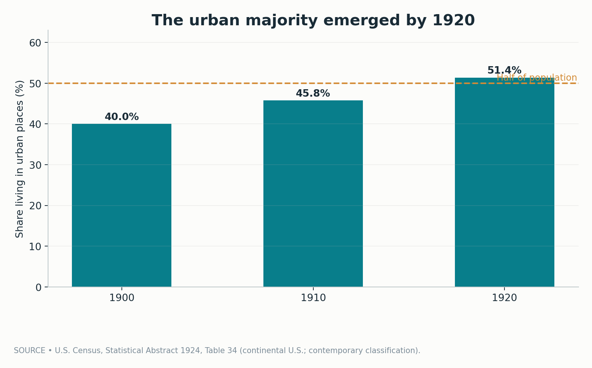
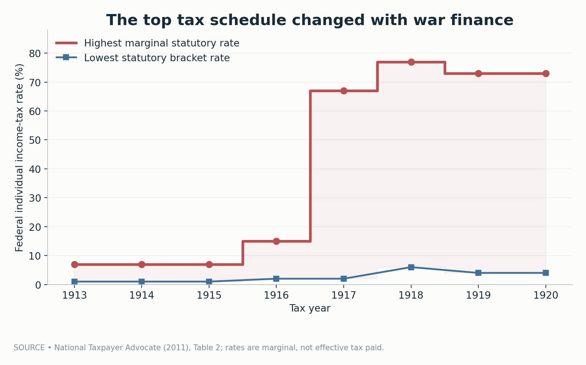
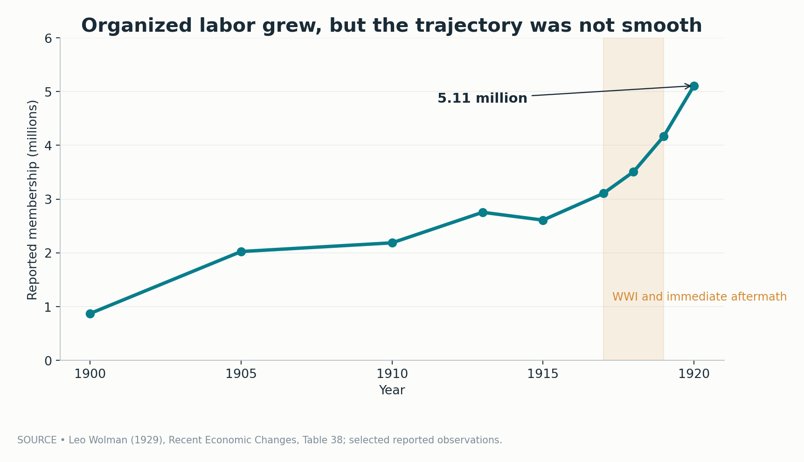
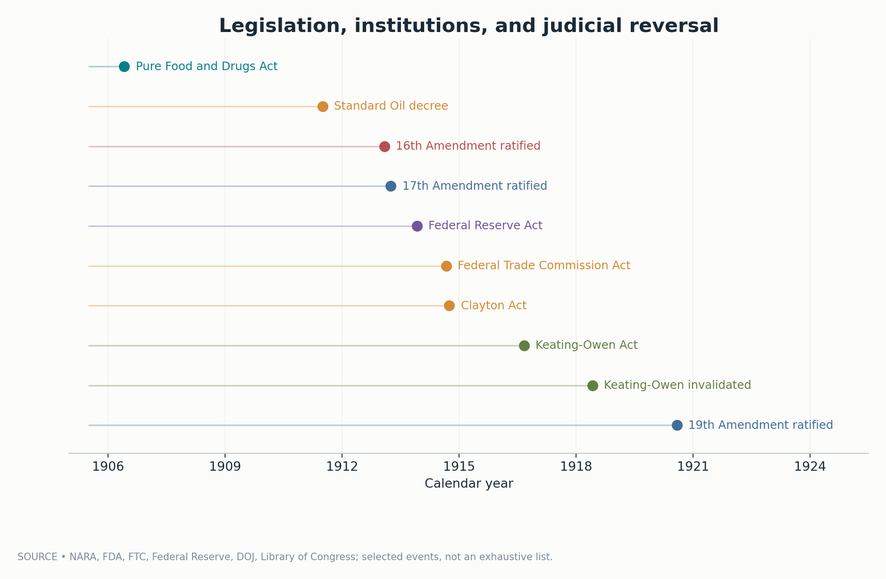
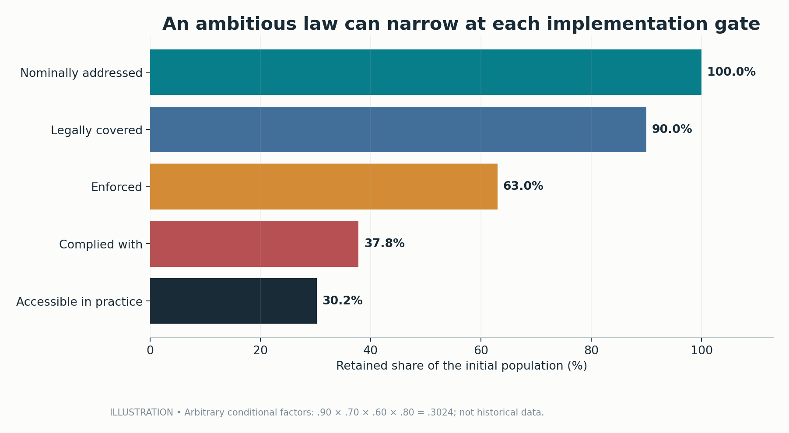
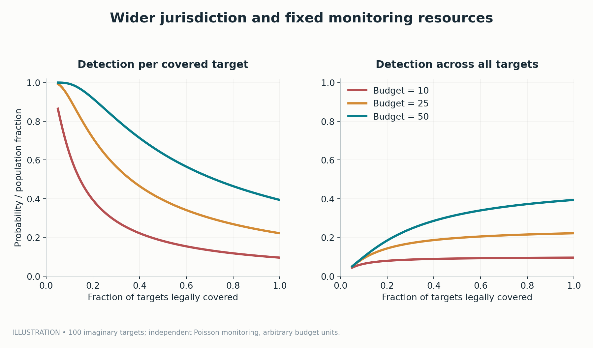
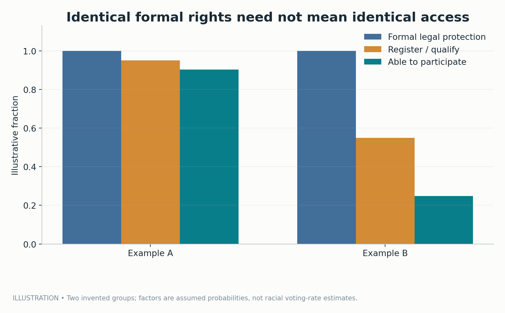
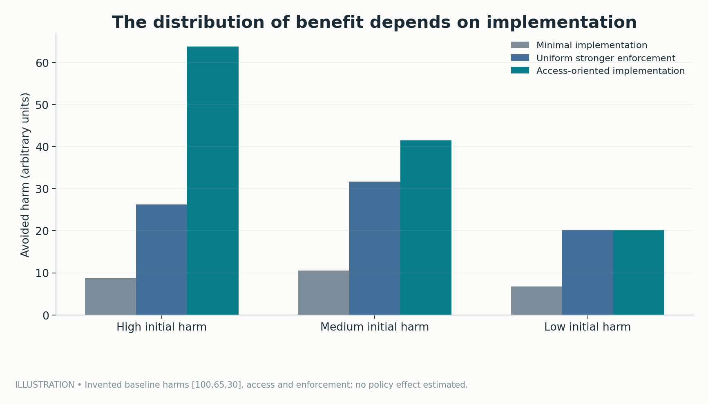

# A Law Is Not a Reform: What the Progressive Era Actually Changed

*The American response to the Gilded Age built new institutions, taxed fortunes, challenged trusts, and expanded the vote. It also reveals why passing a law is not the same thing as changing the distribution of power.*

Diogo Ribeiro | October 2026

*A historical and mathematical essay with eight original figures. Figures 1–4 are based on named historical statistical tables or documented events. Figures 5–8 illustrate mechanisms with explicitly invented parameters. The diagrams are not historical causal estimates. The [reproducible companion](README.md) contains transcribed source data, Python, a notebook, result tables, tests, and an audit of every figure.*

## A reform is an argument about power

The factory has already burned. The workers are already dead. People have gathered outside, demanding that someone explain why an industrial city capable of building skyscrapers could not reliably protect the people sewing the clothes inside them. The event is the Triangle Shirtwaist Factory fire in New York on March 25, 1911. One hundred and forty-six workers died, most of them young immigrant women. In the years that followed, investigations, organizing, and legislative campaigns pushed workplace safety into a more prominent place in American public life. The [National Park Service's labor-history research](https://www.nps.gov/subjects/nationalhistoriclandmarks/upload/Labor_History_in_US-Theme_Study-Final-revised.pdf) documents both the disaster and its political significance.

But the fire raises a question more fundamental than whether legislators eventually responded. What, precisely, counts as a response? A governor can sign a statute. An agency can receive a mandate. An inspector can gain authority to enter a building. Employers can alter their behavior—or discover that the rules can be evaded. Workers can feel safer—or remain unable to complain without losing their livelihoods. A law is a sentence written in the political language of obligation. Reform is the far more demanding work of changing what actually happens.

This is the central problem of the American Progressive Era. Between roughly the 1890s and 1920, reformers confronted the contradictions of the industrial economy that had emerged during the Gilded Age. Railroads and steel mills had created enormous productive capacity. Corporate combinations had developed the power to shape prices, transportation access, and employment. Cities were expanding. Political machines mediated access to jobs and public services. Urban households encountered tainted products, dangerous buildings, inadequate sanitation, and expensive essential goods. Workers organized in an economy in which courts, police, employers, and unions did not possess equal resources.

The responses were real. Americans established new regulatory agencies, altered constitutional rules, created the Federal Reserve, strengthened some consumer protections, and developed new forms of social investigation. The Sixteenth Amendment made an income-tax regime constitutionally secure. The Seventeenth Amendment introduced direct election of United States senators. Congress passed the Federal Trade Commission and Clayton Acts. The Nineteenth Amendment barred denial of the vote on account of sex. Each changed the rules of the political economy in a consequential way.

Yet we should resist the clean story in which the Gilded Age was a time of unchecked exploitation and the Progressive Era was its successful moral correction. Industrial expansion and reform overlapped chronologically. Some Progressives admired business efficiency and wished to improve rather than dismantle industrial capitalism. Some protected consumers but neglected the people producing consumer goods. Some fought political corruption while tolerating, and sometimes actively constructing, racial hierarchy. Some sought expert administration because they distrusted democratic politics. Some were socialists or militant labor organizers who considered mainstream Progressives insufficiently radical.

The era was not one organization, one ideology, or one result. It was a political struggle over **who could define a social problem, who could design a remedy, and whose interests the new institutions would serve**.

My argument is that the Progressive Era created enduring *capacities* for reform without producing universal or permanent *outcomes*. It expanded the possibilities of the American state. It changed electoral procedures and the legal vocabulary of economic power. It opened new routes to protection, but those routes were unevenly accessible, incompletely enforced, and vulnerable to political reversal. The most interesting history lies between the passage of a rule and the daily experience of the people it was supposed to protect.

To see the distance clearly, we need several kinds of evidence. Contemporary statistics tell us something about urbanization, union organizing, and income-tax law. Dated documents establish when major institutions appeared. Case histories show how legislation could meet resistance and judicial limits. Finally, deliberately simple mathematical models expose structural mechanisms: implementation bottlenecks, enforcement scarcity, and the difference between nominal legal rights and practical access. Those models do not retroactively measure the Progressive Era. Their role is to force conceptual precision.

## First, understand the country that demanded reform

It is tempting to explain reform as an outbreak of conscience. Perhaps Americans observed corporate greed, rediscovered civic virtue, and passed corrective legislation. Moral criticism mattered, but that account misses the material transformation that made a different style of politics both possible and necessary. Industrialization produced new problems of scale. A factory injury might concern an individual employee, but repeated accidents across an industry were a matter of public administration. A contaminated product could travel through interstate commerce before any local authority learned of the danger. The price charged by a dominant network could shape the livelihood of people hundreds of miles away.

Market coordination and public governance were becoming technically interdependent. The logic of a railway network could not be reduced to the conduct of one station manager. Municipal public health required sewers, water systems, laboratory capacity, and enforceable standards. Understanding an industrial accident could require engineering expertise, workplace records, testimony from employees, and authority to examine a site. Reform required organizations capable of processing information about a highly connected economy.

At the same time, the United States was becoming more urban. The [Census Bureau's 1924 *Statistical Abstract*, Table 34](https://www2.census.gov/library/publications/1925/compendia/statab/47ed/1924-02.pdf), lists the continental United States as 40.0 percent urban in 1900, 45.8 percent in 1910, and 51.4 percent in 1920. These are contemporaneously tabulated shares using that publication's urban-place definition. Later historical reconstructions sometimes report slightly different figures because urban classifications and revisions changed. The difference is small enough not to alter the story, but important enough that a responsible figure should identify its exact table.

*Figure 1 — Historical transcription. Urban residents became a majority by 1920 under the source's classification; the percentages measure settlement patterns, not support for any reform or a specific policy outcome.*

Urbanization did not mechanically produce Progressivism. Cities could nurture labor radicalism, immigrant mutual-aid organizations, professional reform clubs, political machines, property speculation, and racial segregation at the same time. A growing municipal population might demand sanitary water and also support discriminatory zoning. Employers needed skilled labor and might resist independent unions. Urban consumers could demand cheaper goods while remaining indifferent to the conditions under which workers produced them.

Nevertheless, the aggregate shift helps us understand a political change in the *scale* of expectations. Private philanthropy could not reliably inspect every factory. Voluntary professional ethics could not impose uniform food standards on an interstate market. Electoral patronage could provide some families with jobs, but it was a poor substitute for a predictable legal entitlement. Growing cities brought large populations into contact with systems that were both interdependent and largely outside any individual's control.

The question was no longer simply whether a business owner behaved honorably. It was whether the institution governing that business had a mandate to investigate, resources to act, and a way to make its judgments stick. That is why the Progressive Era gave so much attention to administration, expertise, data collection, and regulation. Those instruments could be used for democratic inclusion. They could also be used for social control. The instruments themselves did not decide whose freedom mattered.

## The Progressives were never a single political subject

The label "Progressive Era" can make a contested historical field appear organized and coherent. In reality, it describes overlapping movements, elections, municipal experiments, legal battles, and intellectual traditions. A middle-class settlement-house worker, a Black voting-rights activist, a railroad regulator, an agricultural insurgent, a suffragist, a socialist editor, and a union organizer might all oppose an aspect of the existing order. They did not necessarily agree about property rights, racial equality, tariffs, strikes, immigration, or the purpose of government.

The presidential election of 1912 makes the plurality unusually visible. Woodrow Wilson spoke of a New Freedom; Theodore Roosevelt and the Progressive Party championed a New Nationalism; William Howard Taft defended another Republican approach; Eugene V. Debs represented an explicitly socialist alternative. These were not four versions of one administrative plan. They differed over corporate scale, the legitimacy of regulation, the role of competition, and how far a democratic society should restructure economic relations. The [National Archives' materials on the 1912 election](https://www.archives.gov/education/lessons/election-cartoons) are a useful entry point into that contested reform atmosphere.

Even familiar shorthand—"trust-busting"—hides a disagreement. One reformer regarded large corporate combinations as threats to republican independence and wanted them broken apart. Another saw productive advantages in large enterprises but demanded public oversight of their prices and practices. An expert might prefer a commission able to collect information and enforce technical standards. A worker might judge these designs by whether an employer could still fire someone for organizing. A farmer might care above all about rail charges, crop credit, or the behavior of a grain purchaser.

These positions could overlap. Competition policy could disrupt exclusionary contracts and still leave a vast imbalance between employers and employees. A regulatory commission could reduce uncertainty about permissible commercial behavior while placing new procedural barriers between ordinary citizens and meaningful redress. Municipal reformers might dislike political bosses while overlooking the informal services machines provided to immigrants who had little access to established institutions.

The other danger is to read the period backward from the achievements that survived. If we start with today's federal income-tax system or today's central bank, the 1913 legislation can look like a destination. But contemporaries did not know those institutions' future scale, amendments, conflicts, or limits. Likewise, 1920 was not the moment when every woman in the United States could cast a ballot freely. The Nineteenth Amendment was a major constitutional victory obtained by decades of organizing; its protections coexisted with racial voter suppression, citizenship exclusion, and local administrative discrimination.

It is therefore more useful to ask what reformers changed along four distinct dimensions. **Legal authority** determines what institutions are empowered or forbidden to do. **Administrative capacity** determines whether new responsibilities can be carried out. **Political access** determines who can influence the design and enforcement of rules. **Distributional incidence** determines which people actually receive benefits, bear costs, and retain leverage. The historical episodes that follow will move repeatedly across those four dimensions.

One statute may improve authority but not capacity. A suffrage amendment may improve formal political inclusion while leaving intimidation in place. A tax reform may create an instrument for redistribution without determining how later governments spend its revenue. Reform is an evolving institutional relationship, not a date on a wall calendar.

## Why the Progressive Era cannot be separated from the Gilded Age

This article follows the earlier essay, [*The Gold Was Real. So Was the Gilding*](https://github.com/DiogoRibeiro7/Medium-Blog/blob/main/gilded-age-political-economy/article.md). That essay argued that rising industrial productivity and unequal bargaining power could coexist, and that national growth statistics could not settle questions of ownership, political exclusion, or workplace safety. The Progressive Era should be understood as an attempt to change the institutions governing that coexistence, not as proof that the economic contradictions had disappeared.

Large corporations did not vanish. Nor did urban poverty, labor conflict, racial hierarchy, or the political influence of wealth. Some parts of industrial capitalism were disciplined, others accommodated. Regulatory expertise made interstate markets more governable, but it also gave government and industry new ways to negotiate standards behind specialized procedures. Organized labor grew under conditions that were unstable and frequently violent. Political suffrage expanded at the national constitutional level while state-level voting restrictions remained powerful.

A useful counterfactual question would be: What would have happened to safety, market power, wages, or public health without a particular Progressive reform? Historical evidence rarely gives us that comparison directly. We can document that legislation changed the legal environment. We can sometimes identify credible consequences through archival work, institutional analysis, or carefully designed historical causal studies. But a timeline of laws next to a timeline of social improvements does not, by itself, establish the effect of the laws.

That discipline matters especially because the period included major confounding transformations: mass migration, rapid technological diffusion, shifts in global demand, financial crises, World War I, and changes in the population's age and occupational structure. A simple before-and-after comparison can assign a national wartime shock to a domestic reform, or treat a legal prohibition as evidence of full compliance.

The right conclusion is neither that reform accomplished nothing nor that quantitative uncertainty makes all historical judgments equally plausible. We know major political and legal rules changed. We know union organizations built substantial membership and that suffragists gained an enduring constitutional guarantee. We also know enforcement could fail and that exclusion was real. The challenge is to preserve those findings without pretending we have measured what the sources cannot establish.

## When a product became a public question

Consider the information problem faced by an ordinary consumer buying medicine in 1905. The purchaser usually lacked a laboratory, detailed knowledge of ingredients, or the ability to investigate a manufacturer's representations. Even if the seller appeared respectable, the consumer could not readily verify every claim. This was not simply a question of irresponsible choices. It was an imbalance in the cost of obtaining reliable information.

Markets sometimes develop private solutions to such problems: reputational incentives, warranties, trusted retailers, professional certification, repeat purchases, independent testing. Each can help, but none guarantees protection when a product's dangers are hard to observe, a brand can profit before damage becomes apparent, or an injured purchaser lacks an effective legal remedy. Where transactions cross state borders, a fragmented local system may be especially weak.

The federal Pure Food and Drugs Act of 1906 marked a significant change in that institutional landscape. As the [Food and Drug Administration's historical account](https://www.fda.gov/about-fda/changes-science-law-and-regulatory-authorities/part-i-1906-food-and-drugs-act-and-its-enforcement) explains, the legislation targeted adulterated or misbranded food and drugs moving in interstate commerce, with enforcement entrusted to the Bureau of Chemistry in the Department of Agriculture. It did not create today's FDA in its present form; the agency's modern name came later. It did establish a powerful regulatory foundation.

The law had a long political prehistory. Harvey Washington Wiley and other scientists had pushed for systematic standards and evidence-based investigation. Civic organizations, state officials, physicians, consumer advocates, and journalists supplied different forms of pressure. The FDA's history notes that many legislative proposals preceded the 1906 enactment. Upton Sinclair's *The Jungle*, focused on industrial labor and meatpacking, helped draw public attention to the conditions under which food was produced and processed. Samuel Hopkins Adams investigated patent-medicine claims. Different investigations converged on the idea that the public could not reasonably be expected to inspect every good independently.

The legislative achievement was neither trivial nor complete. It empowered a federal authority to establish and act on certain violations. Yet the ability to seize a product or prosecute a manufacturer was not the same as ensuring every product's safety. Statutory definitions mattered. Laboratory and investigative capacity mattered. How courts interpreted contested language mattered. A national market was too large to monitor comprehensively through intuition and publicity alone.

There is an economic intuition here. In a stylized market, let the true expected harm from a product be \(h\), while the consumer observes only a noisy signal \(\tilde h\). Without credible disclosure or enforcement, the private decision may be based on \(p+\tilde h\), even though the social cost is closer to \(p+h\). A credible standard can reduce that gap through testing, information, sanctions, or removal of harmful products. But the quality of the intervention depends on what the regulator knows, what it can verify, and whether regulated actors have incentives to comply.

This is why consumer regulation can be understood as a reform of *information and incentives*, not merely a prohibition. It changes who bears the burden of discovering dangerous conduct and who has the authority to respond. Still, as with any instrument, its effects depend on implementation. The achievement of creating a legal basis for enforcement should be celebrated without making the stronger and unsupported claim that adulteration therefore ceased.

The political meaning also depends on which consumers and workers are visible. A safer product does not prove the workers manufacturing it are protected. A clean label can coexist with anti-union retaliation. An agency charged with checking a commodity may have little authority over the labor relation that produced it. Different dimensions of reform can advance at different speeds.

## The trust problem: competition, size, and political influence

The corporation was another great Progressive Era laboratory. Industrial combinations raised a question that classical market slogans could not answer with sufficient precision: When did business coordination produce genuine efficiency, and when did it suppress rivalry, exploit network dependence, or convert private resources into political control?

The Sherman Antitrust Act of 1890 preceded the main reform wave, and its enforcement history crossed the arbitrary boundary between Gilded and Progressive eras. During Theodore Roosevelt's presidency, the federal government brought prominent suits against corporate combinations. The 1911 Standard Oil case became one of the most famous. The [Department of Justice preserves the historical judgment](https://www.justice.gov/atr/legacy-antitrust-judgment-standard-oil-company-of-new-jersey-et-al), an important reminder that judicial action, not a press statement or presidential nickname, was part of the institutional mechanism.

Standard Oil's story is often told as a simple morality play: a large and powerful trust was broken apart, and market competition returned. The legal outcome mattered, but an adequate economic interpretation asks more questions. What conduct created or maintained market power? Were there economies of scale in refining, storage, transport, or distribution? Would divestiture alter prices, entry barriers, and the threat of exclusionary contracts? How would successor firms behave? Which assets or contractual relationships continued to generate advantages?

It is possible for a very large enterprise to reduce unit costs. It is also possible for the same enterprise to use a distribution network, preferential contract, or acquired rival to exclude potential competitors. A proper analysis separates three objects: *productive scale*, *market power*, and *political power*. The three are related but not identical. Breaking up an efficient organization may impose real costs. Tolerating concentrated power without scrutiny may impose different and equally real costs. The task of competition policy is not resolved by choosing one adjective—large, modern, monopolistic, or innovative.

In 1914 Congress adopted the Federal Trade Commission Act and the Clayton Act. The [FTC's guide to antitrust legislation](https://www.ftc.gov/advice-guidance/competition-guidance/guide-antitrust-laws/antitrust-laws) outlines the statutory sequence from the Sherman Act through those 1914 additions. The FTC Act created an independent commission tasked with addressing unfair methods of competition, while the Clayton Act targeted specified practices, including certain mergers, interlocking directorates, and other arrangements. Congress was developing an administrative and legal toolkit, not replacing every difficult market judgment with a mechanical formula.

This was an institutional change of considerable importance. A commission could investigate patterns, develop expertise, and act within a continuing regulatory mandate. It was not limited to episodic popular outrage. But that durability came with new political questions: Who appointed its members? How much information could investigators demand? What counted as an unfair method? How would courts review orders? Could a commission remain independent of both political demands for performative victories and influence from the firms it regulated?

In this sense, the anti-trust movement had two different theories of reform. One was *structural*: alter the organization of an industry so that no private actor retained excessive control over prices or access. The other was *behavioral or administrative*: permit large-scale enterprise but regulate the conduct that injured competition. Different cases and political actors mixed these strategies. Neither supplied a universally correct answer to every industrial market.

For readers with an economics background, consider the familiar difference between static pricing and dynamic incentives. A single-price monopolist facing a downward-sloping demand curve may produce less and charge more than a price-taking benchmark under standard assumptions. But an industry with large fixed costs may be cheaper to operate at scale. Innovation incentives, network effects, the threat of entry, and discriminatory conduct complicate the comparison. A clean blackboard monopoly diagram is a mechanism, not a historical verdict on Standard Oil.

The more subtle lesson is that competition law created a route through which economic concentration could be made *contestable*. It did not guarantee a permanently competitive market structure. A legal victory could be followed by recombination, changed business strategies, new technologies, or a different administrative philosophy. Political decisions about enforcement remained part of the industrial economy.

## Banking: when private rescue was no longer enough

The Panic of 1907 exposed another institutional vulnerability. In a banking system with fragile liquidity arrangements, a shock at one institution could spread through withdrawals, hoarding, disrupted payments, and the failure of otherwise viable credit relationships. Financial stability was a public concern precisely because ordinary depositors and businesses could suffer from failures they neither caused nor had information sufficient to anticipate.

Before 1913 the United States lacked the kind of central banking framework possessed by several other major industrial powers. During the 1907 panic, private financiers, notably J. P. Morgan and associated institutions, helped organize emergency support. That could be interpreted as evidence of elite financial competence. It was also evidence of a dependence on private coordination at moments when the payments system was a matter of national economic welfare. The [Federal Reserve's institutional history](https://www.federalreservehistory.org/essays/before-the-fed) describes the political and monetary debates that followed.

The Federal Reserve Act was signed on December 23, 1913. Its architects did not simply transplant a single European central bank. The [Federal Reserve History account](https://www.federalreservehistory.org/essays/federal-reserve-act-signed) emphasizes the negotiated institutional design, with a federal board and regional Reserve Banks. This arrangement reflected disagreement over the location of monetary authority: Wall Street, Washington, regional banking interests, and the wider economy were not interchangeable constituencies.

Creating the Federal Reserve changed the menu of possible responses to banking stress. It supplied a framework for reserve management, payments, and central-bank lending that had previously been fragmented. But the existence of such an institution does not mean financial crises ended. The Great Depression would later expose profound defects in the monetary and banking system and in policy decisions taken within it. The development of federal deposit insurance in the 1930s belonged to a later reform wave, not the original 1913 act.

This sequence illustrates why an institution is best understood as a *capacity under governance*. A fire department's existence does not establish that it has enough staff, water, access routes, or effective leadership to contain every fire. Likewise, a central bank's charter does not tell us how it will behave under uncertainty, whether its instruments are adequate for a particular shock, or who bears losses during rescue operations.

At the same time, it would be absurd to deny the distinction between having and lacking a national monetary institution. The reform created public authority and operating machinery that could be modified, criticized, and deployed. The most convincing verdict is neither an institutional triumphalist slogan nor a claim of futility. It is that the 1913 act fundamentally altered the architecture within which later financial policy would be contested.

## Taxing income: a new capacity, not an automatic redistribution

Few Progressive Era changes were as important to the future federal state as the Sixteenth Amendment, ratified in February 1913. The [National Archives](https://www.archives.gov/milestone-documents/16th-amendment) describes the constitutional change that authorized federal taxation of income without the earlier apportionment constraints. The resulting tax system did not spring fully formed into the modern world. Its early reach was comparatively narrow, its rates changed rapidly, and its administration required new records, forms, staff, and legal interpretation.

The National Taxpayer Advocate's historical study, [*From Tax Collector to Fiscal Automaton*](https://www.taxpayeradvocate.irs.gov/wp-content/uploads/2020/09/IRS-TAS-ARC-2011_VOL-2.pdf), provides a useful table of early statutory rates. In 1913 the highest federal individual income-tax marginal rate was 7 percent, above a very high income threshold. It rose to 15 percent in 1916, 67 percent in 1917, and 77 percent in 1918 before settling at 73 percent in 1919 and 1920. These are tax-year statutory rates. They are not estimates of the percentage of a wealthy household's income actually surrendered in tax.

*Figure 2 — Historical transcription. Highest and lowest statutory marginal brackets from an IRS report. The peak is strongly associated with World War I finance; neither series measures average effective taxation, tax compliance, or redistributive spending.*

The dramatic wartime jump is important because it cautions against treating a time trend as the implementation of a single timeless Progressive program. Congress needed to finance an extraordinary military mobilization. Political coalitions and fiscal demands changed. The federal tax system became a practical revenue instrument under conditions that did not resemble the world of 1913.

It is also important to distinguish **the power to tax**, **the tax schedule**, **the tax base**, **the taxes actually collected**, and **the disposition of revenue**. A high statutory top rate does not imply that most households paid that rate. A marginal rate applies only to the portion of taxable income within its bracket, subject to the legal structure of the time. Exemptions, deductions, enforcement, income composition, and taxpayer behavior all matter. The amount collected cannot be inferred by multiplying the top marginal rate by all income.

Nor does collection establish that resources were redistributed downward. Taxes can finance war, administration, debt service, public infrastructure, or transfers; their distributional effect depends on both the incidence of revenue collection and the beneficiaries of spending. A tax system may be progressive in one dimension while a government program funded by it is unequal in another. We should examine the fiscal package rather than imagining that the presence of a high rate automatically answers every distributive question.

The 1913 breakthrough was therefore foundational in a precise sense. It enabled future federal choices that would otherwise have been harder or constitutionally constrained. It did not predetermine those choices. The same authority could support different political projects across decades. The Progressive Era gave the United States a stronger fiscal instrument, and later history would determine how widely and to what ends that instrument would be used.

This is a recurring property of institutional reforms: their significance may be largest in the opportunities they create for actors not yet on the political stage. A new revenue system, central bank, or regulatory commission has a life beyond the intentions of its original advocates. That makes design, accountability, and the distribution of political voice central to evaluating reform.

## Organized labor: the movement outside the legislation

So far, the story has emphasized statutes, constitutional amendments, and federal institutions. That perspective risks an old error: assuming that reforms originate at the top because the law ultimately bears an official signature. Workers, journalists, settlement-house activists, suffragists, civil-rights organizations, and immigrant associations were not merely the recipients of reform. They helped produce the pressure, information, political costs, and forms of organization that made it possible.

Consider the evolution of American trade-union membership. Leo Wolman's 1929 chapter in *Recent Economic Changes in the United States*, republished by the [National Bureau of Economic Research](https://www.nber.org/system/files/chapters/c4960/c4960.pdf), includes a historical Table 38 that reports 868,500 members in 1900, 2,184,200 in 1910, and 5,110,800 in 1920. Those are not observations from a modern representative labor-force survey. They are historical reported membership figures drawn from organizations with differing definitions. They do not measure union density or the percentage of every American worker covered by collective bargaining.

The direction of the change is nonetheless striking. The labor movement built organizational capacity even as employers, courts, and public authorities contested its legitimacy. Membership did not rise in a smooth line. The figures for 1913 and 1915, for example, show a decline in the selected observations, while the late 1910s show rapid wartime growth. The series describes a volatile political and economic process, not an inevitable march toward union recognition.

*Figure 3 — Published historical series, selected observations. The reported total grew from roughly 0.87 million in 1900 to 5.11 million in 1920. Counts reflect contemporary reporting conventions and do not identify the causal impact of Progressive legislation.*

Why did unions matter as organizations rather than merely as a headcount? Labor bargaining involves a coordination problem. An individual worker may fear that a complaint will lead to dismissal, blacklisting, or a wage cut. Workers who negotiate collectively may gain leverage, but collective action is hard when each person expects others to absorb the risk. An organization can sustain funds, coordinate a strike, share legal information, maintain relationships across workplaces, and turn private grievances into public demands.

The problem is not solved just because a labor law says workers may organize. The credible threat of employer retaliation changes behavior long before a legal challenge can reach a court. Even where bargaining is legally possible, resources differ. A firm may survive a stoppage by drawing on reserves or credit. Workers whose rent is due next week may not be able to maintain one. Collective bargaining therefore depends on background institutions: law, social solidarity, strike funds, alternative employment, public opinion, and the government's willingness to enforce protections.

The Industrial Workers of the World and the American Federation of Labor are reminders that the labor movement itself was not ideologically unified. Strategies differed over craft versus industrial organization, inclusiveness, party politics, and the use of direct action. Some unions tolerated exclusionary practices; other organizers argued for solidarity across race, nationality, and skill. It is not honest history to treat every union as democratic in all respects or every employer as equally hostile. But neither is it honest to treat formal freedom of contract as evidence that employees and corporations bargained with equal practical power.

The First World War altered the terrain. Wartime labor shortages, production demands, and governmental mediation changed incentives for workers and employers. The [National Labor Relations Board's account of pre-Wagner Act labor relations](https://www.nlrb.gov/about-nlrb/who-we-are/our-history/pre-wagner-act-labor-relations) notes that the National War Labor Board established in 1918 recognized a right to organize and bargain through chosen representatives but lacked enforcement power. After the armistice, the wartime truce weakened. Major strikes in 1919 encountered defeats, and the subsequent decade brought serious setbacks for unions.

That institutional sequence matters. A right proclaimed by a wartime body was not the same as the nationwide, enforceable collective-bargaining system developed under the National Labor Relations Act of 1935. It would be inaccurate to credit the Progressive Era with a legal framework that emerged later in the New Deal. The earlier movement supplied organizations, arguments, precedents, and political conflicts that shaped the later law, but the difference between precedent and implementation remains important.

One can therefore make two claims at once. Organized labor became a more substantial participant in American political economy during the Progressive Era. And the period did not secure durable, universal bargaining power for workers. The sharp rise and later decline in reported membership are consistent with a movement operating in an uncertain institutional environment. They cannot, by themselves, tell us which policy caused the changes.

## Child labor and the limits of legislative victory

Child labor presents an even starker test of the difference between an enacted rule and an effective one. The National Child Labor Committee, formed in 1904, helped build public opposition to dangerous and exhausting work performed by children. Photographer Lewis Hine documented children working in mills, mines, factories, and other workplaces. His photographs were both evidence and political communication: they made visible labor that prosperous consumers could otherwise ignore. The [Library of Congress holds the National Child Labor Committee collection](https://www.loc.gov/pictures/collection/nclc/about.html), an unusually powerful archive of the period.

The Keating-Owen Child Labor Act of 1916 was the first substantial federal attempt to restrict the interstate shipment of goods produced under specified child-labor conditions. It was a serious legislative intervention with a contested constitutional theory. Congress sought to use its authority over interstate commerce to limit particular employment practices. In 1918, the Supreme Court in *Hammer v. Dagenhart* invalidated the law. The [Library of Congress chronology](https://guides.loc.gov/this-month-in-business-history/february/national-child-labor-committee-chartered) identifies both the enactment and the judicial reversal.

For a child working in a factory, the difference between those two legal events could be enormous. But a policy timeline that includes only the date of enactment gives the false impression that federal regulation had permanently crossed a settled constitutional threshold. The 1918 decision curtailed that route. Other attempts followed, and state-level legislation varied. Effective nationwide federal child-labor standards would require a later constitutional and political environment.

The [Library of Congress's teaching materials](https://www.loc.gov/classroom-materials/child-labor/) place the first broadly effective federal child-labor regime in the Fair Labor Standards Act of 1938. The date does not mean that state reforms, union action, public campaigns, changing family incomes, and educational expansion were irrelevant before 1938. It means that the federal legal pathway was neither immediate nor smooth. The experience is a textbook example of reform as a process with reversals.

The child-labor campaign also exposes the problem of assigning reform to a single hero. Hine's photographs could influence public opinion, but they did not enforce a statute. Legislators could pass restrictions, but they could not determine the Supreme Court's constitutional doctrine. A family might wish to remove a child from dangerous work but depend on wages for food. A school could be legally available and still inaccessible because of distance, cost, racism, language, or the need for household labor.

Effective protection required a coordinated change in options: more credible enforcement, viable schooling, household income, and norms about the responsibilities of employers and governments. In this sense, labor reform was not only about prohibiting a particular exchange. It was about changing the surrounding circumstances that made that exchange possible or necessary.

The tragedy of the Triangle fire and the campaign against child labor were not identical, and they should not be collapsed into a generic safety story. One concerns an acute workplace disaster and ensuing reforms; the other concerns sustained labor by children and decades of advocacy. Together they show the same mechanism: politically visible suffering can create pressure for new rules, but institutional barriers can still prevent those rules from delivering the intended protection.

## A timeline of new authority—and a reminder about reversals

It is helpful to see the events together, provided we are careful about what the dates represent. The 1906 food and drugs law, the 1911 Standard Oil decree, constitutional amendments in 1913, the creation of the Federal Reserve, the 1914 antitrust statutes, the child-labor law and its invalidation, and the 1920 suffrage amendment are different kinds of acts. Some establish agencies. Some change electoral rights. Some specify commercial offenses. Some are judicial responses to legislation. They do not form a single numerical series of progressive success.

*Figure 4 — Sourced chronology, not an outcome measure. The ten selected events come from the National Archives, FDA, FTC, Federal Reserve History, Justice Department, and Library of Congress. The chart includes the 1918 invalidation of the 1916 federal child-labor law to make the possibility of reversal visible.*

Several relationships become clear when we stop treating each dot as a medal. The constitutional authorization of an income tax was not the same event as the adoption of later wartime tax rates. A Supreme Court decree against a corporation was not the same thing as a lasting change in every market the corporation touched. The creation of the Federal Reserve was not proof that panic had been solved forever. A suffrage amendment changed the constitutional rules of eligibility without ensuring that every eligible citizen could register and vote.

Progress was neither fictional nor self-executing. It was a sequence of authority claims, political settlements, legal interpretations, administrative decisions, and conflicts over who could actually use the new rules.

## Democracy changed its machinery

The Seventeenth Amendment, ratified in April 1913, shifted the selection of United States senators from state legislatures to direct popular election. The [National Archives' history](https://www.archives.gov/milestone-documents/17th-amendment) describes the concerns about legislative deadlock, corruption, and the indirect election system that helped produce the reform. This was a substantial change in the connection between voters and a federal institution.

But it did not transform the Senate into a body elected by an equally enfranchised national public. The relevant electorate still depended on state law and voting practices. Poll taxes, literacy tests, registration rules, intimidation, and racial violence made the formal availability of an election an insufficient measure of democratic participation. An institution can become more directly elected while many citizens remain unable to exercise meaningful political influence.

The Nineteenth Amendment was a more sweeping expansion of formal suffrage. Ratified in August 1920 after generations of petitioning, organizing, litigation, demonstration, imprisonment, and political negotiation, it prohibited denial or abridgment of the right to vote on account of sex. The [National Archives' account](https://www.archives.gov/milestone-documents/19th-amendment) is explicit both about the long struggle and about the fact that ratification did not eliminate every discriminatory voting barrier.

The constitutional victory was genuine. It changed the terms under which women could claim political citizenship and gave activists a powerful legal guarantee. Yet it would be anachronistic to translate that guarantee into the statement that all women voted equally after 1920. African American women in the South continued to face suppression; Indigenous women faced citizenship and administrative barriers; some Asian women faced restrictions rooted in exclusionary nationality law. Women in U.S. territories experienced different legal and political arrangements.

These limitations were not obscure exceptions to a uniformly inclusive movement. They were central to the political landscape. Black suffragists frequently had to campaign simultaneously for women's rights and against racism within wider suffrage organizations. Ida B. Wells-Barnett's resistance to segregation in the 1913 Washington suffrage parade is documented by the [National Park Service](https://home.nps.gov/articles/african-american-women-and-the-nineteenth-amendment.htm). She refused to accept a subordinate position as the price of participation.

That episode helps explain why evaluating reform requires attention to *who sets the conditions for coalition*. An organization may pursue a universal-sounding principle while privileging the comfort of its most powerful constituency. The resulting legal victory may be broad and historically consequential while its coalition politics reveal the limits of solidarity. Both facts belong in the record.

The [National Archives' centennial discussion](https://prologue.blogs.archives.gov/2020/07/31/19th-amendment-at-100-the-19th-amendment/) explains that many women were still denied meaningful voting access for reasons other than sex. To describe the amendment accurately is not to diminish the achievement of those who won it. It is to specify what their victory changed and what remained to be fought.

This distinction also clarifies the difference between democratizing a procedure and democratizing power. Direct election provides voters an opportunity to choose. Effective democracy also depends on the ability to vote, obtain information, organize, challenge administrators, and influence the issues put on the agenda. If social or economic power determines who can participate, procedural reform alone cannot complete the work.

## The exclusion that lived inside Progressivism

The most disturbing contradiction of the Progressive Era was not a minor omission that later historians added for balance. It was the coexistence of democratic reform with organized racial exclusion. The United States developed new capacities to govern markets and extend certain rights while maintaining a political order in which Black Americans could be disenfranchised, segregated, threatened, or murdered. Federal progress and racial regression were not mutually exclusive. They occurred in the same political system.

Woodrow Wilson's administration is an especially revealing case. Wilson supported major reforms of banking, taxation, and competition, yet his federal government also facilitated segregation in offices and employment. The [National Park Service's account of the early civil-rights struggle in the capital region](https://www.nps.gov/articles/000/the-early-civil-rights-struggle-in-the-national-capital-area.htm) describes racial discrimination during the Wilson years, including segregation in federal buildings. A state can expand its administrative reach without becoming racially egalitarian. Indeed, greater administrative capacity can increase the power to exclude when institutions are controlled by discriminatory actors.

This should change how we evaluate the period's celebrated commitment to expertise. Technical administration is often represented as an alternative to corruption or partisanship. It can improve consistency, record keeping, and safety. But experts are selected within political institutions, inherit assumptions from their society, and decide which problems deserve measurement. A standardized procedure can be efficient and discriminatory. An inspection regime can prioritize certain neighborhoods. A voter-registration system can present itself as neutral while imposing burdens selectively.

Many historians have emphasized that some reform movements embraced forms of social engineering that were coercive, racialized, or explicitly eugenic. The vocabulary of efficiency and scientific management did not intrinsically protect civil rights. We should not flatten all reformers into advocates of those policies, but neither should we treat the troubling movements as unrelated to Progressive-era ambitions to remake social institutions. The moral status of a policy cannot be inferred from its use of scientific language.

The political geography of exclusion also matters. Black citizens were not passive victims waiting for a later civil-rights era. The Niagara Movement, the NAACP, independent Black journalism, churches, women's clubs, and local organizers pressed for full citizenship and protection against violence. The [National Park Service's account of civil-rights organizing between 1900 and 1941](https://home.nps.gov/subjects/civilrights/rekindlingcivilrights.htm) documents this activism and the persistence of restrictions. The establishment of the NAACP in 1909 is a significant part of the Progressive Era, even when broader political narratives put white reform politicians at the center.

Immigration and citizenship restrictions supplied another boundary. A society could condemn the exploitation of workers in one industry while using racialized immigration rules to define who belonged. Chinese exclusion, restrictions affecting Asian immigrants, and exclusionary naturalization rules operated alongside supposedly universal languages of rights and public welfare. It would be misleading to treat immigration as only an economic supply variable. The right to belong to the political community shaped access to schools, public institutions, legal remedies, and the ballot.

Indigenous people faced their own distinct history of dispossession, allotment, and contested citizenship. The 1924 Indian Citizenship Act came after the article's central period, and even citizenship did not immediately secure voting in every state. The lesson is not that all excluded groups faced the same mechanism. It is that the content of a formal rule must be examined alongside the institutions deciding who counts as a protected person.

The era also invites scrutiny of class-based exclusions. A regulatory benefit may be most accessible to people with education, time, money, legal representation, or established organizational networks. A household with enough resources can complain, litigate, or relocate. A worker dependent on a particular employer may lack those options. Formal equality before a regulatory agency does not eliminate differences in capacity to use it.

These are not rhetorical objections to reform. They tell us *what a complete reform would require*. A policy that prohibits dangerous conduct but leaves its most vulnerable intended beneficiaries unable to report violations has an implementation problem. A voting amendment that bars one form of discrimination while leaving other barriers untouched has a scope problem. An agency that produces technical standards while excluding affected communities from its agenda has a democratic-accountability problem.

To say that the Progressive Era was both reformist and exclusionary is therefore not to offer a bland compromise between celebration and condemnation. It is a specific account of institutional development: the state acquired powers that could protect people, discipline economic actors, or reinforce hierarchy depending on the rules and political coalitions governing their use.

## A mathematical way to distinguish law from reform

Historical interpretation does not require a formula. But mathematics can expose an ambiguity that ordinary political language sometimes conceals. When someone says a reform was "successful," do they mean that the law passed? That an agency began operating? That a measurable social indicator improved? That the poorest people benefited? Or that a particular policy caused the improvement?

Those are five different claims. A legislative record can establish the first. An agency's existence and operations bear on the second. Descriptive data may help with the third and fourth, subject to scope and measurement. A credible causal claim about the fifth needs an argument about the counterfactual: what would have happened without the reform? Mixing the five creates a false sense of empirical certainty.

Start with an intentionally simple model. Imagine a hypothetical policy intended to help 100 people. Each person must pass four conceptual gates. First, the law must actually cover the situation. Second, the responsible authority must enforce its obligation when relevant. Third, the regulated party must comply or be made to comply. Fourth, the intended beneficiary must be able to access the protection in practice.

Write the conditional probabilities of reaching each successive gate as \(p_L\), \(p_E\), \(p_C\), and \(p_A\). The chain rule then gives

\[
P(\text{realized protection})=p_L\,p_E\,p_C\,p_A.
\]

This is a statement about a *constructed sequence of conditional probabilities*. It does not assume that legal coverage, enforcement, compliance, and access are independent events. More importantly, it is not an empirical model of Progressive-era government. We have not estimated the probabilities from historical sources. It is a disciplined thought experiment about the difference between intent and realization.

Suppose, arbitrarily, that the factors are 0.90, 0.70, 0.60, and 0.80. The resulting retained share is 0.3024. A policy that sounds broad in its statement of purpose may reach substantially fewer people after successive restrictions and failures. The numerical result is not a claim that 30.24 percent of early twentieth-century Americans benefited from Progressive reform. It is a warning against the logical error of equating the first gate with the last.

*Figure 5 — Hypothetical illustration, not historical evidence. The invented implementation factors yield a 30.24 percent final share. Actual public programs have more complicated pathways, feedback, and overlapping forms of access.*

The model is deliberately spare. In reality, a person might obtain protection through a court even when an agency did not act. An employer might comply voluntarily because a law changes expectations. Publicity could alter conduct without a formal prosecution. A successful complaint could improve conditions for coworkers. People might also be harmed by enforcement practices. The real institutional landscape is a network rather than a one-way assembly line.

Nevertheless, the sequence identifies questions worth asking of any policy. Is the rule's jurisdiction too narrow? Does the administrative body have resources? Are violations observable? Does the sanction change incentives? Can affected people invoke the law safely? Does enforcement reach the places where risk is greatest? Are there opportunities for review when an agency refuses to act?

These were not abstract questions in the Progressive Era. The 1906 food and drugs law depended on inspectors, chemists, legal definitions, and federal jurisdiction. The Keating-Owen law depended on a constitutional theory that the Supreme Court rejected. The Nineteenth Amendment altered a central legal barrier but left other eligibility and access barriers in place. A federal banking institution could supply instruments while still exercising them well or poorly.

The law-to-reform distinction also tempers the temptation to confuse moderation with effectiveness. Political leaders may seek calm, orderly administration, and incremental change. Those preferences can be defensible when they enable durable improvements. But an insistence that aggrieved people wait quietly while enforcement remains absent can function as a demand that they accept the status quo. The question is not whether a reform sounds civil or radical. It is whether the new institution changes the constraints that generated the harm.

## The enforcement-budget dilemma

There is another reason reforms can disappoint even when lawmakers and administrators act in good faith: jurisdiction can expand faster than capacity. If an agency is required to inspect a larger universe without receiving more people, time, equipment, or authority, the probability of examining any particular case may fall. That does not imply wider coverage is undesirable. It means the relationship between legal ambition and implementation resources must be made explicit.

Consider a second hypothetical model. Let \(N=100\) potential targets. The law covers a share \(c\) of them. A regulator possesses monitoring intensity \(B\), measured in arbitrary units. Assume inspection opportunities arrive at each covered target according to a simple Poisson process with mean \(B/(cN)\). Then the probability that a covered target receives at least one detection opportunity is

\[
d(c,B)=1-\exp\left(-\frac{B}{cN}\right),\qquad 0<c\leq1.
\]

The fraction of *all* targets that are both legally covered and detected under these assumptions is

\[
R(c,B)=c\,d(c,B)
=c\left[1-\exp\left(-\frac{B}{cN}\right)\right].
\]

The two expressions answer different questions. The first is about a target that lies within the regulator's jurisdiction. The second is about the entire population of potential targets. Expanding coverage \(c\) at a fixed monitoring budget can lower the detection chance *per covered target* while increasing the fraction of all potential targets reached. These results can coexist without contradiction.

*Figure 6 — Hypothetical mechanism. There are 100 invented targets and three arbitrary monitoring budgets. The curves are not estimates of the FTC, FDA, banking supervision, factory inspections, or any real historical agency.*

The point is not that the Poisson model describes Progressive enforcement. It almost certainly does not. Real inspection priorities are strategic, violations are not uniform, firms respond to anticipated sanctions, and regulators face legal and political constraints. The useful lesson concerns the denominator. An impressive count of investigations may represent concentrated monitoring of a small group, or sparse coverage of a much larger one. A low detection probability for a covered firm is not synonymous with low total population reach. Without the underlying population and allocation rule, isolated enforcement totals can mislead.

This suggests a more demanding standard for historical evaluation. An annual report saying an agency opened a given number of cases is an activity measure. To interpret it, we would want to know the number and characteristics of regulated establishments, how cases were selected, what violations were discovered, how remedies were implemented, and whether outcomes changed relative to plausible alternatives. More cases may mean stronger enforcement—or more violations, better reporting, expanded jurisdiction, or a change in counting rules.

It also clarifies a political tradeoff. Legislators may have incentives to announce broad protection because the promise is visible, while the budgetary cost of continuous administration is less visible. Enforcement requires recurring appropriations, trained people, credible sanctions, and protection against capture. A reform whose symbolic visibility exceeds its implementation capacity can be electorally attractive and substantively limited.

The opposite risk exists as well. A highly professional agency may develop expertise and still become insulated from the populations whose interests it serves. Independence from arbitrary politics can improve evidence-based decisions. Excessive insulation can make it harder for ordinary people to challenge priorities or bring neglected harms to attention. The design problem is not simply "more expertise" or "more democracy." It is how to create competent institutions that remain accountable for the distribution of their decisions.

## A constitutional right and the practical ability to use it

Suffrage makes the distinction especially vivid because the formal statement of a right has profound moral importance even when access is obstructed. We must not reduce citizenship to a probability. People possess rights; they do not possess a fraction of personhood. Yet probability can help clarify how a universal legal claim might coexist with unequal observed participation.

Imagine two entirely invented groups, A and B. Both receive the same formal protection, set to 1.0 in the illustration. Members of A face a 95 percent chance of successfully clearing an administrative registration hurdle and, conditional on that, a 95 percent chance of participating without an additional obstruction. The corresponding invented probabilities for B are 55 percent and 45 percent. The resulting accessible fractions are \(0.95\times0.95=0.9025\) and \(0.55\times0.45=0.2475\).

*Figure 7 — Hypothetical illustration. Groups A and B are inventions, not racial, gender, geographic, or historical groups. The 90.25 and 24.75 percent values are produced by arbitrary conditional probabilities and must not be described as actual 1920 voting rates.*

The picture shows how formal legal equality can be necessary without being sufficient for equal practical access. It does **not** suggest that the 19th Amendment was meaningless. Removing a sex-based constitutional barrier was a necessary and transformative change for many women. It supplied a legal claim that activists could invoke and defend. The historical problem was that other barriers continued to operate, affecting different populations in different ways.

This distinction extends beyond voting. Imagine a factory law that enables workers to report unsafe conditions. If an employee anticipates losing their job or facing retaliation, the paper right to complain may not translate into actual reports. Imagine a consumer-protection authority that requires legal representation or complicated documentation from complainants. The probability of invoking it may be lower for people with the highest exposure to harm and the fewest resources. Imagine a public-health intervention designed around a standard household type while neglecting communities with different living arrangements or language needs.

The practical ability to use an institution depends on administrative friction, information, social status, time, economic security, and the credibility of enforcement. In contemporary evaluation language, we might separate eligibility, take-up, compliance, and realized outcomes. The Progressive Era's history shows why those categories matter, even though we cannot reconstruct them as a complete historical dataset.

There is a further political consequence. If an institution receives complaints mainly from people best equipped to navigate it, its administrative data can misrepresent the distribution of unmet need. The people with the lowest observed complaint rates may be those with the least ability to complain. Treating administrative records as a neutral map of social harm can reinforce the inequality the reform was intended to address.

This is one way exclusion reproduces itself without the legislature writing an explicitly discriminatory sentence into every rule. Formal scope, administrative design, political intimidation, and resource differences interact. A serious evaluation asks not only "Who has the right?" but "Who can exercise it without unreasonable cost or fear?"

## Who benefits? The incidence of reform is not evenly distributed

The final illustration asks how an intervention's benefits are divided among people who begin with different exposures to harm. Suppose three invented populations experience baseline harm of 100, 65, and 30 arbitrary units. These numbers are not meant to resemble any historical race, gender, class, occupation, or state. They establish only that some groups face more of the target problem than others.

Assume a simplified avoided-harm function for group \(g\):

\[
\Delta H_g=H_g\,a_g\,e\,\ell,
\]

where \(H_g\) is baseline harm, \(a_g\) is practical access, \(e\) is enforcement effectiveness, and \(\ell\) is legal reach. All quantities in the illustration are chosen, not estimated. The function deliberately rules out spillovers, retaliation, price effects, strategic evasion, and changing baseline harm so that the consequences of access and enforcement assumptions can be seen clearly.

We compare three imaginary scenarios. In the first, enforcement is weak and access is especially limited for the high-harm group. In the second, enforcement improves uniformly but the access pattern remains unequal. In the third, enforcement remains stronger and implementation actively reduces the access disadvantage. The exercise produces different allocations of avoided harm even though the legal objective is nominally identical.

*Figure 8 — Hypothetical illustration. The groups, baseline harms, access rates, and enforcement rates are arbitrary. The bars are not historical estimates of antitrust, labor, taxation, voting, or public-health policy.*

This is the difference between evaluating a program by *average benefits* and evaluating it by the distribution of those benefits relative to need. If the most exposed group experiences the greatest administrative barriers, a uniform increase in enforcement may improve total outcomes while preserving a serious inequity. If the program actively reduces those barriers, benefits can shift toward the people previously least able to use it. Neither scenario is universally superior in every real setting; costs, rights, feasibility, and spillovers require separate analysis.

For the Progressive Era, the exercise is a prompt to investigate whose protection became easier to obtain. Did safer consumer products disproportionately help people with purchasing power, or did they reach low-income households as well? Did factory inspections extend to the most dangerous workplaces? Were Black citizens able to invoke the same legal and political remedies as white citizens? Could immigrant families access schools and public services on comparable terms? Which industries had unions capable of enforcing workplace standards, and which did not?

Those questions require sources beyond national statutory summaries. They require firm records, local newspapers, administrative reports, litigation, workplace studies, and testimony from the affected populations. Our small, reproducible dataset does not answer them. Its purpose is to keep the question visible rather than letting a national reform label stand in for an inclusive social outcome.

The incidence perspective also complicates the familiar contrast between economic freedom and government intervention. A law regulating a firm may increase some consumers' freedom from exploitation while constraining that firm's choices. A labor rule may strengthen workers' bargaining positions and reduce an employer's discretion. A voting rule may restrict the ability of local officials to exclude citizens. The relevant analysis asks **whose options expand, whose discretion contracts, and on what moral and empirical grounds**.

Political arguments that describe freedom as a single scalar quantity often conceal this distributional structure. The Progressive Era demonstrates that one person's unrestricted market power can be another person's absence of meaningful alternatives. That observation does not decide every policy tradeoff. It tells us why rights, capabilities, and institutional power must be discussed together.

## What the evidence allows us to say—and what it does not

We should now separate the historical conclusions by their strength. Some are direct documentary findings. Congress passed particular acts on known dates. The Sixteenth, Seventeenth, and Nineteenth Amendments were ratified. The Federal Reserve and Federal Trade Commission were created. The Supreme Court invalidated the Keating-Owen law. These facts do not depend on complicated statistical identification.

Other claims describe a measured historical pattern. The 1924 Census table reports that a majority of the continental U.S. population lived in urban areas by 1920, under its classification. Wolman's published historical union series reports a large increase in membership between 1900 and 1920, though with reporting and coverage limitations. The IRS historical table shows a sharp increase in the highest statutory federal individual income-tax rate during World War I. We can reproduce those values and check the transcriptions.

But none of those patterns, on its own, identifies a treatment effect. The increase in union membership does not measure the effect of the 1914 Clayton Act, the war, the labor movement's tactics, or any particular combination of causes. Urbanization does not quantify support for Progressivism. Tax brackets do not measure effective taxation or wealth redistribution. The chronology does not supply a reform-success index.

The numerical distinction matters because historical analysis can be tempted by an especially persuasive form of confirmation bias: choose an admirable law, identify a favorable trend after its passage, and declare that one caused the other. Without a credible counterfactual, the story may confuse co-occurrence with causation. The opposite error is also possible: observe that a social problem survived and conclude that the law made no difference. Persistence of a problem does not imply a zero effect; conditions might have been even worse without an intervention.

Different historical questions demand different methods. Legal records can establish changes in formal authority. Agency reports can illuminate enforcement activity while also reflecting changing definitions and incentives. Newspapers, photographs, and testimony reveal experiences omitted from aggregate tables, although individual accounts cannot automatically be generalized nationally. Institutional comparison across jurisdictions may help when a policy was staggered or differently implemented, but migration, spillovers, and politically selected adoption complicate inference.

The most persuasive work often combines methods. A quantitative estimate of a change in labor outcomes can be interpreted alongside evidence about organizing, employer practices, and legal enforcement. An archival case study can clarify which groups were denied an apparently universal benefit. A demographic series can give national scale to a local narrative. None of these approaches should be treated as an all-purpose substitute for the others.

Our own companion deliberately takes a modest position. It transcribes small portions of three named tables, checks their values with automated tests, and renders eight reproducible images. The code contains no downloaded mystery dataset and does not fit a historical causal model. Its mathematical examples use invented parameters, identified as such in the figure captions, source notes, result tables, README, and code. This makes the article less visually sensational than a fabricated historical inequality curve would be. It makes it substantially more honest.

I also want to be precise about the period boundary. "Progressive Era" often refers to movements extending from the late nineteenth century into the early 1920s, and different historians choose different endpoints. This article concentrates on the 1890–1920 reform sequence while referring to earlier antitrust law and later New Deal developments when they clarify continuity or limits. The boundary is a narrative convenience, not a mathematical break in American history.

## Five lessons that survive the era

What remains useful about this history outside a university course? The temptation is to translate every Progressive institution into an immediate political analogy. Some analogies can illuminate, but they can also erase what was distinctive about the period: rapid industrialization, the particular constitutional jurisprudence of the time, the racial order, the rise of professional administration, and the pressures of world war. We should not force every contemporary disagreement into a reenactment of 1912.

There are, however, five more general lessons that survive the historical differences.

**First, institutional capacity is a real political achievement.** A regulatory agency, tax system, central bank, or constitutional guarantee creates possibilities that private benevolence and episodic outrage cannot reliably supply. Those possibilities are not self-fulfilling, but their creation changes the range of future democratic choices. A society cannot use an institutional tool it never builds.

**Second, legal reach and practical reach must be reported separately.** A government can declare protection broad while leaving jurisdictional gaps, inadequate funding, complex procedures, and weak enforcement. A useful evaluation tracks the distance between nominal eligibility and realized benefit, especially for groups with the greatest exposure to harm. The question should not stop at "Did lawmakers act?"

**Third, organized pressure can be a condition of reform, not evidence that reform has failed.** Industrial workers, women demanding the vote, Black civil-rights advocates, child-labor campaigners, and consumer activists put issues on the public agenda. Polite elite consensus was seldom the entire mechanism. Institutions sometimes responded precisely because excluded or less powerful people refused to accept the conditions under which their grievances were being managed.

**Fourth, expertise needs democratic accountability.** Technical competence matters in public health, finance, product standards, and competition policy. It can improve decision quality. But scientists and administrators operate inside structures of political authority and social inequality. The legitimacy of expertise cannot rest only on credentials; it must also confront whose problems are counted, who can challenge decisions, and how institutions correct their own errors.

**Fifth, a reform can be valuable and incomplete at the same time.** We need language that allows both judgments. The Nineteenth Amendment was a monumental constitutional change despite persistent voter suppression. The Federal Reserve was an institutional transformation despite later financial failures. The Pure Food and Drugs Act changed regulatory authority despite the limits of enforcement. Acknowledging incompleteness is not the same as denying a victory. It is the first step toward specifying the next task.

The final lesson is perhaps the hardest, because public argument rewards absolute judgments. It is easier to celebrate a golden age of reform or condemn the entire movement as hypocritical. The actual history asks us to hold two propositions together: institutions mattered, and the distribution of their power mattered just as much.

## Conclusion: the signature is the beginning of the story

The Progressive Era did not erase the Gilded Age. It altered the political instruments with which Americans confronted an industrial society. Regulators gained jurisdiction. Taxation became a more substantial federal instrument. Financial governance changed. Competition law developed new institutions. Labor organizations grew. Suffragists won a major constitutional victory. The possibility of collective action through government became less exceptional and more routine.

At the same time, the reforms did not operate on a socially level field. The courts could interrupt a legislative achievement. Agencies needed people and budgets. Economic actors could resist, adapt, or evade. Wartime emergencies reshaped policy. Racial exclusion and unequal citizenship narrowed the reach of democratic promises. New administrative powers could protect, but they could also discriminate. The Progressive Era expanded the capacity of government without eliminating the political struggle over what that government was for.

That is why the most productive question is not "Were the Progressives good?" It is "Which constraints did their reforms change, for whom, through what mechanisms, and with what limits?" The question converts a ceremonial history of statutes into a serious history of power. It permits us to credit genuine achievements without confusing official intentions with everyday realities.

There is a place for modest language in that account. Historical evidence is incomplete, institutional consequences are contested, and mathematical illustrations cannot fill archival gaps. But modesty about the precision of a claim should not become passivity about what the evidence plainly shows. The demand for safe workplaces, fairer political representation, accountable corporations, and usable public protections did not originate as an abstract administrative preference. It emerged from conflicts in which people bore real costs.

The deepest conclusion of the Progressive Era is therefore neither that moderation succeeds nor that radicalism always does. It is that the measure of change is not the elegance of a public promise or the civility of its announcement. It is whether a person who previously lacked safety, political influence, or a meaningful alternative can now do something they could not do before.

**A law records that somebody won a decision. A reform is what happens when that decision survives the institutions, incentives, and inequalities standing between the page and a person's life.**

---

## Sources and further reading

The links below are official institutional histories, primary-law repositories, or digitizations of contemporary historical statistical scholarship. They document claims in the essay; they are not a claim that all historical interpretations are uncontested.

1. U.S. Census Bureau. *Statistical Abstract of the United States: 1924*, Table 34, “Urban and Rural Population, by States, 1900, 1910, and 1920.” [Original scan](https://www2.census.gov/library/publications/1925/compendia/statab/47ed/1924-02.pdf).
2. U.S. Census Bureau. “History of Urban and Rural Areas.” [Definition changes and 1920 urban milestone](https://www.census.gov/about/history/historical-censuses-and-surveys/census-programs-surveys/geography/urban-and-rural-areas.html).
3. Wolman, Leo. “Labor,” in *Recent Economic Changes in the United States*, vol. II, 1929, Table 38. [Digitized NBER chapter](https://www.nber.org/system/files/chapters/c4960/c4960.pdf).
4. U.S. Census Bureau. *Historical Statistics of the United States, 1789–1945*, chapter D, “Labor Force, Wages, and Working Conditions,” documentation for historical union-membership series. [Original scan](https://www2.census.gov/library/publications/1949/compendia/hist_stats_1789-1945/hist_stats_1789-1945-chD.pdf).
5. National Taxpayer Advocate. “From Tax Collector to Fiscal Automaton: Demographic History of Federal Income Tax Administration, 1913–2011,” *Annual Report to Congress*, vol. II, 2011, Table 2. [IRS-hosted report](https://www.taxpayeradvocate.irs.gov/wp-content/uploads/2020/09/IRS-TAS-ARC-2011_VOL-2.pdf).
6. National Archives. [The Sixteenth Amendment](https://www.archives.gov/milestone-documents/16th-amendment).
7. National Archives. [The Seventeenth Amendment](https://www.archives.gov/milestone-documents/17th-amendment).
8. National Archives. [The Nineteenth Amendment](https://www.archives.gov/milestone-documents/19th-amendment).
9. National Archives. [Political Cartoons Illustrating Progressivism and the Election of 1912](https://www.archives.gov/education/lessons/election-cartoons).
10. U.S. Food and Drug Administration. [Part I: The 1906 Food and Drugs Act and Its Enforcement](https://www.fda.gov/about-fda/changes-science-law-and-regulatory-authorities/part-i-1906-food-and-drugs-act-and-its-enforcement).
11. U.S. Food and Drug Administration. [History of the FDA](https://www.fda.gov/about-fda/fda-history).
12. Federal Trade Commission. [The Antitrust Laws](https://www.ftc.gov/advice-guidance/competition-guidance/guide-antitrust-laws/antitrust-laws).
13. Federal Trade Commission. [Our History](https://www.ftc.gov/about-ftc/history).
14. U.S. Department of Justice, Antitrust Division. [Legacy judgment: Standard Oil Company of New Jersey](https://www.justice.gov/atr/legacy-antitrust-judgment-standard-oil-company-of-new-jersey-et-al).
15. Federal Reserve History. [Before the Fed](https://www.federalreservehistory.org/essays/before-the-fed).
16. Federal Reserve History. [The Federal Reserve Act Signed into Law](https://www.federalreservehistory.org/essays/federal-reserve-act-signed).
17. National Labor Relations Board. [Pre-Wagner Act Labor Relations](https://www.nlrb.gov/about-nlrb/who-we-are/our-history/pre-wagner-act-labor-relations).
18. Library of Congress. [National Child Labor Committee: Congressional Charter and History](https://guides.loc.gov/this-month-in-business-history/february/national-child-labor-committee-chartered).
19. Library of Congress. [National Child Labor Committee Photographic Collection](https://www.loc.gov/pictures/collection/nclc/about.html).
20. Library of Congress. [Child Labor Classroom Materials](https://www.loc.gov/classroom-materials/child-labor/).
21. National Park Service. [Labor History in the United States: A National Historic Landmarks Theme Study](https://www.nps.gov/subjects/nationalhistoriclandmarks/upload/Labor_History_in_US-Theme_Study-Final-revised.pdf).
22. National Park Service. [African American Women and the Nineteenth Amendment](https://home.nps.gov/articles/african-american-women-and-the-nineteenth-amendment.htm).
23. National Park Service. [Rekindling Civil Rights, 1900–1941](https://home.nps.gov/subjects/civilrights/rekindlingcivilrights.htm).
24. National Park Service. [The Early Civil Rights Struggle in the National Capital Area](https://www.nps.gov/articles/000/the-early-civil-rights-struggle-in-the-national-capital-area.htm).
25. National Archives. [The Nineteenth Amendment at 100](https://prologue.blogs.archives.gov/2020/07/31/19th-amendment-at-100-the-19th-amendment/).

*Reproduction and data notes: [README](README.md) · [Python analysis](analysis.py) · [Notebook](model_walkthrough.ipynb) · [Historical CSV transcriptions](data/) · [Generated results](results/) · [Unit tests](tests/test_analysis.py). The figures are original visualizations produced by the accompanying source code. The manuscript is prepared for manual Medium publication; opening or merging its GitHub pull request does not publish it to Medium.*
