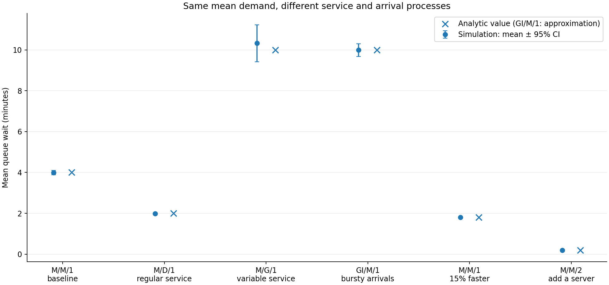
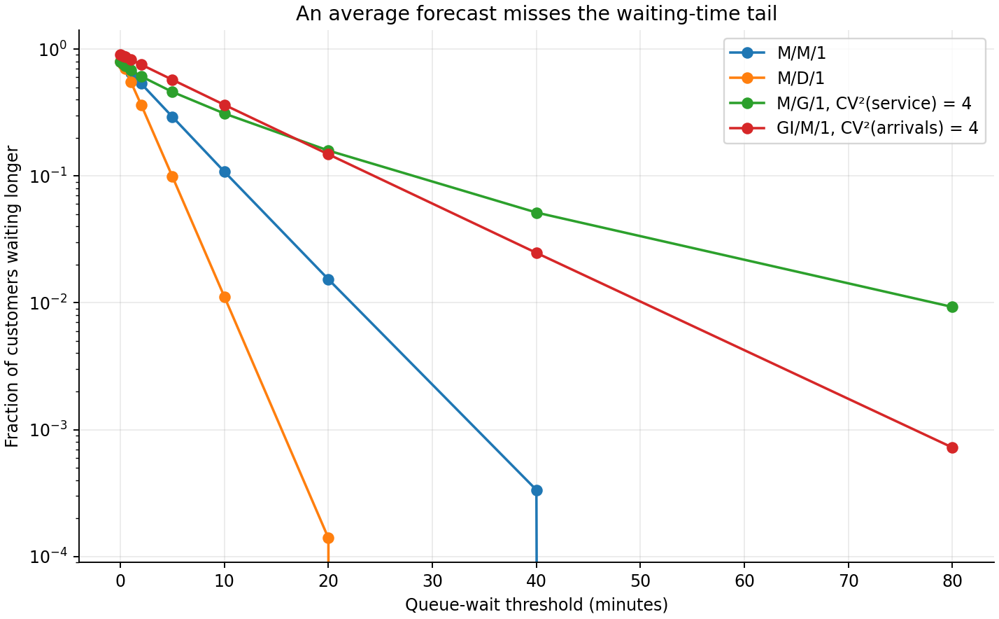
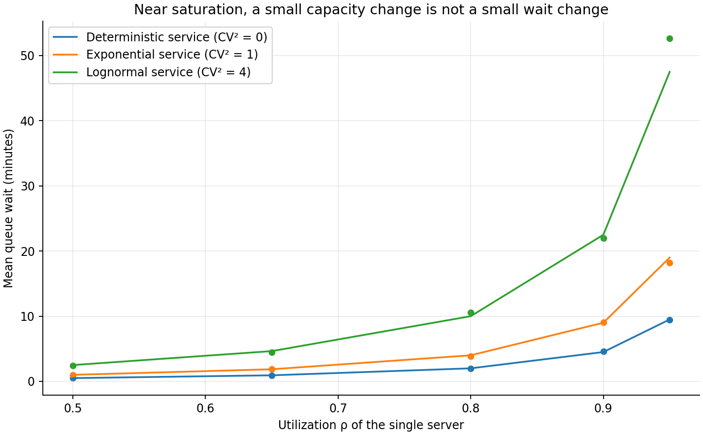
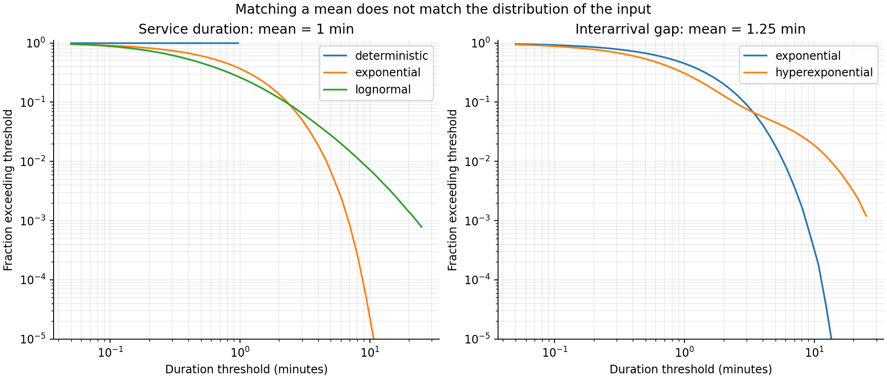
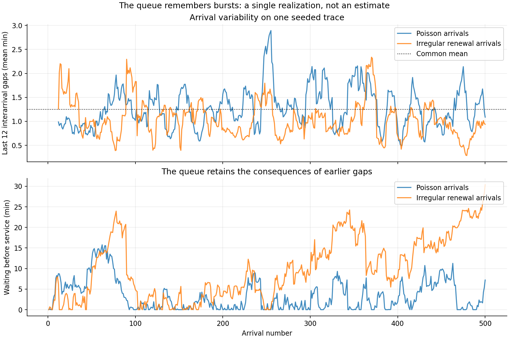
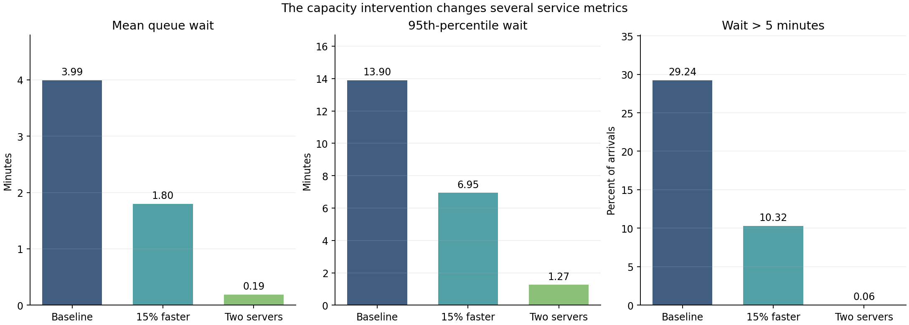
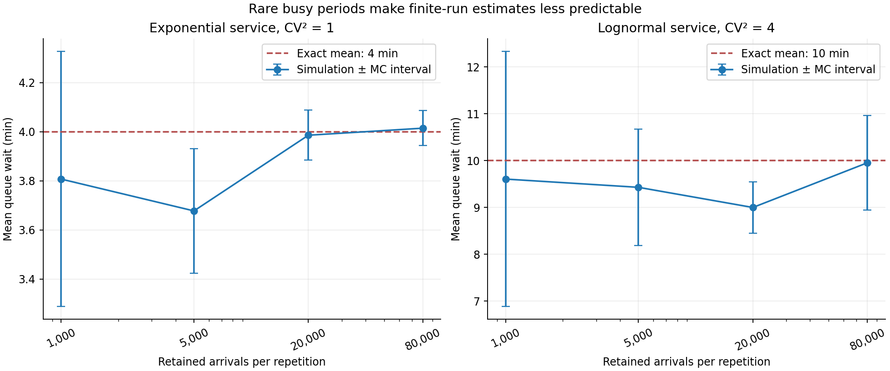

# The Queue Behind the Forecast: Why Good Demand Predictions Still Produce Bad Waiting-Time Decisions

*Queueing theory for data scientists, measured rather than illustrated: six controlled service systems, exact and approximate queueing formulas, sixteen independent simulation runs per system, and the difference between predicting work and predicting delay.*

A forecast says that a service receives forty-eight requests per hour. Its mean service time is one minute, so a server can complete sixty requests per hour. Demand is below capacity. A forecasting model might produce that estimate with very little error, and an operational dashboard might display utilization at a reassuring 80%.

What the dashboard cannot tell us is how long the forty-eighth request will wait.

That depends on when the requests arrive, how variable their durations are, whether work can be handled in parallel, what is already waiting, and whether the system has recovered from the previous busy period. A queue is a dynamic object, not a ratio between two averages. The 80% utilization number is important, but it does not determine the waiting-time distribution.

In a reproducible experiment, I give six queues the same mean arrival rate. Most also have the same mean service time. With one server and Poisson arrivals, deterministic service produces a simulated mean queue wait of 1.984 minutes, exponential service 3.993 minutes, and lognormal service with a squared coefficient of variation of four produces 10.322 minutes. The last system has a 95th-percentile wait of 41.638 minutes. Nothing in the mean demand forecast distinguishes those three situations.

Another queue uses the same mean arrival rate and mean service duration but makes arrivals more irregular. Its mean wait is 9.990 minutes, close to the variable-service case, while the probability of waiting more than five minutes differs sharply: 57.3% for irregular arrivals versus 46.0% for variable service. Two queues can agree about average delay and disagree about the operational experience that matters to customers.

These are not measurements from an actual retailer, hospital, cloud service or transport operator. They are estimates from a controlled synthetic system whose mechanism is specified. The exact stationary results are known for several configurations, which makes it possible to check the simulator rather than ask readers to trust plausible-looking numbers. The experiment, figures, notebook and tests are in [queueing-theory-for-data-scientists](https://github.com/DiogoRibeiro7/Medium-Blog/tree/main/queueing-theory-for-data-scientists) in my Medium-Blog repository. The numerical claims in this article come from the committed full-run output, not from an illustrative calculation made after seeing the plots.

Queueing theory is sometimes treated as an old branch of operational research that data scientists can replace with sufficiently flexible regressors. That division is unhelpful. A forecasting model estimates a stochastic input process. A queueing model explains how the input meets a service mechanism and produces congestion. Simulation connects the two when closed-form mathematics no longer describes the system we have. My question here is not whether classical theory or machine learning should win. It is which quantities each of them can actually identify.

## What is being predicted?

It helps to name the objects before choosing an algorithm. An arrival is a request for service, not necessarily a completed transaction. A service time is the amount of server work required after service starts. A queue wait is the time between arrival and the start of service. System time, sometimes called response time or sojourn time, adds service duration to waiting. Queue length counts people or jobs waiting; system population includes those currently in service.

Let \(\lambda\) be the average arrival intensity in jobs per minute, let \(S\) be service duration, and suppose there are \(c\) identical servers. A basic capacity indicator is

\[
\rho=\frac{\lambda E[S]}{c}.
\]

For a single server, \(\rho\) is the mean amount of work arriving per minute expressed as a fraction of the minute the server could provide. For multiple identical servers, it is offered load divided by the number of servers. This is not a probability that any arbitrary customer waits. It is also not the fraction of time every server is simultaneously busy. Those distinctions matter when a dashboard uses one label, *utilization*, for several quantities.

The familiar \(M/M/1\) notation describes Poisson arrivals, exponential service and one server. Kendall's notation can be extended to \(GI/G/c\): independent, identically distributed renewal interarrival times; a general service-time distribution; and \(c\) servers. The number of waiting positions, the service discipline, abandonment, customer classes and feedback can be included by further extensions. Kendall's work on embedded chains explains why one should not assume the entire system remains Markovian when arbitrary service distributions are introduced.

The experiment uses first-come-first-served service, unlimited waiting space and no abandonment. These restrictions are not incidental details. If requests can time out, retry, overtake, abandon, or be routed to specialist servers, the stochastic object changes. A cloud endpoint that drops requests at the admission controller is not the same queue as a serverless process that accepts work indefinitely and completes it late. A public service office that closes while people are still waiting cannot be represented honestly by a perpetual stationary queue without discussing what happens at closing.

Even at this simple level, the connection to data science is immediate. Time-stamped arrival records estimate the point process that brings work. Event logs, if they capture both the start and the end of actual service, estimate \(S\). Deployment schedules provide \(c(t)\). The queueing model combines these estimates into an outcome distribution. It cannot repair missing meanings in the event log. If a column called "processing time" includes time waiting for a database connection, it may describe a nested queue rather than an independent service duration.

There are two separate empirical questions. First, what demand and service behavior does the available data support? Second, what waits follow if that behavior persists under a specified service policy? A regression from historical hourly arrivals to historical hourly mean wait may be useful for prediction under unchanged policy. It is not automatically a model of what happens if the number of servers changes, because the outcome it learned was produced by the old staffing rule.

## Little's law is powerful because it does not solve the whole problem

The first equation data scientists encounter is usually Little's law,

\[
L=\lambda W.
\]

Here \(L\) is the long-run mean number of jobs *in the system* and \(W\) is their mean system time. With a consistent definition of the queueing boundary, a corresponding relation holds for waiting jobs:

\[
L_q=\lambda W_q.
\]

It is a conservation relationship: under the appropriate stable, stationary or long-run averaging conditions, arrival flow multiplied by residence time gives average population. Little gave a general proof in 1961 and returned to its practical meaning fifty years later. It remains useful partly because it requires less detailed distributional structure than an \(M/M/1\) model.

If an operator measures an average of 3.2 requests waiting while the completed throughput is 0.8 per minute, Little's law gives a mean queue wait of four minutes, provided that the measurement window and population are consistent and the system is sufficiently stable. That is a valuable consistency check. It can detect misleading metrics when a dashboard claims an average queue of three requests and an average wait of a few seconds for the same bounded process.

But the equation does not compute \(L_q\) from \(\lambda\). It contains two unknown performance quantities. Neither the distribution of service durations nor the order in which work arrives appears explicitly. It cannot predict a 95th percentile from an arrival-rate forecast. It cannot tell a planner whether a second server is worth its cost without a model for the queue population under that new policy.

In the three Poisson-arrival, single-server cases of the experiment, exact theory gives mean waits of two, four and ten minutes. Applying Little's law to those theoretical means gives corresponding expected queue populations of 1.6, 3.2 and 8.0 jobs. The same 0.8 arrivals per minute generate very different amounts of waiting work. Little's law remains true in all three. It does not make the cases equivalent.

One implementation error is to mix \(W\), which includes service, with \(W_q\), which excludes it. In the baseline \(M/M/1\) example, exact mean queue wait is four minutes, but mean time in the system is five. The expected number waiting is 3.2; the expected number in the system is 4.0. A dashboard that labels the five-minute total "queue wait" misstates the part of latency that extra staffing might reduce.

There is a second temporal problem. Little's law is not a license to divide a momentary count by the arrival intensity of the last five minutes. The numerator may reflect work accumulated hours earlier. During a surge, the instantaneous count, interval arrivals and departures are not aligned with the eventual experience of the arrivals in that interval. A transient queue needs a transient accounting treatment, with unfinished work and observation boundaries recorded rather than silently discarded.

## A queue is a sequence, not a row in a regression table

For a single FCFS server, the mechanics can be written without stochastic calculus. Suppose job \(n\) arrives at \(T_n\), requires service \(S_n\), and waits \(W_n\). Write \(A_{n+1}=T_{n+1}-T_n\) for the next interarrival duration. Lindley's recursion is

\[
W_{n+1}=\max\left(0,\,W_n+S_n-A_{n+1}\right).
\]

It explains most of the phenomena that a mean-based dashboard conceals. An arrival soon after another can inherit unfinished work. A long service creates a backlog that subsequent jobs may experience even if their own service needs are tiny. A quiet interval lets the system drain. The waiting time of a job is a function of earlier arrivals and earlier service durations, not just its characteristics or the hour of the day.

Consider three jobs arriving at 0, 0.5 and 1 minute, each taking one minute of service. With one server, their waits are 0, 0.5 and 1 minute. With two identical available servers, all three start immediately: the first begins at zero, the second at 0.5, and by the third arrival the first server is free. The companion notebook calculates those waits directly. No statistical fitting is needed because the arrival and service traces, capacity and discipline are known.

What if the average arrival rate and average service time are known but the exact traces are hidden? Then prediction becomes a problem of distributions. The recursion propagates the fluctuations of one process into the state of another. An average is no longer enough to reconstruct what the max operator will do. Generally,

\[
E[\max(0,X)]\ne\max(0,E[X]).
\]

Replacing an uncertain backlog increment with its expectation removes precisely the positive excursions that cause queues. The negative excursions cannot cancel all positive ones because the queue is reflected at zero; idle capacity cannot be stored indefinitely and used to serve yesterday's jobs.

This asymmetry is one reason average-capacity planning fails at high utilization. When demand falls below available service for an hour, the server may become idle. Its spare capacity is lost. When demand exceeds service for an hour, the excess work remains and increases future delays. Two hours whose workload deviations sum to zero need not leave customers with zero waiting-time cost.

A point-process formulation also clarifies what Poisson arrivals mean. In a homogeneous Poisson process, interarrival times are iid exponential, with squared coefficient of variation one. Increments over nonoverlapping intervals are independent and expected counts scale with interval length. Many real arrival processes are time-varying, clustered, scheduled or driven by feedback. Their average intensity can be estimated well while the homogeneous Poisson assumption remains false. Brown and colleagues' analysis of an actual telephone call center makes this decomposition of arrivals, service durations and customer patience an empirical programme, not just a textbook exercise.

Wolff's "Poisson arrivals see time averages" result describes a useful relation between what arrivals observe and what the system experiences over time under a nonanticipation condition. It is not a universal property of bursty arrivals or customers whose arrival decisions depend on queue length. If arrivals avoid a visible long queue, the arrivals that actually join may observe systematically different conditions from an observer sampling time uniformly. That distinction matters when one estimates waiting from customer records alone.

## The second moment of service is part of the answer

For a stationary \(M/G/1\) queue with a Poisson arrival process, iid service times independent of arrivals, FCFS and \(\rho=\lambda E[S]<1\), the Pollaczek–Khinchine formula gives the exact mean wait *before* service:

\[
E[W_q]
=\frac{\lambda E[S^2]}{2(1-\rho)}
=\frac{\lambda E[S]^2(1+c_s^2)}{2(1-\rho)},
\]

where \(c_s^2=\operatorname{Var}(S)/E[S]^2\) is the squared coefficient of variation of service durations.

This is the first formula in the article that predicts a queue performance measure from input assumptions. Its denominator reflects proximity to saturation; its numerator includes the second moment of the service distribution. Fixing the mean arrival rate and mean service time therefore does not fix mean waiting time. The shape of the service distribution matters even before we consider percentiles.

For the experiment, \(\lambda=0.8\) and \(E[S]=1\) minute, so \(\rho=0.8\). With deterministic service, \(c_s^2=0\) and the exact mean queue wait is two minutes. With exponential service, \(c_s^2=1\), so the wait is four. With lognormal service calibrated to the same mean but \(c_s^2=4\), it is ten. The arrival forecast, throughput capacity and mean service time are unchanged.

Why does the second moment enter? Arrivals are more likely to land during a long job than during a short one. Conditional on finding the server busy, the remaining service duration is affected by the length-biased sampling of service intervals. A service process dominated by short tasks but occasionally interrupted by a much longer task creates a residual workload disproportionate to its mean. Every subsequent arrival during that long task can also inherit the backlog it creates.

This does not mean that all "heavy-tailed" distributions can be substituted into the formula without qualification. The experiment's lognormal service times have a finite second moment and a known squared CV of four. The lognormal tail is substantial on the time scale of this experiment, but it is not an infinite-variance distribution. If \(E[S^2]\) is infinite under the same classical assumptions, the formula implies an infinite stationary mean queue wait even when mean offered load remains below capacity. A model based on an average service duration would conceal that possibility entirely.

The exact expectation also does not specify the complete waiting-time distribution for an arbitrary service law. Two distributions with the same first two moments have the same \(M/G/1\) mean wait under these assumptions but can differ in their waiting-time tails. There is no reason to interpret an exact mean formula as an exact quantile model. This limitation will become visible again when the bursty-arrival queue is compared with the lognormal-service queue.

There is a practical inference issue here. Service records often contain completed jobs only. If a window ends while unusually long tasks are still in progress, treating those unfinished durations as complete or excluding them can bias estimates of both the mean and the second moment. When the scientific question is queue performance, truncation and censoring of task durations are not small housekeeping details. They can remove the observations with the greatest influence on the expected residual work.

## The controlled experiment

I use a single FCFS event simulator rather than one simulator for each queue type. It receives sorted arrival times, service durations and a number of servers. It gives every incoming job the earliest feasible service start, using a scalar next-free time for one server and a heap of next-free times for multiple servers. There are no priorities, timeouts, reneging customers or preemption. The same code path handles deterministic, exponential and lognormal service.

The baseline arrival intensity is 0.8 per minute, equivalent to 48 requests per hour. The mean service time is one minute. In the first four scenarios there is one server, so mean offered load is 80% of capacity. Three scenarios use independent exponential interarrivals. Their service distributions are deterministic, exponential or lognormal. The lognormal is parameterized with

\[
\sigma^2=\log(5),\qquad
\mu_{\log S}=-\frac{\sigma^2}{2},
\]

which gives \(E[S]=1\) and \(c_s^2=e^{\sigma^2}-1=4\) when time is measured in minutes.

The fourth scenario keeps exponential service but changes the arrivals to an iid two-phase hyperexponential renewal process. Its average interarrival time is 1.25 minutes, the same as the Poisson cases, but its squared coefficient of variation is four rather than one. Short gaps become more frequent, with longer quiet gaps compensating to preserve the mean. This is a deliberately simple example of irregular or *bursty* arrivals. It has no serial correlation, common shocks or changing intraday intensity, so it should not be mistaken for a realistic clustered event stream.

Two policy variations complete the comparison. One keeps the single-server exponential queue but reduces mean service duration by 15%, to 0.85 minutes. The other keeps the original one-minute exponential service and adds a second identical server. They answer distinct questions: what follows from improving the time needed for each task, and what follows from allowing more tasks to be worked on in parallel?

The published run uses sixteen independent repetitions for each scenario. Every repetition starts with an empty system, simulates 12,000 warm-up arrivals, then records 60,000 arrivals. Poisson-arrival scenarios share the same arrival trace within each repetition, and exponential-service scenarios reuse a common service random stream scaled to their specified mean. This makes some comparisons less sensitive to incidental differences in which customers happened to arrive, while repetitions remain independent through their seed streams. The seed, 20261029, and the complete generator are in the companion Python script.

For each repetition I calculate mean queue wait, the 95th percentile, and the fraction of jobs whose queue wait exceeds five minutes. I average these estimates across repetitions. For the mean I also report an approximate 95% Monte Carlo interval using 1.96 times the standard error across repetition means. It describes numerical uncertainty under the assumed simulator; it does not represent uncertainty about the model, an unknown arrival process, or the service practices of a real organization. The percentile and threshold estimates in the table are averages across repetitions, not confidence intervals.

The experiment has a second component: a sweep of single-server utilization from 50% to 95%, for deterministic, exponential and lognormal service. The arrival rate changes while mean service remains one minute. Longer warm-up and measurement runs are used near saturation because queues that start empty can take a long time to resemble stationary queues. The precise sample sizes and raw estimates are recorded in the sensitivity CSV, rather than hidden behind a smooth chart.

## Same average input, very different waiting times

Here is the central comparison. All scenarios receive 0.8 jobs per minute on average. The first four have identical mean service of one minute and one server. Mean queue waits are in minutes; the final column is the simulated fraction waiting longer than five minutes.

| Queue | Utilization per server | Formula benchmark | Simulated mean [approx. 95% MC interval] | Simulated p95 | P(wait > 5 min) |
| --- | ---: | ---: | ---: | ---: | ---: |
| M/M/1 — exponential service | 0.80 | 4.000 exact | 3.993 [3.893, 4.093] | 13.901 | 29.2% |
| M/D/1 — fixed service | 0.80 | 2.000 exact | 1.984 [1.957, 2.011] | 6.591 | 9.9% |
| M/G/1 — lognormal service, CV² = 4 | 0.80 | 10.000 exact | 10.322 [9.412, 11.232] | 41.638 | 46.0% |
| GI/M/1 — hyperexponential interarrivals, CV² = 4 | 0.80 | 10.000 approximate | 9.990 [9.681, 10.300] | 32.036 | 57.3% |
| M/M/1 — mean service 15% faster | 0.68 | 1.806 exact | 1.801 [1.777, 1.825] | 6.950 | 10.3% |
| M/M/2 — two servers | 0.40 | 0.190 exact | 0.191 [0.189, 0.193] | 1.267 | about 0.1% |

The first three theoretical values are exact Pollaczek–Khinchine stationary means. The two-server value uses the exact Erlang-C model for M/M/2. The benchmark for the hyperexponential-arrival queue is Kingman's heavy-traffic approximation, not an exact equality. It happens to agree closely with this simulation; the experiment does not prove it will work equally well for other renewal distributions, utilizations or dependence structures.

*Figure 1. The same mean arrival rate produces queue waits ranging from a fraction of a minute to about ten minutes. Dots are simulation means, bars are approximate 95% Monte Carlo intervals across independent repetitions, and crosses are analytical benchmarks. Only the GI/M/1 cross is an approximation; the others are exact stationary results under the respective model assumptions.*

The comparison does more than show that adding a server helps. With no change to server count, average demand, or mean service time, changing only service variation increases expected wait by a factor of five between deterministic and high-variance lognormal service. The change is not in how much work exists on average. It is in how work is distributed across jobs and therefore in the unfinished work inherited by later arrivals.

The uncertainty bars also tell a useful story. For the lognormal-service queue, the sample mean of the sixteen repetitions is 10.322 and the estimated interval is [9.412, 11.232], much wider than the interval around the deterministic-service mean. Rare long service jobs create long busy periods and correlated waiting times. A million observed jobs do not behave like a million independent wait measurements. That is why the interval uses repetitions as the units of uncertainty rather than pretending each waiting time is independent.

For comparison, the baseline M/M/1 formula gives an exact waiting-time mean of four minutes, and the simulation produces 3.993. The close match is not itself a discovery: it is a validation checkpoint. The event logic, time units, warm-up, and mean-versus-queue definitions should reproduce a model whose solution is known before the code is trusted for cases without an exact formula.

## An average is not a service-level target

Suppose a service manager promises that most customers will begin service within five minutes. A forecast of mean waiting time is not sufficient to judge that commitment. The relevant quantity is a probability such as \(P(W_q>5)\), or a high quantile of \(W_q\). It is possible to reduce mean waiting while the risk of a smaller threshold behaves differently, especially when comparing different stochastic mechanisms.

The M/M/1 case offers an unusually transparent benchmark. In its stationary regime, queue wait has a point mass at zero: a proportion \(1-\rho\) of arriving jobs begins service without waiting. For positive \(t\),

\[
P(W_q>t)=\rho\,e^{-(\mu-\lambda)t},
\]

where the service rate is \(\mu=1/E[S]\). With \(\lambda=0.8\), \(\mu=1\), and \(t=5\) minutes, the exact exceedance probability is approximately 29.4%. The simulated value is 29.2%. The exact 95th percentile solves \(P(W_q>t)=0.05\), giving approximately 13.86 minutes; the simulated average of sample 95th percentiles is 13.901.

Now compare the two scenarios with mean waits near ten minutes. The high-variance-service queue has a simulated 95th percentile of 41.638 minutes and 46.0% of jobs wait beyond five minutes. The irregular-arrival queue has a *smaller* 95th percentile, 32.036 minutes, but a *larger* fraction above five minutes, 57.3%. One has a heavier far tail over the sampled range, while the other exposes more arrivals to moderate delays. Which is preferable depends on the service-level definition.

*Figure 3. Empirical exceedance curves from the full simulation, with a logarithmic vertical axis. The curves are not identical even when their mean waits are similar. The lognormal-service case dominates part of the far tail while the irregular-arrival case produces more moderate waits. Values are simulated probabilities, not analytically guaranteed tail formulas.*

The curves cross because an expectation integrates behavior over the entire distribution, while a threshold measures one part of it. Minimizing expected delay can be a sensible objective, but it does not automatically minimize the fraction beyond every conceivable deadline. A hospital triage queue, a background compute job, and a synchronous public API may have radically different loss functions for a five-minute wait and a forty-minute wait.

In data science terms, mean absolute forecast error on arrival counts is a proxy objective. The operational objective might be a service-level violation, abandonment probability, deadline miss, backlog carried into the next shift, or a cost-weighted sum. A demand model can dominate a benchmark on mean absolute error and still support a worse staffing decision if the errors occur at the wrong times or if it fails to represent variability relevant to congestion.

The table gives no grounds for declaring the lognormal-service process universally worse than the bursty-arrival process. The experiment defines specific distributions with equal first moments and a chosen squared CV. It does not establish stochastic ordering across all possible time thresholds, nor does it include differences in priority or the consequences of a waiting customer leaving the system.

## The nonlinear cliff near saturation

The denominator \(1-\rho\) in the M/G/1 formula is the source of a feature operational managers recognize but averages obscure. Waiting time does not increase linearly with utilization. For a stable M/M/1 queue with service rate \(\mu\),

\[
E[W_q]=\frac{\rho}{\mu-\lambda}
=\frac{\rho\,E[S]}{1-\rho}.
\]

With mean service of one minute, expected queue wait is one minute at \(\rho=0.5\), four minutes at \(\rho=0.8\), nine minutes at \(\rho=0.9\), and nineteen at \(\rho=0.95\). Raising utilization from 90% to 95% increases offered load by only five percentage points but more than doubles expected waiting. The uncommitted 5% is not a trivial inefficiency; it is the remaining capacity that allows a random backlog to drain.

At each utilization the service-time variance multiplies this effect. Pollaczek–Khinchine gives the following exact means for the three service distributions used in the sensitivity experiment:

| Single-server utilization | Deterministic service | Exponential service | Lognormal service, CV² = 4 |
| ---: | ---: | ---: | ---: |
| 50% | 0.5 min | 1.0 min | 2.5 min |
| 65% | 0.929 min | 1.857 min | 4.643 min |
| 80% | 2.0 min | 4.0 min | 10.0 min |
| 90% | 4.5 min | 9.0 min | 22.5 min |
| 95% | 9.5 min | 19.0 min | 47.5 min |

*Figure 2. Lines are exact stationary means for M/D/1, M/M/1 and the specified M/G/1; dots are simulated means. At high utilization, long convergence times and rare large backlogs make finite simulation runs noisier. The full sensitivity CSV includes between-repetition intervals.*

The 95%-utilization sweep illustrates a methodological warning as well as an operational one. For exponential service, eight longer simulation repetitions give a mean of 18.227 minutes against the exact value nineteen. For lognormal service, they give 52.656 against 47.5; the approximate Monte Carlo interval is [47.103, 58.209]. Those differences are not evidence that an exact identity has failed. They reflect the finite sample, startup behavior and high variability of the simulated queue. A system with very high utilization can spend a long time in one busy period, so more arrivals within that period are not equivalent to more independent experiments.

Near \(\rho=1\), the stationary model itself is also fragile. If the arrival and service processes satisfy the stated assumptions, \(\rho<1\) is the basic stability condition for this single-server queue. But a real service may experience daily rates that temporarily exceed capacity even if its weekly mean is less than capacity. A one-day backlog may survive into the next day; abandonment or operating hours may prevent a stationary distribution from being observed; customer behavior may change when the queue becomes visible. A fitted \(\rho=0.99\) is not automatically a safe estimate simply because it is below one.

This is an important distinction between mathematical instability and poor service. A queue can be positive recurrent and still have an unacceptable tail of waiting times. The question "Will it eventually clear?" is different from "How often will somebody wait half an hour?" A data scientist reporting stability as evidence of adequate capacity has answered the first question and left the second unanswered.

## Capacity changes the mechanism, not just the fitted coefficient

The two policy scenarios make the distinction between prediction and decision concrete. Consider first a 15% reduction in mean service duration. In the exponential case the service mean changes from one minute to 0.85 minutes. With the same arrival intensity, single-server utilization falls from 0.80 to 0.68. The exact M/M/1 mean wait falls from four minutes to 1.806. The full simulation gives 1.801 minutes. A 15% speed improvement therefore reduces queue waiting by about 55%, not 15%.

The effect on system time is different. The baseline exact mean system time is five minutes: four waiting plus one in service. With faster service it is approximately 2.656 minutes: 1.806 waiting plus 0.85 in service. Both components decline, but the relative change in system time is smaller than the relative change in queue wait. If an organization reports end-to-end latency, its percentage improvement will be different from an organization that reports delay before service begins.

The second policy makes two servers available with exponential one-minute service. The offered load is still 0.8 server-minutes of work per minute, but divided across two servers the utilization per server becomes 0.40. Erlang C gives the probability that an arrival must wait and, conditional on waiting, an exponential positive wait. For this example the exact mean queue wait is \(4/21\), approximately 0.1905 minutes. The simulation gives 0.191 minutes, with an average 95th percentile of 1.267 minutes.

One could conclude that the second server solves the problem. That would be a decision without an economic model. A second full-time server is not free. A 15% improvement in service duration may require a capital investment, software engineering, staff training or a change in task definition. A server shared across request classes may have a different effective service distribution. A system can also pool several queues into one shared waiting line, which is not equivalent to maintaining separate one-server lines with equal average work.

The appropriate comparison is a policy-dependent objective. For example, define a cost per minute of customer waiting, a cost of labor or machine capacity, a penalty for missing a deadline and perhaps a fixed cost for enabling an additional service channel. Then calculate the expected cost, or a chosen risk measure, under each policy. The simple experiment establishes the waiting-time consequences of well-defined policies; it does not rank those policies economically because no staffing cost or penalty function was supplied.

In many-server systems, the relationship between server count, offered load and delay has its own structure. The Halfin–Whitt heavy-traffic regime, studied for many exponential servers, shows why staffing cannot be reasoned about by scaling the one-server formula mechanically. Ward Whitt's later GI/G/m approximations address general arrival and service variability in multiple-server settings. Those are better starting points for a large service operation than asserting that the exact M/G/1 result applies after replacing \(1-\rho\) by \(1-\rho/c\).

## Approximations are models with boundaries

The hyperexponential-arrival scenario cannot use Pollaczek–Khinchine as if it had Poisson arrivals. It is a GI/M/1 queue, not M/G/1. An often useful estimate for a GI/G/1 queue is Kingman's heavy-traffic approximation,

\[
E[W_q]\approx
\frac{\rho}{1-\rho}
\frac{c_a^2+c_s^2}{2}E[S],
\]

where \(c_a^2\) is the squared coefficient of variation of interarrival times and \(c_s^2\) is the equivalent quantity for service. This expression separates utilization from two sources of variability. It is especially informative near saturation, but its approximation symbol is important. It is not an exact identity for arbitrary renewal arrivals and service distributions. Kingman's original heavy-traffic work gives a mathematical account of why such approximations can emerge in a limiting regime, not a guarantee of small error for every finite queue.

For the irregular-arrival experiment, \(c_a^2=4\), \(c_s^2=1\), \(E[S]=1\), and \(\rho=0.8\), so the approximation gives ten minutes. The simulated mean is 9.990. That agreement is encouraging for this controlled case. It should be checked across different arrival distributions, parameter values and sample lengths before relying on it as a general production rule. In particular, a process with serially correlated arrivals can have the same interarrival mean and variance as an iid renewal process but a quite different congestion profile.

The balanced two-phase hyperexponential construction is useful because its theoretical moments are transparent. Let \(p=(1+\sqrt{0.6})/2\). With probability \(p\), draw an interarrival time at rate \(2p\lambda\); otherwise draw it at rate \(2(1-p)\lambda\). This mixture has mean \(1/\lambda\) and squared CV four. It has no hidden calendar component. A data scientist can reproduce the discrepancy from the Poisson arrival model without relying on unspecified shocks or an external dataset.

*Figure 4. Empirical survival probabilities for 200,000 independently sampled input durations per distribution. The service distributions on the left all have one-minute means; the arrival-gap distributions on the right both have 1.25-minute means. The deterministic service curve drops to zero at one minute. The logarithmic scale shows why matching the mean does not match the probability of a long job or a long gap. These are input distributions, not waiting-time outcomes.*

For the service distributions, the long tail of the lognormal input eventually dominates the exponential even though the exponential gives more observations above some intermediate thresholds. For interarrival gaps, the hyperexponential process produces both very short and much longer gaps than a Poisson process with the same mean. These contrasts are already visible before any work reaches the server. The queue then transforms them into the waiting-time distributions shown earlier. The input sampling is generated independently of the main waiting-time replications and has its own committed table, so the figure can be checked without reverse-engineering a plot.

One should distinguish this sort of engineering approximation from a simulation whose structure is itself incorrect. A million simulations of Poisson arrivals do not reveal how a calendar-driven burst changes waiting, if no burst mechanism is present in the input process. Increasing Monte Carlo repetitions reduces random variation around the assumptions that were coded. It does not correct a missing process, an incorrectly defined service time, or a staffing intervention that affects arrivals through customer behavior. The same distinction appears in the queueing-network literature, where approximation methods are evaluated against models whose full exact solutions are difficult to calculate; a fast estimator remains conditional on its input and network assumptions.

Approximations are valuable precisely because exact solutions are scarce outside carefully specified model classes. An analyst should therefore report which components are exact, approximate, simulated, estimated from data or imposed by a policy assumption. Mixing them into a single confident number prevents an operational user from understanding where the uncertainty originates. In the present experiment the input parameters are known by construction, the M/G/1 and M/M/2 means are exact under their assumptions, Kingman's value is approximate, and the simulation results are finite-run estimates.

## Methods in plain English: from event logs to a queueing study

In an actual organization I would start with a data contract rather than with Erlang C or a neural network. The contract needs a unique job identifier, an arrival timestamp at the chosen queue boundary, the service-start timestamp, the service-end timestamp, any abandonment or timeout timestamp, the resource that served the job, and a description of the service policy. Timezones, retries and missing events must be interpreted consistently. A line in a database is not necessarily an independent customer; a customer can attempt the same action repeatedly.

The first analysis would reconstruct the event timeline and account for the observation window. How many jobs arrived, started service, completed, abandoned or remained unfinished? How many arrived before the window but were still in the queue when it opened? If a task entered a different service subsystem, did the primary clock stop or continue? These questions determine the denominator of any service-level estimate. Counting only completed jobs in the outcome dataset can make a worsening queue appear faster, because the longest waits have not yet completed.

*Figure 5. A single fixed-seed trace of 500 jobs under Poisson and hyperexponential-renewal arrivals. Both use exactly the same sequence of exponential service requirements. The upper panel is a rolling average of the last twelve interarrival gaps; the lower panel is the actual FCFS waiting time by arrival number. One realization is a mechanism illustration, not an estimator of either scenario's mean or tail.*

The lower panel illustrates why the event history is indispensable. A period of short gaps can create a backlog that survives many subsequent arrivals. A later gap above the common average does not instantly cancel all accumulated waiting. In the irregular-arrival trace the waiting time rises well beyond twenty minutes during a busy stretch, while the Poisson trace may already have recovered. This is not evidence that *every* irregular-arrival trajectory is worse: it is one reproducible realization chosen before examining outcomes. The multi-replication results, not this trace, support the quantitative comparison.

Next I would examine arrival counts at several temporal scales, not just one convenient reporting interval. Estimate the rate by hour of day, day of week, campaign, holiday and operational regime, where supported by the data. Compare count variance with count mean within reasonably homogeneous windows, inspect autocorrelation, and compare empirical interarrival distributions to the fitted process. Raw overdispersion across a whole week does not prove clustering: a nonstationary Poisson process with an accurate time-varying rate can already produce overdispersed pooled counts. Conversely, a plausible average count in a half-hour can hide a minute-long surge.

Service needs a separate investigation. Compare means, standard deviations, empirical survival curves and conditional distributions by task class, channel, worker, equipment, and time. A service-time model that is appropriate for one class may be inappropriate after classes are pooled. If long tasks block short tasks in a single FCFS line, the mix of classes matters even when class-specific arrivals are forecast accurately. If priority scheduling or preemption is used, it should be encoded rather than silently averaged away.

Then I would establish an elementary baseline. Fit a homogeneous M/M/1 or M/M/c only to periods where its assumptions are at least plausible; compare observed waiting means, zero-wait fractions and quantiles to the formula; and perform out-of-sample validation. If the fit is poor, that is information. It may indicate time-varying rates, variability beyond exponential service, non-FCFS handling, abandonment or bad event definitions. Simpler queueing formulas are useful diagnostics when they are not treated as articles of faith.

For the counterfactual analysis, I would replay or simulate the same eligible arrival workload under alternative staffing or service policies. This should be accompanied by uncertainty in the inferred arrival and service processes, not only random seeds within a fixed fitted world. If demand depends on waiting experience, the replay must also model the behavioral feedback or restrict the claim to a short, plausible horizon. A contact centre with abandoned calls and customer redials is especially instructive: the number of offered calls is not necessarily the number of distinct people who initially wanted service.

## Where machine learning helps, and where it cannot substitute for the queue

Data science has several useful entry points. A time-series model can predict a distribution of future arrival rates, conditional on calendar variables and observed recent traffic. A probabilistic service model can estimate task-duration distributions by class or context. A classifier or survival model can estimate customer patience, including censoring when a customer receives service before abandoning. A model of staffing availability can account for absences, breaks, shift changes and equipment failures. These components can feed a simulator or an analytical approximation.

Their targets should remain separate. Predicting the next interval's count answers how much new work is likely to appear. Predicting the waiting time of a new job answers what that work, the existing backlog and available capacity will do together. One can train a direct waiting-time predictor on queue state, recent arrivals, service duration patterns and staffing. That may provide excellent short-horizon predictions under a fixed operating policy. But direct predictive performance under the historical policy is not by itself an estimate of what a new staffing plan will cause.

Consider a model trained on one year of observations from a service with six workers. It learns that on days with eight hundred calls, mean wait is high. A planner then asks what would happen with eight workers. If staffing had historically been increased on unusually difficult days, the historical association between staffing and waiting could even be positive: more workers appear alongside worse queues because managers reacted to congestion. The model needs a causal or structural account of the intervention to separate the response to congestion from the effect of adding capacity.

Forecast evaluation should follow the same discipline. A forecasting model's absolute error or log score is relevant, but the score used for model selection should connect to the decision. Suppose the cost of one extra worker is fixed while the cost of a missed service-level threshold rises rapidly near saturation. A model that is slightly worse on average arrival prediction but better calibrated in the upper tail might lead to better staffing. The comparison should be made by passing alternative forecast distributions through the *same* verified decision simulator and scoring policy outcomes on held-out periods.

The validation split matters. Randomly assigning rows from the same business day to training and testing can leak the day's shock or operating conditions. Time-based splits, grouped by day or other regime, are more defensible for forward decisions. Delayed outcomes must be handled correctly: an arrival near the end of the observation period may not yet have its waiting-time outcome. When using a model to choose workers for the following week, both demand forecasts and queue outcomes should be evaluated as of information available when the decision was made.

There is also a nested-queue problem in computing systems. A request may pass through an API gateway, a CPU worker pool, a database connection pool and an external service. The latency at the gateway can be dominated by a downstream queue whose occupancy is not visible in gateway-level arrival counts. A direct model may predict that latency under observed load, but an intervention on only one component can move the bottleneck elsewhere. Queueing networks and mechanistic simulation are tools for making that topology explicit; they should be combined with measurements, not used in place of them.

## From a prediction to a defensible decision

A service-level model becomes useful when it can compare policies with a defined outcome. Let \(\pi\) represent a staffing or routing policy, \(C_{\text{capacity}}(\pi)\) its capacity cost, and \(W_q(\pi)\) the random waiting time induced by the policy and workload process. A simple objective might be

\[
J(\pi)=C_{\text{capacity}}(\pi)
+c_w\,E[W_q(\pi)]
+c_s\,P\{W_q(\pi)>\tau\}.
\]

The coefficients and threshold are application-specific, and this expression is not an industry standard chosen for the experiment. It only makes explicit that a staffing decision depends on costs and service obligations, not on the point forecast alone. If the organization cares about the worst tail or equity across customer classes, the objective should be changed accordingly. A linear penalty on average delay is not equivalent to a quantile or risk constraint.

When comparing policies through simulation, keep the exogenous random inputs aligned where feasible. In the companion code, the Poisson-arrival configurations share arrival streams within a repetition. The faster and two-server exponential scenarios also reuse service randomness. The differences are therefore more interpretable than they would be if each policy received a completely unrelated workload. But this is a computational variance-reduction device, not a claim that a real organization can make the same customers appear under every intervention.

*Figure 6. The baseline, 15%-faster single server and two-server configurations compared on mean queue wait, 95th-percentile wait and the percentage waiting over five minutes. All values are taken from the full-study summary CSV. The panels illustrate service consequences only; no monetary cost or service-quality penalty has been assigned to either intervention.*

The three panels tell a more useful operational story than a single mean. A 15% faster server cuts simulated mean wait from 3.993 to 1.801 minutes and reduces the fraction above five minutes from about 29.2% to 10.3%. Adding a second server reduces that fraction to approximately 0.06%, but it also changes resource cost substantially. The figure gives a planner quantities that can be attached to a real objective; it does not manufacture a ranking by assuming an unobserved price for waiting or a worker's time.

Once customer behavior depends on the policy, the alignment becomes more complicated. Quicker service may reduce abandonment and redialing, increasing the number of completed requests without increasing the number of initially interested customers. Longer advertised delays may shift demand into another channel. A historical distribution of *offered calls* is then an outcome of the old system as well as an input to it. Replaying offered calls unchanged under a radically different service policy can misrepresent the counterfactual.

I have explored that distinction elsewhere in this repository. The [mechanistic-versus-data-driven-generator study](https://github.com/DiogoRibeiro7/Medium-Blog/tree/main/mechanistic-vs-data-driven-generators) uses a richer simulated contact centre with staffing decisions, abandonment and redials, while the [Anonymous Bank redial study](https://github.com/DiogoRibeiro7/Medium-Blog/tree/main/anonymous-bank-redials) examines what actual call-by-call records can say about repeated attempts. The present article is the simpler mathematical layer: it isolates how arrival and service variability alter the queue even before those feedback mechanisms are introduced.

## What the experiment does not show

The first limitation is the artificial world itself. The queues have known parameters, iid interarrival and service streams, unlimited waiting space and a fixed FCFS rule. They do not have customer classes, deadlines, failures, retrials, dynamic staffing, abandonment, priority or network interaction. No result in the comparison table estimates the waiting time of a real call centre, shop, hospital, metro station or API. The scenario labels describe a constructed experiment, not observations from one of those organizations.

The second limitation is the distinction between a benchmark and a law of nature. The Pollaczek–Khinchine formula is exact only under its specified \(M/G/1\) conditions. Erlang C has its own memoryless arrival and service assumptions. Kingman's approximation has a different status. The simulation validates its implementation on known benchmarks and shows behavior for the chosen GI/M/1 case. It cannot establish that those mathematical assumptions hold in an unobserved system.

The third is simulation uncertainty. The main results use sixteen independent repetitions, not sixteen independent sets of a million customer waits. Within a repetition, waits are strongly dependent through backlog. The reported normal-approximation Monte Carlo intervals quantify only between-repetition variation in finite-run means. They do not provide confidence intervals for estimated business parameters, do not remove start-empty bias completely, and are not guaranteed to be accurate for every heavy-tail or near-saturation regime. At 95% utilization, more warm-up and measurement were deliberately required, and measurable variation remains.

*Figure 7. A separate convergence experiment for exponential and lognormal service at 80% utilization. Each point is the mean across sixteen independent repetitions at the indicated number of retained arrivals per repetition; error bars are approximate 95% Monte Carlo intervals, and horizontal dashed lines are exact stationary mean waits. Warm-up is at least 1,000 jobs or one fifth of the retained sample length. The apparent movement of individual points is finite-run variation, not a monotonic convergence guarantee.*

The intervals narrow with longer replications, but they do so less predictably for high-variance service. At the shortest run length, a few thousand arrivals cannot reliably represent every long busy period. At longer lengths, the lognormal-service estimate approaches the exact ten-minute benchmark within its Monte Carlo interval. The figure does not quantify uncertainty in the input distribution or justify extrapolating convergence to infinite-variance models. It demonstrates why a simulation study should vary run length and number of independent replications instead of reporting only the first plausible estimate.

The fourth is that equal first and second moments do not establish a complete stochastic equivalence. The hyperexponential interarrival mixture has iid durations with squared CV four. A self-exciting process, a scheduled batch-arrival process, and an intraday Poisson rate with the same pooled moments may create very different runs of congestion. Likewise, two service distributions with identical mean and variance may produce different tail service-level outcomes. The experiment is designed to show that moments matter, not that moments are always sufficient.

The fifth is the economic interpretation. Adding a server produces a large simulated delay reduction at the chosen load, but no cost, equity, safety or institutional constraint was modeled. Faster service may alter error rates or quality. A queueing improvement can be good for one metric while transferring work to another subsystem. Without an objective and a realistic resource model, an estimate of waiting time is evidence for a decision, not the decision itself.

Finally, the direction of inference must remain clear. The simulations change model inputs and observe consequences inside a specified system. Those are valid counterfactuals *within that system*. Estimating what staffing changes would cause in an actual organization requires measurement of its mechanisms, adequate identification assumptions, and validation across operating regimes. No amount of precision in a synthetic estimate supplies those missing pieces.

## Reproducing the evidence

The companion folder contains the manuscript, the typed Python queue simulator, a narrative executable Jupyter notebook, the full CSV results, seven generated figures, tests and a path-scoped GitHub Actions workflow. Python 3.12 with the project-local requirements is sufficient; there is no organization data, external API key or downloaded private source. From the project directory:

~~~bash
python -m pip install -r requirements.txt
python -m unittest discover -s tests -v
python analysis.py
~~~

The last command recreates the full results and figures. The quick option runs substantially fewer arrivals and repetitions, writes separate filenames, and exists for development and CI smoke tests only; its noisier estimates should not be substituted for the published full-run table. The notebook provides the exact formulas, a three-job worked trace, a small experiment and the corresponding plots; CI executes it in a fresh kernel to catch broken execution order or imports.

The repository has a long historical archive, so the experiment owns its dependencies and files. It does not rename older notebooks, modify unrelated article material, or require a root-level Python environment. The full result table is [results/summary.csv](results/summary.csv), the utilization sweep is [results/sensitivity.csv](results/sensitivity.csv), and waiting-time exceedance probabilities are [results/tails.csv](results/tails.csv). Separate diagnostics record sampled [input distributions](results/input_variability.csv), an illustrative [queue trace](results/queue_trace.csv) and [Monte Carlo convergence](results/convergence.csv). All figures are generated from these numerical outputs by the same script; no numerical values are drawn by hand after the simulation.

One further reproducibility detail is worth stating. Deterministic seeds make the calculation repeatable with the supplied code and dependency versions. They do not guarantee bit-identical floating-point output across every operating system and future numerical library. The tests therefore check exact mathematical invariants, deterministic trace behavior, distribution design and executable artifacts. A scientific result should survive minor rounding differences without hiding a real change in the simulated mechanism.

## What the queue teaches the data scientist

The main result is not that waiting increases with demand. Everyone who has stood in a queue knows that. The result is that the *same accurately predicted average demand* can imply radically different waits, because demand is only one input to a stateful system. At 80% utilization, fixing service duration at one minute gives two minutes of exact mean wait; making it exponential gives four; allowing greater service variation gives ten. Moving variability into arrivals can produce nearly the same mean wait while redistributing risk across thresholds.

Queueing theory does not remove the need to estimate uncertainty. It says which uncertainty matters, how it interacts with capacity, and when a familiar formula is exact or approximate. Machine learning can improve estimation of arrivals, service needs, patience and operational regimes. But a demand forecast becomes a service prediction only when a queueing mechanism or an adequately validated direct predictor connects it to the work already waiting. It becomes a staffing decision only after the consequences and costs of alternative policies are compared.

That is a useful division of labor between statistics, stochastic processes, simulation and decision science. The data tell us what might arrive and how work might behave. The queue tells us how that work accumulates. The decision model tells us what delay is worth preventing. Confusing any one of those steps with the others produces numbers that look accurate until someone has to wait.

## References

- Baccelli, F. and Brémaud, P. (2003). *Elements of Queueing Theory: Palm Martingale Calculus and Stochastic Recurrences*, 2nd ed. Springer. [doi:10.1007/978-3-662-11657-9](https://doi.org/10.1007/978-3-662-11657-9)
- Brown, L., Gans, N., Mandelbaum, A., Sakov, A., Shen, H., Zeltyn, S. and Zhao, L. (2005). Statistical analysis of a telephone call center: A queueing-science perspective. *Journal of the American Statistical Association*, 100(469), 36–50. [doi:10.1198/016214504000001808](https://doi.org/10.1198/016214504000001808)
- Garnett, O., Mandelbaum, A. and Reiman, M. (2002). Designing a call center with impatient customers. *Manufacturing & Service Operations Management*, 4(3), 208–227. [doi:10.1287/msom.4.3.208.7753](https://doi.org/10.1287/msom.4.3.208.7753)
- Gans, N., Koole, G. and Mandelbaum, A. (2003). Telephone call centers: Tutorial, review, and research prospects. *Manufacturing & Service Operations Management*, 5(2), 79–141. [doi:10.1287/msom.5.2.79.16071](https://doi.org/10.1287/msom.5.2.79.16071)
- Green, L. V., Kolesar, P. J. and Soares, J. (2001). Improving the SIPP approach for staffing service systems that have cyclic demands. *Operations Research*, 49(4), 549–564. [doi:10.1287/opre.49.4.549.11228](https://doi.org/10.1287/opre.49.4.549.11228)
- Halfin, S. and Whitt, W. (1981). Heavy-traffic limits for queues with many exponential servers. *Operations Research*, 29(3), 567–588. [doi:10.1287/opre.29.3.567](https://doi.org/10.1287/opre.29.3.567)
- Kendall, D. G. (1951). Some problems in the theory of queues. *Journal of the Royal Statistical Society: Series B*, 13(2), 151–173. [doi:10.1111/j.2517-6161.1951.tb00080.x](https://doi.org/10.1111/j.2517-6161.1951.tb00080.x)
- Kendall, D. G. (1953). Stochastic processes occurring in the theory of queues and their analysis by the method of the imbedded Markov chain. *The Annals of Mathematical Statistics*, 24(3), 338–354. [doi:10.1214/aoms/1177728975](https://doi.org/10.1214/aoms/1177728975)
- Kingman, J. F. C. (1961). The single server queue in heavy traffic. *Mathematical Proceedings of the Cambridge Philosophical Society*, 57(4), 902–904. [doi:10.1017/S0305004100036094](https://doi.org/10.1017/S0305004100036094)
- Kingman, J. F. C. (1962). On queues in heavy traffic. *Journal of the Royal Statistical Society: Series B*, 24(2), 383–392. [doi:10.1111/j.2517-6161.1962.tb00465.x](https://doi.org/10.1111/j.2517-6161.1962.tb00465.x)
- Little, J. D. C. (1961). A proof for the queuing formula: L = λW. *Operations Research*, 9(3), 383–387. [doi:10.1287/opre.9.3.383](https://doi.org/10.1287/opre.9.3.383)
- Little, J. D. C. (2011). Little's law as viewed on its 50th anniversary. *Operations Research*, 59(3), 536–549. [doi:10.1287/opre.1110.0940](https://doi.org/10.1287/opre.1110.0940)
- Whitt, W. (1983). The Queueing Network Analyzer. *Bell System Technical Journal*, 62(9), 2779–2815. [doi:10.1002/j.1538-7305.1983.tb03204.x](https://doi.org/10.1002/j.1538-7305.1983.tb03204.x)
- Whitt, W. (1983). Performance of the Queueing Network Analyzer. *Bell System Technical Journal*, 62(9), 2817–2843. [doi:10.1002/j.1538-7305.1983.tb03205.x](https://doi.org/10.1002/j.1538-7305.1983.tb03205.x)
- Whitt, W. (1993). Approximations for the GI/G/m queue. *Production and Operations Management*, 2(2), 114–161. [doi:10.1111/j.1937-5956.1993.tb00094.x](https://doi.org/10.1111/j.1937-5956.1993.tb00094.x)
- Wolff, R. W. (1982). Poisson arrivals see time averages. *Operations Research*, 30(2), 223–231. [doi:10.1287/opre.30.2.223](https://doi.org/10.1287/opre.30.2.223)

