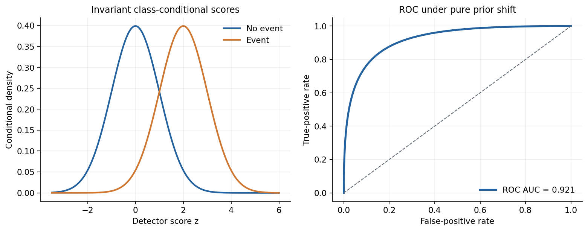
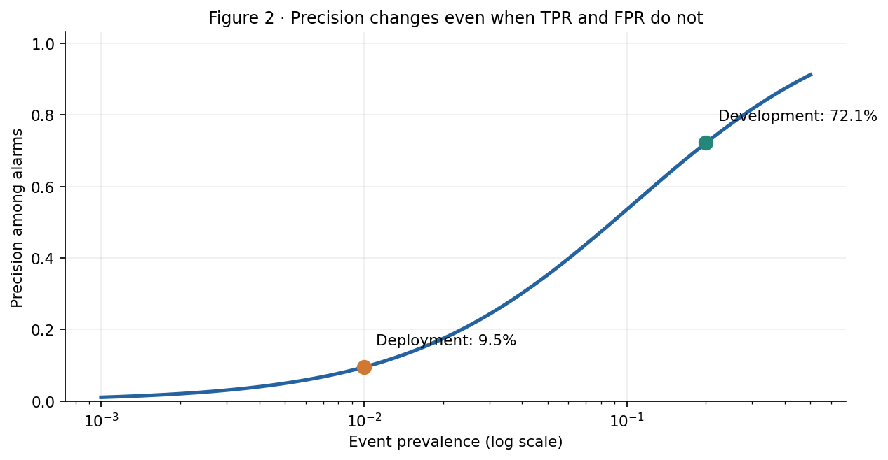
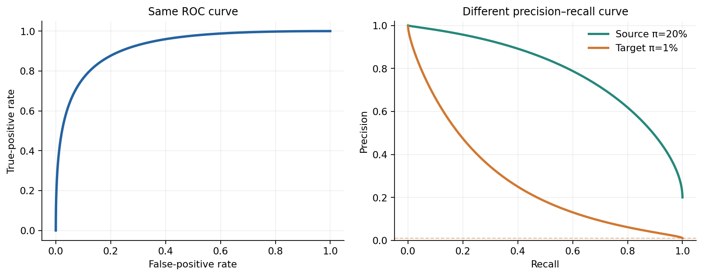
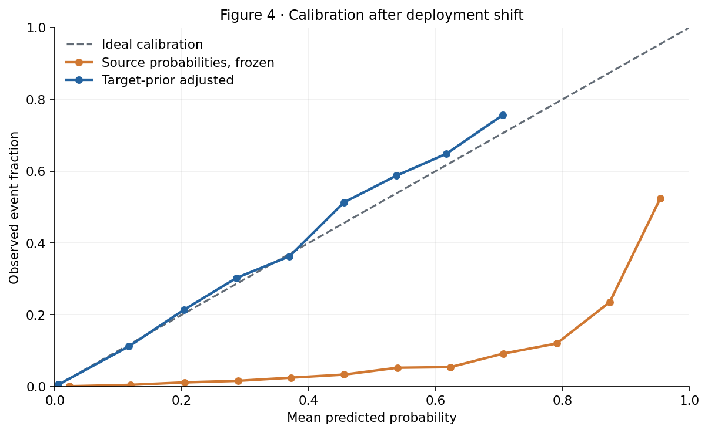
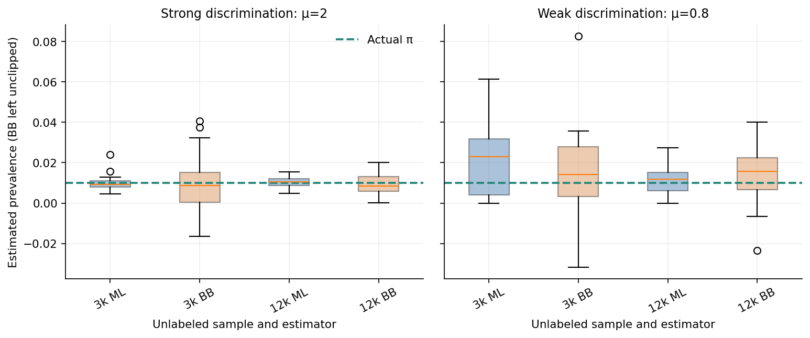
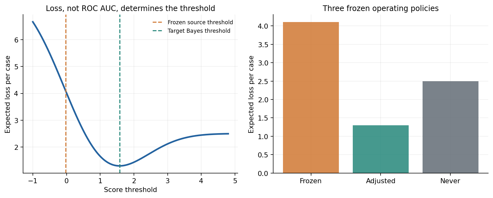
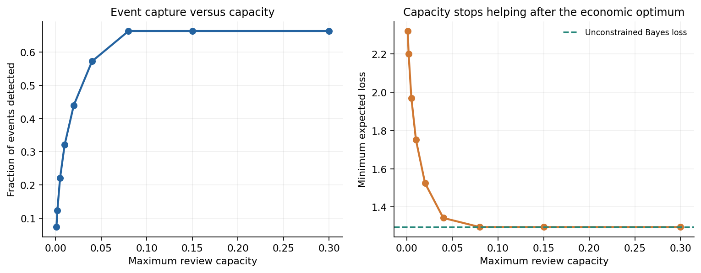
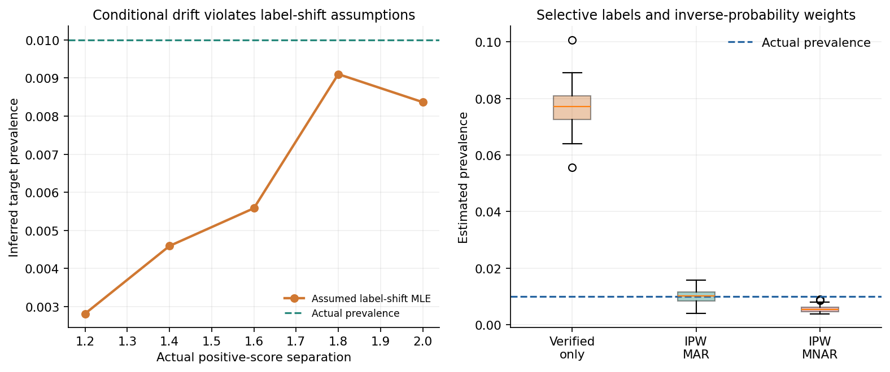

# An Alarm Score Is Not a Probability: Rare Events, Base Rates, and Decision Thresholds

*A mathematical and reproducible investigation of why good ranking, calibrated risk, and an economically useful alarm are three different things.*

**Diogo Ribeiro**

---

Imagine a detection system developed on a balanced dataset, tested with care, and presented to management with a receiver operating characteristic area under the curve of approximately 0.92. It is deployed in a production environment. Almost immediately, operators report a large number of alarms that lead nowhere. The model has not necessarily become less discriminating. Its code may be identical, its score distributions within each class may be unchanged, and the ROC curve may be exactly the same. What changed is the prevalence of the event.

Now imagine a second problem. The system's software produces a number between zero and one, so a dashboard labels that number a *probability*. But the model was trained in an environment where one event in five observations was positive. In service, only one event in a hundred is positive. Even if the original probability estimate was perfectly calibrated, it is no longer calibrated for the new population. Its ranking can remain useful while the numerical risk estimate becomes misleading.

A third problem arrives when management decides to act on every score above 0.5, or above a threshold chosen by maximizing the F1 score on historical validation data. The cost of sending an operator, the cost of ignoring an actual defect, and the number of cases that can be reviewed each day were never put into that calculation. What looks like a machine-learning threshold is really an unstated economic policy.

These problems often appear together in predictive maintenance, fraud screening, credit operations, home monitoring, industrial quality control, and any service where the outcome worth detecting is unusual. They are particularly visible when an alarm initiates work by a human being. False positives consume time, true positives are valuable only if action is possible, and verification is rarely complete. The observed labels then become selected by the alarm policy itself.

This article begins with a simple mathematical model, because a model that is fully specified gives us a known answer against which every approximation can be checked. We then deliberately break its assumptions. The analysis separates six questions:

1. Can a score rank event cases above non-event cases?
2. Among all cases flagged by a chosen threshold, what fraction actually contain an event?
3. Does a quoted probability match the event rate in the population where it will be used?
4. Can a change in event prevalence be estimated without immediate access to target labels?
5. Which threshold minimizes the expected cost of action and inaction, subject to limited review capacity?
6. What happens when the score distributions drift or only selected outcomes are subsequently verified?

The answers are connected, but none is interchangeable with another. AUC cannot by itself answer the fourth or fifth question. A reliability diagram cannot prove that an alert is affordable. And a high precision estimate from selectively verified alarms does not necessarily describe the deployed population.

All numerical values in this article come from a seeded synthetic experiment. Eight figures and ten CSV tables are regenerated by the accompanying Python study. There are no measurements from an industrial plant, clinical population, or corporate system, and the differences in simulated costs must not be described as realized savings.

## 1. Three mathematical objects are being confused

Let \(Y\in\{0,1\}\) indicate whether an event occurs and let \(Z\in\mathbb{R}\) denote an alarm score, with larger values intended to indicate greater risk. A score is a numerical ordering device. A posterior probability is a conditional distribution:

\[
p_\pi(z)=P_\pi(Y=1\mid Z=z).
\]

The subscript \(\pi\) is important. It reminds us that the probability belongs to a particular population whose event prevalence is \(\pi=P(Y=1)\). The same score \(z\) can have a different posterior probability in another population, even when the model's class-conditional behavior does not change.

Finally, an action is a function \(a(z)\in\{0,1\}\): investigate or do not investigate. Its correctness depends on the loss assigned to each outcome, the timing of the decision, and the available operational capacity. Although the action may be computed from \(p_\pi(z)\), it is not the probability itself.

To make the distinctions measurable, consider equal-variance Gaussian conditional score distributions:

\[
Z\mid Y=0\sim N(0,1),\qquad
Z\mid Y=1\sim N(\mu,1),\qquad \mu=2.
\tag{1}
\]

The density of a standard normal variable is \(\phi\), and its cumulative distribution is \(\Phi\). The class-conditional densities are \(f_0(z)=\phi(z)\) and \(f_1(z)=\phi(z-\mu)\). Therefore the likelihood ratio and its logarithm are

\[
\Lambda(z)=\frac{f_1(z)}{f_0(z)}
  =\exp\!\left(\mu z-\frac{\mu^2}{2}\right),
\qquad
\log\Lambda(z)=\mu z-\frac{\mu^2}{2}.
\tag{2}
\]

Bayes' theorem gives the posterior odds:

\[
\frac{p_\pi(z)}{1-p_\pi(z)}
  =\frac{\pi}{1-\pi}\Lambda(z).
\tag{3}
\]

Taking logarithms converts this into a particularly transparent relation:

\[
\operatorname{logit}p_\pi(z)
  =\operatorname{logit}(\pi)+\mu z-\frac{\mu^2}{2}.
\tag{4}
\]

Here \(\operatorname{logit}(u)=\log[u/(1-u)]\). This formula contains the entire story. The score-dependent part is \(\mu z-\mu^2/2\). The population-dependent part is the prior log-odds. They add, but they have different meanings. A score does not become a universal probability because a software library applies a sigmoid transformation to it.

Equation (4) is exact for the selected generative model, not an assumption about the output of arbitrary classifiers. A real classifier must have its probabilities assessed using held-out representative data. Its score can also have different class-conditional distributions from the Gaussian ones used here. The purpose of (1) is to expose the mathematical structure without the ambiguity of unknown ground truth.

We take the development prevalence to be

\[
\pi_s=0.20,
\]

and the deployment prevalence to be

\[
\pi_t=0.01.
\]

The change is a factor of twenty in prevalence. We begin by keeping both conditional densities \(f_0\) and \(f_1\) fixed. In the distribution-shift literature, this is called **label shift** or **prior-probability shift**. It is narrower than the general notion of dataset shift: it assumes that \(P_t(Z\mid Y)=P_s(Z\mid Y)\), while allowing \(P_t(Y)\ne P_s(Y)\). That assumption will later be tested rather than silently preserved.

## 2. The ROC curve is not a deployment contract

Suppose an alarm is triggered when \(Z\ge t\), for some cutoff \(t\). Under (1), its true-positive rate and false-positive rate are

\[
\operatorname{TPR}(t)=P(Z\ge t\mid Y=1)
  =1-\Phi(t-\mu),
\tag{5}
\]

\[
\operatorname{FPR}(t)=P(Z\ge t\mid Y=0)
  =1-\Phi(t).
\tag{6}
\]

Neither expression contains \(\pi\). Under pure label shift, sensitivity and false-positive rate at the same *score* threshold remain unchanged. Moving the threshold traces the same ROC curve in development and deployment. In this model, its area can also be derived without numerical integration:

\[
\operatorname{AUC}
=P(Z_1>Z_0)
=P(Z_1-Z_0>0)
=\Phi\!\left(\frac{\mu}{\sqrt 2}\right)
\approx 0.92135.
\tag{7}
\]

The equality uses independent draws \(Z_1\sim N(\mu,1)\) and \(Z_0\sim N(0,1)\). Their difference follows \(N(\mu,2)\). Thus AUC has a clean probabilistic interpretation here: the probability that a randomly chosen event case receives a higher score than a randomly chosen non-event case.

That is useful information. It measures discrimination over threshold choices. But it is not the probability that an alarm is correct. It is not the fraction of flagged cases that matter. It is not the rate of expensive investigations. And it does not tell us whether the score threshold is appropriate when prevalence or misclassification costs change.

*Figure 1. The left panel shows the conditional score densities, not the population mixture. Changing prevalence changes how frequently each density contributes observations, but not these two shapes. The right panel shows the resulting population ROC curve. Both are analytical objects, so the displayed AUC does not fluctuate with sample size.*

This distinction suggests a basic deployment practice: record the score threshold separately from the posterior-probability threshold, and record the event prevalence in the population against which performance is evaluated. When a benchmark reports only ROC AUC, ask what operating point is actually intended and who will bear its errors.

For a system that is used to order cases for later investigation, an invariant ranking can retain value. For a system that automatically alarms every time the estimated probability exceeds a fixed number, the same unchanged ranking may produce a very different workload. The two uses of the detector should not be evaluated by one metric.

## 3. A strong detector can generate mostly false alarms

Precision, or positive predictive value, asks a question that ROC AUC does not:

\[
\operatorname{PPV}_{\pi}(t)
=P_\pi(Y=1\mid Z\ge t).
\]

Bayes' theorem gives

\[
\operatorname{PPV}_{\pi}(t)
=\frac{\pi\operatorname{TPR}(t)}
{\pi\operatorname{TPR}(t)+(1-\pi)\operatorname{FPR}(t)}.
\tag{8}
\]

Unlike TPR and FPR, this quantity contains the population prevalence explicitly. At any nontrivial threshold with both true and false alarms, lowering the event prevalence lowers precision. That does not require an approximation or a particular machine-learning algorithm. It follows directly from the denominator.

Consider the score cutoff \(t=1.5\). Equations (5) and (6) give

\[
\operatorname{TPR}(1.5)\approx 0.69146,\qquad
\operatorname{FPR}(1.5)\approx 0.06681.
\]

With development prevalence \(\pi_s=0.20\), equation (8) yields approximately \(72.13\%\) precision. With deployment prevalence \(\pi_t=0.01\), at the *same cutoff and with the same score distributions*, precision is only \(9.47\%\).

One can make the arithmetic operational by imagining 100,000 independent deployment cases. At 1% prevalence, the expected number of events is 1,000 and the expected number of non-events is 99,000. The cutoff finds about 691 of the 1,000 events, but it also flags about 6,614 non-events. Of roughly 7,305 alarms, only about 691 are true positives. In expectation, more than nine alarms out of ten are false.

These are model expectations, not an observed confusion matrix. The exact integer counts would vary from sample to sample. The point is that even a small false-positive rate can overwhelm a rare event when the population contains so many more non-events.

*Figure 2. True-positive and false-positive rates are held fixed at the values for score threshold 1.5. The horizontal axis changes only event prevalence. The two marked points are development and deployment. Precision moves from approximately 72% to 9.5%, although the ROC curve and AUC remain unchanged.*

The resulting workload has a clear unit: alarms per unit of monitored population or per day. If a factory monitors 100,000 parts and a team has capacity to inspect only 500, an alert fraction around 7.3% is not an abstract performance inconvenience. It is a capacity mismatch. For home monitoring, an alert can consume a nurse's or social worker's time. In security operations, each false alert may create a costly case. The statistical denominator has an organizational counterpart.

It is not enough to say that a low event rate is difficult. Equation (8) tells us *how* it is difficult: an otherwise acceptable \(\operatorname{FPR}\) may need to be orders of magnitude smaller before precision becomes operationally satisfactory. This is why rare-event systems require prevalence-aware evaluation.

## 4. Precision–recall curves inherit the base rate

A precision–recall curve plots \(P(Y=1\mid Z\ge t)\) against \(\operatorname{TPR}(t)\) over thresholds. Its recall coordinate depends on the positive-class conditional distribution. Its precision coordinate depends additionally on \(\pi\).

Under the present label shift, the ROC curve remains the same while the precision–recall curve moves. This is not a contradiction. It is a consequence of mapping ROC coordinates to precision through equation (8). Davis and Goadrich studied the mathematical relationship between the two representations [1], and Saito and Rehmsmeier examined the special importance of precision–recall displays in imbalanced evaluations [2].

*Figure 3. The score ranking and class-conditional rates do not change. The precision scale does. The dashed line at target prevalence indicates the baseline precision of an uninformative ranking when positive predictions are made.*

This figure should not be interpreted as saying that ROC is an invalid metric, or that precision–recall curves contain independent information that ROC curves cannot mathematically recover when prevalence is known. They summarize different projections of the same operating characteristics. When the problem is rare-event triage, however, precision and absolute alarm volume often speak more directly to the workflow.

Even an area under a precision–recall curve requires care. Average precision and trapezoidal PR area use different interpolation conventions. PR-Gain curves were proposed partly to address scale and aggregation issues in PR analysis [3]. Instead of arguing that one scalar should replace another, this article preserves the threshold-level rates so that precision, workload, and expected cost can be recomputed for any relevant prevalence.

Notice also the distinction between a threshold on \(Z\) and a threshold on a purported probability. Equation (5) describes what happens at a fixed \(Z\) cutoff. A fixed *numeric posterior cutoff* after recalibration usually corresponds to a different \(Z\) cutoff. The ROC curve still exists as the same set of possible operating points, but the chosen operating point moves. This is one of the reasons that model monitoring must log the decision rule, not just the version number of the classifier.

## 5. Yesterday's calibrated probability is not today's probability

Calibration is a statement about conditional frequencies in a specified population. Roughly, among cases assigned probability \(0.1\), one tenth should be positive in a sufficiently large representative group. The formal version asks whether

\[
E[Y\mid \widehat p(Z)]=\widehat p(Z).
\tag{9}
\]

For the Gaussian model, the source posterior \(p_{\pi_s}(z)\) from equation (4) is perfectly calibrated in the source population, because it is the true conditional probability. But a perfectly calibrated source posterior is not automatically calibrated in the target population. When \(\pi_s\ne\pi_t\), its prior odds are wrong.

Under pure label shift, the correction is available directly from Bayes' theorem. Divide the target posterior odds by the source posterior odds:

\[
\frac{p_{\pi_t}(z)}{1-p_{\pi_t}(z)}
\bigg/
\frac{p_{\pi_s}(z)}{1-p_{\pi_s}(z)}
=\frac{\pi_t/(1-\pi_t)}{\pi_s/(1-\pi_s)}.
\tag{10}
\]

Therefore

\[
\boxed{\operatorname{logit}p_{\pi_t}(z)
=\operatorname{logit}p_{\pi_s}(z)
 +\operatorname{logit}(\pi_t)-\operatorname{logit}(\pi_s).}
\tag{11}
\]

For the chosen prevalences, the additive correction to log-odds is approximately \(-3.209\). The same score that appeared to carry a sizable event probability in development may carry a small probability in deployment. The transformation is strictly increasing on the interior of \((0,1)\), so it does not alter the ranking, ROC, or the order in which cases should be inspected.

Equation (11) is sometimes treated as a convenient post-processing trick. It should be understood as a consequence of a *model assumption*: stable \(P(Z\mid Y)\) and a calibrated source posterior. If either condition fails, the correction need not be valid. If the source score was never calibrated, multiplying its odds by a prior ratio cannot magically repair arbitrary distortions. A monotone transformation preserves ordering; calibration requires information about outcomes.

In the experiment, we generate a target sample of 120,000 cases at 1% true prevalence, compute the exact source posterior, and compare it with the analytically corrected posterior. Figure 4 bins the predicted probabilities and compares each bin with the observed event fraction.

*Figure 4. Orange uses the perfectly source-calibrated probability without changing its prior. Blue applies the exact target-prior odds correction. Only bins with at least 30 observations are drawn; high-probability bins still exhibit finite-sample variation. Reliability diagrams require counts and uncertainty as well as visual proximity to the diagonal.*

The target-sample Brier score falls from approximately \(0.03891\) under the frozen probabilities to \(0.00835\) under the corrected probabilities. Binary logarithmic loss falls from approximately \(0.14352\) to \(0.03718\). These are sample-based, seeded comparisons, not analytic guarantees for every finite dataset. In expectation, a correct conditional probability minimizes these strictly proper losses. The proper-scoring-rule framework is developed in Gneiting and Raftery [4].

The binned expected calibration error in this particular run falls from approximately \(0.0969\) to \(0.00025\). That quantity is descriptive. It is dependent on the chosen bin boundaries, sample distribution, and the treatment of sparse bins; it is not a substitute for a proper score or a confidence interval. A model can change its expected calibration error merely because the binning changes. Calibration evaluation should therefore include proper scores, reliability diagrams with counts, and checks specific to decision-relevant probability ranges.

Why not simply recalibrate every model by fitting a sigmoid? Because the correction's target differs according to the available information. Temperature scaling and other post-hoc methods address calibration with representative labeled validation data, as examined by Guo and colleagues [5]. Label-shift correction uses a structural relationship between source and target populations; it may be possible to estimate the new prior from unlabeled target scores, but only under additional identifiability conditions. One cannot assume that one technique solves the other's problem.

There is also a practical issue in very rare events. An overall probability score is often dominated by the large number of negative cases. Improvements near the bulk of the distribution can hide poor behavior in the small probability interval where an expensive decision is made. The relevant calibration region is therefore not necessarily the visually impressive high-probability end of a diagram. It is the part intersected by the operational threshold and by the review budget.

## 6. Can we estimate a new prevalence without target labels?

So far we have used \(\pi_t=0.01\) as known. In a new deployment, it may not be known at all. A factory may discover defective parts only after delayed inspection; a home-monitoring intervention may not receive confirmed clinical labels for weeks; a fraud alert may be resolved after a lengthy investigation. Can unlabeled target scores tell us the new event prevalence?

Under pure label shift, the target marginal density is a mixture:

\[
f_t(z)=\pi_t f_1(z)+(1-\pi_t)f_0(z).
\tag{12}
\]

If the source posterior \(p_s(z)=P_s(Y=1\mid Z=z)\) is calibrated, Bayes' theorem gives

\[
f_1(z)=\frac{p_s(z)f_s(z)}{\pi_s},
\qquad
f_0(z)=\frac{[1-p_s(z)]f_s(z)}{1-\pi_s}.
\tag{13}
\]

Insert (13) into (12) and divide by \(f_s(z)\). For unlabeled target scores \(z_1,\dots,z_n\), the unknown-prevalence log-likelihood, up to a constant independent of \(\pi\), is

\[
\ell(\pi)=\sum_{i=1}^{n}
\log\!\left[
\frac{\pi}{\pi_s}p_s(z_i)
+\frac{1-\pi}{1-\pi_s}\{1-p_s(z_i)\}
\right].
\tag{14}
\]

Maximizing this scalar function gives a maximum-likelihood estimate of target prevalence. Related expectation–maximization corrections were described by Saerens, Latinne, and Decaestecker [6]. Label-shift identification and black-box estimation have also been studied by Lipton, Wang, and Smola [7], while subsequent research emphasized the importance of calibrating the posterior used for adaptation [8].

There is a second route based only on a coarse alarm indicator. At a fixed score threshold, let \(q_t=P_t(Z\ge t)\) be the observed target alarm fraction. Under label shift,

\[
q_t=\pi_t\operatorname{TPR}(t)+(1-\pi_t)\operatorname{FPR}(t),
\]

so

\[
\widehat\pi_{\mathrm{BB}}
=\frac{\widehat q_t-\widehat{\operatorname{FPR}}}
{\widehat{\operatorname{TPR}}-\widehat{\operatorname{FPR}}}.
\tag{15}
\]

This is a one-dimensional illustration of confusion-matrix-based black-box shift estimation. The denominator measures how differently the two classes behave under the indicator. If \(\operatorname{TPR}\) and \(\operatorname{FPR}\) are nearly equal, the inversion is unstable. A small estimation error in the numerator gets magnified by a small denominator.

The formula also explains why an apparently absurd negative estimate can appear from a finite sample even though the actual prevalence must lie in \([0,1]\). If the observed alert rate is below the estimated false-positive rate, the unprojected inverse becomes negative. Clipping it to zero may be appropriate as part of a constrained estimator, but silently hiding the negative value discards a warning about the data, sample variation, or assumptions.

We run 23 independently seeded target samples per configuration, comparing two class separations, \(\mu=2.0\) and \(\mu=0.8\), at sample sizes 3,000 and 12,000. Both estimators use the correct source distributions, so this experiment isolates variance and identifiability rather than model misspecification. The likelihood estimator is constrained to the valid probability interval; the black-box inverse is deliberately displayed without clipping.

*Figure 5. Each box summarizes independent repetitions, with true prevalence fixed at 1%. ML means unlabeled mixture-likelihood estimation; BB means the unprojected black-box inversion. Weak discrimination makes prevalence harder to identify. The true prior is shown as a horizontal dashed line.*

Figure 5 makes a mathematical limitation visible. When \(f_1\) and \(f_0\) approach each other, their mixture weights become difficult to recover. At the limiting case \(f_1=f_0\), equation (12) does not depend on \(\pi_t\) at all. The prevalence is then unidentifiable from unlabeled scores. No clever optimizer can extract information that is absent from the likelihood.

It follows that an unlabeled prevalence estimate needs its own uncertainty assessment, ideally including uncertainty in source calibration and the estimated class-conditional behavior. The plotted boxplots condition on known source parameters. In a deployed model, those quantities are estimated and may drift; ignoring that uncertainty can make an estimated shift look more precise than it is.

## 7. The decision threshold is an economic quantity

Suppose a false alarm costs \(c_{\mathrm{FP}}\) and a missed event costs \(c_{\mathrm{FN}}\). For this simplified exercise, a correct alarm and a correct non-alarm have zero incremental loss. Conditional on a calibrated event probability \(p\), the expected loss of **alarming** is

\[
L(a=1\mid p)=c_{\mathrm{FP}}(1-p),
\]

while the expected loss of **not alarming** is

\[
L(a=0\mid p)=c_{\mathrm{FN}}p.
\]

Alarm if and only if the first quantity is no greater than the second:

\[
c_{\mathrm{FP}}(1-p)\le c_{\mathrm{FN}}p
\quad\Longleftrightarrow\quad
p\ge\frac{c_{\mathrm{FP}}}{c_{\mathrm{FP}}+c_{\mathrm{FN}}}.
\tag{16}
\]

The cost-optimal *posterior-probability* threshold is therefore

\[
p^\star=\frac{c_{\mathrm{FP}}}{c_{\mathrm{FP}}+c_{\mathrm{FN}}}.
\tag{17}
\]

The formula is not a universal default. It depends entirely on how the loss matrix was defined. If investigating a true positive also costs time, if an investigation only partially reduces harm, or if late alerts have a different value, those terms belong in the calculation. If the two possible actions have losses \(L_{a,y}\), then the comparison must use the full conditional expected losses \(\sum_y L_{a,y}P(Y=y\mid Z=z)\).

For illustration we choose \(c_{\mathrm{FP}}=8\) and \(c_{\mathrm{FN}}=250\) arbitrary units. This yields \(p^\star=8/258\approx 0.03101\). The low posterior threshold is not a typographical error: when a miss is expensive relative to a false alarm, even a small event probability can justify investigation.

But which *score* threshold corresponds to this posterior threshold? Inverting equation (4) gives

\[
t^\star(\pi)
=\frac{\operatorname{logit}(p^\star)-\operatorname{logit}(\pi)
+\mu^2/2}{\mu}.
\tag{18}
\]

At the development prevalence of 20%, this translates to a score cutoff of approximately \(-0.02786\). At the target prevalence of 1%, the correctly adjusted cutoff is approximately \(1.57655\). The same posterior threshold belongs to very different score thresholds in the two populations.

The expected target-population loss per monitored case at score cutoff \(t\) is

\[
\mathcal R_{\pi_t}(t)
=c_{\mathrm{FP}}(1-\pi_t)\operatorname{FPR}(t)
+c_{\mathrm{FN}}\pi_t[1-\operatorname{TPR}(t)].
\tag{19}
\]

This formula counts false alarms and missed events weighted by their consequences. It does not depend on a particular sample of observed labels, because Gaussian tail probabilities are known. It is a population calculation conditioned on the model assumptions.

Applying the development-era cutoff unchanged to the 1% deployment population yields an expected loss of approximately **4.10124 cost units per monitored case**. Updating the prior and applying the Bayes cutoff yields approximately **1.29496**. The frozen policy is about **3.17 times as costly** in this synthetic scenario.

*Figure 6. The left panel is the expected loss from equation (19), not a fitted loss curve. The vertical lines mark the frozen development and corrected target score cutoffs. The right panel compares the resulting frozen policies with a near-never-alarm rule. Cost units are arbitrary and not monetary savings.*

The frozen development rule alarms on roughly \(51.6\%\) of target cases, because most negative scores exceed its low cutoff. The corrected rule alarms on about \(6.35\%\). The change in action volume is substantial. It is not achieved by increasing ROC AUC, retraining a more complex model, or identifying a new feature. It follows from applying the correct prior to a calibrated score and choosing the cutoff for a defined loss.

There is an important qualification. The corrected rule is optimal only for the stated loss model and population. The costs of missed events may be heterogeneous, escalating with severity, or partially preventable. False-alarm costs may vary by day, queue length, region, or personnel availability. When the loss function changes, the optimal action can change even if the probability model remains correct. A calibration report is therefore necessary for expected-cost decisions but not sufficient for designing them.

## 8. An optimal alarm can still exceed the review budget

So far we have acted as though every alarm could receive attention. Operational systems often have a finite inspection or intervention capacity. A company may be able to inspect only a fixed percentage of production, a response team may manage a finite number of daily cases, or a healthcare service may have limited follow-up appointments. The statistical decision then becomes a constrained allocation problem.

Let \(b\in(0,1)\) denote the maximum fraction of cases that can be investigated. For a score threshold \(t\), the expected fraction of alarms is

\[
q_\pi(t)=\pi\operatorname{TPR}(t)
+(1-\pi)\operatorname{FPR}(t).
\tag{20}
\]

The capacity constraint is \(q_{\pi_t}(t)\le b\). In the Gaussian model, \(q_\pi(t)\) is strictly decreasing in \(t\). Thus, for every nondegenerate capacity \(b\), there is a unique threshold \(t_b\) solving \(q_{\pi_t}(t_b)=b\).

If the objective is to minimize the expected loss in (19), the optimal capacity-constrained cutoff is

\[
\boxed{t^\star_b=\max\{t^\star(\pi_t),t_b\}.}
\tag{21}
\]

The maximum matters. A high enough threshold satisfies the capacity constraint, while choosing a threshold lower than the unconstrained Bayes optimum would add alerts whose expected false-alarm cost exceeds their expected benefit. Capacity is a ceiling, not a target that must be filled. Many production dashboards implicitly treat using every available review slot as a performance measure. Under a specified loss model, this may be economically inefficient.

For example, with a 1% review budget, the population cutoff is approximately \(t_b=2.465\). The system detects about \(32.1\%\) of events, and expected loss is approximately \(1.752\) units per monitored case. With a 4% budget, the best feasible cutoff is approximately \(1.817\), recall rises to about \(57.3\%\), and expected loss falls to about \(1.343\). Allowing 8% capacity is enough to use the unconstrained Bayes threshold, whose expected alarm fraction is only \(6.35\%\). Increasing the capacity further does not improve the optimal loss in this toy scenario.

*Figure 7. The left panel shows expected event recall under the best cost-feasible threshold. The right panel shows the minimum loss with an upper bound on the alarm fraction. The loss plateaus when capacity ceases to bind; the system does not need to use spare slots merely because they exist.*

This result has several limitations worth making explicit. We have assumed independent cases, identical case-handling costs, and a known calibrated score. When events are temporally clustered, inspection capacity becomes a queueing problem as well as a classification problem. If cases differ in urgency or potential harm, the relevant ranking may be expected treatment benefit or expected cost reduction, not event probability alone. Where an intervention changes outcomes, causal effect estimation becomes necessary. An intervention may also consume a resource for multiple periods, so a one-shot threshold need not maximize long-run utility.

Nevertheless, (21) captures a useful first principle. Model probabilities, expected decision losses, and resource constraints should be joined explicitly. If the budget changes, recompute the operating point and its consequences. The same AUC can coexist with many feasible or infeasible review policies.

## 9. The label-shift assumption can be the thing that fails

Up to this point, the score distributions conditioned on event status have been held constant. Real deployments can violate that assumption in several ways. A sensor can degrade, a machine can operate in a different regime, a fraud mechanism can adapt to the detection system, and a new cohort can present events with weaker signals. These are changes in \(P(Z\mid Y)\), not simply changes in \(P(Y)\).

To demonstrate this difference, the eighth figure changes the mean of the positive-class distribution from \(\mu=2.0\) to values as small as \(1.2\), keeping the negative-class distribution and true prevalence at 1%. The analyst, however, continues using the \(\mu=2.0\) source posterior when estimating target prevalence. That is a deliberately misspecified analysis.

Under the true changed model, ROC AUC is no longer invariant: it falls from approximately 0.921 at \(\mu=2.0\) to approximately 0.802 at \(\mu=1.2\). The mixture model in equation (14), written using the old source conditional densities, is wrong as well. Its optimizer produces a *pseudo-true* parameter for the assumed family rather than necessarily recovering the actual prevalence.

In the seeded experiment, the estimated prevalence at the weakest separation is about 0.28%, although the true prevalence remains 1%. One should not read this single value as a universal direction or size of bias; it results from a specific kind of conditional drift and a finite unlabeled sample. The mathematical point is broader: changes in the positive-score distribution can mimic changes in mixture weight. Without additional information, an unlabeled change in the marginal score distribution need not identify which mechanism moved.

This is an identification problem. If \(f_0\), \(f_1\), and \(\pi\) are all allowed to vary without restrictions, the observed marginal \(f_t(z)\) has many possible decompositions. An estimator that returns a plausible number has not proved that its decomposition is correct. A monitoring system should therefore test whether its assumed label-shift mechanism is compatible with subsequent labeled samples, even if those samples arrive slowly.

An appropriate workflow might maintain a stable sentinel sample that receives verification regardless of alarm status, compare conditional score distributions within verified classes, and periodically refit or recalibrate when changes are supported by evidence. If the reference population itself is unrepresentative, the monitoring design must be reconsidered. Statistical diagnostics cannot repair a lack of information by declaration.

## 10. The labels may be selected by the alarm

The final difficulty is more subtle because it is created by the evaluation process. Imagine a detector that flags a subset of cases for investigation. Flagged cases receive a confirmed outcome. Cases below the threshold are rarely inspected, so their true outcomes remain unknown.

If performance is computed only from the verified cases, the estimated event prevalence can be many times the population prevalence. That is not necessarily evidence that the deployment environment has become more dangerous. It may be a property of the verification mechanism.

Let \(V=1\) indicate that the true outcome was verified, and let \(A=1\) indicate that the case was flagged. In the experiment, every flagged case is verified, while a random 4% of unflagged cases are verified. The actual verification propensity is therefore

\[
e(A)=P(V=1\mid A)=
\begin{cases}
1,&A=1,\\
0.04,&A=0.
\end{cases}
\tag{22}
\]

Under the assumption that verification is conditionally independent of the unknown outcome given alarm status,

\[
V\perp Y\mid A,
\tag{23}
\]

the inverse-probability-weighted Horvitz–Thompson prevalence estimator is

\[
\widehat\pi_{\mathrm{HT}}
=\frac{1}{N}\sum_{i=1}^N\frac{V_iY_i}{e(A_i)}.
\tag{24}
\]

Its unbiasedness for the finite monitored population follows by conditioning on the observed cases and labels:

\[
E\!\left[\frac{V_iY_i}{e(A_i)}\biggm|A_i,Y_i\right]
=Y_i\frac{E[V_i\mid A_i,Y_i]}{e(A_i)}
=Y_i.
\tag{25}
\]

Average over \(i\) and divide by \(N\). The mechanism and its propensities are not minor implementation details: they supply the assumptions that make this weighting possible. This is an application of unequal-probability sampling principles associated with Horvitz and Thompson [9]. The problem of selective verification in diagnostic testing was studied explicitly by Begg and Greenes [10], and the same logic arises in alarm systems that generate their own labels.

In 55 independently seeded synthetic populations, the verified-only prevalence is much larger than 1%, because flagged cases are overrepresented among the observed outcomes. Using the known alarm-conditional propensities brings the weighted estimate near the true population prevalence, with sampling variability that depends on how often unflagged cases are verified.

But suppose that, among unflagged cases, the small number of genuinely positive cases is *less likely* to obtain a verified label than otherwise comparable negative cases. In the deliberately violated experiment, unflagged positives have a 1% verification probability while unflagged negatives still have 4%. An analyst who continues to weight all unflagged verified cases by \(1/0.04\) uses the wrong propensities. The resulting weighted prevalence is biased downward.

*Figure 8. Left: the unlabeled label-shift estimator becomes unreliable when the positive-class score distribution drifts, even though true prevalence remains 1%. Right: the selected-only event estimate is high; correct inverse-probability weights under missing at random given alarm recover the prevalence on average; the same weights fail when verification depends on the unobserved outcome. Boxplots summarize independent replicates.*

The missing-at-random condition in (23) is not something the unverified labels can validate directly. If the verification probability depends on unmeasured severity, follow-up behavior, or latent outcome even after conditioning on observed covariates, the simple estimator is not identified from the available records. We may need external verification samples, design-based random audits, richer measured covariates, or sensitivity bounds.

In a real system, verified negatives should be kept as carefully as verified positives. The choice of whom to verify affects the data available for updating the detector. A policy that concentrates all observation effort on high scores can gradually remove the information needed to determine whether low scores remain safe.

## 11. A practical evaluation protocol

The mathematical example suggests an evaluation report with separate layers. A single leaderboard cannot serve all of them.

**Population and sampling.** Specify the definition of an event, the observation unit, the evaluation window, the population at risk, and how labels were obtained. Record whether the validation set was case-control sampled, enriched for positive examples, or based on real consecutive observations. A training mixture created for model development should not be silently presented as operational prevalence.

**Discrimination.** Report ROC AUC with uncertainty and show threshold-level TPR and FPR. Under severe imbalance, include precision–recall information at the relevant deployment prevalence, but distinguish the change caused by prevalence from the change caused by class-conditional score drift. Record both counts and rates: a false-positive rate without a denominator hides workload.

**Probability estimation.** Test calibration on representative labeled data where possible. Report at least one proper scoring rule, examine calibration in the operational probability range, and include bin counts. If label shift is suspected, state exactly which conditional distributions are assumed invariant and how the new prior was estimated. Present uncertainty, including the possibility that the prevalence estimator is poorly identified.

**Economics.** Define the action, the alternative, the value of a correct response, the consequences of misses, and the cost of false interventions. Derive the probability threshold from the loss comparison rather than adopting 0.5 automatically. When costs are subjective or hard to measure, evaluate a range of plausible cost ratios and show how the preferred policy changes.

**Capacity.** Translate the policy into expected alarms per day or per thousand monitored cases. Include queueing, staffing, and delays when those features matter. If only a fixed fraction of cases can be handled, optimize with that explicit constraint. Do not equate filling every available review slot with producing value.

**Feedback and verification.** Report which outcomes are observed, the verification delay, and the process deciding who receives a confirmed label. Use independent random audits where feasible. If inverse-probability weighting is used, document its positivity and conditional-independence assumptions. Separate what is estimated from the observed sample from what is inferred about the whole population.

**Drift response.** Monitor event prevalence, class-conditional score behavior, calibration, investigation capacity, and realized decision costs as distinct quantities. A stable AUC is not proof of stable calibration. A changing alert rate is not proof that event prevalence changed. A better binned reliability diagram is not proof that the operating policy is cheaper.

One useful way to summarize a detection system is as a sequence of functions:

\[
\underbrace{Z}_{\text{score}}
\;\longrightarrow\;
\underbrace{p_\pi(Z)}_{\text{population risk}}
\;\longrightarrow\;
\underbrace{a^\star(Z)}_{\text{decision under loss and capacity}}
\;\longrightarrow\;
\underbrace{V}_{\text{observed verification process}}.
\tag{26}
\]

Each arrow involves an assumption. The first depends on whether the score can be interpreted probabilistically in the target population. The second depends on costs and feasible actions. The third determines what labels are subsequently available for model evaluation. A feedback loop exists: future training data are affected by past decisions.

These layers can also be tested separately. A model with stable ranking but poor target calibration may be usable after justified prior adjustment. A well-calibrated model may be operationally useless because of an impossible review budget. A low-cost current policy may fail to support learning if it almost never verifies the cases it rejects. This is why evaluation should follow the decision process, not stop at a model metric.

## 12. What the experiment proves—and what it does not

The experiment proves several identities within the chosen assumptions. Bayes' theorem determines how precision changes with prevalence at a fixed operating point. For equal-variance Gaussian scores, ROC AUC has the closed form in equation (7). Under pure label shift and a calibrated source posterior, equation (11) produces the exact target posterior. Under the declared loss matrix, the Bayes threshold minimizes expected classification loss, and equation (21) gives the best threshold under a simple capacity ceiling.

The simulation illustrates other claims without converting them into universal numerical laws. Brier and log-loss improvements, repeated prevalence estimates, and selective-verification boxplots are seeded finite-sample outcomes. Their exact numerical values depend on sample size, score separation, verification design, and random variation. The reproducible code allows readers to change these assumptions.

The model also excludes important operational structure. Events may be temporally dependent and their consequences may grow with detection delay. The true probability of an event may depend on many covariates rather than a scalar score. Data may be censored, interventions may change the outcome, and separate groups may experience different prevalences and costs. Costs themselves may be uncertain. Human review can produce noisy labels rather than perfect verification. Each of those features changes the appropriate model or experiment.

A detection system may need a state-space model, an event-time model, a causal treatment-effect model, a constrained sequential policy, or a queueing model. The present article is not claiming that a single threshold solves all of those problems. It argues for preserving the distinction between the probability model and the decision problem as the system becomes more sophisticated.

Calibration methods such as beta calibration [11] can be valuable when an arbitrary classifier's output does not represent probabilities reliably. They do not eliminate the requirement to know which population the probabilities describe. Likewise, a technically correct label-shift estimator is not an excuse to ignore evidence that class-conditional score distributions changed. Statistical methods are valid under assumptions, and responsible deployment requires mechanisms to check those assumptions.

## 13. Conclusions: report the rate, estimate the risk, justify the action

The strongest result in this study is not a new classifier. It is a separation of concepts that are routinely treated as synonyms. An ROC AUC around 0.921 can coexist with 9.5% precision at a fixed score threshold when events are rare. A score can remain equally good at ranking cases while a source-calibrated posterior becomes badly miscalibrated in deployment. A fixed policy can become 3.17 times as costly as a prior-adjusted decision in a fully specified synthetic experiment. A prevalence estimator can fail when class-conditional score distributions move, and an evaluation can become biased because only flagged cases are verified.

The remedy is not always a more complicated neural network, more elaborate cross-validation, or an extra metric on a dashboard. Begin by defining the target population and its base rate. Distinguish discrimination from the posterior probability needed for an action. Derive the threshold from consequences and review capacity. Maintain a verification design that permits the deployed population to be evaluated. Then treat every assumption as something that deserves evidence rather than something guaranteed by a training pipeline.

An alarm score tells us how a model orders observations. A calibrated probability tells us how often an event should occur among observations assigned that risk. A decision tells us whether acting is worth its consequences. They belong to the same analytical system, but they are not the same number.

## References and primary research sources

1. Davis, J. and Goadrich, M. (2006). *The Relationship Between Precision-Recall and ROC Curves*. Proceedings of ICML. [Original paper](https://doi.org/10.1145/1143844.1143874).
2. Saito, T. and Rehmsmeier, M. (2015). *The Precision-Recall Plot Is More Informative than the ROC Plot When Evaluating Binary Classifiers on Imbalanced Datasets*. PLOS ONE 10(3), e0118432. [Original article](https://journals.plos.org/plosone/article?id=10.1371/journal.pone.0118432).
3. Flach, P. and Kull, M. (2015). *Precision-Recall-Gain Curves: PR Analysis Done Right*. NeurIPS 28. [Original paper](https://papers.nips.cc/paper/2015/hash/33e8075e9970de0cfea955afd4644bb2-Abstract.html).
4. Gneiting, T. and Raftery, A. E. (2007). *Strictly Proper Scoring Rules, Prediction, and Estimation*. Journal of the American Statistical Association, 102(477), 359–378. [Author-hosted original paper](https://sites.stat.washington.edu/people/raftery/Research/PDF/Gneiting2007jasa.pdf).
5. Guo, C., Pleiss, G., Sun, Y., and Weinberger, K. Q. (2017). *On Calibration of Modern Neural Networks*. Proceedings of ICML, PMLR 70:1321–1330. [Original paper](https://proceedings.mlr.press/v70/guo17a.html).
6. Saerens, M., Latinne, P., and Decaestecker, C. (2002). *Adjusting the Outputs of a Classifier to New a Priori Probabilities: A Simple Procedure*. Neural Computation, 14(1), 21–41. [Original paper, institutional PDF](https://dipot.ulb.ac.be/dspace/bitstream/2013/68391/1/Decaestecker_NeuralComp02.pdf).
7. Lipton, Z. C., Wang, Y.-X., and Smola, A. (2018). *Detecting and Correcting for Label Shift with Black Box Predictors*. Proceedings of ICML, PMLR 80:3122–3130. [Original paper](https://proceedings.mlr.press/v80/lipton18a.html).
8. Alexandari, A., Kundaje, A., and Shrikumar, A. (2020). *Maximum Likelihood with Bias-Corrected Calibration Is Hard-To-Beat at Label Shift Adaptation*. Proceedings of ICML, PMLR 119:222–232. [Original paper](https://proceedings.mlr.press/v119/alexandari20a.html).
9. Horvitz, D. G. and Thompson, D. J. (1952). *A Generalization of Sampling Without Replacement from a Finite Universe*. Journal of the American Statistical Association, 47(260), 663–685. [Original paper](https://www.stat.cmu.edu/~brian/905-2008/papers/Horvitz-Thompson-1952-jasa.pdf).
10. Begg, C. B. and Greenes, R. A. (1983). *Assessment of Diagnostic Tests When Disease Verification Is Subject to Selection Bias*. Biometrics, 39(1), 207–215. [Original study record](https://pubmed.ncbi.nlm.nih.gov/6871349/).
11. Kull, M., Silva Filho, T. M., and Flach, P. (2017). *Beta Calibration: A Well-Founded and Easily Implemented Improvement on Logistic Calibration for Binary Classifiers*. AISTATS, PMLR 54:623–631. [Original paper](https://proceedings.mlr.press/v54/kull17a.html).

## Reproducibility

The [companion directory](README.md) provides the Python implementation, dependency requirements, unit tests, and an executable [Jupyter notebook](rare_event_detection.ipynb). The publication figures are regenerated from the exact formulas and explicitly seeded samples, and the ten CSV files preserve the numerical evidence at the operating points used in the article. The full run and a separate quick CI run are available. Figures and tables represent **synthetic** data only; nothing here establishes a realized deployment benefit or a clinical or industrial performance guarantee.
