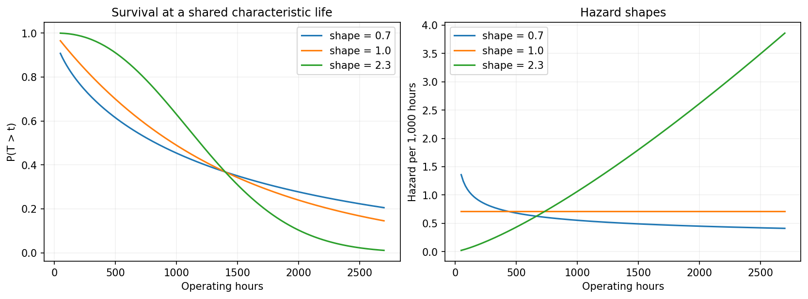
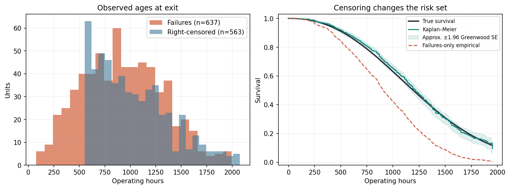
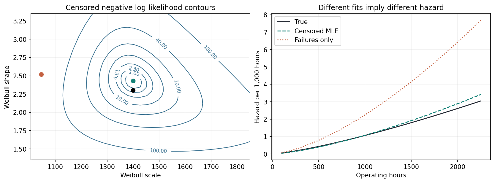
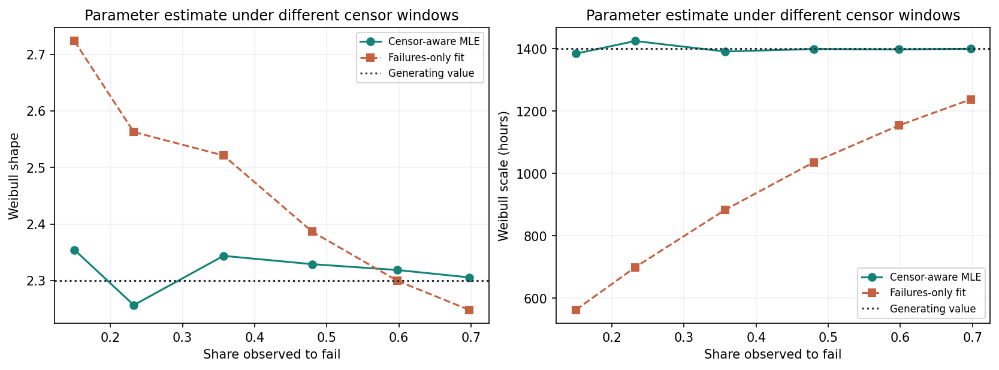
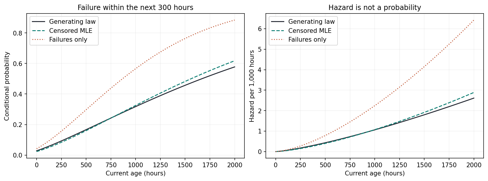
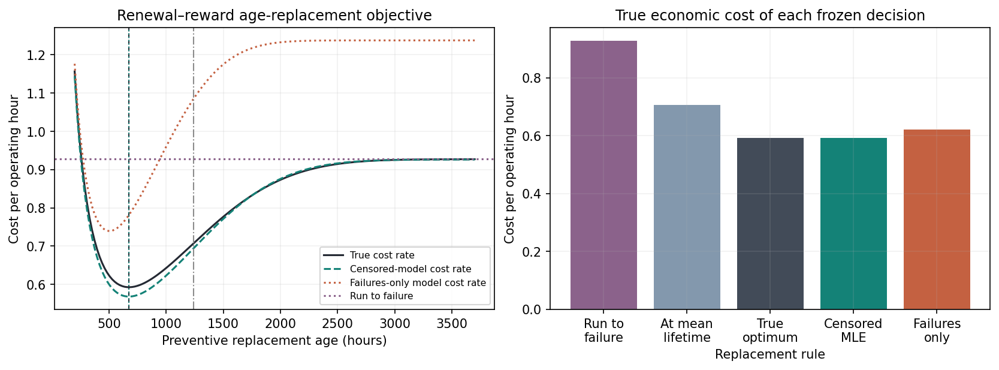
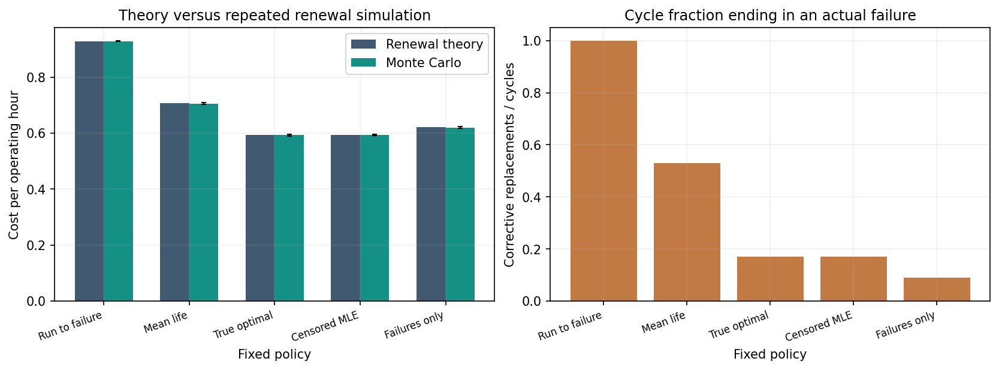
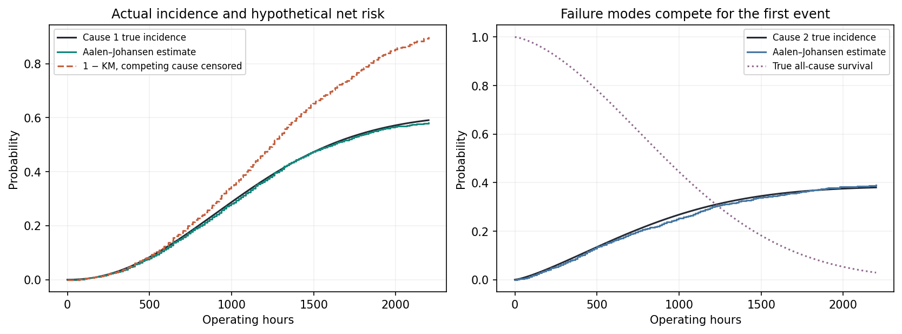

# A Machine Does Not Fail at Its Mean

## Reliability Statistics, Censoring, and Maintenance Decisions

*Why average lifetime is not a failure probability, why an unfinished life test still contains information, and why preventive maintenance should be optimized as a stochastic renewal decision.*

*By Diogo Ribeiro*

---

A component can have an expected lifetime of 1,240 operating hours and still be at substantial risk of failing long before that age. Another component can have exactly the same expected lifetime but become *less* likely to fail as it ages. A third can maintain essentially the same instantaneous failure rate at every age.

These are not paradoxes. They are consequences of different lifetime distributions. The expected lifetime compresses an entire distribution into one number. That number does not tell us how risk changes with age, how likely an asset is to survive the next inspection interval, or when replacement is economically justified.

Industrial data science frequently inherits this compression from familiar performance dashboards. We see mean time between failures, mean time to failure, average maintenance cost, number of corrective repairs, and the proportion of components replaced during an observation window. Each statistic can be useful. None, in isolation, defines a preventive-maintenance policy.

There is a second problem, less obvious but often more damaging. The historical data may contain many machines that *have not yet failed*. A motor installed fourteen months ago and still operating is not a motor with a zero lifetime, nor a motor whose lifetime is known to be fourteen months. All we know is that its lifetime exceeds its observed running time. If we discard such records and fit a distribution only to failures, we select a systematically unrepresentative subset of the original fleet.

In survival analysis this is called **right-censoring**. The mathematical tools developed to handle it are old and precise. The product-limit estimator of [Kaplan and Meier (1958)](https://doi.org/10.1080/01621459.1958.10501452), hazard-based estimators, and parametric censored likelihoods allow us to use the information we actually observed without pretending to know the unseen failure times.

The third problem begins when we translate statistical estimates into interventions. If preventive replacement costs less than an unplanned failure, replacing every part early can appear attractive. But excessive preventive replacements discard serviceable life. Replacing too late exposes the organization to a high corrective-repair cost. The appropriate criterion is usually not the mean lifetime or the minimum expected cost of one cycle. It is the long-run cost per operating hour, with the renewal length in the denominator. The classic work of [Barlow and Hunter (1960)](https://doi.org/10.1287/opre.8.1.90) frames preventive maintenance as an optimization problem.

Finally, a machine can fail for more than one reason. Electrical failure may occur before mechanical wear, making the mechanical failure age unobservable. A failure-mode analysis that treats every competing event like ordinary administrative censoring answers a different question from the one a planner often needs: *What is the actual probability that this mode is the first failure?* That distinction leads to cumulative-incidence estimation and the [Aalen–Johansen framework](https://www.jstor.org/stable/i412608).

In this article we will work through all four questions:

1. How do survival, hazard, mean lifetime and conditional failure probabilities differ?
2. What does a right-censored record contribute to statistical inference?
3. How do those estimates change an age-replacement decision?
4. How should we calculate failure-mode incidence when causes compete?

The mathematics will be accompanied by a fully synthetic Python study: eight original figures, ten CSV tables, a notebook, mathematical tests and a documented implementation. The [reproducibility companion](README.md) contains the exact generation process. No private maintenance records, industrial production data, or employer-specific costs are used.

The core principle is straightforward: **the goal is to estimate the failure process that matters to a decision, not merely to describe the ages of the units that happened to fail.**

## 1. Lifetime, reliability, hazard and cumulative hazard are different objects

Let \(T\geq0\) be the random age at which a component first fails, measured in accumulated operating hours. Define the cumulative distribution function

\[
F(t)=P(T\leq t)
\]

and the survival, or reliability, function

\[
S(t)=P(T>t)=1-F(t).
\]

When the lifetime distribution has a density, we write \(f(t)=F'(t)\). The instantaneous hazard is

\[
h(t)=\lim_{\Delta t\downarrow0}
\frac{P(t<T\leq t+\Delta t\mid T>t)}{\Delta t}
=\frac{f(t)}{S(t)}.
\]

The conditioning is not optional. Hazard describes the instantaneous failure intensity **among components that have survived to age \(t\)**. It is not the density among all original components. Nor is it the probability of failing at exactly \(t\), which is zero for a continuous lifetime distribution.

Integrating hazard gives the cumulative hazard,

\[
H(t)=\int_0^t h(u)\,du.
\]

Under an absolutely continuous lifetime law,

\[
S(t)=\exp[-H(t)].
\]

This identity is important because it connects local rates to an accumulated probability of survival. Even a low instantaneous hazard can produce substantial cumulative failure probability over a long horizon. Conversely, a large value of the hazard at an age does not by itself specify the chance of failure over a practical maintenance interval.

We also define the mean time to failure:

\[
\operatorname{MTTF}=\mathbb E[T]
=\int_0^\infty S(t)\,dt,
\]

provided the expectation exists. This integral incorporates the entire lifetime distribution. Different survival curves can have the same area while assigning very different risk to the ages that matter operationally.

### A Weibull example

For positive shape parameter \(\beta\) and scale \(\eta\), the two-parameter Weibull distribution is

\[
S(t)=\exp\left[-\left(\frac{t}{\eta}\right)^\beta\right],
\quad
H(t)=\left(\frac{t}{\eta}\right)^\beta,
\]

\[
h(t)=\frac{\beta}{\eta}
\left(\frac{t}{\eta}\right)^{\beta-1},
\qquad
\mathbb E[T]=\eta\Gamma\left(1+\frac1\beta\right).
\]

The interpretation of \(\beta\) determines the shape of the hazard:

- If \(0<\beta<1\), hazard decreases with age.
- If \(\beta=1\), hazard is constant, giving the exponential distribution.
- If \(\beta>1\), hazard increases with age.

The [NIST Engineering Statistics Handbook](https://www.itl.nist.gov/div898/handbook/apr/section1/apr162.htm) gives these formulas and reliability interpretations. The Weibull family is useful because it separates the characteristic life \(\eta\) from the nature of age dependence.

We plot three shapes—0.7, 1.0 and 2.3—at a shared scale of 1,400 hours. At \(t=\eta\), every curve has survival \(e^{-1}\), but their hazard trajectories are markedly different.



*Figure 1.* Shared scale does **not** mean shared mean lifetime. The decreasing-hazard, constant-hazard and increasing-hazard cases are displayed to isolate how shape controls age dependence. The figure uses generating distributions, not estimated curves.

The decreasing-hazard case may represent a population affected by early defects or selection of more robust surviving units. The increasing-hazard case can describe an idealized wear-out mechanism. The constant-hazard case models memorylessness. These are possible interpretations of mathematical shapes, not diagnoses that can be made from an estimated \(\beta\) without engineering evidence.

It is also worth resisting a common shortcut: the word *Weibull* is not an automatic synonym for reliability. A mixture of components operating in different environments can produce a complex population hazard even if each conditional subgroup follows a simple Weibull law. A mechanically reasonable wear model may fail after maintenance changes, supplier substitutions, or load shifts. Distributional adequacy must be assessed, not assumed.

## 2. Right-censoring is information, not missing data to discard

Suppose we inspect 1,200 newly installed synthetic components. Their true lifetime follows a Weibull distribution with \(\beta=2.30\) and \(\eta=1{,}400\) hours. Each unit also has an independent administrative observation limit \(C\), uniformly distributed between 550 and 2,100 hours.

We observe

\[
Y=\min(T,C),
\qquad
\delta=\mathbf 1(T\leq C).
\]

If \(\delta=1\), the component failed during observation and \(Y=T\). If \(\delta=0\), monitoring ended while the component was alive and all we know is \(T>Y\). The hidden true lifetime in the synthetic generator exists for validation, but it would not be available to an actual analyst.

In the full seeded run, 637 of the 1,200 units are observed to fail. The other 563 are right-censored. Their observed running times still establish lower bounds on lifetime. Removing them throws away evidence that they survived until those ages.

### Why the risk set matters

Let \(t_1<t_2<\cdots\) denote the distinct observed failure ages. At failure age \(t_j\), let \(n_j\) be the number of units still under observation and at risk immediately before that age, and let \(d_j\) be the number of observed failures at that age. Censoring reduces future risk sets but is not itself counted as a failure.

The Kaplan–Meier product-limit estimator is

\[
\widehat S(t)=
\prod_{t_j\leq t}\left(1-\frac{d_j}{n_j}\right).
\]

Its logic is conditional. At each event age, estimate the fraction that survives the event among the units then known to be at risk; multiply these fractions to obtain survival from the origin to the chosen age.

We also compute the Nelson–Aalen cumulative-hazard estimator:

\[
\widehat H(t)=\sum_{t_j\leq t}\frac{d_j}{n_j}.
\]

The two estimators are closely related but not numerically identical for finite risk sets: in general \(\widehat S_{\mathrm{KM}}(t)\ne\exp[-\widehat H(t)]\) exactly. They converge toward compatible underlying quantities under appropriate conditions.

For pointwise descriptive uncertainty, we use Greenwood's approximation:

\[
\widehat{\operatorname{Var}}\{\widehat S(t)\}
\approx \widehat S(t)^2
\sum_{t_j\leq t}\frac{d_j}{n_j(n_j-d_j)}.
\]

When a final failure exhausts a risk set, special endpoint conventions are needed; the implementation does not present this approximation as a universal exact interval. The shaded band in the figure is a simple pointwise \(\pm1.96\) standard-error display, clipped to the probability range. It is neither an exact confidence interval nor simultaneous coverage over all ages.

### The complete-case trap

Imagine discarding every censored unit, keeping only the 637 observed failures, and constructing an empirical lifetime distribution from those ages. The resulting curve falls much faster than the actual survival function. That is not because the machines became less reliable when we opened the spreadsheet. It is because units with longer lifetimes were more likely to leave observation without a recorded failure.



*Figure 2.* Left: failures and right-censored observations form overlapping, distinct exit populations. Right: Kaplan–Meier follows the generating survival closely, while the failures-only empirical curve underestimates survival. Greenwood shading is approximate and pointwise.

This is an example of selection bias induced by an apparently harmless data-cleaning step. The subset of failed units is not a random sample from the original lifetime distribution. It is a sample conditional on failure having occurred before the observation limit.

The difference matters directly to maintenance. A model that makes components appear shorter-lived can encourage unnecessarily early replacements, higher spare-part expenditure and discarded remaining useful life.

### What independent censoring really assumes

Our censoring time is generated independently of component lifetime. This gives the Kaplan–Meier estimator and the censored parametric likelihood an appropriate basis for estimating the marginal failure distribution.

Real operational censoring may not be independent. Machines under heavy load can be removed from service for overhaul; low-quality parts may be inspected more frequently; facilities may retire whole lines after known reliability problems. A sensor that stops reporting during a developing fault creates a particularly difficult observation mechanism.

Independence is not merely a software option. It is a statement about how units become unobserved. Sometimes a conditional independence assumption is reasonable given load, site, operating regime or other covariates. Sometimes it is not. When censoring is informative, more sophisticated observation models and sensitivity analyses are necessary.

## 3. Likelihood must match what the observer actually saw

The difference between fitting failures only and using right-censored data becomes explicit in the likelihood.

For independent observations \((y_i,\delta_i)\), the contribution of a failure is the density \(f(y_i)\). A censored record contributes the survival probability \(S(y_i)\), because it tells us that lifetime exceeded the censoring age. Ignoring factors involving only the independent censoring mechanism, the likelihood is

\[
\mathcal L(\beta,\eta)=
\prod_{i=1}^{n}
f(y_i;\beta,\eta)^{\delta_i}
S(y_i;\beta,\eta)^{1-\delta_i}.
\]

Consequently,

\[
\ell(\beta,\eta)=
\sum_{i=1}^{n}\delta_i\log f(y_i;\beta,\eta)
+\sum_{i=1}^{n}(1-\delta_i)\log S(y_i;\beta,\eta).
\]

For the Weibull law,

\[
\ell(\beta,\eta)=
\sum_i\delta_i\left[
\log\beta-\beta\log\eta
+(\beta-1)\log y_i\right]
-\sum_i\left(\frac{y_i}{\eta}\right)^\beta.
\]

Notice that **every observation** contributes to the final cumulative-hazard sum. The failure indicator affects the density part but does not remove censored units from the exposure term.

Our Python implementation optimizes this likelihood in \((\log\beta,\log\eta)\) coordinates, using an analytic gradient and a bounded numerical optimizer. Transforming to logarithmic coordinates enforces positive parameters and improves numerical behavior. The implementation independently validates the single-observation contributions against a standard Weibull density calculation.

The [NIST handbook section on censored maximum likelihood](https://www.itl.nist.gov/div898/handbook/apr/section4/apr412.htm) develops the likelihood principle for censored life data and describes why exact failures and surviving units contribute different factors.

### What the fitted model actually recovers

For our seeded synthetic sample, the estimates are:

| Model | Weibull shape \(\beta\) | Weibull scale \(\eta\) |
| --- | ---: | ---: |
| Generating distribution, known only in simulation | 2.300 | 1,400.0 |
| Correct likelihood, using failures and censored exposure | 2.429 | 1,400.4 |
| Incorrect failures-only likelihood | 2.518 | 1,046.9 |

The full likelihood recovers the characteristic scale remarkably closely in this one realization. Its estimated shape is somewhat higher than the generating value. We should not expect an exact parameter recovery from a finite sample, even if the family and censoring assumptions are correct.

The failures-only fit is substantially shifted toward shorter apparent lifetime. It uses fewer observations *and* analyzes a selected population. These are different likelihoods on different data selections; their raw log-likelihood values are not comparable model-selection scores for the same experiment.



*Figure 3.* Left: the censored-data likelihood surface with the true, correct-likelihood and failures-only parameter positions. Right: the estimated hazard diverges substantially in later operating life when censoring is discarded. The contour levels are changes in negative log-likelihood, not posterior credible regions.

The two-dimensional likelihood surface reminds us that shape and scale are estimated jointly. A narrow estimate of one number does not make the other certain. Parameter covariance, possible boundary solutions, sample sizes, and observation schedules all affect uncertainty. A formal confidence region would require carefully chosen likelihood-ratio calibration, asymptotic approximations or resampling, rather than calling every plotted contour a confidence boundary.

Our point here is identification from the correct observation model, not a claim that Weibull MLE solves every reliability problem. If failure times are interval-censored between inspections, their contributions are probabilities over intervals such as \(F(b)-F(a)\), not exact densities. If machines enter observation after surviving a prior unrecorded period, likelihoods must account for delayed entry. The NIST discussion makes this distinction explicit.

## 4. A censoring experiment makes the mechanism visible

The preceding result could be dismissed as a lucky or unlucky draw. We therefore repeat the data-generating experiment under several administrative observation designs.

We hold the *true* lifetime law fixed at \((\beta,\eta)=(2.30,1400)\), but change the upper limit of the independent censoring window. Each replicate draws 540 new components, with censor ages uniform between 250 hours and an upper limit ranging from 950 to 3,500 hours. We run 28 independent replicates at every setting, fit the correct censored likelihood and the failures-only likelihood, then summarize the fitted parameters.

As expected, observing the fleet for longer reveals a larger proportion of genuine failures. The mean fraction of observed failures rises from about 15.0% at the shortest window to about 69.7% at the longest.

The correct likelihood's mean scale estimate stays relatively close to 1,400 hours throughout: approximately 1,384 at the shortest window, 1,399 at a 2,100-hour upper limit, and 1,400 at the longest. The failures-only fit behaves differently. Its average scale moves from approximately 562 hours through 1,036 hours to 1,237 hours as progressively more failures become observable.



*Figure 4.* The horizontal coordinate is the observed-failure fraction averaged across 28 independent simulation replicates. The mean of the fitted shape and scale is plotted for each censoring regime. Error estimates across replicate fits are available in the source CSV; the lines themselves are not confidence bounds.

This exercise isolates a common reporting hazard. Suppose two factories use identical components but one has maintained digital failure records for five years and the other for eighteen months. A naïve dashboard based only on completed failures may report very different average lifetimes, even before differences in load, maintenance, or manufacturing quality are considered.

The shorter observation window does not prove worse reliability. It changes which lifetimes can be seen to completion.

The correct likelihood is not unaffected by sample size or censoring. Under heavy censoring, fewer failures contribute direct density information, uncertainty increases, and certain parametric shapes may become difficult to estimate. The 28 replicates describe this particular design, not a general small-sample error bound. What the experiment demonstrates is that treating independent censoring correctly avoids the systematic truncation mechanism induced by the failures-only shortcut.

## 5. The risk over the next inspection interval is conditional

Consider a component that has already operated for 1,000 hours. A maintenance manager asks whether it is likely to fail during the next 300 hours. The relevant quantity is not \(F(1300)\), because that includes components that failed long before age 1,000. It is also not \(h(1000)\), which has units of inverse time and is not an interval probability.

The operationally relevant quantity is

\[
\begin{aligned}
p(a,\Delta)
&=P(a<T\leq a+\Delta\mid T>a)\\
&=1-\frac{S(a+\Delta)}{S(a)}\\
&=1-\exp\left[-\int_a^{a+\Delta}h(u)\,du\right].
\end{aligned}
\]

For Weibull survival, this becomes

\[
p(a,\Delta)=
1-\exp\left\{
-\frac{(a+\Delta)^\beta-a^\beta}{\eta^\beta}
\right\}.
\]

The formula provides a direct connection between age, inspection horizon, fitted lifetime model and a decision-relevant probability. It can be evaluated over a range of current ages, and each curve has an explicit time horizon.

At age \(a=1000\) with \(\Delta=300\), the study reports:

| Source | Conditional probability of failure in the next 300 hours |
| --- | ---: |
| Generating Weibull law | 31.8% |
| Correct censored-likelihood fit | 32.5% |
| Failures-only fitted model | 56.6% |



*Figure 5.* Left: the actual next-interval failure probability, conditional on having survived to the age on the horizontal axis. Right: the corresponding hazard, scaled per 1,000 operating hours. The plotted quantities have different units and interpretations.

For the increasing-hazard generating model, the next-300-hour failure probability rises with current age. It would be inappropriate to apply that conclusion to every machine in a heterogeneous fleet. A component with decreasing hazard, a recently repaired part, or a unit exposed to a sudden change in operating conditions can behave differently.

The failures-only model dramatically overstates the 300-hour risk in this simulation. If a scheduling system interpreted that output as a calibrated probability, it could allocate crews or spare parts too early. But the converse is also possible: an incorrectly specified or stale model can underestimate risk and create unsafe deferrals. The right lesson is to validate *conditional future risk* under the actual observation process, rather than declaring either early or late maintenance universally preferable.

Conditional predictions are only as good as their conditioning variables. Chronological age and accumulated operating hours are not interchangeable for a machine with intermittent operation. Calendar time can matter for corrosion, while loaded running hours may matter for wear. Temperature, load, vibration, duty cycle, start-stop frequency, and maintenance history can change the hazard. Our experiment deliberately uses only operating age to keep the survival mathematics visible.

## 6. Preventive replacement is a renewal decision, not a fitted mean

Once we have an estimate of the lifetime distribution, we still have to decide what to do with it. A statistical fit is an intermediate object. Maintenance has costs, resources, time windows, safety constraints, and alternative interventions.

Consider a simple *age-replacement* policy. Start with a new component. If it fails before age \(\tau\), replace it correctively at the failure time. Otherwise, if it survives until \(\tau\), replace it preventively at that age. In either case the next cycle begins with a new, statistically identical component.

We assign synthetic costs:

- Preventive replacement: \(c_p=220\) cost units.
- Corrective replacement after failure: \(c_f=1150\) cost units.

These are illustrative coefficients, chosen to create a meaningful trade-off. They are not measured repair costs or a recommendation for any real plant. A more realistic model would distinguish spare-part costs, labor, downtime, lost production, failure consequences and discounting.

### Expected cost per cycle

The cycle ends at

\[
X_\tau=\min(T,\tau).
\]

If the component survives beyond \(\tau\), we pay \(c_p\). If it fails before \(\tau\), we pay \(c_f\). Hence the expected cost of one replacement cycle is

\[
\mathbb E[C_\tau]
=c_p P(T>\tau)+c_f P(T\leq\tau)
=c_pS(\tau)+c_f[1-S(\tau)].
\]

We cannot minimize this quantity alone. If \(c_p<c_f\), then pushing \(\tau\) toward zero makes almost every replacement preventive and drives the expected *cost per cycle* toward \(c_p\). That is not an economically sound policy: it would replace components at a nearly infinite frequency.

What matters is the service time obtained in each cycle. Using the tail integral identity,

\[
\mathbb E[X_\tau]
=\mathbb E[\min(T,\tau)]
=\int_0^\tau S(u)\,du.
\]

Under independent as-good-as-new renewals, the renewal–reward principle gives the long-run expected cost per operating hour:

\[
\boxed{
J(\tau)=
\frac{c_pS(\tau)+c_f[1-S(\tau)]}
{\displaystyle\int_0^\tau S(u)\,du}.
}
\]

The units matter. The numerator is expected cost per cycle; the denominator is expected operating hours per cycle. Their ratio is cost per operating hour. For a Weibull lifetime, the denominator can be expressed with the incomplete gamma function, and the code evaluates that expression rather than approximating the integral separately for every candidate age.

The *run-to-failure* policy is the limit \(\tau\to\infty\). Assuming finite \(\mathbb E[T]\),

\[
J(\infty)=\frac{c_f}{\mathbb E[T]}.
\]

The optimum is a solution to

\[
\tau^*=\arg\min_{\tau\in(0,\infty]}J(\tau).
\]

The inclusion of \(\infty\) is important. A finite scheduled replacement age is not necessarily better than waiting for failure.

### Memorylessness defeats age-based preventive replacement

Take the Weibull shape \(\beta=1\), equivalent to an exponential lifetime. The hazard is constant: surviving one additional hour does not make the next hour more dangerous under this model. With a positive preventive replacement cost and otherwise identical as-good-as-new units, proactively replacing a functioning component cannot reduce its future age-dependent hazard, because there is no age-dependent hazard to reset.

Indeed, for this model and \(c_p>0\), a finite age threshold has higher renewal cost rate than the run-to-failure limit. The tests in the companion verify that property. An operations team could still replace preventively for reasons outside the model—mandatory inspections, contractual availability, known batch defects, or nonfailure benefits—but those reasons would need to appear in the decision problem.

By contrast, when the hazard increases sufficiently with age and corrective failure is expensive, a finite \(\tau^*\) can be advantageous. The optimum depends on both the lifetime distribution and the cost ratio. There is no universal threshold such as 'replace at 80% of MTTF' that follows from probability theory.

### What the study finds

Under the generating Weibull law \((2.30,1400)\), the mean lifetime is approximately 1,240.3 hours. Minimizing the true renewal–reward objective gives an optimal preventive age of approximately **675.5 hours**. The difference is substantial. Replacing at the mean age would be considerably later than this particular cost optimum.

The correctly censored model selects approximately 674.5 hours. The failures-only model selects approximately 504.8 hours, because its fitted scale is much shorter and its hazard is exaggerated.



*Figure 6.* Left: the true, correctly fitted and failures-only fitted cost curves, with the true and fitted minima, mean lifetime and run-to-failure benchmark. Right: all five proposed actions evaluated using the **same generating lifetime law**. The incorrect model's own predicted minimum must not be confused with its achieved cost under the true law.

This separation between training objective and evaluation distribution is central. A misspecified fitted model can report a low *predicted* cost at its own preferred age, yet that policy can be more expensive when evaluated against the actual generating process. Operational optimization does not make model uncertainty disappear.

## 7. Validate decisions with independent renewal simulations

The analytic formula for \(J(\tau)\) is helpful, but simulation can reveal whether it has been implemented correctly and whether a proposed action behaves as expected in repeated operations.

For each fixed policy, we generate an independent sequence of new component lifetimes. Every cycle ends with either a preventive replacement at the specified age or an earlier corrective replacement at failure. We record the total cost and total operating hours, then estimate the long-run rate as their ratio. This is a renewal simulation; it is **not** a simulation of a repairable machine whose imperfect repairs change its age or failure intensity.

To assess Monte Carlo variability, the full study uses 40 independent batches of 3,300 cycles for each policy, or 132,000 simulated renewal cycles per policy. We report the average of batch cost-rate estimates and a descriptive standard error across batches. The error bars reflect simulation uncertainty *conditional on the synthetic lifetime law*, not the statistical uncertainty of estimating that law from censored observations.

The seeded results are:

| Policy | Replacement age (hours) | True theoretical cost/hour | Monte Carlo cost/hour |
| --- | ---: | ---: | ---: |
| Run to failure | \(\infty\) | 0.9272 | 0.9284 |
| Replace at the true mean lifetime | 1,240.3 | 0.7070 | 0.7058 |
| True optimal age (oracle) | 675.5 | 0.5924 | 0.5927 |
| Correctly censored fitted policy | 674.5 | 0.5924 | 0.5928 |
| Failures-only fitted policy | 504.8 | 0.6215 | 0.6196 |



*Figure 7.* The cost-rate comparison uses the same underlying generating lifetime law for every policy. Monte Carlo bars include approximate 1.96 batch-standard-error margins. The second panel shows how the policies change the fraction of cycles ending in a corrective failure. Those percentages describe simulated renewal outcomes, not field service levels.

The properly censored policy is almost indistinguishable from the generating-law optimum in this single realization. The failures-only policy has true expected cost rate about 0.6215 instead of 0.5924, an increase of roughly **4.9%** relative to the optimum. It prevents more failures by replacing components earlier, but the extra premature replacements make it more expensive under the chosen synthetic objective.

This result is useful because it distinguishes three kinds of error:

1. **Statistical error:** the fitted Weibull parameters differ from the generating values.
2. **Decision error:** the estimated parameters imply a different replacement age.
3. **Economic regret:** that age produces a larger cost per operating hour under the actual lifetime law.

A large parameter error does not always create large decision regret. If the cost curve is flat near its minimum, a range of replacement ages can perform similarly. Conversely, a small distributional error near a steep decision boundary can be expensive. To judge a model's operational usefulness, we need both reliability diagnostics and decision sensitivity.

The comparison with run to failure is dramatic in this synthetic setting because the shape is increasing-hazard and the corrective cost is far larger than the preventive cost. That is not a universal maintenance saving. A different failure law, lower corrective penalty, or significant planned-maintenance downtime can reverse the preference.

Even an internally consistent simulation cannot validate an economic model against reality. It validates the mathematical implementation *under the assumptions supplied*. Before using the method in a real plant, we would need credible cost estimates, observable asset ages and repair histories, and a prospective evaluation of whether the chosen interventions actually reset the relevant hazard.

## 8. Competing risks: the first cause matters

The previous analysis assumes a single failure event. Real assets have multiple failure modes. A compressor can develop a bearing fault or an electrical fault. A sensor can fail because of a battery, communication loss, enclosure damage or electronics degradation. These events compete to become the *first observed failure*.

Let \(T_1\) and \(T_2\) be latent times to failure from causes 1 and 2. In a simple construction with no repair before failure, the first failure time is

\[
T=\min(T_1,T_2).
\]

We observe its type \(K\in\{1,2\}\), unless independent administrative censoring occurs first. The relevant observed-world quantity for cause \(k\) is its cumulative incidence function:

\[
F_k(t)=P(T\leq t,\ K=k).
\]

This differs from a marginal distribution of \(T_k\). A latent mechanical failure age might never be observed because the unit failed electrically first. Competing causes remove units from the possibility of a different *first* failure.

### Cause-specific hazard and cumulative incidence

Let \(h_k(t)\) denote the cause-specific hazard among units that have not yet failed from any cause. Overall survival is determined by the sum of cause-specific hazards:

\[
S_{\mathrm{all}}(t)=
\exp\left[-\int_0^t\{h_1(u)+h_2(u)\}\,du\right].
\]

The actual cumulative incidence of cause 1 is

\[
F_1(t)=\int_0^t S_{\mathrm{all}}(u)h_1(u)\,du.
\]

The survival factor is crucial. It counts only units still alive and eligible to fail first from cause 1 at age \(u\). Omitting the competing risk changes the estimand.

The nonparametric Aalen–Johansen estimator accumulates increments of

\[
\Delta\widehat F_k(t_j)
=\widehat S_{\mathrm{all}}(t_j^-)
\frac{d_{kj}}{n_j},
\]

where \(d_{kj}\) is the number of failures of cause \(k\) at age \(t_j\), \(n_j\) is the all-cause risk set immediately beforehand, and \(\widehat S_{\mathrm{all}}(t_j^-)\) is survival just before the event time. The total estimated cumulative incidence across causes and all-cause survival sum to one at the event times.

### Why 1 − Kaplan–Meier is a different question

Suppose we compute Kaplan–Meier for cause 1 while recording every cause-2 event as a censoring event. The resulting \(1-\widehat S_1(t)\) is related to the cause-specific *net* failure risk under a hypothetical elimination of competing causes. It is not generally the probability of cause 1 being the observed first failure.

To see the difference intuitively, imagine that some components fail electrically at age 500 hours. They can no longer be the first mechanical failures at age 1,000 hours. A calculation that treats their electrical failure as an uninformative disappearance can redistribute probability among the still-observable mechanical failures and overstate the mechanical first-event incidence.

Importantly, Aalen–Johansen identification of the observed-world cumulative incidence requires an appropriate independent administrative censoring assumption, not independence between unobserved latent cause times. Our **simulation** happens to generate independent latent Weibull times so we can calculate a reference curve analytically. Interpreting a net-risk curve as the effect of *preventing the other cause* would require additional causal assumptions; latent event times are not generally recoverable from ordinary competing-risk records.

For this second experiment we generate 2,900 units. Cause 1 follows a latent Weibull law with shape 2.2 and scale 1,450 hours, and cause 2 has shape 1.3 and scale 2,150 hours. Independent administrative censoring ends between 700 and 2,600 hours. The sample contains 1,342 observed cause-1 events and 968 cause-2 events; the remainder are censored.

Near 1,804 hours, the generating cause-1 cumulative incidence is about **54.3%**. The Aalen–Johansen estimate is approximately **53.9%**. The naïve \(1-\)Kaplan–Meier calculation treating cause 2 as censoring gives approximately **78.4%**.



*Figure 8.* Left: the generating and estimated cause-1 cumulative incidence versus the hypothetical net-risk curve. Right: cause-2 incidence and overall event-free survival. Every curve is calculated from synthetic data with independent administrative censoring. The red net-risk curve answers a different question, not simply a noisier estimate of the black curve.

The difference is too large to dismiss as rounding. The naïve estimator changes the target quantity. We should distinguish the two approaches in reliability reports, warranty analyses, and failure-mode prioritization.

For systems with covariates, cause-specific hazard regression and subdistribution-hazard modeling provide distinct modeling strategies. The landmark work of [Cox (1972)](https://doi.org/10.1111/j.2517-6161.1972.tb00899.x) motivates hazard regression, while [Fine and Gray (1999)](https://doi.org/10.1080/01621459.1999.10474144) develop a proportional subdistribution-hazards approach for competing risks. We do **not** implement those regressions here. We focus on the estimands and nonparametric first-event calculation, where the conceptual distinction is already visible.

## 9. What breaks when the data come from an actual factory?

Synthetic reliability studies are attractive because the generating lifetime law, censoring mechanism, and cost structure are known. Real maintenance records are not so accommodating.

### Delayed entry and selective observation

An installed machine can enter an electronic maintenance dataset only after surviving years of prior service. If we treat its database creation date as an initial lifetime origin, we erase the fact that it had already survived to an older age. This is delayed entry or left truncation, not ordinary right-censoring. The appropriate risk sets include a machine only after its true observation-entry age, conditional on having survived until then.

Equipment that fails before a monitoring system is installed can be entirely absent from the sampled population. A Weibull fit to the remaining fleet may then appear artificially optimistic. The distinction between the population of new units and the stock of surviving units must be explicit.

### Interval-censoring and inspection schedules

Many industrial failures are not observed continuously. A machine may be recorded as working during one inspection and failed during the next. The event is known to occur within an interval \((L,R]\), not at \(R\) exactly. If we replace every interval with its right endpoint, the likelihood is misspecified and failure ages can be biased.

The likelihood contribution is \(P(L<T\leq R)=F(R)-F(L)\). That is different from a density at \(R\) and from survival through \(R\). The inspection schedule can also depend on health indicators, making observation more complex. Correct failure-time inference starts by recording how and when failure was actually detected.

### Repairable systems are not independent new components

The model in this article assumes perfect renewal: every replacement supplies a new component with the same lifetime distribution. A production line with a recurring fault may not reset its hazard after repair. The repair could be minimal, imperfect, or confined to one subsystem. Repair duration can accumulate, and shared environmental stress can make successive failure intervals dependent.

In such cases it may be more appropriate to model the recurrent-event counting process, a nonhomogeneous Poisson process, a virtual-age model, or a state-dependent maintenance process. MTBF calculated from recurrent failures is not interchangeable with MTTF of nonrepairable items. We should not force a single-lifetime renewal model onto a repairable system merely because the code is convenient.

### Heterogeneous populations create deceptive hazards

Suppose a fleet combines units from several suppliers, production lots, sites or duty cycles. Even if each group has a stable conditional hazard, the mixture can exhibit a changing population hazard because high-risk units disappear from the surviving population earlier.

This phenomenon creates a form of survivor selection that can mimic decreasing hazard. It is not necessarily a physical improvement in surviving components. A pooled Weibull shape can therefore be a poor engineering summary of a heterogeneous fleet. Relevant covariates, stratification, hierarchical models, or mixture distributions may be necessary to represent the actual mechanism.

The same point applies to maintenance interventions. If high-risk units are proactively replaced, the remaining observed failure distribution reflects the intervention policy, not simply the untreated natural lifetime law. Training a replacement model on outcomes created by the previous replacement policy can produce feedback and selection bias. Prospective policy changes require explicit treatment of which counterfactual lifetimes are unobserved.

### Nonstationarity and environmental change

Failure behavior can shift when the supplier changes, operating loads increase, factory temperature changes, preventive maintenance improves, or technicians adopt a new repair procedure. Historical hazards are conditional on those earlier conditions. A fixed Weibull curve fitted to the entire archive can blur genuinely different operating regimes.

For decision support, monitor not only overall calibration but time- and regime-dependent calibration. An apparently excellent historical fit is insufficient if the operational population has changed. This is the reliability counterpart of model drift in more familiar predictive systems.

## 10. From statistical confidence to decision confidence

How confident should we be in a replacement age inferred from censored observations? There are at least three distinct layers of uncertainty.

First, there is **sampling uncertainty** in the lifetime parameters. A fitted scale of 1,400 hours does not mean the population scale is known exactly. A bootstrap that resamples independent component-level observation pairs can describe one dimension of variability under an appropriate censoring design. Profile likelihood and large-sample covariance calculations are other options. Our contour plot is a diagnostic surface, not a substituted confidence region.

Second, there is **model uncertainty**. The Weibull distribution may not be the correct law. Comparing against lognormal, gamma, piecewise hazard, or mixture alternatives can reveal whether the hazard shape is stable under reasonable specifications. A low Akaike information criterion does not guarantee correct conditional failure risk at the ages that matter to a maintenance decision. NIST's [Weibull assessment guidance](https://www.itl.nist.gov/div898/handbook/eda/section3/weibplot.htm) emphasizes examining distributional adequacy rather than accepting a family by default.

Third, there is **economic uncertainty**. Preventive and corrective costs are not immutable constants. Downtime may depend on the day of the week, production schedule, spare-part availability, or downstream customer commitments. A replacement policy optimized with guessed penalties may be more sensitive to costs than to the lifetime estimate.

A disciplined validation design should therefore include:

1. The exact at-risk population and start-of-life definition.
2. Event dates, detection intervals, failure causes, and censoring reasons.
3. Kaplan–Meier or cumulative-incidence comparisons against model-implied probabilities.
4. Calibration of conditional failure risk at operationally relevant horizons.
5. Resampling or profile-likelihood checks for parameter uncertainty.
6. Sensitivity to alternative lifetime models and observed fleet covariates.
7. Decision regret over a range of cost coefficients, not one selected ratio.
8. Feasibility checks for maintenance windows, crews, spare parts and safety rules.
9. Time-ordered or prospective validation rather than random mixing of historical periods.
10. An auditable fallback rule when the monitoring data or statistical fit becomes unreliable.

These checks ask whether a model is statistically adequate, whether its proposed intervention is feasible, and whether the improvement remains meaningful under uncertainty. They should not be collapsed into a single predictive leaderboard.

## 11. The implementation: what is reproducible, and what is not claimed

The [Python companion](README.md) implements the statistical objects directly:

- Weibull survival, hazard, mean lifetime and conditional failure probability.
- Generation of independent administrative censoring.
- Kaplan–Meier and Nelson–Aalen estimators with tied event times and a changing risk set.
- Right-censored Weibull maximum likelihood with positive parameterization and analytic gradient.
- Monte Carlo censoring-window sensitivity across six observation designs.
- Renewal–reward age replacement with numerical optimization and independent cycle simulation.
- Aalen–Johansen cumulative incidence for two competing first-failure causes.

The notebook provides a shorter walkthrough. Automated tests check analytical identities, Weibull likelihood against an independent density implementation, manual risk-set calculations, monotonic cumulative incidence, renewal-cost predictions, and output reproducibility. The full run generates eight figures and ten CSV source tables. The quick run uses smaller data and preserves all full-run artifacts.

Two kinds of synthetic information appear in the code. The fitting functions receive only the observable right-censored age and event indicator. For validation, the generator also retains the hidden latent lifetime and the generating distribution. That latter information is labeled as **oracle only**. Using it to train the model would leak the answer to the experiment.

The article does not estimate remaining useful life in a real factory, implement a recurrent-event repair model, provide a formally optimal maintenance plan under uncertain costs, or identify the causal effect of eliminating one competing failure mode. Nor does an observed 4.9% synthetic decision regret establish a business saving. These are illustrative consequences of chosen laws and costs, with all numerical assumptions exposed.

The boundary between inference and intervention should remain visible. A causal claim about a maintenance intervention requires a design that addresses the fact that the intervention changes which failure events can subsequently be observed. A useful predictive survival model can support such a design, but does not create causal identification by itself.

## 12. Conclusions: estimate survival, then optimize the action

Industrial reliability is not summarized by the mean life of the components that happened to fail during a reporting window.

The distribution matters because hazard can rise, fall or remain constant with age. The observation process matters because units still running at the study cutoff contribute survival information. The decision objective matters because minimizing cost per renewal hour can lead to an earlier or later replacement age than the mean lifetime. And failure definitions matter because actual cumulative incidence under competing causes is not the same as hypothetical net risk.

Our synthetic experiment makes the chain visible. The proper censored likelihood estimates the underlying lifetime scale close to its generating value, while the failures-only fit shortens it substantially. The resulting maintenance threshold shifts from approximately 675 to 505 hours. In the stipulated renewal model, that premature replacement raises expected cost per operating hour. In a separate competing-risk experiment, the actual probability of cause 1 being the first failure is roughly 54%, while treating the alternative failure as censoring yields a very different estimate near 78%.

These results are not reasons to replace every hazard model with a Weibull fit, nor to adopt a particular preventive schedule. They illustrate why each step in the reasoning must use the correct mathematical object: an observation model for censored data, a failure model for conditional risk, a renewal objective for long-run cost, and cumulative incidence for first-event probabilities.

For me, that is the central contribution of industrial statistics. It is not simply producing a better failure forecast. It is making the assumptions behind reliability decisions explicit, testing them against what was actually observed, and asking whether the resulting intervention does what the organization needs.

The mean lifetime is a useful statistic. A machine does not schedule its failure around it.

---

## References and primary sources

1. Aalen, O. O., & Johansen, S. (1978). *An Empirical Transition Matrix for Non-Homogeneous Markov Chains Based on Censored Observations*. **Scandinavian Journal of Statistics**, 5, 141–150. [Journal issue](https://www.jstor.org/stable/i412608).
2. Barlow, R., & Hunter, L. (1960). *Optimum Preventive Maintenance Policies*. **Operations Research**, 8(1), 90–100. [https://doi.org/10.1287/opre.8.1.90](https://doi.org/10.1287/opre.8.1.90).
3. Cox, D. R. (1972). *Regression Models and Life-Tables*. **Journal of the Royal Statistical Society, Series B**, 34(2), 187–202. [https://doi.org/10.1111/j.2517-6161.1972.tb00899.x](https://doi.org/10.1111/j.2517-6161.1972.tb00899.x).
4. Fine, J. P., & Gray, R. J. (1999). *A Proportional Hazards Model for the Subdistribution of a Competing Risk*. **Journal of the American Statistical Association**, 94(446), 496–509. [https://doi.org/10.1080/01621459.1999.10474144](https://doi.org/10.1080/01621459.1999.10474144).
5. Kaplan, E. L., & Meier, P. (1958). *Nonparametric Estimation from Incomplete Observations*. **Journal of the American Statistical Association**, 53(282), 457–481. [https://doi.org/10.1080/01621459.1958.10501452](https://doi.org/10.1080/01621459.1958.10501452).
6. Nelson, W. (1972). *Theory and Applications of Hazard Plotting for Censored Failure Data*. **Technometrics**, 14(4), 945–966. [https://doi.org/10.1080/00401706.1972.10488991](https://doi.org/10.1080/00401706.1972.10488991).
7. NIST/SEMATECH. *e-Handbook of Statistical Methods: Weibull Distribution*. [Weibull formulas and interpretation](https://www.itl.nist.gov/div898/handbook/apr/section1/apr162.htm).
8. NIST/SEMATECH. *e-Handbook of Statistical Methods: Maximum Likelihood Estimation*. [Censored-data likelihood](https://www.itl.nist.gov/div898/handbook/apr/section4/apr412.htm).
9. NIST/SEMATECH. *e-Handbook of Statistical Methods: Weibull Plot*. [Distribution diagnostics](https://www.itl.nist.gov/div898/handbook/eda/section3/weibplot.htm).

## Reproducibility

All synthetic datasets, estimators, renewal policy calculations, eight figures, and ten machine-readable result tables are in the [companion directory](README.md). From that directory:

```bash
python -m pip install -r requirements.txt
python analysis.py
python -m unittest discover -s tests -v
```

Use `python analysis.py --quick` for a reduced, independently suffixed smoke run. The notebook `reliability_statistics.ipynb` reproduces the main conceptual steps in a fresh kernel. The code intentionally keeps the generated latent lifetimes separate from the observed data provided to its estimators.
