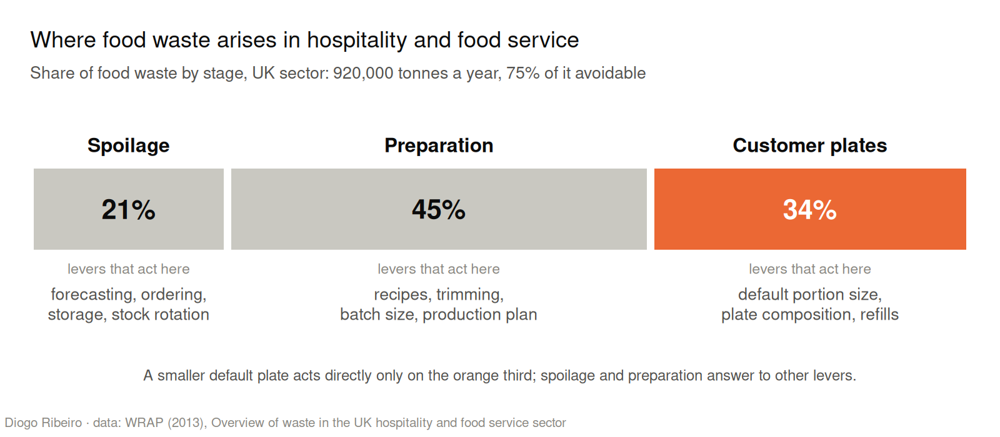
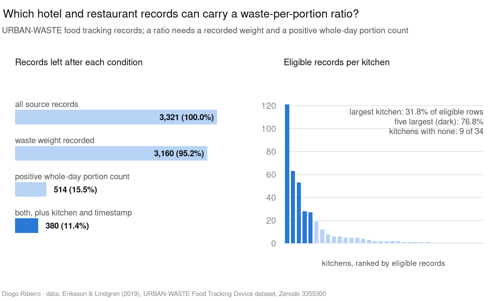
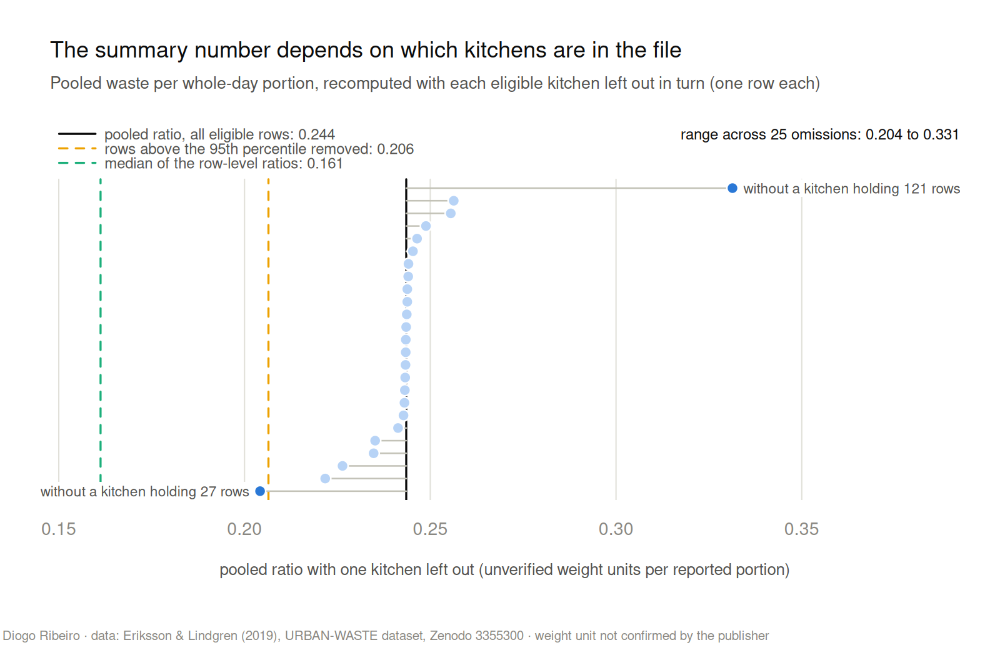
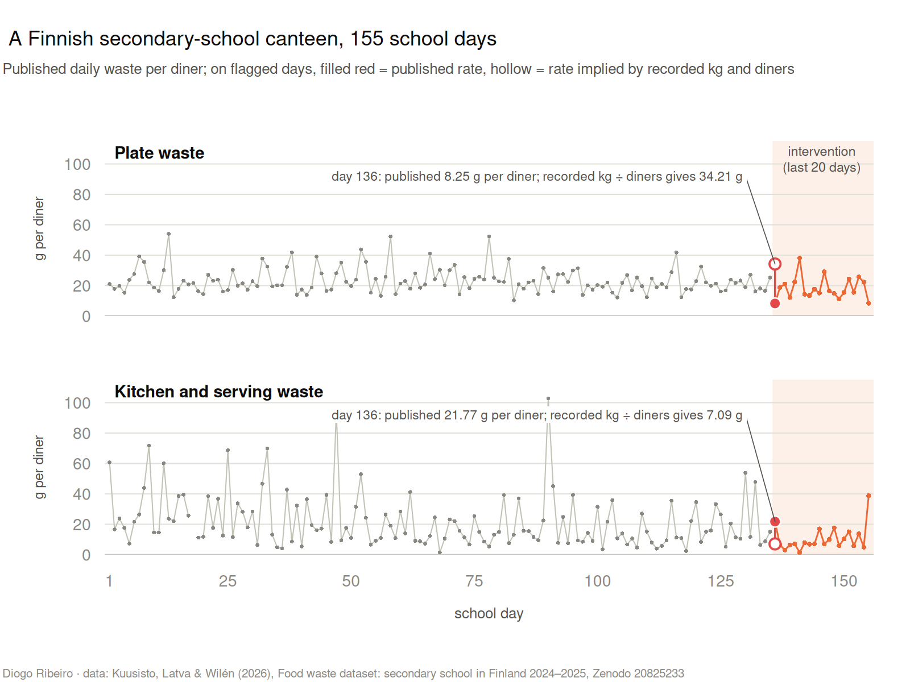
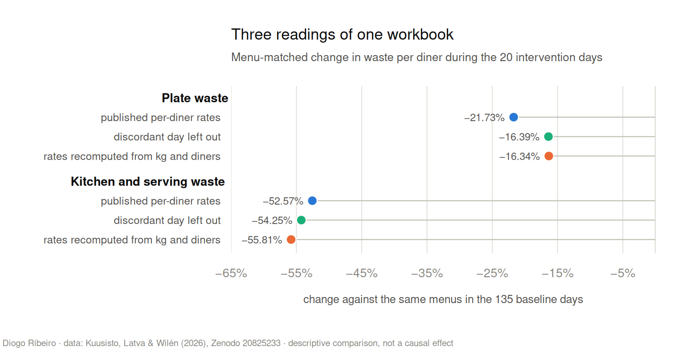
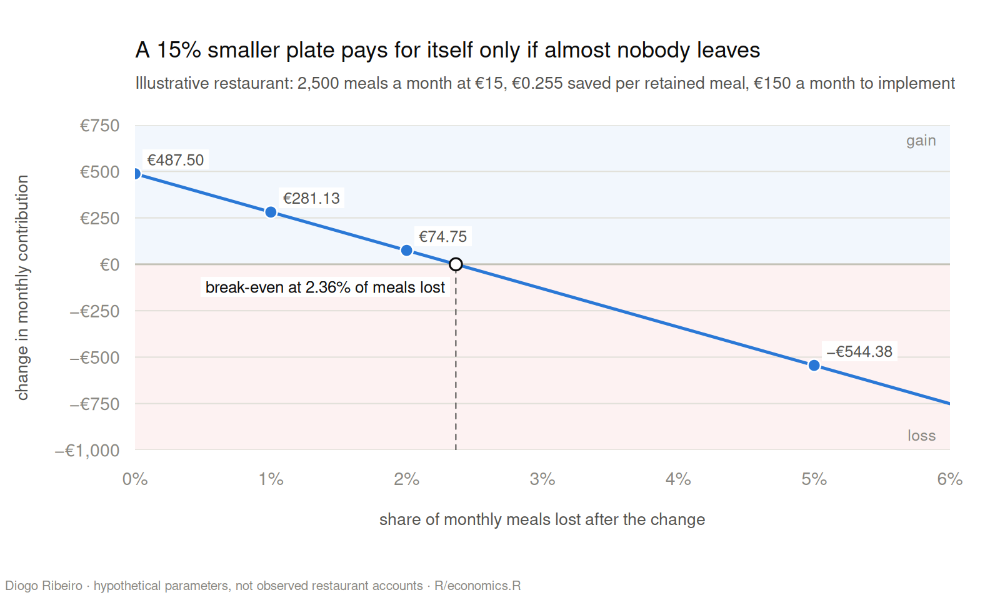
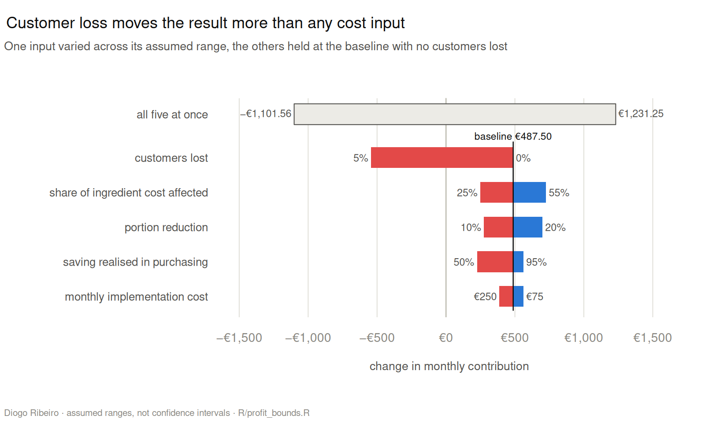
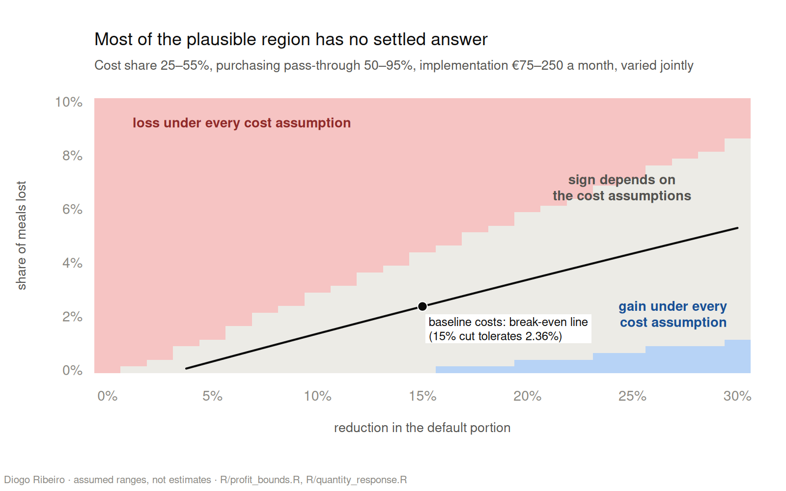
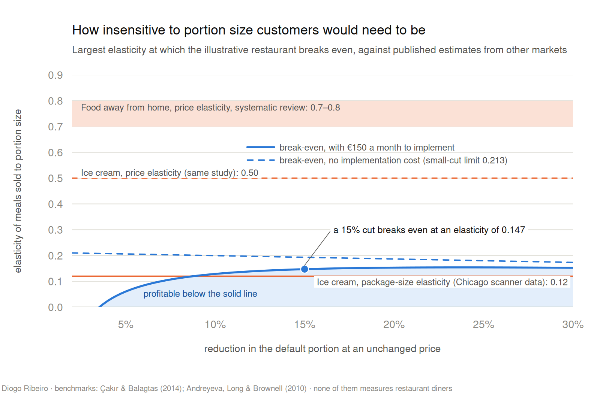
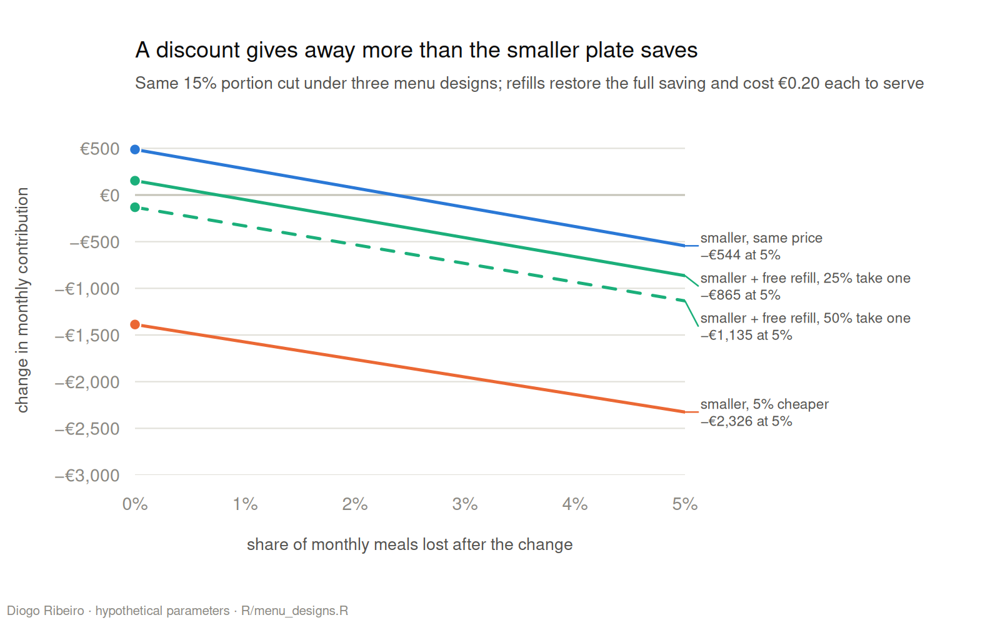

# The Economics of the Uneaten Meal

*Public food-waste data, a contribution-margin model and a break-even elasticity: when a smaller plate sold at the same price pays for itself, and how much of that question the evidence can settle*

A customer orders a meal. Before it reaches the table the restaurant has bought the ingredients, stored them, prepared them and plated them, and it has paid people at every one of those stages. Some of the food never leaves the kitchen. Some of what does leave comes back uneaten. The restaurant paid for all of it. The customer, for their part, bought a meal rather than a stated number of grams. Put those facts side by side and a business question follows that gets less attention than it deserves: how much of the food served is actually needed to deliver what the customer is paying for?

The obvious answer is to serve less, keep the price, pocket the difference in ingredients and preparation, and count the smaller bin at the end of the night as a bonus. It sounds like a free improvement in operating margin. It is not free. It is a hypothesis with a cost side, a demand side and a missing empirical link between the two, and most of this piece is about that link.

Two customers paying the same price make the problem concrete. One cares about the quality of the ingredients and would happily take a slightly smaller serving. The other reads the size of the portion as a measure of what the restaurant owes in return for the money. A saving of a few cents per dish disappears quickly once enough of the second kind stops coming back, so the useful question is not only how much less food a kitchen could prepare, but how many transactions it can afford to lose.

Nutrition complicates things further. The mass of a meal, its energy and its quality are different quantities, and trimming a heap of fried potatoes is not the same intervention as trimming the protein of a meal that was already thin. The target is unnecessary production relative to what customers need, not restriction for its own sake, and a sensible portion policy leaves room for people who need more food to get it.

The scale is real. The United Nations Environment Programme estimated that 1.05 billion tonnes of food waste were generated in 2022 across households, food service and retail, inedible parts included, and that food service accounted for about 290 million tonnes of it ([UNEP, Food Waste Index Report 2024](https://www.unep.org/en/news-and-stories/press-release/world-squanders-over-1-billion-meals-day-un-report)). Those numbers describe a global system, not what any particular restaurant could save, but they make the serving decision a reasonable place to look for money.

I do not own a restaurant, I have no access to a point-of-sale system and I do not run a field team. What I can do is take public datasets, check how they were collected, build an accounting model that can be defended line by line, and work out the conditions under which a smaller portion could pay. That is narrower than solving food waste, and more honest than quoting an imagined figure for monthly savings.

The analysis is written in R and lives in the [restaurant-portion-economics folder of my Medium-Blog repository](https://github.com/DiogoRibeiro7/Medium-Blog/tree/main/restaurant-portion-economics). It uses archived waste records from European hotel and restaurant kitchens and from one Finnish school, published US cost benchmarks, and a set of explicit business assumptions that anyone can change. Every figure in this article is drawn by that code, and the four that use real data are regenerated in a GitHub Actions workflow that downloads the original files from Zenodo and checks them against the publishers' checksums. Data and assumptions are kept apart throughout, and where the data cannot identify something, the text says so.

The short version of what came out is this. Only about a third of food-service waste is left on plates, so a smaller default portion reaches a minority of the problem directly. The public commercial records cannot produce a credible waste-per-meal figure: only 380 of 3,321 rows carry the information a ratio needs, a handful of kitchens dominate them, and the unit of weight is not documented. The Finnish school data show waste falling during an intervention period, but one day's record contradicts itself, and depending on which of its numbers you believe the drop in plate waste is 21.73% or about 16%. On the economic side, the illustrative restaurant I use saves €0.255 on each retained meal by cutting the default portion by 15%, and it breaks even if it loses 2.36% of its meals. Restated as an elasticity, customers must be close to indifferent to portion size: the cut pays only if each 1% taken off the plate costs fewer than about 0.15% of meals sold. That threshold sits barely above a published estimate of how supermarket shoppers react to a smaller ice-cream carton, and far below how restaurant demand reacts to price. Discounting the smaller plate loses money before a single customer reacts. And unless its weekly sales are unusually stable, a single restaurant could not tell a 2.36% loss from noise in its own till data within a trial of any reasonable length.

None of this is a case for quietly serving less and calling it sustainability. That strategy can destroy the trust on which repeat business depends. The case is for treating the quantity of food as a design variable, next to recipe, price, service style and purchasing. If a leaner default serving could deliver the same experience with less unnecessary material, the economic and environmental interests would line up. The work is in finding out when they do and when they do not.

## What exactly are we trying to reduce?

The first mistake in food-waste analysis is to treat every discarded kilogram as if it came from a portion that was too large. Food is lost in purchasing, in storage, in preparation, at the pass and on the plate, and those pathways have different causes and different remedies. A tomato that spoils in the cold room is not saved by serving less rice with the main course. A heap of pasta left on the plate might respond to a smaller default serving. Trimmings respond to technique, recipe design or the supplier's specification. A model that lumps these together assumes a common mechanism that may not exist.

The best public breakdown I know of for the sector comes from WRAP, the UK waste charity, which estimated that UK hospitality and food-service outlets throw away about 920,000 tonnes of food a year, three quarters of it avoidable. Of that waste, 21% is spoilage, 45% arises in preparation and 34% is left on customers' plates ([WRAP, 2013](https://www.wrap.ngo/resources/report/overview-waste-hospitality-and-food-service-sector)). The figures are old, British and sector-wide, so they say nothing precise about any one kitchen. They do say something about the shape of the problem: the stage a smaller default plate acts on directly is about a third of the total.

*Figure 1. Where food waste arises in UK hospitality and food service, and which levers act at each stage. Source: WRAP (2013).*

Accounting identities make the same point more precisely. Imagine a restaurant that buys 100 units of an ingredient. Some of it is lost in storage, some becomes inedible preparation residue, some is turned into food that is served, and some of what is served comes back. Written out:

Purchased mass = storage losses + preparation losses + served mass + other inventory changes.

Served mass = consumed mass + customer leftovers + other serving losses.

These are identities, valid as long as the boundaries are defined and the quantities measured consistently. They are not estimates of any effect. What they do is force us to say where a change happens. If the kitchen cuts its default plated quantity, it may prepare less. It may also convert plate waste into food left in the pans at the end of service, in which case the waste has moved to a different line of the ledger and the purchasing bill has not changed at all.

For profit, the variable that matters is avoidable purchasing or production cost, not discarded mass. A kilogram of cheap starch, a kilogram of fish and a kilogram of mixed scraps cost very different amounts to replace, so removing the same share of each has very different financial consequences. Preventing waste can also save purchasing administration, refrigeration, storage and disposal, but those components belong in the calculation only when they are genuinely avoidable and measured. A disposal contract that is fixed for the month is not cheaper because one bin is a little lighter.

The second mistake is to confuse the amount served with the amount eaten. A smaller default portion reduces food served, but the customer can ask for more, order a side, take food home or simply eat more later. The environmental reading depends on what happens to total production and consumption, not on what remains on one plate. And a canteen that switches to a smaller serving spoon is running a different experiment from a restaurant that changes the portion printed on its menu: the mechanism and the person deciding are not the same.

The third mistake concerns calories. The mass of a dish does not reveal its energy. Watery vegetables add weight and few calories; oils and sauces add little weight and a lot of energy. Ingredient composition, edible yield, serving size and the amount actually eaten are all needed before making a nutritional claim, and a model built on waste weights alone cannot say how much energy a smaller plate removes. For that reason nutrition stays in this analysis as a constraint and an unresolved module, rather than as a column of decorative calorie figures.

The right unit of analysis also changes with the decision. A chef deciding how much fish to portion needs ingredient-level data; an owner deciding whether to offer a smaller lunch needs contribution per transaction and some knowledge of customer behaviour; a municipality planning landfill diversion needs material flows across many establishments. Collapsing those into one number produces attractive dashboards and poor decisions. This project is about the restaurant's contribution margin, and for that question waste data describe the physical problem, not how customers respond to the proposed solution.

A sound idea can still fail because it acts on the wrong part of the process. If the costly waste happens in preparation, cutting what reaches the plate achieves little. If plate leftovers are concentrated in a cheap side dish, trimming it saves little money and may still damage the impression of generosity. If ingredients can be prepared in smaller batches without the customer noticing, the best improvement may be operational and invisible. That is why the analysis starts from the flow of food and not from a universal target of 10%, 15% or 20% smaller meals.

The economic question is therefore narrower than "can a restaurant waste less?". It is this: can a change in the default quantity and composition of a meal reduce avoidable variable cost by enough to cover its implementation cost and any loss of demand? Public data can light up parts of that question. They cannot make the unobserved parts go away.

## What the public data can tell us

The first source is the URBAN-WASTE Food Tracking Device dataset, published by Eriksson and Lindgren in 2019 and archived on Zenodo as record 3355300. It holds waste records collected in hotel and restaurant kitchens. An R script downloads the original file, checks it against the publisher's checksum and analyses it without putting a copy in the repository. That matters more than it sounds: a number should be traceable to a named source file, not to an undocumented spreadsheet that has passed through several hands.

Reading the file took more than one attempt. An early parser guessed the wrong delimiter, because the column names themselves contain commas, and silently kept only 1,586 rows from 29 kitchens. The corrected parser, which refuses to proceed unless all thirteen published column names match exactly, recovers 3,321 rows from 34 kitchens. Had I summarised the first version, the numbers would have been wrong before any model was fitted. A pipeline can pass every unit test on a synthetic CSV and still misread the real one, which is why the source itself has to be validated, not only the code.

The more serious problem is missing information. A waste-per-portion ratio needs three things in the same row: a recorded waste weight, a positive count of whole-day portions, and usable kitchen and timestamp labels. Weight is recorded in 3,160 rows. A positive whole-day count appears in 514. Both, with labels, appear in 380, which is 11.44% of the file, and those 380 rows come from 25 of the 34 kitchens. The other nine are not waste-free, and their missing denominators should not be read as zeros. Whether a count is recorded may depend on the kitchen, the type of service or local recording habits, all of which may also be related to how much is wasted. Nothing in the file suggests the gaps are random.

*Figure 2. Left: URBAN-WASTE records left after each condition a waste-per-portion ratio needs. Right: the 380 eligible records by kitchen. Source: Eriksson & Lindgren (2019), Zenodo 3355300.*

The usable rows are also unevenly spread. One kitchen supplies 121 of the 380, about 31.84%. The five largest supply 292, or 76.84%. Together the eligible rows carry only about 7.71% of all the waste weight recorded in the file. Every one of these numbers describes the file, not a population of restaurants, and it would be indefensible to call a ratio computed on these rows the waste per meal of an average European restaurant.

That ratio, recorded waste over whole-day portions, comes to about 0.24353 in the file's undocumented weight units per reported portion. The median of the row-level ratios is about 0.16125. Dropping rows above the 95th percentile of row-level ratios moves the pooled figure to about 0.20644. Leaving out one kitchen at a time moves it anywhere between about 0.20418 and 0.33135. The swing is driven by two kitchens: removing the one with 121 rows pushes the ratio up by more than a third, and removing one with 27 rows pulls it down to the bottom of the range. None of these numbers is the right one. Together they show how much the summary depends on weighting, on outliers and on which kitchens happen to be in the file.

*Figure 3. The pooled URBAN-WASTE ratio recomputed 25 times, each time without one eligible kitchen, against three other summaries of the same rows. Units are the file's undocumented weight units per reported portion. Source: Eriksson & Lindgren (2019), Zenodo 3355300.*

It would be easy to label those numbers kilograms and multiply them by a food cost. I do neither. The documentation I could find does not establish the weight unit, the stage at which the waste was weighed, or whether the weighing window lines up with the whole-day portion count. Until it does, the ratio is a structural diagnostic, and no amount of decimal places or regression would turn it into a measurement per meal.

The second source is a Finnish dataset published by Kuusisto, Latva and Wilén in 2026 (Zenodo record 20825233). It covers 155 school days at a secondary school in western Finland between August 2024 and April 2025, with daily plate waste, kitchen and serving waste, and the number of diners. The first 135 days are a baseline; during the last 20, the school ran an art-based intervention in which artist-designed solutions targeting food waste were put in place. Lunch follows a 25-day menu cycle that repeats every five weeks. Unlike the commercial file, this one states its units, kilograms per day and grams per diner. It also comes from a different setting, with a different intervention, from the business idea being tested here.

Comparing each intervention day with the baseline average for the same menu, and using the published per-diner figures, plate waste is about 21.73% lower during the intervention and kitchen and serving waste about 52.57% lower. These are descriptive contrasts. They are not effects of serving smaller meals, and they say nothing about how a restaurant customer would respond to paying the same price for less food. They also inherit everything else that changed between the autumn and the spring: weather, attendance, menus within the cycle, and the attention that any intervention attracts.

Checking the workbook against itself turned up a discrepancy on day 136, the first intervention day. The recorded plate waste is 11.633 kilograms and the number of diners is 340, which implies about 34.21 grams per diner. The published rate for that day is 8.25 grams per diner. For kitchen and serving waste the recorded mass is 2.410 kilograms and the published rate 21.77 grams per diner, whereas mass and diners imply about 7.09 grams. No other day with both values recorded fails the same check, which allows for rounding by tolerating a gap of up to 2 grams or 3%, whichever is larger. There is no way to decide which value is right by choosing the one that agrees with the conclusion one would like.

*Figure 4. Daily waste per diner in the Finnish school, with the intervention period shaded. On day 136 the published rate (filled) and the rate implied by the recorded mass and diner count (hollow) disagree in both series. Source: Kuusisto, Latva & Wilén (2026), Zenodo 20825233.*

The series also shows something the averages hide. Kitchen and serving waste is volatile throughout the baseline, with single days above 90 grams per diner, while plate waste moves within a much narrower band. A 20-day window is short against that background, and day 136 sits at its very start.

The analysis therefore reports three readings of the same workbook: the published per-diner rates, the same rates with the discordant day left out, and rates rebuilt from the recorded masses and diner counts. For plate waste, the reduction against matched baseline menus is 21.73%, 16.39% and 16.34% respectively. For kitchen and serving waste it is 52.57%, 54.25% and 55.81%. The direction never changes, but for plate waste, the stream a smaller portion would act on, a quarter of the apparent reduction depends on one day's record. All three readings are reported; none is substituted silently for the published data.

*Figure 5. The same menu-matched comparison under three readings of the Finnish workbook. Descriptive contrasts, not causal effects. Source: Kuusisto, Latva & Wilén (2026), Zenodo 20825233.*

Accessible data are not automatically comparable data, and a measurement is not automatically an identified effect. The order of work matters: verify the file, understand how the observations were made, examine missingness and units, report the inconsistencies, and only then estimate anything. And neither dataset, however carefully read, says how many paying restaurant customers a smaller portion would cost.

## The contribution-margin equation

Suppose a restaurant sells N meals a month at price p. Let c be the ingredient cost of a meal and v the other variable costs attributable to serving it. Contribution per meal is m = p − c − v. Fixed costs matter for whether the business survives, but when they are genuinely the same under both alternatives they cancel out of the comparison, so I work with contribution rather than pretending to estimate net profit from accounts I do not have.

Let r be the fraction by which the default portion is cut. Not every ingredient shrinks with it. Sauces, garnishes, minimum order quantities, fixed recipe components, packaging and anything the restaurant should not reduce all stay where they are, so let s be the share of ingredient cost that the cut actually touches. Even within that share, preparing less does not always mean buying less: suppliers sell in cases, waste moves between stages, and purchasing habits adjust slowly. Let a be the fraction of the theoretical reduction that shows up in the purchasing bill.

The avoidable ingredient cost per retained customer is then

S = c × s × r × a.

The equation is deliberately plain. It claims neither that every restaurant can save this amount nor that discarded-food data supply any of its parameters. Each factor has a physical or operational meaning that a particular restaurant could measure.

Now suppose the new portion reduces the number of meals sold by a proportion l, and let I be the monthly cost of implementing the change: retraining, new menus, changes to kitchen routines. Monthly contribution before the change is N × m. After it, it is N × (1 − l) × (m + S) − I. The difference is

Δ = N × [(1 − l) × (m + S) − m] − I,

which rearranges to

Δ = N × [S − l × (m + S)] − I.

The first term is the purchasing saving the restaurant would make if demand did not move. The second removes the contribution lost on the meals that are no longer sold, including the savings that would have been made on them. The third is the cost of making the change. At this level the model is an accounting identity conditional on its inputs, not a fitted relationship between behaviour and outcomes.

Setting Δ = 0 and solving for the largest loss of customers the change can absorb gives

l* = (S − I/N) / (m + S),

provided m + S is positive. If l* is negative, the change fails even if every customer stays. If l* is positive but small, the business case rests on customer acceptance to a degree that can easily outweigh the food saving. For an operator, that threshold is more useful than any recommendation to cut portions by a fixed percentage.

To make this concrete, take an illustrative restaurant that sells 2,500 meals a month at €15 each, with €5 of ingredients and €2 of other variable cost per meal, so that each meal contributes €8 before fixed costs. Cut the default portion by 15%, let the cut touch 40% of ingredient cost, let 85% of the theoretical saving reach the purchasing bill, and allow €150 a month to implement it.

The saving per retained meal is €5 × 0.40 × 0.15 × 0.85 = €0.255. If no customer leaves, monthly contribution rises by 2,500 × €0.255 − €150 = €487.50. With 1% fewer meals the gain is about €281.13; with 2% fewer, about €74.75. With 5% fewer, the change costs about €544.38 a month. These are arithmetic scenarios, not observed outcomes.

*Figure 6. Change in monthly contribution for the illustrative restaurant as a function of the share of meals lost after a 15% portion cut. Hypothetical parameters.*

The break-even loss in this example is about 2.36% of monthly meals. A modest drop in demand is enough to absorb the entire saving. That does not mean a 15% cut will lose 2.36% of customers; estimating that relationship requires evidence I do not have, and the rest of this piece is largely about how much can be said without it.

The structure of l* also explains why the threshold is so tight. Ignore implementation cost for a moment and l* is roughly S/m, the saving per meal as a fraction of the contribution per meal. Ingredients are a minority of the price, only part of them shrinks with the portion, and the margin on each meal is several times larger than the saving. Losing one meal costs the restaurant its whole margin; keeping it gains a few cents.

The inputs are not Portuguese restaurant benchmarks. I chose them to make the model easy to inspect. Later I set them against US industry ratios of food cost to sales, but a business-level ratio of food and non-alcoholic beverage spending to sales is not the ingredient cost of a particular €15 dish, and treating it as one would confuse both the unit of observation and the composition of cost.

This is where the model becomes useful to someone running a restaurant. An owner does not need to accept any argument about sustainability to use it. The question reduces to two operational quantities: how much ingredient cost is actually avoidable per retained meal, and how many transactions can be lost before the change stops paying. Those two numbers, together with implementation cost, settle most of the answer.

## What uncertainty permits us to conclude

One way to finish the analysis would be to pick a customer-loss figure and announce whether the change succeeds. That produces an answer, but it hides the fact that no reliable estimate of the demand response exists. The alternative is to map the region of assumptions in which the restaurant comes out ahead. That does not turn guesses into observations. It makes the role of each guess visible.

For the example restaurant, let the portion cut range from 10% to 20%, the share of ingredient cost affected from 25% to 55%, the share of the saving that reaches purchasing from 50% to 95%, customer loss from zero to 5%, and implementation cost from €75 to €250 a month. These are ranges chosen by the analyst. They are not confidence intervals estimated from the commercial waste file or from the Finnish school.

Within that box, and as long as the baseline margin is positive, Δ rises with the affected cost share, the size of the cut and the share of saving realised, and falls with customer loss and implementation cost. Because Δ is monotone in every input, its smallest and largest values over the box sit at two opposite corners, and they can be written down exactly. There is no need for a Monte Carlo simulation to find an extreme that algebra delivers directly.

Let S_min = c × s_min × r_min × a_min and S_max = c × s_max × r_max × a_max. The smallest change in contribution over the box is

Δ_min = N × [(1 − l_max) × (m + S_min) − m] − I_max,

and the largest is

Δ_max = N × [(1 − l_min) × (m + S_max) − m] − I_min.

For the example, the saving per retained meal ranges from €0.0625 to €0.5225, and the monthly change in contribution from about −€1,101.56 to +€1,231.25. The interval contains zero, so profitability is not robust over these assumptions: both a gain and a loss are compatible with them. This is not a 95% interval, a posterior distribution or a forecast for any operator.

Which assumption matters most? Varying one input at a time across its range, with the others held at the baseline and no customers lost, answers that directly. Moving customer loss from zero to 5% swings the result by more than €1,000, about twice as much as moving the affected cost share across its entire range, and several times more than implementation cost. The cost-side inputs are things an owner can measure from invoices and recipes. The input that dominates is the one nobody has measured.

*Figure 7. Change in monthly contribution as each input moves across its assumed range with the others at the baseline, and the exact range when all five move together. Hypothetical parameters.*

The break-even loss threshold can be bounded the same way. At the unfavourable corner it is below zero, so the change fails even if nobody leaves. At the favourable corner it is positive, so there is some tolerance for lost sales. Repeating the calculation over a grid of portion cuts and customer losses produces a map with three regions: combinations that lose money under every cost assumption in the box, combinations that gain under every one, and a wide band in between where the sign depends on the cost assumptions. The region where the gain is guaranteed is a thin strip along the bottom: cuts deeper than about 15%, and losses of no more than about 1% of meals.

*Figure 8. For each combination of portion cut and customer loss, whether the contribution change is positive under every cost assumption in the box, negative under every one, or depends on them. The line is the break-even loss at the baseline cost assumptions. Hypothetical parameters.*

The map does not encode how demand responds to portion size. Treating r and l as independent coordinates lets us inspect possible outcomes; it does not reveal the curve that connects them, and choosing r to maximise contribution without that curve would be a mathematical solution to an invented problem.

## The same threshold, written as an elasticity

There is one more thing the algebra can do without data, and it turns out to be the most useful. A threshold expressed as a share of lost meals is hard to compare with anything, because nobody publishes the share of meals lost after a 15% portion cut. A threshold expressed as an elasticity can be compared with what economists have measured elsewhere.

When the price stays the same and the portion shrinks by r, the price per unit of food rises by r / (1 − r), about 17.65% for a 15% cut. Suppose meals sold respond to that effective price with a constant elasticity ε, which is equivalent to saying that meals sold scale with portion size raised to the power ε. Then the meals kept after the cut are a fraction (1 − r)^ε of the meals sold before, the share lost is l = 1 − (1 − r)^ε, and the change in contribution becomes

Δ = N × [(1 − r)^ε × (m + S) − m] − I.

Setting Δ = 0 gives the largest elasticity at which the cut still breaks even:

ε* = ln[(m + I/N) / (m + S)] / ln(1 − r).

For the illustrative restaurant and a 15% cut, ε* is about 0.147. Each 1% removed from the plate may cost at most about 0.15% of meals sold. Without implementation cost, and for small cuts, the threshold tends to c × s × a / m, the avoidable ingredient cost per unit of portion cut divided by the margin per meal, which here is 1.7 / 8 = 0.2125. What the restaurant can afford is set by its cost structure, not by how deep it cuts: between cuts of 10% and 30% the threshold barely moves, from about 0.13 to a maximum of about 0.154, because the saving and the effective price increase grow together.

How does 0.15 compare with anything measured? The closest evidence I found is not about restaurants at all. Using supermarket scanner data from the Chicago ice-cream market, where several brands shrank their cartons, Çakır and Balagtas estimated that demand responds to package size with an elasticity of about 0.12, roughly a quarter of its response to price, which they put at about 0.5 ([Journal of Retailing, 2014](https://doi.org/10.1016/j.jretai.2013.06.002)). A systematic review of 160 studies by Andreyeva, Long and Brownell found food away from home among the most price-responsive categories, with elasticities of about 0.7 to 0.8 in absolute value ([American Journal of Public Health, 2010](https://doi.org/10.2105/AJPH.2008.151415)).

If restaurant diners reacted to a smaller plate the way Chicago shoppers reacted to a smaller carton, a 15% cut would cost about 1.93% of meals and the example restaurant would gain about €88.92 a month, inside the break-even line but not by much. If they reacted to the smaller plate as they would to an equivalent price rise, at the ice-cream price elasticity of 0.5 the cut would cost about 7.80% of meals and roughly €1,123 a month. At the restaurant price elasticities in the review, the loss would be larger still.

*Figure 9. The largest elasticity of meals sold with respect to portion size at which the illustrative restaurant breaks even, with and without implementation cost, against published estimates from other markets. None of the benchmarks measures restaurant diners. Sources: Çakır & Balagtas (2014); Andreyeva, Long & Brownell (2010).*

None of these numbers measures what a restaurant needs. An ice-cream carton is bought once and eaten at home; a plate is looked at, shared, photographed and remembered, and the decision to return is made weeks later. The restaurant response could be weaker than the carton response, because diners rarely weigh their food, or stronger, because the plate sits in full view. What the comparison does establish is where the decision lives. The break-even elasticity sits just above the package-size elasticity from the ice-cream study and well below every price elasticity in the review. A restaurant cutting portions at an unchanged price is betting that its customers treat a smaller plate much more like a smaller carton than like a higher bill. That is a specific, testable claim, and it is a more useful thing to know than a projected annual saving.

Industry data can constrain the cost side in the same spirit. The US National Restaurant Association reported 2024 respondent medians for food and non-alcoholic beverage costs of 32.0% of sales in full-service restaurants and 32.4% in limited-service ones, and among full-service operators 33.7% below US$2 million in annual sales and 31.0% above. The project turns these into clearly labelled cross-market scenarios, but a median across US businesses is not the ingredient bill of a particular dish in Portugal, and the spread of four medians is not a measure of uncertainty about any one restaurant. Nor do the waste files measure purchasing savings or customer response, so those parameters stay as explicit inputs rather than numbers borrowed from data that cannot identify them.

A useful result does not have to be a confident point estimate. A tight threshold can on its own rule out careless business plans, and it tells an operator exactly which quantity a pilot would need to measure.

## Three designs, three different business risks

Making the meal smaller is not, by itself, a complete product decision. The restaurant also has to decide how to tell customers, whether to change the price, and what to offer people who need or want more food. Those choices change the accounting, and they also change the behavioural response that nobody has measured. The model should represent both without pretending the second is known.

The first design is a smaller default portion at the original price, which is the business idea as first stated. No revenue is given up on any retained sale and the purchasing saving raises the contribution per meal. But the price per unit of food goes up: if a €15 dish loses 15% of its mass and keeps its price, the price per gram rises by about 17.65%. That does not mean customers perceive a 17.65% price increase, because what a restaurant sells includes quality, service, location, atmosphere and convenience. It does explain why an unannounced change can be read as worse value even by a customer who would have been perfectly satisfied with the smaller meal.

The second design is a smaller portion with a discount. Now the restaurant gives up some revenue on every retained sale in exchange for a proposition that may be easier to accept. In the illustrative case, a 5% discount on a €15 meal gives away €0.75 per transaction, nearly three times the €0.255 that a 15% smaller portion saves in ingredients. Contribution falls by about €1,387.50 a month before a single customer reacts and after implementation costs. A discount might attract more customers or change the mix of customers, but those effects need their own evidence, and a negative accounting result cannot be rescued by quietly assuming that people will turn up.

The third design is a smaller default portion at the original price with a free refill on request. This trims food for people who do not want the full amount while preserving access for people who do. It brings its own uncertainty. Some customers will ask for the refill, and each refill gives back some or all of the ingredient saving and costs staff time, service equipment and coordination in the kitchen. Refills might also improve how customers judge value and how much they trust the restaurant, but that possible benefit cannot be counted twice, once as an assumed rise in demand and again as a costless service.

The R code generalises the contribution equation to cover all three. Let d be the proportional discount, u the fraction of retained customers who ask for one refill, f the fraction of the ingredient saving that a refill gives back, and h the cost of handling a refill. The ingredient saving after refills, averaged over retained transactions, is

S_refill = c × s × r × a × (1 − u × f).

The contribution per retained meal becomes

m_new = p × (1 − d) − c − v + S_refill − u × h,

and with a monthly loss of meals l and implementation cost I, the change in contribution is

Δ = N × (1 − l) × m_new − N × m − I.

The refill is treated as something with a cost to the operator rather than as free, and a cash discount is kept separate from the quantity of food saved. Two designs with the same plated mass can have different contributions, different implications for repeat visits and different service costs.

With 15% smaller default portions, a quarter of customers asking for a refill, each refill restoring the full saving on the affected ingredients, €0.20 to handle each refill and €200 a month to implement, contribution rises by about €153.13 a month if demand does not change. If half of the customers ask, the gain becomes a loss of about €131 a month before anyone leaves. The refill design is fragile in a different way from the same-price design: it depends less on how many customers leave and more on how many come back to the counter.

*Figure 10. Change in monthly contribution for the same 15% portion cut under three menu designs, as the share of meals lost rises from zero to 5%. Hypothetical parameters.*

Published portion-size studies are relevant here, but none of them settles the choice between these designs. In controlled experiments in Stanford University dining halls, Voşki and colleagues found that a serving spoon 25% smaller reduced the meat taken by about 18% a day without lowering diners' satisfaction, while a spoon 50% smaller produced no reduction in meat served and a significant fall in satisfaction ([Stanford experiments](https://www.ncbi.nlm.nih.gov/pmc/articles/PMC12001533/)). In three Dutch restaurants, Reinders and colleagues cut the meat on main-dish plates by an average of 12.5% and doubled the vegetables; satisfaction with the visit as a whole did not change, satisfaction with the main dish fell slightly, and vegetable consumption rose ([International Journal of Behavioral Nutrition and Physical Activity, 2017](https://doi.org/10.1186/s12966-017-0496-9)). A randomised field experiment by Hua and colleagues in US cafés tested whether relabelling a smaller main course as the standard portion shifts what diners choose ([Appetite, 2026](https://www.sciencedirect.com/science/article/pii/S0195666326000565)).

Each of these answers a nearby question rather than the one here. A smaller option sold for less cannot tell us what happens when the same customer receives less for the same price. A spoon in a university dining hall is not a plated restaurant meal that a paying customer has come to expect. A measure of satisfaction on the day is not a measure of whether that customer returns next month. The Stanford result carries one lesson worth taking seriously all the same: the response to a smaller serving was not proportional. The moderate cut worked and the large one provoked compensation and dissatisfaction, which is exactly the kind of curve the constant-elasticity model in the previous section cannot represent, and a reason to treat any single elasticity as a local approximation.

There is also a fourth design that changes the restaurant's production without changing the customer-facing portion at all. Better demand forecasts, staggered preparation, smaller batches and adjustments to recipes can cut kitchen waste while keeping the menu's promise intact, and Figure 1 suggests that is where two thirds of the waste arises. I cannot claim those strategies always win, but they put far less pressure on the customer-value problem, and they belong in the comparison rather than outside it.

Choosing between these designs is product design under uncertain behaviour, not an exercise in dividing kilograms by meals.

## What an independent analysis can offer a restaurant

After the source validation, the descriptive work and the economic model, the conclusion is awkward but useful. The biggest unknown in the original proposition is not the algebra. It is how customers respond to visibly receiving less at an unchanged price. A restaurant may well save on ingredients, but the value of the saving depends on how many meals it keeps selling, and the elasticity calculation shows how little room there is.

Without access to anyone's accounts, it would be misleading to advertise a percentage improvement in restaurant margins. Neither the 3,321 commercial waste records nor the school intervention supplies the missing demand and cost data, and even the commercial waste-per-portion figures need caution, because the denominator exists for a narrow, unevenly spread subset and the unit of weight is undocumented. What can honestly be offered at this stage is a transparent decision framework, not a promise of savings.

That framework is still worth something to an owner. It runs on information most restaurants already hold: meals sold, recipe quantities, ingredient costs from invoices, portions prepared and thrown away, complaints and, where it exists, repeat custom. No sensor platform or machine-learning system is needed to find out whether the economics are plausible, and the restaurant's own records are more relevant than any cross-country benchmark.

The sequence is short. Pick a few high-volume dishes, establish the avoidable cost of each ingredient, and separate kitchen waste from plate waste. Identify changes that would not compromise nutritional adequacy or the identity of the dish. Compute the break-even loss and the break-even elasticity for each, keeping implementation and service costs explicit. Only if the potential gain is large relative to the uncertainty does a trial make sense. For the €15 restaurant in the example, that exercise says a €0.255 saving per retained meal, after €150 a month of implementation, tolerates a loss of about 2.36% of transactions, or an elasticity of about 0.15. That is not a decision to shrink the meal. It is a threshold against which customer research, trial results or experienced judgement can be compared.

The threshold also says something uncomfortable about trials. Suppose the restaurant tries the smaller plate and compares weekly meals sold with and without it. If the part of week-to-week variation the comparison cannot explain is 5% of sales, detecting a 2.36% loss with conventional power (a 5% two-sided test with 80% power) needs about 69 weeks in each arm, assuming independent weeks. At 10% it needs about 273 weeks per arm. Seasonality, holidays and serial correlation make the real requirement larger. One restaurant comparing its till receipts before and after a menu change cannot see the effect that decides whether the change pays. A credible test needs several comparable sites with matched controls, randomisation at the level of the customer or the table, or repeat-visit data from a loyalty scheme. That, more than anything, is why such a test needs an operator with more than one restaurant.

A real trial would also have to watch for things the model leaves out. Customers may change how they order, share differently or switch to more expensive sides. Staff may compensate for smaller servings with extra sauce. Ingredients bought in bulk may not fall in proportion to the portion, and plate waste may simply reappear as end-of-service leftovers. The response may differ by dish, by time of day and between regulars and occasional visitors, all of which a monthly average conceals. And communication is part of the intervention: a restaurant that silently shrinks portions while describing the dish as before risks its customers' sense of fairness, even among those who would have chosen the smaller quantity themselves. Reducing waste must not become a euphemism for selling materially less under an unchanged promise, and the serving that maximises a narrow profit equation is not necessarily right for someone with higher energy needs, a child or an older person at nutritional risk.

## What the results establish, and what they do not

On the data side, the commercial tracking file contains genuine kitchen observations, but only 380 of 3,321 records support even a provisional waste-to-portion diagnostic, and the result depends on which few kitchens are included; it cannot be used to announce an average saving per restaurant meal. The Finnish file is cleaner and its intervention-period differences are large, but the intervention was an art project in a school, not a fixed-price portion cut in a business, and one inconsistent day moves the plate-waste reduction from about 21.73% to about 16.34%. A credible analysis shows that discrepancy rather than picking whichever number sounds better.

The model establishes a conditional fact. If a smaller default serving creates real avoidable ingredient savings, and the contribution kept on retained sales exceeds the contribution lost on the sales that disappear plus the cost of making the change, monthly contribution rises. Stated like that it sounds obvious. Its thresholds are not: in the illustrative restaurant a loss of a little over 2% of transactions is enough to erase an apparently attractive saving, and the elasticity this implies is close to the lowest of the published estimates I compared it with.

The bounds establish a second conditional fact: over a reasonably broad set of assumed purchasing, implementation and customer-response parameters, both a gain and a loss are possible, and the customer response moves the answer more than any cost input. The model can draw the break-even surfaces. It cannot say how likely each side is without further evidence, and it does not identify an optimal portion size or a guaranteed route to higher profit.

The next step is not another model feature. It is better source definitions, credible ingredient-cost detail and defensible evidence on how customers respond to portions sold at unchanged prices: for an independent researcher, a systematic review of the quantity-response literature; for an interested restaurant group, a multi-site pilot with controls, customer safeguards and enough weeks to see the effect it is looking for. The quantity that matters economically is not the food thrown away or the calories removed. It is avoidable cost net of the change in behaviour, the service effects and the cost of implementation, and any honest business case has to put the customer inside the equation.

The question is not whether restaurants could serve less. They can. The question is whether they can serve the right amount, cut unnecessary production and keep the value that brings customers back. That is a much more demanding proposition, and a more useful one to analyse.

## References and reproducibility

- United Nations Environment Programme. *Food Waste Index Report 2024*. https://www.unep.org/resources/global-food-waste-index-report-2024
- WRAP (2013). *Overview of waste in the UK hospitality and food service sector*. https://www.wrap.ngo/resources/report/overview-waste-hospitality-and-food-service-sector
- Eriksson and Lindgren (2019). URBAN-WASTE Food Tracking Device dataset. Zenodo record 3355300: https://zenodo.org/records/3355300
- Kuusisto, A., Latva, J. and Wilén, E. (2026). Food waste dataset: secondary school in Finland 2024–2025. Zenodo record 20825233: https://zenodo.org/records/20825233
- Çakır, M. and Balagtas, J. V. (2014). Consumer response to package downsizing: evidence from the Chicago ice cream market. *Journal of Retailing*, 90(1), 1–12. https://doi.org/10.1016/j.jretai.2013.06.002
- Andreyeva, T., Long, M. W. and Brownell, K. D. (2010). The impact of food prices on consumption: a systematic review of research on the price elasticity of demand for food. *American Journal of Public Health*, 100(2), 216–222. https://doi.org/10.2105/AJPH.2008.151415
- Voşki, A. et al. (2025). Effect of a portion-size default nudge on meat consumption and diner satisfaction: controlled experiments in Stanford University dining halls. https://www.ncbi.nlm.nih.gov/pmc/articles/PMC12001533/
- Reinders, M. J., Huitink, M., Dijkstra, S. C., Maaskant, A. J. and Heijnen, J. (2017). Menu-engineering in restaurants: adapting portion sizes on plates to enhance vegetable consumption, a real-life experiment. *International Journal of Behavioral Nutrition and Physical Activity*, 14, 41. https://doi.org/10.1186/s12966-017-0496-9
- Hua, S. V., Roberto, C. A., Yam, E., Leone, E., Gibson, L. A. and Rimm, E. B. (2026). Changing portion size labels of main courses to encourage selection of smaller portions when dining out: a randomized controlled field experiment. *Appetite*. https://www.sciencedirect.com/science/article/pii/S0195666326000565
- National Restaurant Association. Food cost ratios across restaurant formats (2024 observations): https://www.restaurant.org/research-and-media/research/restaurant-economic-insights/analysis-commentary/restaurant-operators-kept-food-cost-ratios-in-check-in-2024/
- National Restaurant Association. Differences by restaurant sales volume (2024 observations): https://restaurant.org/research-and-media/research/restaurant-economic-insights/analysis-commentary/higher-volume-restaurants-reported-lower-food-cost-ratios-in-2024/
- Code, figures, protocols and source audit: https://github.com/DiogoRibeiro7/Medium-Blog/tree/main/restaurant-portion-economics

All money figures in the example are hypothetical. The R project reproduces every number and figure in this article, with regression tests; the four figures built on real data are redrawn by a GitHub Actions workflow from the checksum-verified Zenodo files. The data analysis and the financial assumptions are separate components, and neither is presented as a causal estimate of restaurant profitability.

