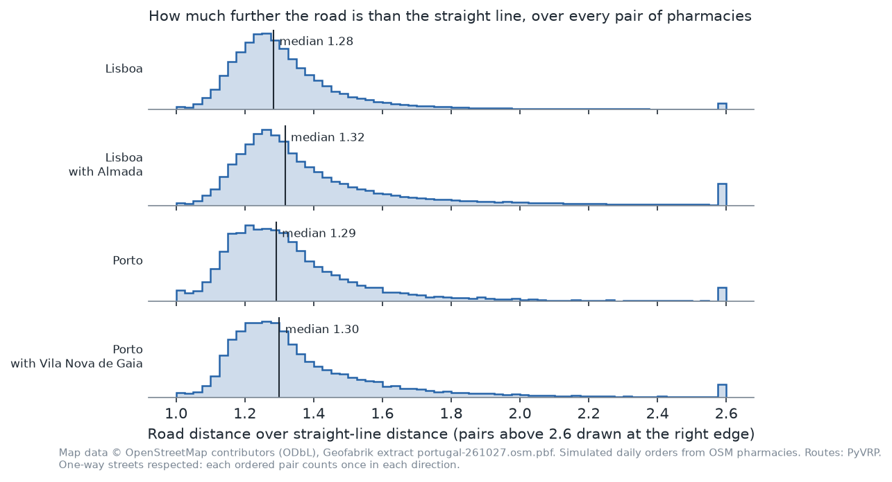
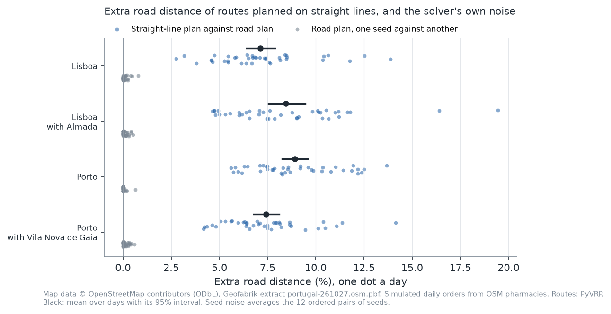
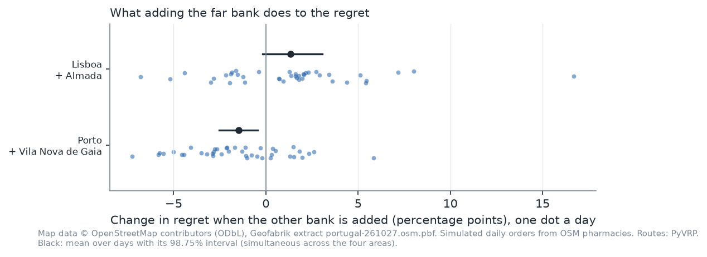
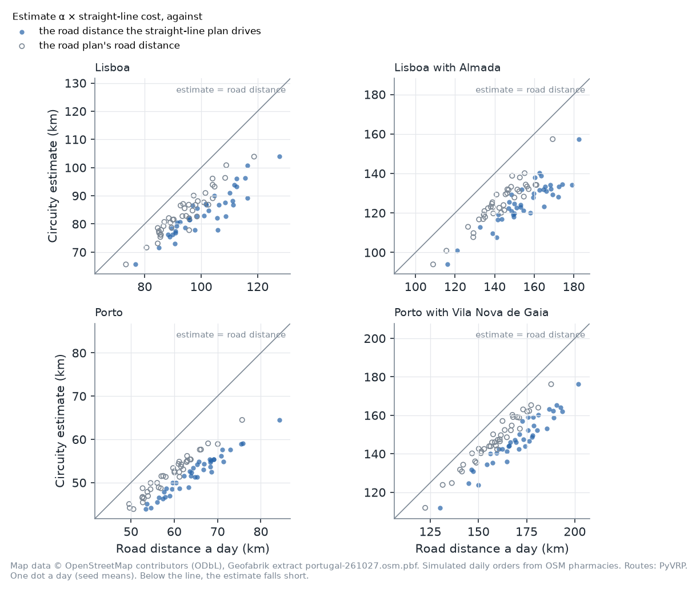
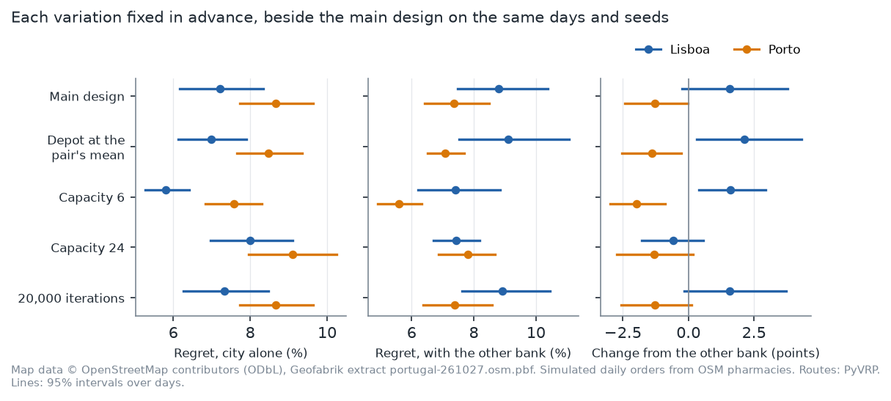

# Straight Lines, Real Roads

*What planning delivery routes on straight-line distances costs, in {{n_solves}} routing problems solved on the roads of Lisbon and Porto*

*Map data © OpenStreetMap contributors, available under the Open Database Licence ([openstreetmap.org/copyright](https://www.openstreetmap.org/copyright)).*

A distributor plans tomorrow's delivery routes tonight, and the plan needs the distance between every pair of stops. Road distances need a road network and a shortest-path computation for every pair. Straight-line distances need two coordinates and a formula. Planning on straight lines is the cheaper shortcut, and its cost is easy to define: the routes are planned on straight lines but driven on roads.

I measured that cost on the OpenStreetMap road networks of Lisbon and Porto, with simulated daily orders from the cities' pharmacies. The design was registered before any distance was computed or any route was solved, and every number below is read by code from the result files in the [project repository](https://github.com/DiogoRibeiro7/Medium-Blog/tree/main/routing-on-real-roads).

In short: routes planned on straight lines drove {{e1_min}} to {{e1_max}} further on the roads than routes planned on road distances, more than {{noise_times}} times the solver's own run-to-run noise. A river crossed by few bridges did not widen that gap by the registered rule, against what I expected: in Lisbon a rise is not established, and in Porto adding the far bank narrowed it. Multiplying straight-line distances by one detour factor, to estimate what the routes will cost, understated the road distance the straight-line plans drove by {{e4_own_min}} to {{e4_own_max}}.

## Two plans for the same day

Each day's orders define one routing problem: a depot, the pharmacies that ordered, and identical vans that carry {{capacity}} orders each, as many vans as needed. The plan minimises the total distance driven, with no time windows: the capacitated vehicle routing problem.

I solve each problem twice. The *straight-line plan* minimises total distance computed on straight-line distances; the *road plan* minimises it on road distances. Both are then driven on the roads, and the regret of planning on straight lines is

> regret = (road distance of the straight-line plan) ÷ (road distance of the road plan) − 1.

One fact shapes what follows. If every road distance were the straight-line distance times one constant α, every plan's road distance would be α times its straight-line distance, and a plan that minimises one would minimise the other. A single detour factor can correct a cost estimate, but it cannot change a plan. For exactly optimal plans, any regret must therefore come from how unevenly the roads detour: from pairs of stops where the road is much longer than the straight line beside pairs where it is barely longer, and from one-way streets, which make the road distance depend on the direction while the straight line does not.

The detours are uneven. Over every ordered pair of pharmacies in Lisboa, the road is a median {{alpha_lisbon_city}} times the straight line, but one pair in twenty is below {{ratio_p5_lisbon_city}} and one in twenty above {{ratio_p95_lisbon_city}}. The other three areas have similar medians and longer upper tails.

*Each panel is one area; the black line is the median ratio.*

## The data and the runs

- **Roads.** OpenStreetMap, from Geofabrik's extract of Portugal dated {{extract_date}}. The drivable network is what OSMnx's `drive` filter keeps, with one-way streets respected, clipped to the area plus {{buffer_km}} km so that routes may leave a municipality briefly. Around Lisbon that is a directed graph of {{nodes_lisbon}} nodes (junctions and dead ends) and {{edges_lisbon}} edges; around Porto, {{nodes_porto}} and {{edges_porto}}.
- **Customers.** OpenStreetMap's pharmacies: {{n_lisboa}} in Lisboa, {{n_almada}} in Almada, {{n_porto}} in Porto and {{n_gaia}} in Vila Nova de Gaia. They stand in for a distributor's customers: real places, spread across each city. Their orders are not public, so each pharmacy orders one unit a day with probability {{pi_lisbon}} in Lisbon and {{pi_porto}} in Porto, independently, over {{n_days}} simulated days. That gives on average {{orders_lisbon_city}} orders a day in Lisboa, {{orders_lisbon_both}} with Almada, {{orders_porto_city}} in Porto and {{orders_porto_both}} with Gaia.
- **Depot.** The road node nearest the mean location of the city's own pharmacies.
- **Distances.** The road distance is the shortest directed path between the nodes nearest two pharmacies, so it can differ by direction. The straight-line distance is the great-circle distance between the same two nodes.
- **Solver.** PyVRP {{pyvrp_version}}, a hybrid genetic search, stopped after {{iterations}} iterations and run with {{n_seeds}} random seeds for each plan. An iteration budget, unlike a time limit, gives the same routes on any machine; the tests re-solve problems from the committed results to check it.

## How the comparison works

There are four areas, two in each city: the city alone, and the city with the municipality across its river (Almada across the Tagus, Vila Nova de Gaia across the Douro). Within a city, both areas share one road network and one depot, and the larger area's orders on a day are the smaller one's plus the far bank's. The comparison between them is paired by day.

A solver like this one is a randomised search, and two runs with different seeds can return slightly different plans. So the regret has to be compared with a placebo: the road plan against itself under another seed. The *seed noise* is the average gap, in either direction, between the road distances of two road plans that differ only in their seed.

The decision rules were fixed in advance. Intervals are percentile bootstraps over the {{n_days}} days. For the two questions that decide something, the intervals are simultaneous across the four areas ({{simultaneous_level}} each): the regret exceeds the noise in an area if the interval of their difference lies above zero, and the river raises the regret if the interval of the change lies above zero.

## Planning on straight lines: {{e1_min}} to {{e1_max}} more road

Per area, with 95% intervals, the straight-line plans drove further by:

- **Lisboa:** {{e1_lisbon_city}} ({{e1_lisbon_city_low}} to {{e1_lisbon_city_high}}), about {{km_lisbon_city}} km a day.
- **Lisboa with Almada:** {{e1_lisbon_both}} ({{e1_lisbon_both_low}} to {{e1_lisbon_both_high}}), about {{km_lisbon_both}} km a day.
- **Porto:** {{e1_porto_city}} ({{e1_porto_city_low}} to {{e1_porto_city_high}}), about {{km_porto_city}} km a day.
- **Porto with Vila Nova de Gaia:** {{e1_porto_both}} ({{e1_porto_both_low}} to {{e1_porto_both_high}}), about {{km_porto_both}} km a day.

Changing only the seed moves the road plan's distance by {{noise_min}} to {{noise_max}} on average. By the registered rule, the regret exceeds the noise in all four areas, and by a wide margin: on no day in any area was the regret below {{r_day_min}}, and on no day was the noise above {{noise_day_max}}. The two plans use almost the same number of routes; they differ in which pharmacies share a route and in the order they are visited.

*One dot a day. Blue: the straight-line plan against the road plan, averaged over seeds. Grey: the road plan against itself under another seed. Black: the mean over days with its 95% interval.*

## The river: no established rise, and a fall in Porto

I expected the regret to rise when the area spans water that few bridges cross, and to rise more in Lisbon than in Porto. In the Lisbon network, every shortest road path between the two banks crosses the 25 de Abril bridge; in Porto, the paths use {{porto_bridges}} bridges.

- **Lisbon:** adding Almada changes the regret by {{e3_lisbon}} percentage points (simultaneous interval {{e3_lisbon_low}} to {{e3_lisbon_high}}). The interval includes zero, so a rise is not established.
- **Porto:** adding Vila Nova de Gaia changes it by {{e3_porto}} points ({{e3_porto_low}} to {{e3_porto_high}}). The whole interval lies below zero: the far bank lowered the regret.

The expectation failed in both cities. The straight-line plans do handle the water a little worse: they send more routes across it than the road plans, {{cross_straight_lisbon}} of routes against {{cross_road_lisbon}} in Lisbon and {{cross_straight_porto}} against {{cross_road_porto}} in Porto. Over a whole day, those extra crossings do not add up to an established rise in the regret.

Why Porto's regret falls, these data do not say. One pattern fits both cities: one-way streets, which a straight-line plan cannot see. In Porto alone, the road distance between two pharmacies differs between the two directions by a median {{asym_porto_city}}, against {{asym_porto_both}} once Gaia is added; in Lisbon the figure barely moves, from {{asym_lisbon_city}} to {{asym_lisbon_both}}. Two cities make a pattern, not a test.

*One dot a day: the regret with the far bank minus the regret in the city alone, on the same day. Black: the mean over days with its simultaneous interval.*

## The detour factor falls short

Straight-line distances are also used to estimate what the routes will cost. The estimate here multiplies the straight-line plan's straight-line distance by α, the area's median ratio of road to straight-line distance ({{alpha_min}} to {{alpha_max}} across the four areas), which comes from the distance tables alone, before any route is solved.

It falls short everywhere. Against the road distance the straight-line plan actually drives, it is short on average by {{e4_own_lisbon_city}} in Lisboa, {{e4_own_lisbon_both}} with Almada, {{e4_own_porto_city}} in Porto and {{e4_own_porto_both}} with Gaia. Against the road plan's distance, the shortest on offer, it is still short by {{e4_best_min}} to {{e4_best_max}}. In every area it falls short on every one of the {{n_days}} days, against either.

The reason lies in the legs that routes actually drive. Write κ for a plan's own ratio of road to straight-line distance on a day: its total road distance over its total straight-line distance. The estimate's error against that plan's road distance is then exactly

> error = α ÷ κ − 1,

so the estimate falls short whenever a plan's legs detour more than the median pair of pharmacies. They do, and the straight-line plan's most of all:

- **Routes are chains of short hops.** The road plans' legs average {{leg_min}} to {{leg_max}} km in a straight line, depot legs included, while two pharmacies picked at random are a median {{pair_min}} to {{pair_max}} km apart. On the legs the road plans drive, κ is {{kappa_road_min}} to {{kappa_road_max}}, already above α.
- **The straight-line plan selects its own errors.** Among the possible hops, it picks those that look shortest on a straight line, and those include the ones where the straight line understates the road most. On its legs, κ is {{kappa_straight_min}} to {{kappa_straight_max}}. This is what the optimizer's curse predicts (Smith and Winkler, 2006): choose the option whose estimate looks best, and its true cost will on average exceed the estimate, even when every estimate is unbiased.

The values of κ and the leg lengths were computed after the registered results, from the same solves, and decide nothing.

*One dot a day, seed means. Filled: against the road distance the straight-line plan drives. Hollow: against the road plan's road distance. Below the diagonal, the estimate falls short.*

## How robust is this?

I fixed {{n_variants}} variations in advance, each run on the first {{sens_days}} days with {{sens_seeds}} seeds and set beside the main design on the same days and seeds: a depot at the mean of all the pair's pharmacies, vans of {{cap_small}} and of {{cap_large}} orders instead of {{capacity}}, and {{iter_large}} iterations instead of {{iterations}}.

- **The regret persists.** It stays between {{sens_e1_min}} and {{sens_e1_max}} in every variation and area.
- **It grows with the vans' capacity in both cities alone:** in Lisboa, {{cap_small_lisbon}} with vans of {{cap_small}}, {{cap_main_lisbon}} with {{capacity}} and {{cap_large_lisbon}} with {{cap_large}}; in Porto, {{cap_small_porto}}, {{cap_main_porto}} and {{cap_large_porto}}. Smaller vans make more trips to and from the depot, legs that both plans drive in much the same way; that is consistent with the pattern, but the variations do not test it.
- **More search changes little.** {{effort_ratio}} times the search effort moves no estimate by more than {{iter_max_change}} percentage points, so the results do not hinge on the search budget.
- **The river.** Porto's change from the far bank is negative in every variation. Lisbon's is positive in {{lisbon_e3_positive}} of the {{n_variants}} variations and negative with the largest vans; {{lisbon_e3_above}} of the positive ones have 95% intervals above zero, but those intervals are not corrected for the many comparisons, and the variations decide nothing.

*The main design on the same days and seeds, then each variation fixed in advance. Lines are 95% intervals over days.*

## What this does not say

- **Not time.** Distance only: no speeds, traffic, turn restrictions or time windows. The regret in driving time could be larger or smaller.
- **Not real orders.** The pharmacies are real, but their orders are simulated, one unit each, and OpenStreetMap does not map every pharmacy.
- **Not optimal plans.** Each plan is the best that a fixed search found. The seed noise and the longer search bound how much that matters here.
- **Not every city.** Two Portuguese city centres, chosen for their rivers. A city with a regular street grid could give a different answer.
- **Not other uses.** Choosing depot locations or sizing a fleet on straight-line distances are different questions.

## What to do with it

If road distances can be computed, plan on them. Everything here came from a free map extract and open-source tools. If a plan must be made on straight lines, expect routes about {{e1_min}} to {{e1_max}} longer than they need to be in cities like these, and do not budget with the median detour factor: the legs that routes actually drive detour more than the typical pair of stops.

## Data, code and acknowledgements

The data, the code, the research plan with every change made to it and the full results are in the [project repository](https://github.com/DiogoRibeiro7/Medium-Blog/tree/main/routing-on-real-roads). Map data © OpenStreetMap contributors, available under the Open Database Licence ([openstreetmap.org/copyright](https://www.openstreetmap.org/copyright)), from Geofabrik's extract `{{extract_file}}`. The derived tables in the repository (pharmacy locations, snapped nodes and distance matrices) are published under the same licence.

Software: OSMnx {{osmnx_version}}, from Boeing, G. 2025: Modeling and Analyzing Urban Networks and Amenities with OSMnx, Geographical Analysis, 57(4), 567-577. doi:10.1111/gean.70009. PyVRP {{pyvrp_version}}, from Wouda, N. A., L. Lan and W. Kool. 2024: PyVRP: A High-Performance VRP Solver Package, INFORMS Journal on Computing, 36(4), 943-955. doi:10.1287/ijoc.2023.0055.

Smith, J. E., and R. L. Winkler. 2006: The Optimizer's Curse: Skepticism and Postdecision Surprise in Decision Analysis, Management Science, 52(3), 311-322. doi:10.1287/mnsc.1050.0451
