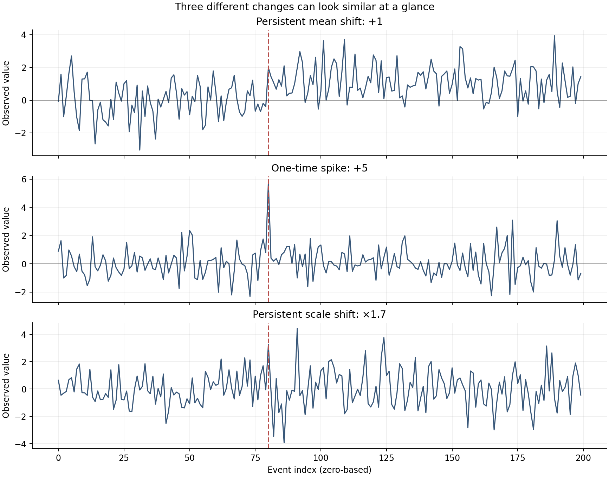
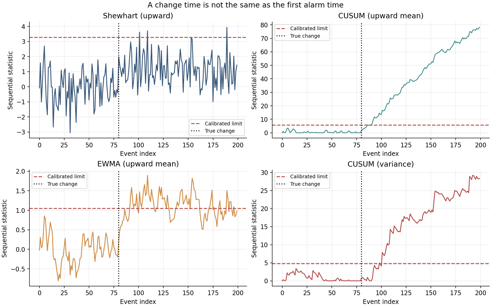
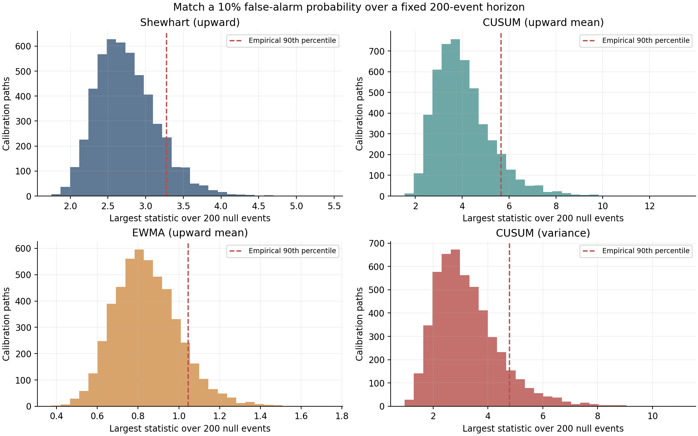
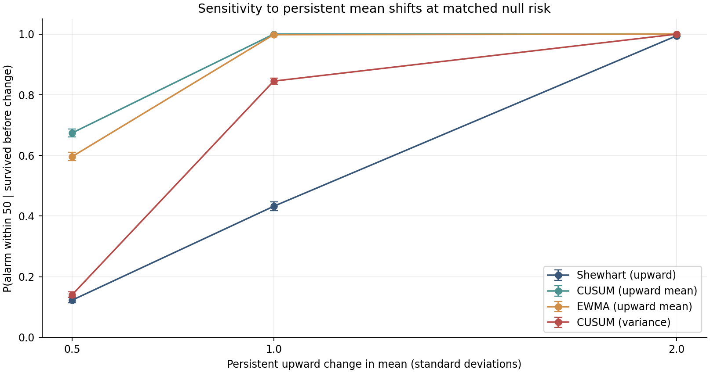
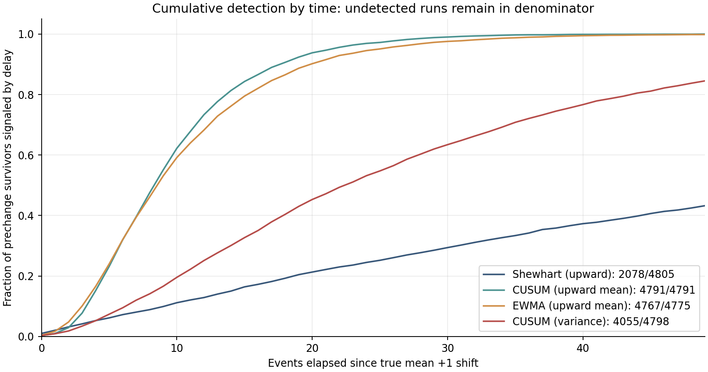
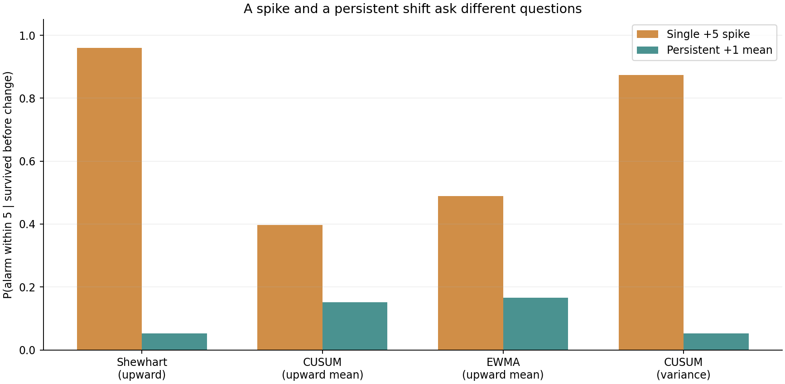
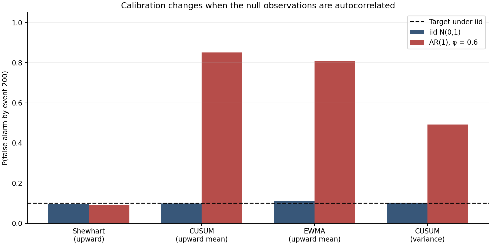
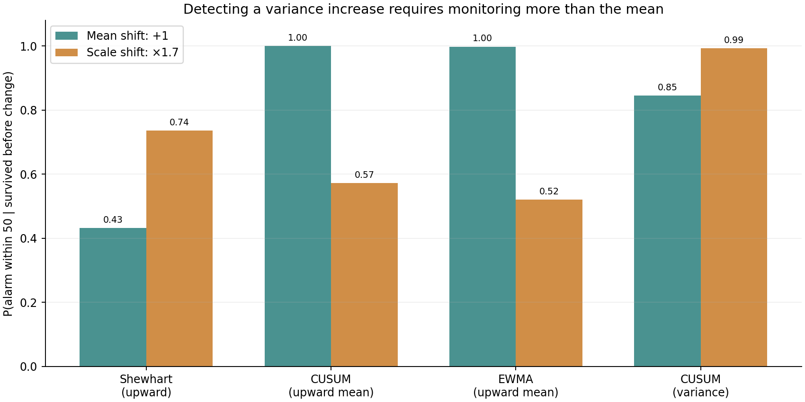

# The Alarm Is Not the Change: Sequential Change-Point Detection for Data Scientists

*From CUSUM and EWMA to likelihood ratios, false-alarm budgets, and the uncomfortable difference between detecting a shift and understanding a system.*

It is three in the morning. A dashboard reports a sudden increase in API latency. An alert fires. Someone opens an incident, inspects the last deployment, and discovers that the service began slowing down at 01:47. Did the alarm detect a change at three? Did the change begin at 01:47? Or had the monitoring system been accumulating weak evidence for an hour before the threshold was crossed?

These questions sound like variations on the same event. Mathematically, they are not.

An online change-detection procedure sees observations arrive one at a time. It must decide whether the available history is inconsistent enough with a reference behaviour to justify an alarm. Its decision depends on the data, the definition of normal, its sensitivity settings, the cost of investigating false positives, and how long it has been watching. Even when the underlying change is known to have occurred, an alarm will usually arrive later. Sometimes noise makes it arrive earlier. Sometimes it never arrives at all.

That distinction is more important than the apparent sophistication of the algorithm.

In data science, monitoring is often implemented as a sequence of threshold checks. We fit a model, compare the latest output with a baseline, and attach a label such as *drift detected*. But a threshold does not itself specify the error rate of a monitoring programme. A method that looks conservative at one observation can become almost certain to produce an alarm after thousands of opportunities. A method calibrated under independent noise can behave very differently when observations are correlated. And a detector designed for a persistent mean shift may answer the wrong question when the problem is a single anomalous event or an increase in variability.

Sequential change-point detection gives us a framework in which these problems can be stated precisely. It connects hypothesis testing, stochastic processes, likelihood ratios, control charts, survival-like stopping-time calculations, time-series modelling, and the practical decisions that turn model outputs into interventions.

We will derive four online detectors, compare them in a controlled simulation, and examine what happens when a seemingly innocent assumption is broken. The comparison uses eight reproducible figures, independent calibration and validation streams, and an executable Python notebook. All numerical results refer to **synthetic Gaussian data**, with a known baseline and a known intervention index. They are not results for a production service, factory, hospital, transport network, or financial market. The reproducibility package is in [the companion directory](README.md).

Our most useful result is also the one that would be easiest to miss in a conventional benchmark. When we calibrate every detector to approximately a 10% chance of a false alarm across 200 independent observations, a positively autocorrelated Gaussian process with exactly the same marginal distribution changes that risk to approximately **85% for the mean CUSUM** and **81% for EWMA**. Nothing changed in the one-observation histogram. Only the way observations are arranged in time changed.

To understand why, we need to start with the object we are actually trying to detect.

## First distinguish an anomaly, a change, and an alarm

Suppose a stream of observations is written as

\[
X_1,X_2,\ldots,X_t,\ldots
\]

and the data-generating mechanism may change at an unknown time \(\nu\). In a simple model, the observations before \(\nu\) follow a reference distribution \(F_0\), while those from \(\nu\) onward follow \(F_1\):

\[
X_t\sim
\begin{cases}
F_0,&t<\nu,\\
F_1,&t\geq\nu.
\end{cases}
\]

This is a modelling statement, not a complete description of reality. The change might be gradual. Observations may be correlated. Several variables may move together. A season may turn, a sensor may be replaced, or an upstream data pipeline may silently alter a definition. None of these possibilities is encoded in the simple notation above.

Yet it establishes three distinct times and concepts:

1. **The physical or statistical change time \(\nu\).** This is when the generating mechanism actually changes. In our simulation we know it because we construct the data. In practice we rarely do.
2. **The alarm time \(T\).** This is the first time the detector crosses its decision threshold. It is computed online and may occur before, at, or after \(\nu\).
3. **A retrospective change-time estimate \(\hat{\nu}\).** This may be obtained later by examining a whole window of observations, including data that were unavailable when an online alarm would have been required.

A change-point estimate is not an alarm, and an alarm is not automatically an estimate of the change time. Mixing them produces misleading performance claims.

Consider four possible phenomena:

- A permanent rise in average demand, perhaps caused by a new customer cohort.
- A brief spike that disappears at the next observation.
- An increase in variance while the mean remains unchanged.
- A smooth, predictable seasonal pattern that is normal once the calendar is taken into account.

An algorithm that fires under all four may look sensitive. It may also have no useful ability to distinguish an actual behavioural regime change from a model that omitted predictable structure. A useful monitoring system begins by saying *which differences from the reference state require action*.

Our first figure shows a mean shift of one baseline standard deviation, a single unusually large observation, and a lasting 70% increase in standard deviation. For the synthetic construction, the intervention occurs at **zero-based event index 80**. The figure is a set of individual sample paths; their visual shape is not a measurement of detection probability.



*Figure 1. Three different departures from a baseline. The red dashed marker is the known intervention index, not a detector's discovered change time. Individual paths illustrate the phenomena; independent Monte Carlo streams determine the reported performance.*

The visually obvious intervention is a luxury of simulation. In an operational stream, there may be no intervention log and no ground-truth date. This is why evaluation with only a few selected screenshots is insufficient. We need to define what it means for a monitoring rule to behave well over many possible histories.

## Sequential decisions are stopping times

A sequential detector operates under a simple information constraint: its decision at time \(t\) may depend on \(X_1,\ldots,X_t\), but not on \(X_{t+1}\) or later observations. If \(\mathcal{F}_t\) represents the information available at time \(t\), the alarm time \(T\) is a *stopping time* when the event \(\{T\leq t\}\) can be determined using \(\mathcal{F}_t\).

This definition formalizes a distinction that often disappears in applied notebooks. A retrospective method can use the entire future-looking sample to declare that a change probably happened on Monday. It cannot honestly report that it would have alerted an engineer on Monday unless its decision could have been made with Monday's information alone.

For a sequential score \(S_t\) and a threshold \(h\), a typical rule is

\[
T_h=\inf\{t\geq1:S_t>h\},
\]

with \(T_h=\infty\) if the statistic never crosses the threshold. The crossing rule is deliberately strict in our code: a value exactly equal to \(h\) is not an alarm.

Once we make \(T_h\) the object of interest, several evaluation questions become possible:

- Under the reference process, what is \(P_0(T_h\leq H)\) for a specified horizon \(H\)?
- How long does the detector ordinarily run before a false signal, such as \(E_0[T_h]\), the usual in-control average run length?
- If a change occurs at \(\nu\), how likely is the first alarm to fall within the next \(d\) observations?
- What is the distribution of the delay \(T_h-\nu\), and what do we do with paths that never alarm before the evaluation ends?

These are not interchangeable summaries. A small expected delay can coexist with an unacceptable false-alarm rate. A short median delay among successful detections can conceal a large fraction of undetected streams. A fixed-horizon false-alarm probability is not an average run length.

The last distinction deserves emphasis. Even in an ideal independent test sequence with a constant per-step alarm probability \(p\), the chance of at least one alarm across \(H\) independent opportunities would be \(1-(1-p)^H\). Most sequential statistics, including the ones below, are temporally dependent *even when the raw observations are iid*. Their alarms do not simply obey that independent-Bernoulli formula. We will therefore calibrate a whole trajectory's maximum, not a single-time quantile.

## The simplest detector: Shewhart's current-observation rule

A Shewhart-type rule compares a new observation with a fixed upper limit. In our standardized baseline, the statistic is just the current value:

\[
S_t^{\mathrm{Sh}}=X_t,\qquad
T_{\mathrm{Sh}}=\inf\{t:X_t>h_{\mathrm{Sh}}\}.
\]

For a known \(N(0,1)\) reference distribution, we could select a pointwise Gaussian quantile. But a 99th-percentile one-sided limit gives a 1% chance of an exceedance **at a particular observation**, not a 1% chance of seeing any exceedance during the next 200 observations. Since our comparison concerns entire monitored sequences, we will instead choose an empirical full-horizon threshold.

The Shewhart statistic has no accumulated memory. That is both its strength and its limitation. A very large isolated observation can cross the limit immediately. A modest but lasting upward shift may produce many observations somewhat higher than normal without creating enough individual extremes to cross a high threshold quickly.

It is tempting to call this detector primitive and move on. That would be a mistake. If the cost comes from the size of a single hazardous excursion rather than a persistent shift, a well-calibrated direct limit may be exactly the relevant decision rule. A model is useful because it matches the loss mechanism, not because it has the longest mathematical description.

For a health sensor, a single extreme measured value might merit an immediate check, while a gradual rise in average measurements requires a different protocol. For a streaming service, a brief burst in latency and a persistent increase in baseline latency can trigger different operational responses. A detector that blends these use cases into one threshold is making an implicit choice about what counts as harm.

## Page's CUSUM accumulates evidence for a persistent shift

The cumulative sum approach has a different logic. Instead of asking whether the newest observation is extreme by itself, it asks whether a run of observations contains growing evidence against the reference mechanism.

Suppose the baseline density is \(f_0\) and the post-change density is \(f_1\). For a new observation \(X_t\), define its log-likelihood ratio

\[
\ell_t=\log\frac{f_1(X_t)}{f_0(X_t)}.
\]

A positive value supports the alternative. A negative value supports the baseline. If we knew a change started at a particular time \(k\), then the accumulated evidence through \(t\) would be \(\sum_{i=k}^{t}\ell_i\). But a genuine online detector does not know \(k\). It must consider whether a convincing run of evidence began at some time in the past.

Page's one-sided CUSUM statistic is

\[
G_t=\max\{0,G_{t-1}+\ell_t\},\qquad G_0=0.
\]

Equivalently, \(G_t\) is the largest positive accumulated log-likelihood support among candidate run beginnings ending at \(t\), with zero representing the choice to start again. The recursion discards prolonged negative evidence rather than allowing it to cancel a later genuine shift indefinitely.

For a unit-variance Gaussian reference and an upward mean alternative,

\[
H_0:X_t\sim N(0,1),\qquad
H_1:X_t\sim N(\delta,1),\quad\delta>0,
\]

the log-likelihood ratio is

\[
\ell_t
=\log\frac{\phi(X_t-\delta)}{\phi(X_t)}
=\delta X_t-\frac{\delta^2}{2}.
\]

For a fixed \(\delta\), dividing the recursion by the positive number \(\delta\) yields a CUSUM on the same information:

\[
C_t=\max\left\{0,C_{t-1}+X_t-\frac{\delta}{2}\right\},
\qquad C_0=0.
\]

We choose \(\delta=1\), giving the reference allowance \(k=\delta/2=0.5\). That is why the experiment uses

\[
\boxed{C_t=\max(0,C_{t-1}+X_t-0.5).}
\]

When observations are still \(N(0,1)\), the expected increment *before truncation* is \(-0.5\). Under the designated \(N(1,1)\) alternative, it is \(+0.5\). The state therefore tends to retreat toward zero under the reference state and accumulate under a lasting upward shift. The threshold controls how much accumulated evidence we require before acting.

There is no universal CUSUM threshold. The statistic's scale depends on the reference allowance, the score distribution, the state initialization, the sampling interval and the requested false-alarm objective. A threshold of five can be permissive under one design and conservative under another. Our choice will be an empirically calibrated value determined by the simulated null process.

The derivation also shows what the CUSUM is **not** doing. It is not a generic, parameter-free detector for every imaginable change. We have chosen a likelihood model that favours a particular upward shift. A downward mean shift would need another one-sided statistic or a two-sided design. A change in variance, dependence, skewness or event rate may or may not raise this particular score. A strong result for the specified \(N(1,1)\) alternative is evidence of alignment between the detector and the constructed alternative, not proof that CUSUM universally dominates.

The original formulation is associated with E. S. Page's 1954 work on continuous inspection schemes. Sequential detection theory subsequently developed different optimality criteria. Lorden (1971), for example, formalized a worst-case conditional detection-delay objective under a false-alarm constraint, while Pollak (1985) studied a different conditional delay criterion. The theorems and their asymptotic regimes are more specific than the slogan that one monitoring procedure is simply *optimal*. We will use the practical recursion without asserting those theorems for an unverified real-world stream.

## EWMA accumulates information with geometric forgetting

An exponentially weighted moving average (EWMA) is another way to carry past observations into the present. Its recursion is

\[
Z_t=\alpha X_t+(1-\alpha)Z_{t-1},
\qquad Z_0=0,\quad 0<\alpha\leq1.
\]

Repeated substitution gives

\[
Z_t=\alpha\sum_{j=0}^{t-1}(1-\alpha)^j X_{t-j},
\]

when the initial state is zero. The newest observation receives weight \(\alpha\); each older observation receives a geometrically decreasing weight. Unlike a finite moving average, EWMA has no hard cutoff in its history. Unlike the one-sided Page recursion, its state is not truncated at zero. A sufficiently negative sequence can drive it below the reference mean.

We use \(\alpha=0.20\), so one observation contributes 20% of the latest state update. There is no claim that 0.20 is optimal for all changes. Smaller values emphasize slow accumulation but can make the rule sluggish to sudden changes. Larger values react faster to individual observations but carry less sustained memory.

Under independent observations with variance \(\sigma^2\), a known zero initial state gives

\[
\operatorname{Var}(Z_t)
=\alpha^2\sigma^2\sum_{j=0}^{t-1}(1-\alpha)^{2j}
=\sigma^2\frac{\alpha}{2-\alpha}
\left[1-(1-\alpha)^{2t}\right].
\]

The stationary limit is \(\sigma^2\alpha/(2-\alpha)\). For \(\alpha=0.20\) and \(\sigma=1\), the limiting standard deviation is \(1/3\). A fixed operational upper limit can be considered, but the finite-sample state variance and repeated monitoring matter. Once again, we calibrate the maximum of the entire 200-event EWMA path.

An EWMA also appears naturally in modern machine-learning infrastructure. It is often used to smooth a feature metric, input completeness, prediction error, device heartbeat rate, or count of anomalous sensor events. Smoothing is useful, but smoothing alone is not a hypothesis test. A displayed trend becomes an operational alert only after we define its reference behaviour, threshold and acceptable error rate.

The classical control-chart connection goes back to S. W. Roberts's 1959 paper on geometrically weighted moving averages. Later work brought EWMA ideas into concept-drift monitoring, including Ross and colleagues' 2012 treatment of concept-drift detection. The historical connection is useful because the control-chart literature has spent decades addressing problems that are routinely rediscovered in streaming ML.

## To detect a change in spread, change the likelihood model

If the mean stays at zero while the distribution becomes wider, a mean detector is not explicitly targeting the new mechanism. A series can become riskier without an average trend. For example, a sensor's errors may become erratic around the same central value; a service may alternate between unusually fast and unusually slow responses while its mean remains approximately unchanged.

We therefore add a Gaussian variance CUSUM with

\[
H_0:X_t\sim N(0,1),
\qquad
H_1:X_t\sim N(0,r^2),
\quad r=1.7.
\]

For this pair of densities, the log-likelihood increment is

\[
\ell_t^{(v)}
=\log\frac{f_1(X_t)}{f_0(X_t)}
=-\log r+\frac{X_t^2}{2}
\left(1-\frac{1}{r^2}\right).
\]

The variance CUSUM statistic becomes

\[
V_t=\max\{0,V_{t-1}+\ell_t^{(v)}\},
\qquad V_0=0.
\]

Its score has two components. The negative constant penalizes evidence that is ordinary under the wider distribution. The positive squared-observation term rewards observations with large absolute magnitude, regardless of sign. A lasting increase in spread should therefore accumulate evidence even when positive and negative values cancel in a mean.

This detector has an important interpretive limitation. A nonzero mean also increases the expected value of \(X^2\) relative to a known zero baseline. Consequently, our variance CUSUM may signal under a mean shift even though the variance has not changed. It detects evidence against the *specified full reference density*, not the exclusive causal mechanism called “variance change”. In a production system where a mean shift and a scale shift have different actions, we would need joint monitoring, mean-adjusted residuals, or a more explicit multivariate model.

Like the mean CUSUM, the variance rule is deliberately designed with a specific alternative in mind. Our simulated variance change multiplies the standard deviation by 1.7. A success on that scenario demonstrates the benefit of aligning a score with its alternative, but it would be misleading to market this as a method validated for arbitrary forms of variance drift.

## Four statistics, one sample path, different alarm times

We now have four monitoring scores:

\[
\begin{aligned}
S_t^{\mathrm{Sh}}&=X_t,\\
C_t&=\max(0,C_{t-1}+X_t-0.5),\\
Z_t&=0.20X_t+0.80Z_{t-1},\\
V_t&=\max\left(0,V_{t-1}-\log1.7+
\frac{X_t^2}{2}(1-1/1.7^2)\right).
\end{aligned}
\]

Each uses only present and past observations. Each starts from a known zero state. Each receives its own calibrated upper threshold. But the states have different units, so a direct comparison of the raw statistic values is meaningless. A value of four for a CUSUM is not four times as alarming as a value of one for an EWMA.

The next figure plots all four statistics against the *same* illustrative mean-shift path from Figure 1. It marks the true intervention at index 80 and each method's 200-event false-alarm threshold. The traces are not four independent experiments; their purpose is to show how one sequence of observations is translated into different forms of cumulative evidence.



*Figure 2. Causal statistic trajectories on a single constructed mean-shift path. The vertical dotted line is the known change; the horizontal dashed line is each method's separately calibrated alarm threshold. Their crossings describe **first alarm times**, not estimated change locations.*

An important consequence follows. If an incident team traces the alarm back to a software deployment that occurred ten minutes earlier, the deployment timestamp is external evidence, not something recovered automatically by the threshold crossing. We can use the alarm to open an investigation. Locating the change, diagnosing why it happened, and deciding whether to intervene are separate tasks.

## Calibrate the *monitoring programme*, not a single observation

Meaningful comparison requires a common false-alarm objective. Otherwise one method can appear powerful simply because its threshold is low. A high-sensitivity alarm that fires constantly is rarely operationally useful.

We choose a transparent, finite-horizon objective:

\[
\boxed{P_0(T_h\leq200)=0.10.}
\]

In words: if the process remains in control for 200 observations, target a 10% probability of at least one false alarm during that horizon.

This is an experiment-specific choice, not a recommended universal production risk. We choose 10% because it produces visible comparisons in a short simulation. A safety-critical or high-volume production service may require much lower rates, longer calibration histories and explicit costs for missed detections.

For detector \(m\), generate \(B=5{,}000\) independent reference trajectories of length \(H=200\). On each trajectory \(b\), compute the maximum statistic

\[
M_m^{(b)}=\max_{1\leq t\leq H} S_{m,t}^{(b)}.
\]

The threshold is the empirical 90th percentile of these \(B\) maxima:

\[
h_m=\widehat Q_{0.90}
\left(M_m^{(1)},\ldots,M_m^{(B)}\right).
\]

Because every maximum already accounts for all opportunities to alarm in that path, this choice targets the probability of **at least one** crossing across the full horizon. We do not assume that observations of a CUSUM or EWMA statistic are independent, and we do not treat a one-step Gaussian z-score as a whole-period false-alarm probability.

We use 6,000 additional iid reference trajectories to validate the thresholds. This holdout matters because evaluating on the same maxima used to choose a quantile would understate how much random calibration uncertainty remains. The validation results are approximately 9.5% for Shewhart, 9.9% for mean CUSUM, 11.1% for EWMA and 10.3% for variance CUSUM. The deviations are finite Monte Carlo fluctuations and threshold-estimation error, not evidence that the theoretical target should be interpreted as exactly 10.000% in every new simulation.



*Figure 3. Each panel is the empirical distribution of the **largest** statistic attained over 200 iid-reference observations for 5,000 calibration paths. The dashed marker is the detector-specific 90th-percentile threshold. These are not one-observation quantile estimates.*

The thresholds in this fixed-seed experiment are approximately 3.279 for Shewhart, 5.665 for the mean CUSUM, 1.046 for EWMA, and 4.788 for the variance CUSUM. Their numerical magnitudes should not be ranked. Each score is on its own scale.

The phrase *finite-horizon* is essential. We have matched the probability of an alarm by observation 200 under an iid \(N(0,1)\) reference. We have **not** matched the in-control average run lengths \(E_0[T]\). We have **not** calibrated a process that restarts after alarms. We have **not** promised to preserve the same risk across 2,000 observations, across months, or after the baseline drifts. The operational frequency of alerts depends on the monitoring protocol beyond any single 200-event experiment.

Choosing a horizon is itself a design decision. Are 200 observations 200 API requests, 200 minutes, 200 patient-days, or 200 batches? An event-based horizon may correspond to ten seconds during a traffic spike and ten hours overnight. If the decision depends on calendar time, the arrival process and rate of observations belong in the model as well.

This finite-horizon design is also not a substitute for average-run-length calibration when ARL is the actual operational objective. The two can be related through the distribution of \(T\), but neither can be inferred from the other without additional assumptions. Our comparison stays within the question it actually answers.

## Design the experiment around a known change, not an observed alarm

To isolate the behaviour of the four scores, every reference observation comes from a standard normal distribution with **known** mean zero and variance one. We generate new streams for calibration, new streams for validating the false-alarm probability, and new streams for each alternative. Separate pseudorandom namespaces prevent an innocuous code change in one scenario from silently changing all of the other results.

The evaluation horizon contains 200 events. The simulated intervention begins at zero-based index 80, so 80 observations are drawn from the reference mechanism and 120 observations lie on the post-intervention side. The principal endpoint concerns the first 50 observations after index 80, or indices 80 through 129 inclusive. A shorter five-observation endpoint captures immediate response.

The alternatives are intentionally simple:

| Scenario | Distribution at and after index 80 | Question |
| --- | --- | --- |
| Persistent +0.5 mean | \(N(0.5,1)\) | Can a weak upward drift accumulate evidence? |
| Persistent +1 mean | \(N(1,1)\) | What happens at the designated mean-CUSUM alternative? |
| Persistent +2 mean | \(N(2,1)\) | How quickly do large shifts become visible? |
| One-time +5 spike | Add 5 to the observation at index 80 only; thereafter \(N(0,1)\) | Is the procedure sensitive to an isolated event? |
| Persistent scale ×1.7 | \(N(0,1.7^2)\) | Does changing spread create an alarm without changing the mean? |

For each scenario, we simulate 5,000 independent 200-observation streams. The units are **observations**, not hours or days. A permanent change exists only in the three mean-shift cases and the scale-shift case. The one-time pulse is deliberately not a permanent changepoint.

Our baseline knowledge is unusually generous. In applied monitoring, the reference mean and variance would commonly be estimated from historical data, sometimes from a short or contaminated baseline. That uncertainty may significantly alter thresholds. We omit it here because this is an experiment about **sequential decision rules**, not a survey of reference-state estimation.

One further precaution matters: each alternative has the same prechange mechanism. The score thresholds are fixed before alternative streams are generated. We neither tune a threshold on the very shift we later claim to detect nor adjust the result after observing which detector wins. The settings for CUSUM and EWMA are deliberately visible. They are choices, not optimized parameters discovered from this benchmark.

## A conditional detection probability needs a denominator

Suppose the true change occurs at \(\nu=80\). A detector may alarm at event 35 due to ordinary noise. If we record only the first alarm, that path has already stopped *before* the change. It is incorrect to count it as successfully detecting the shift at event 80, even if the underlying statistic crosses a limit again later.

Our main probability is therefore defined among trajectories that remain unalarmed when the true change begins:

\[
p_m(d)=
P_{\nu,m}\left(
\nu\leq T_m<\nu+d\mid T_m\geq\nu
\right).
\]

The corresponding Monte Carlo estimate is

\[
\hat p_m(d)=
\frac{
\sum_{b=1}^{B}
\mathbf 1\{
T_m^{(b)}\geq\nu,\,
T_m^{(b)}<\nu+d
\}
}{
\sum_{b=1}^{B}
\mathbf 1\{T_m^{(b)}\geq\nu\}
}.
\]

The denominator is the number of simulated streams that **survived without a prior alarm**. It is not blindly set to 5,000. Depending on the detector and scenario, approximately four to five percent of paths in this experiment signal before event 80, as the baseline still generates ordinary noise. Those paths are excluded from this specific conditional risk set.

This metric is useful, but it is not a full description of the operational system. It describes first-alarm behaviour for eligible trajectories. It does not answer how often an alert would recur after a reset, how long a team needs to investigate it, or what happens after the first alert. Our experiment has no restart protocol and no human response model.

The phrase *detected within 50* also needs care. A postchange alarm cannot be assumed to have been **caused** by the change. Some paths would cross the threshold during those same 50 observations even if the baseline continued. A controlled simulation permits comparison against a null scenario, but the event \(\nu\leq T<\nu+50\) is an alarm following the imposed change, not a causal proof that a particular alarm originated from it. When we say “detection probability” below, that is our operational shorthand for this explicitly defined event.

For each proportion we report a descriptive 95% Wilson interval based on the number of eligible paths. The intervals quantify Monte Carlo binomial variation under the chosen fixed model and fixed thresholds; they do not include parameter estimation, threshold-selection uncertainty, or structural uncertainty about which process a real sensor follows. Because the procedures act on the same constructed scenario but the performance endpoints differ, differences between methods also deserve more sophisticated uncertainty assessment before any claim of strict practical superiority.

Finally, define the delay after the known change as

\[
D_m=T_m-\nu,\qquad \text{when }T_m\geq\nu.
\]

If \(T_m\) never occurs within the 50-event evaluation window, that path has a **right-censored detection delay** for this analysis. Setting its delay to zero would be absurd; deleting it and comparing only successful detections would introduce selection bias. We retain the undetected paths in every cumulative detection probability. The median delay *among those detected by 50* is reported only as an additional, explicitly selected-subset statistic.

## Persistent mean changes reveal what accumulation buys us

The first performance comparison asks how the conditional chance of an alarm within 50 observations changes as the persistent upward mean shift grows from 0.5 to 1.0 and then 2.0 baseline standard deviations.

The contrast is clear. For a modest shift of +0.5, the Shewhart rule alarms within 50 observations on about 12% of eligible paths. The mean CUSUM reaches about 67%; EWMA about 60%. Neither number is automatically a production recommendation, but both show what collecting weak evidence across time can achieve when the alternative is persistent. A single elevated observation may be unremarkable, yet repeated moderately elevated observations can become compelling as a sequence.

At +1, the mean CUSUM and EWMA are nearly saturated within the 50-event window. The Shewhart rule reaches about 43%. The variance CUSUM reaches about 85%, despite being designed for a variance alternative, because a mean shift also increases squared observations relative to a zero-mean null. This cross-response is a reminder that an alarm statistic does not carry a unique explanation of the mechanism.



*Figure 4. Conditional probability of a first alarm within 50 observations after the synthetic mean shift, with descriptive 95% Wilson intervals. All methods were calibrated to approximately the same **iid 200-observation false-alarm risk**, not the same average run length.*

The essential table, rounded from the [committed full-run evidence](results/scenario_metrics.csv), is:

| Mean shift | Shewhart | Mean CUSUM | EWMA | Variance CUSUM |
| --- | ---: | ---: | ---: | ---: |
| +0.5 | 0.123 | 0.674 | 0.596 | 0.141 |
| +1.0 | 0.432 | 1.000 | 0.998 | 0.845 |
| +2.0 | 0.995 | 1.000 | 1.000 | 1.000 |

The table does not establish a permanent ranking. It establishes how these four fixed configurations behaved under three specified alternative distributions. At +2, all four have enough evidence by event 50 that their detection fractions approach one, and a coarse deadline alone hides differences in speed. At +0.5, the cost of insufficient memory becomes visible.

The mean CUSUM was specifically derived for a +1 Gaussian mean shift. Its success there should be expected. EWMA's success is also consistent with its gradual accumulation of positive values. It does not follow that either is best for every nonstationary stream. If changes are transient, alternate in direction, affect higher moments, or are superimposed on seasonality, the relative performance can be very different. The important practical question is the one that generated the data: *What change do we need to react to?*

The presence of a calibrated false-alarm constraint makes the comparison more informative. If we had allowed the mean CUSUM a very low threshold and Shewhart a very high one, we could have manufactured an apparently decisive result without saying anything about the methods. Matching a relevant null risk is a necessary starting point for comparing detection capability, although it is not enough to solve all differences in operational cost.

## Time to alarm: do not delete the failures

Detection by a deadline is useful, but an engineer responding to degradation also cares when the alarm appears. Two detectors may both signal by the fiftieth observation, with one typically firing in three observations and the other in twenty-five. Those are different interventions if every minute of delay has a cost.

For the +1 mean-shift scenario, we compute the cumulative fraction of **prechange survivors** whose first alarm has occurred by each elapsed event \(d=0,\ldots,49\). For every \(d\), the denominator is the same set of eligible paths. Paths without an alarm by event \(d\) remain in the denominator. In particular, the curves need not reach one. The endpoint at \(d=49\) is exactly the conditional 50-observation detection probability in the preceding section.



*Figure 5. Cumulative first-alarm fractions after a known +1 mean change. The curves use all paths that survived the prechange period, including streams still undetected at each displayed delay. They are not cumulative distributions computed only among eventual detections.*

Among streams that do alarm within 50 observations, the experiment produces median zero-based delays of approximately nine events for mean CUSUM and EWMA, compared with 21 for Shewhart and 19 for the variance CUSUM. Yet the values for Shewhart and variance CUSUM describe only the paths that managed to alarm. Treating a 21-event *median among detections* as a typical response time for every Shewhart-monitored shift would ignore the roughly 57% that did not produce a timely alarm at all.

There are several common statistical traps in reporting delay:

First, if a study excludes all non-detected runs and publishes the average delay of the remainder, a detector that alarms on just the easiest trajectories may look remarkably fast. Conditioning on detection changes the population.

Second, if a detector alarms before the change and the evaluation counts any later threshold crossing as a success, the analysis has quietly switched from a **first-alarm stopping rule** to an unspecified repeated-alarm rule. Repeated alerts can be studied, but that requires explicit reset states and operational rules.

Third, if a model takes longer to respond because it is intentionally resistant to noisy spikes, the longer delay may be a rational cost of lower false-alarm risk. Delay cannot be optimized in isolation.

Finally, the clock has units. The difference between nine and twenty observations is not a difference of eleven minutes unless the events occur once per minute. If events arrive in bursts, a distribution of elapsed *event counts* and a distribution of elapsed *calendar times* may give different operational answers.

## A one-time spike is not a regime change

The fifth scenario deliberately injects an isolated +5 observation at index 80, then returns immediately to the original \(N(0,1)\) process. Its mechanism is a pulse, not a change from one persistent regime to another.

Compare the chance of the first alarm occurring in the first five observations after that event with the corresponding five-event response to a sustained +1 mean change:

| Method | Single +5 spike | Persistent +1 mean |
| --- | ---: | ---: |
| Shewhart | 0.960 | 0.053 |
| Mean CUSUM | 0.398 | 0.152 |
| EWMA | 0.489 | 0.165 |
| Variance CUSUM | 0.873 | 0.052 |

All percentages condition on no prechange alarm. The very different probabilities arise despite every detector using exactly the same threshold it used in the persistent-mean experiment.



*Figure 6. Conditional probability of an alarm within the first five observations after either a single +5 pulse or a sustained +1 mean shift. High response to the pulse does not establish ability to identify a persistent regime change.*

This is a practical reason to avoid collapsing anomaly detection and change-point detection into one category. Suppose a payment system sees one unusually large transaction and returns to normal activity. An anomaly detector may sensibly flag it immediately. A detector for a sustained shift in average transaction volume may sensibly require repeated evidence. Both decisions can be correct because they optimize different actions.

It is also why model benchmarking should include *negative controls*. If the purpose of an alarm is to detect persistent deterioration, then isolated harmless spikes should appear in a test suite precisely because they should **not** always cause the same response. Conversely, if the harm is the spike itself, insisting on sustained evidence may be unacceptable. A model specification is incomplete until the costs of each type of error are made explicit.

## The counterexample: identical Gaussian marginals, radically different false alarms

We have so far calibrated the four methods under independent \(N(0,1)\) observations. That is a strong assumption, especially for sensor readings, rolling aggregates, network load, financial returns, and model residuals. These processes often exhibit serial correlation, seasonality, bursts, or slow-moving latent states.

Now consider a different reference process that has the **same marginal** \(N(0,1)\) distribution but is correlated through time. Let

\[
X_t=\phi X_{t-1}+\sqrt{1-\phi^2}\,\varepsilon_t,
\qquad
\varepsilon_t\overset{\mathrm{iid}}{\sim}N(0,1),
\quad\phi=0.6.
\]

Start the process in its stationary marginal distribution \(X_1\sim N(0,1)\), independent of subsequent innovations. Then

\[
E[X_t]=0,\qquad
\operatorname{Var}(X_t)=1,\qquad
\operatorname{Corr}(X_t,X_{t+k})=\phi^{|k|}.
\]

The histogram of individual observations still tends toward a standard normal shape. The mean is zero and the variance is one. A one-sample normality test will not diagnose the relevant problem. But a positive observation tends to be followed by other positive observations, and a negative observation by other negative observations. Those runs can change an accumulated score profoundly.

We now make one deliberate mistake: **reuse the thresholds calibrated under independence** on 6,000 independent streams of this stationary AR(1) null, each of length 200. There is no mean change, no variance change, and no intervention. Every alarm is false according to the experiment's null definition.

The results:

| Detector | iid null: \(P(\text{alarm by 200})\) | AR(1) null, \(\phi=0.6\) |
| --- | ---: | ---: |
| Shewhart | 0.095 | 0.090 |
| Mean CUSUM | 0.099 | **0.851** |
| EWMA | 0.111 | **0.809** |
| Variance CUSUM | 0.103 | **0.492** |



*Figure 7. A deliberately invalid transfer of iid-calibrated thresholds to a stationary Gaussian AR(1) null with \(\phi=0.6\). Both nulls have N(0,1) one-observation marginals. The enormous changes in false-alarm risk are caused by temporal dependence, not a different marginal mean or variance.*

The mean CUSUM and EWMA, which looked especially effective for persistent mean changes, now generate false alarms on more than eight out of ten correlated-null trajectories. The variance CUSUM's false-alarm probability also rises sharply, to about 49%. Shewhart changes comparatively little because it sees each observation directly rather than accumulating long runs, although dependence still affects the probability of at least one extreme during a fixed horizon.

Why does this happen?

For the mean CUSUM, each increment under the baseline has expectation \(-0.5\), regardless of whether the observations are iid or the stationary AR(1) process above. But the *distribution of runs of positive increments* changes. The recursion is built to interpret sustained positive evidence as a regime change. Positive serial correlation can supply such runs during an entirely in-control process. The algorithm is doing what its score tells it to do; it is the reference model that is wrong.

For EWMA, correlated inputs increase the variability of a geometrically weighted sum relative to the iid formula. The filter's reference variance is no longer \(\sigma^2\alpha/(2-\alpha)\). A fixed upper threshold chosen for independent data becomes too easy to cross when a run of correlated observations reinforces the state.

Even the variance CUSUM is affected. Although its score uses \(X_t^2\), the squared values of a correlated Gaussian process are themselves correlated: large absolute observations tend to appear in clusters. A string of large squared scores can therefore accumulate apparent evidence for a variance change despite the unchanged marginal variance.

The smaller change for Shewhart is also informative. Its crossing criterion depends on whether a particular \(X_t\) exceeds a fixed value. Positive dependence reduces the effective number of nearly independent opportunities for isolated extremes across a finite interval. Here the observed whole-horizon probability is slightly lower than under iid observations. There is no general guarantee that serial dependence always reduces Shewhart's familywise risk for every process, threshold and horizon.

It is tempting to summarize this with an “effective sample size” correction. For estimating a mean from a long stationary AR(1) sequence, the familiar large-sample approximation is

\[
n_{\mathrm{eff}}\approx n\frac{1-\phi}{1+\phi}.
\]

At \(n=200\) and \(\phi=0.6\), this is about 50. The figure gives useful intuition about why 200 correlated observations do not carry the same information as 200 independent ones. But that approximation is a variance adjustment for certain mean estimators; it is **not** a valid general replacement for recalibrating maxima of nonlinear CUSUM and EWMA stopping rules.

The practical lesson is direct. Calibrating a monitoring statistic on shuffled historical observations can destroy the very dependence structure that determines false-alarm frequency. So can fitting a threshold on model residuals that were assumed white but retain serial correlation. A per-observation probability calibration may be accurate, and a histogram may look perfectly Gaussian, while the actual sequential monitoring programme produces intolerable numbers of alerts.

When dependence is plausible, the calibration procedure must represent the dependence structure. Options include fitting an appropriate time-series reference model and simulating from it, designing the detector on suitably standardized innovations, using justified block-bootstrap methods, or calibrating directly against long historical in-control sequences when enough relevant data exist. These approaches have their own modelling and finite-sample limitations. There is no free, universal “dependence correction”.

Notice also that an autocorrelated process can be normal operation. If a thermostat exhibits inertia, a queue has memory, or a service processes batched requests, positive serial dependence is not necessarily evidence of degradation. A monitoring rule that treats all persistence as a change will confuse expected dynamics with an intervention.

## Why variance changes demand their own measurement

The final figure returns to a lasting distribution change. We compare the conditional 50-event response to a +1 mean shift with the response to multiplying the standard deviation by 1.7, leaving the mean zero.

The variance CUSUM detects the designed scale alternative in about **99.3%** of eligible streams within 50 observations. The upward Shewhart rule reaches roughly 73.7%, the mean CUSUM 57.2%, and EWMA 52.0%. The latter two values are not zero because a wider distribution generates more positive observations and occasional runs that lift an upper-sided mean statistic. Their alarms do not imply the mean truly increased.



*Figure 8. Detection within 50 events for a +1 mean shift and a standard-deviation multiplier of 1.7. The variance CUSUM is built from the likelihood ratio of exactly that scale alternative. Cross-signals from mean detectors should not be interpreted as diagnoses of a mean change.*

The comparison illustrates an important separation between *detection* and *classification of the reason for a change*. A procedure can reliably say “the current process is inconsistent with the reference” while remaining unable to identify whether the cause is changed location, spread, dependence, data quality, sampling frequency, or a mixture of mechanisms.

In practice, a broad alarm can serve as an initial gate to more specialized diagnostics. The follow-up might compare rolling location and scale, inspect residual autocorrelation, examine source composition, or run model-based hypothesis checks. That is a different workflow from expecting one change-point score to produce a complete explanation in its alert payload.

The simple Gaussian variance alternative also shows a fundamental design choice: *what do we mean by change?* A widened distribution may increase the probability of harmful extremes even when the average outcome is unchanged. If an SLA breach, equipment fault, or clinical escalation is governed by a tail, monitoring only the mean can overlook exactly the variation the business or care team needs to see. Conversely, a wider but harmless spread may not justify the same operational action as a sustained degradation of average performance.

## Offline segmentation and online alarms solve different problems

Change-point detection is a broad term. It is tempting to collect every algorithm with that label into one benchmark, but an offline segmentation method and an online alarm procedure may answer different statistical questions.

An offline algorithm receives a completed sequence \(x_1,\ldots,x_n\) and estimates the number and locations of changes. A common formulation minimizes a sum of within-segment costs plus a penalty for introducing more changepoints:

\[
\min_{K,\tau_1,\ldots,\tau_K}
\left[
\sum_{j=0}^{K}
\mathcal C(x_{\tau_j+1:\tau_{j+1}})
+\beta K
\right],
\]

with \(\tau_0=0\), \(\tau_{K+1}=n\), and a chosen segment cost \(\mathcal C\). The penalty \(\beta\) expresses a preference against explaining every fluctuation with a new segment. Examples of costs include residual sum of squares for piecewise-constant means or negative likelihood under a segment-specific distribution.

Algorithms such as PELT, developed by Killick, Fearnhead and Eckley (2012), are important because they make penalized offline segmentation computationally tractable, with linear computational cost under particular conditions. But the retrospective estimated location of a break at index 80 is not evidence that a live system would have alerted at index 80. The completed record contains observations from after index 80. An algorithm can use them to sharpen the retrospective location.

An online detector faces a different task. It must act before those future observations are available. Its threshold should therefore be judged by false alarms and detection delays at the times it could actually have fired. A fair benchmark for online detection must run the method observation by observation and record its first stopping time. Running a retrospective algorithm once over the final 200 observations and reporting how close its estimated change index was to 80 is a different experiment.

The [older nonparametric change-point notebook](../change_point/change_point.ipynb) in this repository explores another approach to locating changes. The present article is deliberately complementary: it concentrates on repeated online decisions, stopping times, and false-alarm calibration.

There are also Bayesian online approaches. Adams and MacKay (2007) formulate Bayesian online changepoint detection in terms of a posterior distribution over the *run length* — the number of observations since the most recent change — updated as new data arrive. A hazard specification describes prior beliefs about changepoint occurrence, while a predictive model describes the observations within regimes. This can provide a posterior description of possible recent changes rather than only one thresholded score.

It does not eliminate the need to define a decision. A posterior probability must still be translated into an action, with consequences for false alarms, late signals, and changes that matter. It also inherits assumptions about the hazard, predictive distribution, baseline and dependence. Choosing a Bayesian method is not an exemption from calibration or operational validation.

The useful taxonomy is therefore not “old control charts versus modern machine learning.” It is whether we are estimating past segmentation, maintaining an online posterior, testing sequential evidence against a reference, or deciding on an intervention. Those targets can be part of the same system, but they should not be collapsed into one reported accuracy number.

## Data science has several distinct reasons to monitor change

Consider a deployed prediction model. The input distribution may change while the mapping from inputs to targets stays stable. The conditional target distribution \(P(Y\mid X)\) may change even if the distribution of \(X\) barely moves. Labels may arrive after a delay, making direct performance monitoring unavailable for the most recent events. The fraction of missing or invalid inputs may change because a data pipeline failed rather than because users behaved differently.

These require different observables and different interpretations. A shift in one input feature is not automatically a loss of predictive performance. A stable feature histogram is not a guarantee that the model remains calibrated. If the operational question is whether a model's error has deteriorated, sequentially monitoring a relevant error series is closer to the objective than running a detector on every raw input field and declaring any change to be model failure.

Even monitoring error series requires care. Residuals from a time-series model may have heteroscedasticity or serial correlation. Prediction errors can vary with season, device type, geography, or product mix. A threshold calibrated on the marginal distribution of last month's residuals may be invalid if the deployment mixes a new composition of traffic, or if the residuals were never independent in the first place.

For an industrial process, the observable might be a physical measurement or a standardized model residual. A mean CUSUM can be appropriate when a small permanent offset is the anticipated failure mode. A scale chart may be more relevant when rising mechanical instability first appears as greater variability. Before building the detector, ask whether the system can drift gradually or whether an intervention is expected to produce a step. The distinction determines whether a step-change model is a useful approximation.

For a stream of service requests, queueing dynamics create additional structure. Latency observations may be correlated because requests share a backlog. A rising queue can itself induce a sustained delay pattern even while underlying service capacity remains unchanged. Detecting a rise in latency is not the same as determining whether arrivals increased, service times changed, or capacity was removed. The companion [queueing-theory article](../queueing-theory-for-data-scientists/article.md) discusses why these mechanisms matter for capacity decisions; sequential detection asks when accumulated evidence has become strong enough to investigate one of them.

For health-related monitoring, the problem is often even more sensitive to context. An individual's baseline may vary with sleep, time of day, medication, activity or device placement. Missingness can signal a sensor failure or a change in behaviour. When observations arrive through home devices, their timestamps, sampling rates and online status affect what a “run” means. An unexamined upper-threshold rule could produce repeated false alerts on ordinary daily cycles. Conversely, smoothing too aggressively could hide a rapid deterioration. The mathematics does not select the clinical response; domain expertise, prospective validation and appropriately governed escalation do.

Across these applications, there is a common structure: statistical evidence belongs to an explicit operational problem. The same signal can be harmless for one decision and urgent for another. A detector without an action policy is only half a design.

## An alert should be a policy, not just a score

In an actual system, one can design the monitoring pipeline as a sequence of questions:

1. **What is the eligible observation?** Define the event unit, timestamp, quality flags, de-duplication rule, and treatment of late arrivals. If the stream contains repeated revisions of one event, counting every revision as new evidence artificially strengthens the detector.
2. **What is the normal reference state?** Decide whether observations should first be adjusted for time of day, calendar, seasonal effects, covariates, product composition, or expected queueing dynamics. Validate the residual process, especially temporal dependence.
3. **Which alternatives matter?** Specify an upward mean shift, downward shift, variance increase, change in tail probability, change in arrival rate, or a more complex distributional shift. Do not assume one score is equally sensitive to all of them.
4. **What is the false-alarm budget?** Define whether it is a probability over a fixed horizon, an expected time to false signal, a monthly alert count, or a cost-weighted objective. These choices are related but not interchangeable.
5. **What constitutes an incident?** If the first crossing triggers a review, what happens to the score? Is it reset immediately, held until acknowledgement, paused for a refractory period, or continued to detect subsequent changes? The repeated-alarm policy alters real alert frequency.
6. **How is the action evaluated?** Record eligible periods, alarms, confirmed events, missed events and investigation costs. In a real system, many “true change” labels will be uncertain. A post hoc incident report should not be silently promoted to perfectly observed ground truth.

The pipeline should log the detector version, baseline version, model parameters, threshold, current statistic, data-quality state, event time, processing time, and the reason the alert was generated. If the policy changes, the historical alert count becomes a mixture of monitoring regimes unless the versions are retained.

There is also a multiple-monitoring problem. Suppose a model tracks hundreds of features, devices, cohorts and geographic segments. Calibrating each independent chart to a 10% risk over a horizon does not make the risk of *any* alert across all charts 10%. If there were \(m\) independent charts with individual horizon risk \(p\), the probability of at least one alert would be \(1-(1-p)^m\). In practice the charts may also be correlated, so even that simple formula may not apply. The number of simultaneous questions must be considered in the overall alert policy.

The reference distribution can change through intentional interventions, such as a planned software release, new sensor firmware or updated forecasting model. If the system continues using the old baseline indefinitely, it may keep raising “anomalies” that are normal under the new regime. But automatically adapting the reference to all recent observations has the opposite risk: a slow harmful drift can be absorbed into the baseline until the alarm goes quiet. Baseline adaptation is a policy decision, not a harmless preprocessing convenience.

One can formalize an operational decision with expected cost. If \(C_{\mathrm{FA}}\) is the cost of a false investigation, \(C_{\mathrm{miss}}\) the cost of a missed change, and \(C_{\mathrm{delay}}(d)\) the cost of response delay \(d\), a useful monitoring policy should be evaluated by their joint consequences, not a single classification metric. The exact function depends on the application, and our synthetic experiment does not estimate any of these costs.

This is the point at which data science meets operations research. Detection tells us what evidence is available. A decision model asks whether acting now produces a better expected outcome than waiting for another observation. The mathematical details may be different, but the separation between inference and choice is essential.

## Checks before trusting a sequential detector

The counterexample in Figure 7 suggests a short list of diagnostic questions that a production evaluation should answer. They are not formal guarantees; they are the places where a convincing notebook most often stops short of a useful deployed system.

**Is the baseline truly stationary over the evaluation horizon?** If the reference distribution drifts naturally with time, a detector for a stationary reference will react to expected evolution. Seasonality can be modelled before monitoring, but the adjusted residuals should then be assessed for remaining structure.

**Do residuals have serial dependence?** A density fit cannot answer this question. Look at autocorrelation, time-indexed diagnostics, clusters of exceedances, and the behaviour of the entire alarm statistic over real or realistically simulated reference trajectories. Figure 7 shows that correct one-point marginals alone are not enough.

**Did the test set influence the threshold?** Tuning a threshold after examining the validation alarms invalidates the nominal independence of that validation. If hyperparameters, detector families, feature transformations and limits are all selected on one dataset, the final reported false-alarm probability is subject to selection effects. Use a separate, representative assessment period or a clearly justified nested design.

**Are the clocks consistent?** Event index, observation time, processing time and alert delivery time should be distinguished. A backfilled event may have a timestamp from yesterday but only become visible to the detector today. A retrospective replay must reproduce what was knowable at each decision instant.

**Are labels observed independently of interventions?** Once an alert causes an investigation or action, the monitored process may change because people acted. The absence of continued degradation does not prove that the alarm would have been wrong without intervention. Historical evaluation of an alert policy can become a causal inference problem with feedback.

**Are missed detections counted?** A chart that reports only the delay of successful alarms is incomplete. Report probability of alarm by relevant deadlines and the number of paths that remain undetected. When the event time itself is uncertain, state that limitation instead of inventing exact delays.

**Are the error costs asymmetric?** The objective for a network performance warning, an equipment shutdown, and a clinical escalation should not be assumed identical. A threshold that is appropriate when a false alert costs a few minutes of inspection may be unacceptable if it triggers a disruptive automatic intervention.

**Can the algorithm distinguish a changed population from a changed pipeline?** Schema revisions, units, duplicate events, missing data and changed sampling rates can create artificial shifts. Data quality checks should be designed alongside statistical monitors, not left as a second-stage explanation after every false alarm.

Passing these checks does not prove validity in an arbitrary future environment. It does make the assumptions and failure conditions easier to inspect. That transparency is a substantial improvement over a monitoring system whose only documented parameter is “sensitivity: medium”.

## Reproducibility: what the figures establish and what they cannot

The accompanying [Python implementation](analysis.py) contains the four causal recursions, the independent pseudorandom generators, fixed-horizon maximum-statistic calibration, holdout validation, scenario measurements, Wilson intervals and all eight figure generators. The [annotated notebook](sequential_change_detection.ipynb) executes a reduced version; the [results directory](results/summary.csv) contains the full-run numerical evidence.

The full experiment uses master seed 20261030 and versioned dependency requirements. It saves six CSV tables in addition to the eight figures. A separate quick mode uses the same experimental structure with fewer streams and writes suffix-labelled files, so a smoke test cannot silently overwrite the publication figures. Mathematical unit tests check the score recursions and stopping-time behaviour; simulation tests check reproducibility, null calibration, sensitivity, dependence failure and right-censoring denominators. The continuous-integration job runs those checks and executes the notebook in a fresh Python kernel.

To reproduce the published values from the article directory:

```bash
python -m pip install -r requirements.txt
python -m unittest discover -s tests -v
python analysis.py
```

The synthetic data offer an important advantage: we know the true intervention index, the reference distribution, and every alternative mechanism. That lets us isolate modelling decisions that would be confounded in a field study. It also imposes a limitation. We cannot conclude that the same rankings, delays or false-alarm fractions would arise on a real stream with unknown parameters, non-Gaussian residuals, nonstationarity, missing observations, changing data definitions and operational feedback.

Even our uncertainty intervals are conditional on more than is commonly acknowledged. The reported Wilson intervals treat the experiment's data-generating mechanism and calibrated thresholds as fixed. A full uncertainty analysis could vary the calibration sample, estimate the baseline, explore misspecified alternatives, use time-block resampling when warranted, and measure performance across a range of dependence structures. No single confidence interval can absorb uncertainty from a reference model whose assumptions were never tested.

This is why the AR(1) result is valuable. Its importance does not rest on the exact percentages 85.1 and 80.9. It demonstrates, under transparent construction, how the same marginal Gaussian baseline can yield radically different behaviour for sequential alarms when its temporal structure changes. Anyone can reproduce that contrast, inspect the assumptions, and decide which aspects resemble their own operational problem.

## Conclusion: evidence arrives in time, and decisions have consequences

A changepoint is a statement about the process generating observations. An alarm is a decision made from the observations available so far. An estimated historical changepoint is a separate inference made, often with future data. Keeping these objects distinct prevents many misleading claims about monitoring performance.

The four detectors illustrate different uses of memory. Shewhart reacts to a large current observation. Mean CUSUM accumulates likelihood evidence for a designated upward shift. EWMA smooths past values with geometric forgetting. A variance CUSUM uses squared values to target a wider Gaussian distribution. None has a universal meaning outside its reference model and alert policy.

Our simulation matched the chance of a false alarm over 200 iid-reference observations, then asked how quickly each detector signaled after known synthetic interventions. Small persistent mean changes favoured accumulation. A large one-time spike favoured immediate sensitivity. A variance alternative favoured a likelihood ratio designed for spread. The strongest warning came when the observations became correlated: unchanged N(0,1) marginals did not protect the iid-calibrated CUSUM and EWMA thresholds from very frequent false alarms.

The lesson for data science is not that everyone should use one control chart, or that more complex algorithms always win. It is that the statistical question must be matched to the decision: the process considered normal, the departures worth acting on, the time scale, the error budget, and the cost of acting too soon or too late.

Good monitoring does not merely announce that something changed. It makes clear **what the alarm means, how often it can be wrong, how long it may take, and which assumptions would make those promises fail**.

## Original sources and further reading

These references support the mathematical and methodological discussion. The empirical percentages and figures above are produced by this article's synthetic experiment, not taken from any of these publications.

1. **Page, E. S. (1954).** “Continuous Inspection Schemes.” *Biometrika*, 41(1–2), 100–115. [https://doi.org/10.1093/biomet/41.1-2.100](https://doi.org/10.1093/biomet/41.1-2.100). The foundational CUSUM inspection formulation.
2. **Roberts, S. W. (1959).** “Control Chart Tests Based on Geometric Moving Averages.” *Technometrics*, 1(3), 239–250. [https://doi.org/10.1080/00401706.1959.10489860](https://doi.org/10.1080/00401706.1959.10489860). The classical EWMA control-chart contribution.
3. **Lorden, G. (1971).** “Procedures for Reacting to a Change in Distribution.” *The Annals of Mathematical Statistics*, 42(6), 1897–1908. [https://doi.org/10.1214/aoms/1177693055](https://doi.org/10.1214/aoms/1177693055). Formal conditional delay and sequential change-detection criteria.
4. **Pollak, M. (1985).** “Optimal Detection of a Change in Distribution.” *The Annals of Statistics*, 13(1), 206–227. [https://doi.org/10.1214/aos/1176346587](https://doi.org/10.1214/aos/1176346587). A distinct optimality formulation for sequential detection delay.
5. **Basseville, M., and Nikiforov, I. V. (1993).** *Detection of Abrupt Changes: Theory and Application*. Prentice Hall. An extensive treatment of likelihood, sequential tests and statistical change detection.
6. **Killick, R., Fearnhead, P., and Eckley, I. A. (2012).** “Optimal Detection of Changepoints With a Linear Computational Cost.” *Journal of the American Statistical Association*, 107(500), 1590–1598. [https://doi.org/10.1080/01621459.2012.737745](https://doi.org/10.1080/01621459.2012.737745). Penalized offline segmentation and the PELT algorithm, with the conditions underlying its complexity claims.
7. **Adams, R. P., and MacKay, D. J. C. (2007).** “Bayesian Online Changepoint Detection.” [https://arxiv.org/abs/0710.3742](https://arxiv.org/abs/0710.3742). Bayesian filtering over run length under an explicit hazard and predictive model.
8. **Ross, G. J., Adams, N. M., Tasoulis, D. K., and Hand, D. J. (2012).** “Exponentially Weighted Moving Average Charts for Detecting Concept Drift.” *Pattern Recognition Letters*, 33(2), 191–198. [https://doi.org/10.1016/j.patrec.2011.08.019](https://doi.org/10.1016/j.patrec.2011.08.019). An EWMA-related connection to streaming data and concept drift.

*All experiment data are synthetic. Figures, code, notebook, methodology and machine-readable outputs are provided for reproducibility. This article is a statistical methods discussion, not a validated safety-critical alerting procedure.*
