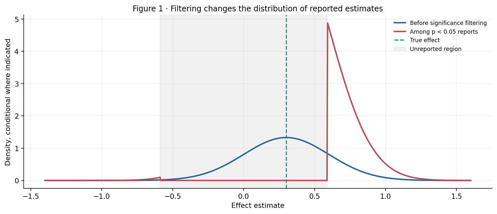
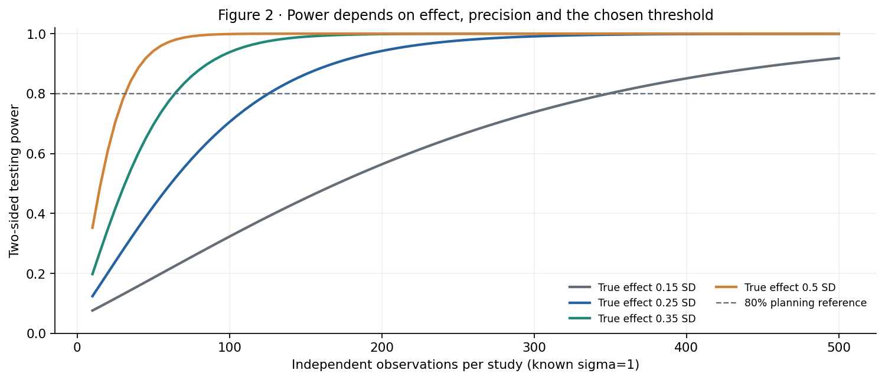
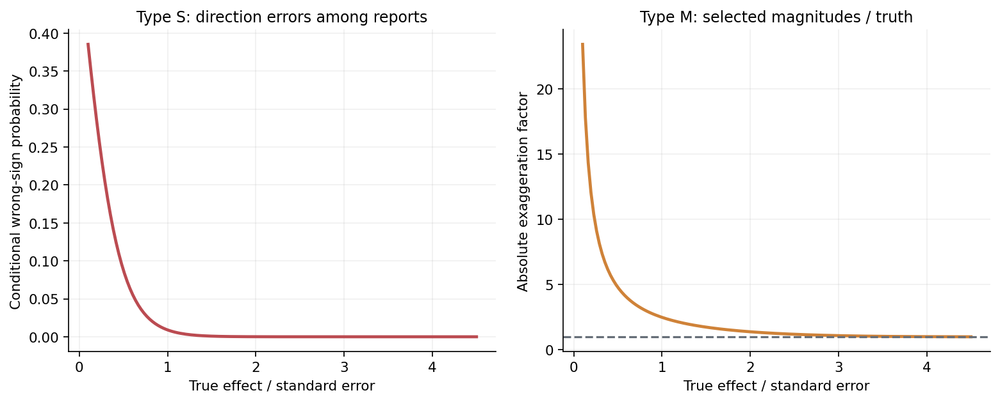
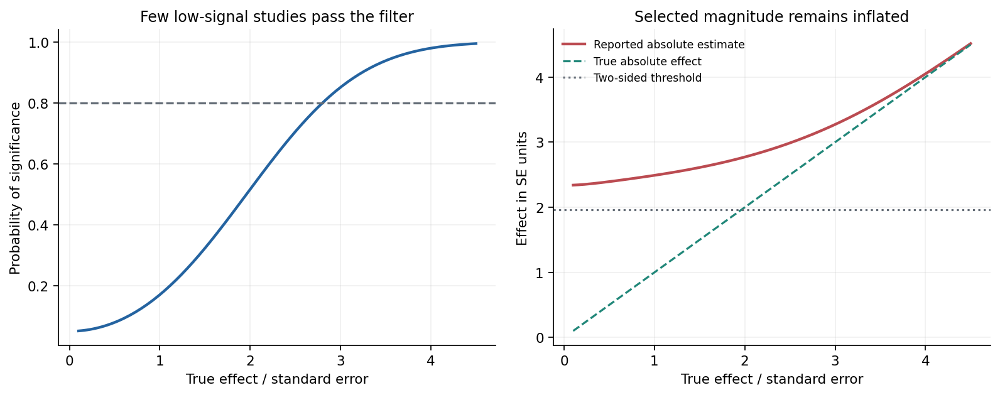
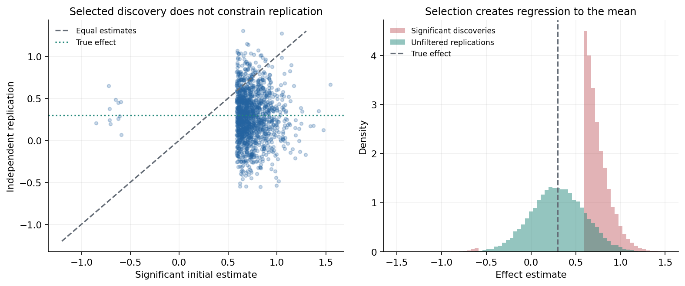
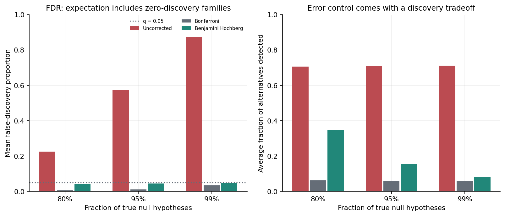
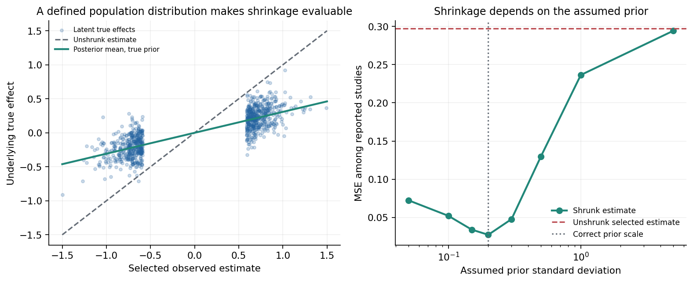
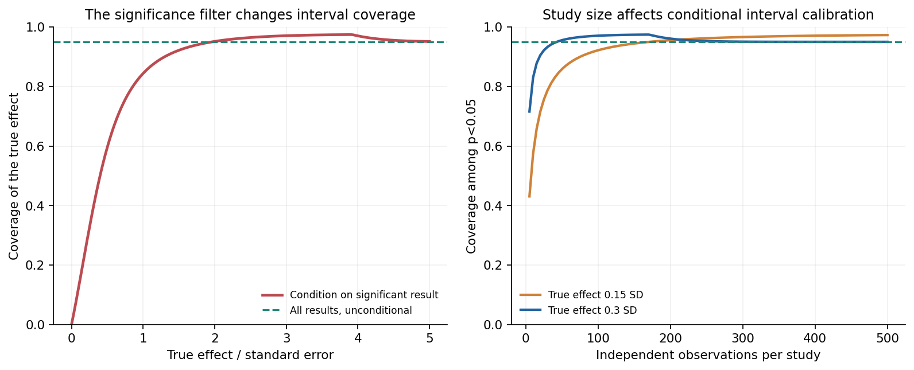

# A Significant Result Is Not a Replicable Effect

## Statistical Power, Type S and Type M Errors, and the Winner's Curse

*A mathematical investigation of why filtering research by statistical significance changes the effects we see—and why replication, multiplicity correction, and shrinkage answer different questions.*

Suppose a scientist is studying an intervention with a true positive effect of 0.30 units. The available experiment estimates that effect with a standard error of 0.30. The observed estimate is unbiased: if the experiment is repeated under identical conditions and all estimates are retained, their average equals 0.30.

That sounds reassuring. But the scientist's journal, research team or organization may have a reporting rule: only results that reach a two-sided \(p<0.05\) receive attention. An estimate of 0.30 is not statistically significant, because it is only one standard error above zero. To clear the threshold, a positive estimate must exceed approximately 0.588.

The reporting system therefore preferentially retains experiments in which random error makes the apparent effect unusually large. It may also retain a few experiments that have the wrong sign and are unusually negative. The selection rule changes the distribution of the effects that anyone gets to see.

Our synthetic experiment makes the consequences measurable. With a true effect of 0.30 and standard error of 0.30, only about **17%** of otherwise valid studies obtain two-sided significance at the 5% level. Among those significant studies, the expected **absolute reported effect is roughly 2.49 times the true effect**. An independently generated replication estimate, without any reporting filter, returns to an average near 0.30. Nothing was fabricated, the estimator was originally unbiased, and the p-value calculation was mathematically correct. Selection alone created the exaggeration.

The effect is known as the **winner's curse**. A related phenomenon appears in genetic association discovery, medical studies, econometrics, machine-learning benchmarks, scientific competitions, and internal business experimentation. When a noisy outcome is both used to select a winner and reported as the winner's measured ability, its reported magnitude is systematically distorted.

We will distinguish several issues that are often confused:

- Power: the probability of crossing a chosen testing threshold when a specified alternative is true.
- Type S error: the probability that a statistically significant estimate has the wrong sign.
- Type M error: the degree to which a significant estimate exaggerates the true effect in absolute magnitude.
- False-discovery control: the behavior of errors across a family of many hypotheses.
- Conditional interval coverage: what happens to an ordinary confidence interval when we report it only after a significance filter.
- Shrinkage: what a clearly specified population model can do for estimation after noisy selection, together with the risks of a misspecified prior.

These quantities are not interchangeable. A small p-value is not a large effect, a significant result is not a guarantee of replication, and an FDR-controlled result is not automatically an unbiased estimate of an effect's magnitude.

The accompanying [Python study](analysis.py) makes each distinction explicit, with eight original figures, ten machine-readable tables, an executable [notebook](significance_selection.ipynb), and tests of the exact Gaussian formulas. All experiments use **synthetic observations with explicit random seeds**. They are methodological illustrations, not claims about any real dataset, research field or particular published study.

## 1. What the significance test actually conditions on

Start with a simple estimation problem. Suppose

\[
\widehat\theta\mid\theta
\sim N(\theta,s^2),
\]

where \(\theta\) is an unknown but fixed effect and \(s\) is a known standard error. Define the standardized effect

\[
\delta=\frac{\theta}{s},
\qquad
Z=\frac{\widehat\theta}{s}.
\]

Then \(Z\sim N(\delta,1)\). For a two-sided test of the point null \(H_0:\theta=0\) at level \(\alpha\), the rejection rule is

\[
S=\{|Z|>c_\alpha\},
\qquad
c_\alpha=\Phi^{-1}(1-\alpha/2).
\]

At \(\alpha=0.05\), \(c_\alpha\approx1.96\). The nominal testing rule controls the probability of rejecting \(H_0\) **when that point null is true**, provided the assumptions and testing procedure are valid. It does not say that the probability of the null given a rejection is 5%. That latter probability would require a prior or population frequency for true nulls and a model for test outcomes under alternatives.

The same testing rule does not make a significant estimate practically important. An effect of 0.002 may be highly significant when its standard error is 0.0002. An effect of 2.0 may fail the threshold when its standard error is 1.5. Statistical significance is a relationship between a test statistic and a reference distribution, not a unit-independent measure of consequentiality.

Now consider a report that appears only when \(S\) occurs. The unconditional density of \(\widehat\theta\) is \(f(x\mid\theta)\). The density among selected studies is

\[
\boxed{
f(x\mid\theta,S)=
\frac{f(x\mid\theta)\,\mathbf{1}\{|x|>c_\alpha s\}}
{\Pr_\theta(S)}.
}
\]

This is a truncated and renormalized distribution. The numerator explicitly discards the middle of the sampling distribution; the denominator rescales what remains. The result does not have the same mean, variance, sign probabilities or typical magnitude as the unselected estimator.

That last point is crucial. The statement

\[
\mathbb{E}_\theta[\widehat\theta]=\theta
\]

does **not** imply

\[
\mathbb{E}_\theta[\widehat\theta\mid S]=\theta.
\]

Unbiasedness before selection and unbiasedness after selection are logically different claims. When reporting depends on the realized estimate, selection can destroy the latter even if the former is exact.

*Figure 1. Both curves arise from the same Gaussian experiment with true effect 0.30 and standard error 0.30. The reported distribution has no mass in the nonsignificant region; it is conditional on crossing the threshold.*

The red curve may look extreme because it must integrate to one over only the reported tails. Its high density at the positive threshold is a mathematical property of conditioning, not a claim that such observations are common among *all* attempted studies. Only approximately 17% of our attempts are retained at all.

One common misconception is that selection bias requires a researcher to manipulate data. It does not. If independent scientists run honest, fixed-analysis studies but only the significant estimates enter the visible record, the distribution of published effect sizes is already selected. Optional stopping, specification search, many outcomes and unreported exclusions can add further distortions, but they are not needed for the basic winner's curse to exist.

## 2. Power is defined before the result exists

For the Gaussian two-sided test, power is an exact tail probability:

\[
\begin{aligned}
\operatorname{Power}(\delta)
&=\Pr_\delta(|Z|>c_\alpha)\\
&=\Pr_\delta(Z<-c_\alpha)+\Pr_\delta(Z>c_\alpha)\\
&=\Phi(-c_\alpha-\delta)
+1-\Phi(c_\alpha-\delta).
\end{aligned}
\]

This probability depends on the true standardized effect, the test threshold, and the statistical model. It is not a property of the p-value eventually observed.

At \(\delta=0\), the probability of rejection is the test's size, \(\alpha\). At \(\delta=1\) and \(\alpha=0.05\), power is approximately **0.1701**. At large positive \(\delta\), power approaches one. Negative alternatives have the same two-sided power as their positive counterparts with equal magnitude.

If an estimate is a sample mean with a known observation standard deviation \(\sigma\), and \(n\) observations are independent, the standard error is \(s=\sigma/\sqrt n\). The standardized effect becomes

\[
\delta=\frac{\theta\sqrt n}{\sigma}.
\]

This connects sample size to power. It also shows why a single universal sample-size target is meaningless. The required \(n\) depends on a scientifically relevant effect, the noise scale, the testing threshold, and the intended power.

For an approximate planning calculation with a two-sided normal test and positive \(\theta\), one often uses

\[
n\approx
\frac{(z_{1-\alpha/2}+z_{1-\beta})^2\,\sigma^2}
{\theta^2},
\]

where \(1-\beta\) is desired power. This expression approximates the exact two-sided solution by emphasizing the dominant positive rejection tail. It is useful for planning, not an exact identity for all effect sizes.

*Figure 2. Exact Gaussian power against independent sample size when \(\sigma=1\), for several true effect sizes. The 80% line is a conventional planning reference, not a mandatory universal standard.*

Two implications follow. First, sample size justification should start from an effect size and uncertainty level that matter to the problem, not from how many rows happen to be available. Second, power cannot be diagnosed retrospectively by substituting the observed estimate into the alternative. Such “observed power” is largely a transformation of the same test statistic or p-value and does not recover the missing information about the true effect.

This matters when significance is used as the main reward. An underpowered study rarely crosses the threshold. Conditional on crossing, it is disproportionately a study with unusually favorable sampling noise. Power and exaggeration are therefore related through selection. The question is not simply whether the study finds significance; it is what a reported estimate from that procedure is likely to represent.

The Type S and Type M framework of Gelman and Carlin (2014) provides a useful vocabulary for those problems. It redirects attention from “Will this result be significant?” toward “If this design produces a result that we are likely to publish, how often will its direction be wrong, and how far might its magnitude be from the truth?”

## 3. Type S: a significant result can point in the wrong direction

Let \(\theta>0\), so \(\delta>0\). A sign error occurs when \(\widehat\theta<0\). A **Type S error among significant results** is more specific: the observation must land in the wrong, sufficiently negative rejection tail.

Its conditional probability is

\[
\begin{aligned}
\Pr(\widehat\theta<0\mid S,\theta>0)
&=\Pr(Z<-c_\alpha\mid |Z|>c_\alpha)\\
&=\frac{\Phi(-c_\alpha-\delta)}
{\Phi(-c_\alpha-\delta)+1-\Phi(c_\alpha-\delta)}.
\end{aligned}
\]

The denominator is power. The numerator is the probability of a wrong-direction significant result. For a negative true effect, the formula is symmetric after replacing \(\delta\) by \(|\delta|\).

At \(\delta=1\), Type S risk conditional on significance is about **0.9%**. That is small but not zero. When the true effect is much smaller than its standard error, the two rejection tails become more balanced and the conditional wrong-sign probability increases. At the exact null \(\theta=0\), there is no correct effect direction and Type S is not defined. We should not assign a sign error to a parameter that has no sign.

Why does the conditional risk matter? In an intervention study, policy makers may care at least as much about direction as about magnitude. A reported beneficial effect that is actually harmful is different from a true benefit exaggerated by a factor of two. The two failures should be measured separately.

Power alone cannot communicate both risks. A fixed power level determines the total probability of significance but does not directly describe the distribution of signs among selected results without the underlying model. In our simple symmetric Gaussian case, the relationship can be calculated exactly. In more complicated designs—especially with bias, asymmetric errors or multiple outcomes—the analysis has to be adapted.

## 4. Type M: significant effects are often too large

Type M concerns *magnitude*, not direction. For a fixed nonzero effect, define the exaggeration ratio

\[
\boxed{
M(\delta)=
\mathbb E\left[
\frac{|\widehat\theta|}{|\theta|}
\;\middle|\;
|\widehat\theta/s|>c_\alpha
\right].
}
\]

In standardized units this becomes

\[
M(\delta)=
\frac{\mathbb E[|Z|\,\mathbf{1}\{|Z|>c_\alpha\}]}
{|\delta|\,\Pr(|Z|>c_\alpha)}.
\]

For \(\delta>0\), the numerator can be evaluated from the tails of a shifted standard normal:

\[
\begin{aligned}
A_+&=\delta\,[1-\Phi(c_\alpha-\delta)]
+\varphi(c_\alpha-\delta),\\
A_-&=-\delta\,\Phi(-c_\alpha-\delta)
+\varphi(c_\alpha+\delta),\\
M(\delta)&=\frac{A_++A_-}
{\delta\,\operatorname{Power}(\delta)},
\end{aligned}
\]

where \(\varphi\) is the standard normal density. The companion implementation evaluates this expression directly and tests it against Monte Carlo draws. Type M is undefined when \(\theta=0\), because division by a zero true magnitude is meaningless.

The ratio is about **2.4909** at \(\delta=1\). With \(\theta=0.30\), the expected absolute estimate among significant studies is therefore about \(2.4909\times0.30=0.7473\). The exact ratio is not the same as the probability of a wrong sign, nor is it the bias of the estimator averaged over all attempted experiments.

*Figure 3. Type S and Type M depend on the true effect in standard-error units. A small Type S probability does not prevent substantial magnitude exaggeration.*

This is perhaps the most counterintuitive result. The study with a one-standard-error true effect is much more likely to produce a significant report with the **correct sign but an exaggerated magnitude** than to produce a significant report with the wrong sign. Focusing only on false positives or sign reversals misses an important source of distorted scientific claims.

As \(\delta\) increases, significance ceases to depend so strongly on an unusually favorable noise realization. Type M approaches one. Strongly powered studies can still produce noisy estimates, and no single study is guaranteed to be accurate, but selection imposes less distortion on the reported population of effects.

The conceptual connection is straightforward. Significance requires \(|\widehat\theta|>c_\alpha s\). When the true \(|\theta|\) is smaller than that threshold, the minimum selected magnitude already exceeds the true magnitude. The full Type M calculation averages over both selected tails, weighting extreme observations by their sampling probabilities.

*Figure 4. The left panel shows the chance a study is reportable under a significance rule. The right panel contrasts the expected reported absolute effect with the true effect, in standard-error units.*

This is a general feature of threshold-based reporting. In a machine-learning benchmark, one can choose the run with the highest accuracy from many noisy evaluations and then overstate the expected accuracy of that chosen configuration. In operations, a team can highlight only interventions with statistically significant apparent savings and overstate the savings to be expected after deployment. The precise correction depends on the selection mechanism, but the logical problem is the same: a noisy statistic is used twice, first to decide what is shown and then as an unadjusted measurement of what was selected.

## 5. Independent replication and regression to the mean

One of the clearest ways to understand the winner's curse is to ask what happens when the selected experiment is repeated.

Let \(\widehat\theta_1\) be the original estimate and \(\widehat\theta_2\) an independently generated replication, with

\[
\widehat\theta_1,\widehat\theta_2
\overset{\mathrm{ind}}{\sim}N(\theta,s^2).
\]

The first estimate determines whether the study is reported:

\[
S_1=\{|\widehat\theta_1/s|>c_\alpha\}.
\]

The second estimate is drawn independently of the first, and crucially **is not filtered again**. Under this design,

\[
\mathbb E[\widehat\theta_2\mid S_1]
=\mathbb E[\widehat\theta_2]
=\theta.
\]

Independence makes the argument almost embarrassingly simple. Conditioning on an unusually large original estimate changes the distribution of the original estimate, but it does not change the distribution of a truly independent replication with the same underlying effect.

This is the mathematical core of regression to the mean in the present experiment. No mysterious tendency of nature to reverse extreme values is required. We first selected an extreme noisy measurement. We then made a new measurement without requiring it to be extreme. The second measurement is less extreme on average because it was not selected by the same criterion.

The synthetic study generates 180,000 candidate originals with \(\theta=0.30\) and \(s=0.30\). It selects 30,755 significant original estimates, or 17.09% of candidates, close to the exact 17.01% power. Every candidate also receives an independent replication estimate; we analyze the replications corresponding to significant originals without applying another selection rule.

The average *signed* significant original estimate is approximately **0.736**. Its average *absolute* magnitude is **0.747**, reflecting the small number of negative significant reports. The average signed independent replication estimate is **0.300**.

The distinction between signed and absolute averages is deliberate. An absolute effect magnitude is always nonnegative, so the mean absolute replication estimate is not expected to equal \(|\theta|\), even with no selection. In our setting it is approximately 0.350 because of ordinary measurement noise. It would be misleading to call that discrepancy a failed replication or to compare average absolute values as if absolute value preserved unbiasedness.

Only about **17.22%** of the unfiltered independent replications reach two-sided significance, as the exact power calculation predicts. A replication may estimate the correct underlying effect on average and still fail a conventional significance threshold most of the time when the design is underpowered. Failure to cross a threshold is not the same as evidence that the effect is absent.

*Figure 5. Left: significant originals versus independent replication estimates. Right: significant originals occupy the tails of the estimation distribution, while unfiltered replications return to the ordinary sampling distribution centered on the true effect.*

This calculation does **not** show that real replication studies must fail 83% of the time. It assumes a fixed true effect, the same standard error and sampling model, independent noise, and no change in population or treatment implementation. Real replication projects can have greater power, different methods, improved measurements, heterogeneous effects, or systematic differences between settings. Our 17.22% is a property of a specific synthetic design.

Nor does the experiment show that every initial significant estimate is individually exaggerated. Some are below the true effect in absolute value, and some are close to it. The claim is about the conditional distribution of reported estimates across a repeated selection process. It is perfectly possible for an individual selected estimate to be accurate while the selection mechanism inflates the visible ensemble.

The practical lesson is that a replication should be designed for the original scientific question, not for proving that a first p-value was reproducible. The main quantities to compare are effects on compatible scales, uncertainty intervals, and the variation expected under stated models. A binary pair of significant/nonsignificant labels throws away most of that information.

## 6. Many tests create a different error problem

The winner's curse can occur with one planned hypothesis. Multiple testing introduces another layer: the number of opportunities to cross a threshold.

Suppose we test \(m\) independent true null hypotheses, each at \(\alpha=0.05\). The expected number of false rejections is \(0.05m\). The probability of at least one false rejection is

\[
\Pr(V\ge 1)=1-(1-\alpha)^m,
\]

where \(V\) is the number of false discoveries. This expression assumes independent tests and that *all* null hypotheses are true. If hypotheses are dependent, or some alternatives are true, the joint false-rejection behavior changes.

For \(m=1000\) independent true nulls, the expected number of false rejections is 50. A sufficiently large set of noise-only experiments will almost surely contain something that looks significant at the unadjusted 5% level. Selecting the most impressive result among them creates both a discovery-count problem and an effect-magnitude problem.

There are several possible error criteria. Familywise error rate (FWER) is the probability of at least one false rejection. A Bonferroni procedure tests each hypothesis at \(\alpha/m\). By the union bound, it controls FWER at most \(\alpha\) under arbitrary dependence when individual p-values are valid. This can be conservative and has limited power when \(m\) is large.

False discovery rate (FDR) answers another question. For a family with \(R\) rejected hypotheses and \(V\) false rejections, define the false-discovery proportion

\[
\operatorname{FDP}=\frac{V}{\max(R,1)}.
\]

When there are no rejections, define the realized FDP to be zero. The FDR is the **expectation across repeated families**:

\[
\boxed{\operatorname{FDR}=\mathbb E(\operatorname{FDP}).}
\]

That is not generally equal to \(\mathbb E(V)/\mathbb E(R)\), and it is not the posterior probability that an individual rejection is false. The distinction matters especially when some simulated families produce no discoveries or when the number of rejected hypotheses varies substantially.

The Benjamini–Hochberg (BH) step-up procedure addresses this expectation under specified dependence assumptions. Sort the p-values:

\[
p_{(1)}\le p_{(2)}\le\cdots\le p_{(m)}.
\]

Find the largest \(k\) satisfying

\[
p_{(k)}\le \frac{kq}{m},
\]

and reject hypotheses with p-values at or below \(p_{(k)}\). If there is no such \(k\), reject none. Under independent valid p-values and the usual continuous setting, BH controls the FDR at no more than \(q\,m_0/m\), where \(m_0\) is the number of true nulls, and therefore at no more than \(q\).

That is an expectation about the family-level procedure. It does not promise that at most 5% of discoveries are false in every realized family. Some families may have a larger realized FDP, particularly when the number of discoveries is small.

Our experiment simulates 240 independent families for each of three *expected* null fractions: 80%, 95% and 99%. Each family contains 1,000 independently generated z-tests. Under a true null, the statistic is standard normal. Under an alternative, it has mean 2.5 and variance one. Each hypothesis is independently assigned null or alternative status according to the specified fraction.

The simulation compares uncorrected \(p<0.05\), Bonferroni at \(0.05/1000\), and BH at \(q=0.05\). For the setting with 95% true nulls, we obtain the following seeded averages:

| Method | Mean false-discovery proportion (FDR estimate) | Mean false discoveries per family | Mean fraction of alternatives detected |
| --- | ---: | ---: | ---: |
| Uncorrected 5% tests | 57.0% | 46.90 | 70.9% |
| Bonferroni | 1.0% | 0.04 | 5.9% |
| Benjamini–Hochberg | 4.3% | 0.45 | 15.5% |

*Table 1. Independent-family Monte Carlo estimates for an expected 95% null fraction, 1,000 tests per family and standardized alternative effect 2.5. Counts, realized FDPs and alternative detection rates appear in [multiplicity_summary.csv](results/multiplicity_summary.csv) and [multiplicity_replicates.csv](results/multiplicity_replicates.csv).*

The uncorrected procedure detects more real alternatives, but it also produces many more false reports. Bonferroni greatly restricts false rejections, at a substantial cost in detection. BH chooses a different operating point by controlling the expectation of the false-discovery proportion rather than the chance of any false rejection. Which error criterion is appropriate depends on what each false and missed discovery costs.

*Figure 6. Mean FDP across repeated test families and mean fraction of true alternatives detected as the fraction of nulls changes. The reference line is the chosen BH FDR target of 0.05.*

The plot also shows why the prevalence of real effects matters. When 99% of tested hypotheses are null in the simulator, the uncorrected procedure's estimated FDR rises to about 87.4%. That is different from saying that a single p-value of 0.05 has an 87.4% probability of being false. The 87.4% describes a particular mixture of nulls and alternatives, a specific rejection policy, and repeated families. If those assumptions change, so does the result.

BH's familiar guarantee also has boundaries. The simulation constructs **independent p-values**, so the ordinary independence argument is relevant. Some positive dependence structures permit additional guarantees; arbitrary dependence and adaptive hypothesis definitions do not automatically inherit the same bound. In a dataset with highly correlated features, repeated outcomes, shared controls or selection of hypotheses using the same observations, one must check the appropriate multiple-testing theory. Our simulator intentionally excludes those complications.

Finally, controlling false discoveries does not remove winner's-curse exaggeration from the estimated effects that survive correction. Indeed, a more stringent discovery threshold can intensify the selection on unusually large observed estimates, conditional on passing it. An error-rate correction and an estimation-bias correction solve different problems. They should not be treated as substitutes.

## 7. Shrinkage helps only under an explicit model

If significant estimates are systematically inflated, perhaps we should shrink them toward a common center. This is a reasonable idea. But “shrink the coefficients” is not a fully specified inferential procedure. We need a population model for effects and an observation model for estimates.

Consider a hierarchical Gaussian model:

\[
\theta_j\overset{\mathrm{iid}}{\sim}N(0,\tau^2),
\qquad
\widehat\theta_j\mid\theta_j\sim N(\theta_j,s^2).
\]

This differs from the earlier fixed-effect study. Previously, the true effect was exactly 0.30 across attempts. Now many independently sampled effects vary according to a known, symmetric population distribution. That change in design is deliberate: it makes the consequences of an explicit prior testable against simulated latent truths.

Under the Normal–Normal model, the posterior mean is

\[
\boxed{
\mathbb E[\theta_j\mid\widehat\theta_j]
=\frac{\tau^2}{\tau^2+s^2}\widehat\theta_j.
}
\]

The multiplier

\[
B=\frac{\tau^2}{\tau^2+s^2}
\]

lies strictly between zero and one for finite positive scales. When measurement noise is large relative to actual variation across effects, the raw estimate is heavily shrunk. When the effects themselves are very heterogeneous, less shrinkage is appropriate.

In this experiment, \(\tau=0.20\) and \(s=0.30\). Therefore

\[
B=\frac{0.20^2}{0.20^2+0.30^2}
=\frac{0.04}{0.13}\approx0.3077.
\]

An observed reported effect of 0.90 would have posterior mean approximately 0.277 under this **known and correctly specified** population model. That is not a statement that the true effect must be 0.277. It is a model-based conditional expectation, balancing the estimate's measurement uncertainty against the assumed distribution of underlying effects.

We generate 180,000 latent effects from the declared normal prior, add independent Gaussian estimation noise, and retain only observations crossing the same two-sided significance filter. Approximately 18,608 effects are selected. We then compare squared error of the raw selected estimates with squared error of posterior-mean estimates.

The mean squared error among selected reports is approximately **0.297** for the unshrunk estimator and **0.0273** for the posterior mean using the true prior. That large reduction is unsurprising under the deliberately favorable model: the posterior mean is the optimal squared-error predictor of a latent effect given the observation and the correct prior. The result is not an endorsement of blindly shrinking every empirically significant claim by 69%.

*Figure 7. Left: the selected observed estimate, the latent true effect and the correct-prior posterior mean. Right: conditional MSE as the **assumed** prior scale changes, compared with using the unshrunk estimate.*

When we deliberately use the wrong prior scale, estimation risk changes. Setting the assumed scale to 0.05 yields selected MSE around 0.072; a scale of 0.50 yields about 0.130; a very diffuse scale of 5.0 nearly reproduces the raw selected estimate's MSE. The best scale in this simulated population is the correct value, 0.20. This is evidence about the model we constructed, not evidence that a simple normal prior is adequate for real treatment effects or economic impacts.

In applications, \(\tau\) is often unknown. Estimating it from the same selected studies without accounting for selection may introduce another layer of bias. Heterogeneous effects may follow mixtures, have a point mass near zero, be asymmetric, depend on covariates, or be affected by measurement artifacts. A normal prior centered at zero can be poorly suited to those cases. Any empirical-Bayes or hierarchical solution needs model checks and sensitivity analysis.

An additional statistical subtlety is worth stating. Under the correctly specified generative model, if reporting is a deterministic function of the *fully observed* estimate, observing the exact value of that estimate already reveals whether it passed the filter. The posterior distribution of the latent effect given the full estimate does not acquire a second independent piece of information from the redundant reporting indicator. But if we are trying to infer the population distribution of effects from a database that includes **only selected studies**, the selection mechanism changes the likelihood for what enters that database and must be modeled. These are different inferential tasks.

The distinction protects against a common overcorrection. Winner's-curse selection motivates caution, yet it does not justify arbitrary numerical discounts to every significant estimate. A defensible correction specifies the reporting mechanism, the population of effects, the estimator's error distribution, and the target of inference.

## 8. A 95% confidence interval need not cover 95% of reported results

Statistical significance and classical confidence intervals have a direct relationship in the elementary normal model. For a two-sided level-\(\alpha\) test of zero, the usual interval is

\[
C(Z)=[\widehat\theta-c_\alpha s,\ \widehat\theta+c_\alpha s].
\]

Under the stated Gaussian model, it has exact unconditional coverage:

\[
\Pr_\theta(\theta\in C(Z))=1-\alpha.
\]

At \(\alpha=0.05\), this equals 95% for every fixed \(\theta\). But if the analysis only displays confidence intervals from significant studies, it changes the probability calculation:

\[
\Pr_\theta(\theta\in C(Z)\mid |Z|>c_\alpha).
\]

The conditioning event is a function of the same noisy observation used to construct the interval. There is no reason to expect the unconditional 95% statement to remain true after that filtering.

We can calculate the conditional coverage exactly. Write \(Z=\delta+\varepsilon\) with \(\varepsilon\sim N(0,1)\). The ordinary interval contains the true parameter if and only if

\[
|\varepsilon|\le c_\alpha.
\]

The result is significant when \(|\delta+\varepsilon|>c_\alpha\). For a nonnegative true standardized effect, a confidence interval that covers the positive truth cannot lie in the negative rejection tail. The joint event of coverage and significance is therefore

\[
\max(-c_\alpha,c_\alpha-\delta)
<\varepsilon<c_\alpha.
\]

Dividing by the significance probability gives

\[
\boxed{
\Pr_\delta(\theta\in C(Z)\mid S)
=\frac{
\Phi(c_\alpha)-
\Phi\left(\max(-c_\alpha,c_\alpha-|\delta|)\right)
}{
\operatorname{Power}(|\delta|)
}.
}
\]

The formula is symmetric in the sign of the true effect. It shows three regimes.

At \(\delta=0\), **conditional coverage is zero**. A result declared significant against the true point null has, by construction, a conventional 95% interval that excludes zero. This observation is mathematically tautological, but it makes the failure of unconditional interpretation unmistakable.

At \(|\delta|=1\), conditional coverage is approximately **84.40%**, despite exact 95% coverage if all studies were reported. The significant-only collection of intervals has a different coverage frequency than the collection of all intervals.

At moderately larger true effects, conditional coverage can actually rise **above** 95% before approaching 95% again as power tends to one. Conditioning does not uniformly make every coverage probability smaller. Its effect depends on how the selection region intersects the region in which an interval covers its target. Saying merely that post-selection confidence intervals always undercover would therefore be false even in this simple Gaussian example.

*Figure 8. Left: coverage among significant reports varies with the true standardized effect, although the unconditional interval always covers at 95%. Right: for fixed scientifically meaningful effects, sample size changes the conditional coverage behavior through the standard error.*

This calculation is different from the false discovery rate. Here we hold one true effect fixed and ask whether a confidence interval covers that effect conditional on a selection event. FDR concerns a distribution of true and false null hypotheses across repeated families. The two results can coexist: a procedure may control FDR and still report selectively distorted effect sizes or intervals.

There are principled ways to address selective inference, depending on the research setting. One can reserve independent data for estimation after a discovery stage, account for the selection event in a selective likelihood, or fit a hierarchical model to all planned estimates rather than only significant ones. Each approach has its own cost and assumptions. Sample splitting reduces data available at each stage; selective methods require a correct characterization of what was selected; hierarchical estimation depends on its population model. No one strategy is automatically preferable for all problems.

The more basic prevention is to avoid conditioning the availability of quantitative estimates on whether they cross an arbitrary testing threshold. Report the estimates and uncertainty from prespecified analyses, including those that fail to reach significance. That retains information about the full sampling process and makes discrepancies between studies easier to interpret.

## 9. Statistical significance and scientific importance are separate coordinates

The attraction of the p-value threshold is understandable. A decision maker wants a rule; a researcher wants to know whether a pattern can plausibly arise under a chosen null model. A declared cutoff can be more transparent than a flexible retrospective judgment.

The mistake is using that cutoff as a surrogate for several other quantities. An intervention can be statistically detectable and economically negligible. A large effect can be imprecisely estimated. A small effect can matter greatly when applied to a large population or when cumulative losses are substantial. Conversely, a large standardized effect might be generated by a biased comparison, inconsistent measurement or a target population irrelevant to the decision.

We should therefore distinguish at least four questions:

1. What causal or descriptive parameter is being estimated, and under which identification assumptions?
2. What effect magnitude would matter operationally, scientifically or clinically?
3. How uncertain is the estimate, given its sampling design and the actual analysis procedure?
4. What action is justified by the estimated distribution of consequences and the cost of errors?

A test of the point null \(\theta=0\) answers only a narrow part of the third question, contingent on the first being well specified. It does not determine whether an effect crosses a practical minimum of interest. For that, researchers may need interval estimates relative to a predeclared practically meaningful range, equivalence or noninferiority testing under justified margins, or a decision analysis based on anticipated costs and benefits.

The purpose of a power calculation should also follow this logic. If the smallest effect that would change a decision is \(\theta_{\min}\), planning around \(\theta_{\min}\) is often more informative than planning around a guessed effect that happens to make sample size affordable. The latter strategy can lead to a study that detects only unusually large estimates and then treats them as representative.

There is a role for exploratory work. Early research may intentionally screen many candidates, accept more false leads, and use inexpensive experiments to identify promising directions. The problem arises when exploratory selection estimates are interpreted as if they came from independent confirmatory tests. It is possible to run an honest screening process and still require later, separately designed estimation or confirmation before making high-cost commitments.

In research communication, this also suggests a shift in emphasis. A headline such as “statistically significant improvement” should not substitute for an effect estimate with units, uncertainty, sample-size justification, design limitations, and details of how many hypotheses or variants were considered. Numbers survive evaluation only when the process that produced them remains visible.

## 10. How I would audit a study before trusting a significant effect

In an applied data science project, the following audit is more useful than checking whether an isolated p-value is below 0.05.

**Define the target parameter.** Is the estimated effect a difference in population means, a regression slope, an average treatment effect, a hazard ratio, a conversion lift or a predicted reduction in operating costs? Is the scale additive, multiplicative or logarithmic? What assumptions identify it? The winner's-curse simulation starts with an unbiased Gaussian estimate by construction; a real study must justify that starting point.

**Inspect how standard errors were obtained.** Independent-unit assumptions may fail when there are repeated measures, clusters, serial dependence or shared shocks. If the standard error is wrong, the standardized effect \(\delta\), the p-value, the power calculation and the selection analysis may all be wrong together. Neither Type S/M formulas nor multiple-testing corrections can rescue a fundamentally misspecified sampling variance.

**Reconstruct the selection mechanism.** Were outcomes, predictors, subgroups, transformations or time windows chosen after looking at the data? Was the final reported model selected from hundreds of candidates? Were nonsignificant experiments archived or discarded? Was the study stopped when a threshold was crossed? A nominal one-hypothesis p-value can conceal many opportunities for selection. The relevant probability experiment includes the full selection process, not just the final displayed test.

**Separate discovery from effect estimation.** If the same noisy estimate was used to choose the winner and measure its magnitude, expect selection effects. Independent validation, shrinkage with sensitivity checks, or formally selection-adjusted inference may be appropriate. Do not treat a significant-only sample mean as the mean effect across all attempted interventions.

**Report the base rate of plausible effects when interpreting discoveries.** The expected fraction of true nulls, the strength of alternatives and the testing procedure jointly determine the false-discovery composition. An FDR bound has a specific definition. It should not be rewritten as a posterior probability that one particular effect is false.

**Plan replication for the quantity of interest.** A replication with the same low power can easily produce a nonsignificant p-value even when the original scientific effect is stable. Compare estimates and intervals on compatible scales, examine heterogeneity, and plan precision in relation to a meaningful effect size. A replication should not be reduced to a ritual in which matching binary threshold labels is the only possible success.

**Check a range of plausible effects.** Power, Type S and Type M depend on the unknown truth. An analyst should evaluate these quantities across a scientifically defensible interval of effect sizes, not only at the effect estimated by a selected discovery. If selection has already inflated the estimate, using that same estimate as the input for post hoc power can make the design look stronger than it was.

**Use decision loss when making decisions.** The cost of a false positive may be small in a cheap laboratory screen and enormous in a public-health intervention. The cost of a missed effect may also be asymmetric. A threshold optimized for familywise error, FDR or posterior expected loss will depend on those consequences. A procedure's attractiveness cannot be assessed independently of what happens after a discovery is declared.

**Preserve the complete experiment.** Store prespecified hypotheses, all tested variants, seeds, code, data provenance, preprocessing decisions, exclusions and results that did not cross the significance threshold. This makes it possible to distinguish effects that were truly predicted in advance from those identified after exploratory selection.

These steps are not a demand for one statistical philosophy. Frequentist selective inference, hierarchical Bayesian estimation, carefully designed replication and decision-theoretic analysis offer different tools. They can complement one another when their assumptions and targets are explicit.

## 11. What the computational experiment does not establish

The mathematical model is intentionally simple. Its strength is that the selection probabilities and exaggerated magnitudes are exactly calculable. Its limitation is that a real research program is not a collection of identical independent Gaussian studies with a single known standard error.

First, our individual-study analysis assumes \(s\) is known. When it is estimated, the sampling distribution may involve a t statistic, degrees of freedom, model-fitting uncertainty or heteroskedasticity. The exact normal-tail formulas should not be applied mechanically to a small-sample study with a poorly estimated standard error.

Second, the fixed-effect replication exercise assumes every attempt has the same true \(\theta\) and \(s\). In reality, interventions may differ across sites, populations, periods or implementation regimes. A new study can produce a different estimate because of genuine effect heterogeneity, not merely regression to the mean. Conversely, poor measurement quality, confounding or model error can produce consistent but wrong estimates.

Third, the multiple-testing exercise assumes independent hypothesis tests and deliberately simple point-null/alternative distributions. BH's error guarantee is connected to that design. Correlated tests, hierarchical hypotheses, repeated peeking and adaptive hypothesis generation require additional treatment. Familywise control, FDR control, local false-discovery probabilities and decision risk are distinct mathematical objects.

Fourth, the Gaussian shrinkage exercise assumes the true effect distribution \(N(0,0.2^2)\) is known. It constructs a favorable case for model-based shrinkage and then exposes sensitivity to assumed prior width. The result cannot establish that shrinking a published biomedical effect, a factory improvement or an advertising lift by a fixed proportion will improve its accuracy. Distributional assumptions, selection of published studies and estimation of the prior scale have to be confronted with data.

Fifth, every Monte Carlo frequency has simulation error. With 180,000 attempted fixed-effect studies, the fraction selected is accurately estimated, but the selected-set Type S risk still depends on a much smaller number of wrong-sign reports. The multiplicity experiment has only 240 repeated families per setting. It supports a qualitative comparison and approximate numerical values, not arbitrarily precise claims about realized FDR in a new population. The exact Gaussian calculations, where available, are the stronger source of truth.

Finally, a p-value is defined relative to a complete statistical model and planned procedure. Even a correctly calculated value does not validate causal identification, sampling representativeness, measurement reliability, model extrapolation or practical relevance. Publication bias and selective reporting do not exhaust the ways that scientific evidence can go wrong.

## 12. What is reproducible in the companion study

The study accompanies the manuscript in its own [repository directory](README.md). All parameters are declared in a typed design object. The Gaussian power, Type S, Type M, and selected-interval calculations use exact normal distribution functions. Simulated experiments use explicit random seeds and independent streams for discovery and replication. The multiple-testing implementation contains a tested BH step-up rule rather than an unverified convenience wrapper.

Eight numbered figures illustrate a coherent progression: how the significance filter truncates the sampling distribution; how power changes with planned sample size; how Type S and M evolve; how discovery selection exaggerates magnitudes; why independent replication regresses toward the true effect; how multiple-testing procedures trade discoveries against false discoveries; what a correctly specified prior can accomplish; and how selection changes conventional interval coverage.

Ten machine-readable tables preserve the numerical evidence, including full replication summaries and per-family false-discovery proportions. An executable [notebook](significance_selection.ipynb) demonstrates the formulas and invokes a separate quick study in a temporary directory. The mathematical tests compare analytic expressions with seeded Monte Carlo estimates and check that repeated runs produce identical CSV outputs.

Reproduction also invites falsification. Change the standardized effect from one to three and compare Type M. Change the reporting threshold and observe the tradeoff between discovery frequency and conditional exaggeration. Increase the number of null hypotheses while keeping the alternative distribution fixed. Replace the correct shrinkage prior with an implausibly narrow or wide one. Report all intervals instead of only significant ones. The conclusions should change in exactly the ways predicted by their mathematical assumptions.

These are more informative stress tests than adding decorative plots to a manuscript. They show which observed patterns follow from a stated mechanism and which could disappear if that mechanism is changed.

## Conclusion

The winner's curse is not an accusation of misconduct. It is a consequence of conditioning on a noisy statistic and then treating that selected statistic as an ordinary estimate.

In our simple study, the underlying estimator is unbiased. Yet a significance-only reporting rule retains about 17% of attempted results and makes their average absolute magnitude approximately 2.49 times the truth. A separately sampled replication returns to the original effect on average. Multiple-testing correction can control how many false leads enter a discovery set, but it does not automatically correct the magnitudes of the effects that survive. A correctly specified shrinkage model can improve estimation, but its guarantees are inseparable from its population assumptions.

The most important question is therefore not whether a reported result is significant. It is **what process selected it for reporting, and how that process changes the meaning of the reported estimate**.

Statistical evidence becomes more useful when discovery, estimation, replication, and decision-making are treated as related but distinct tasks.

---

## References

The works below are original research papers or official methodological statements. Their roles in this manuscript are specific: the simulation's numerical values come from the [companion code](analysis.py), while these sources establish the relevant theoretical and research context.

1. Gelman, A., and Carlin, J. (2014). “Beyond Power Calculations: Assessing Type S (Sign) and Type M (Magnitude) Errors.” *Perspectives on Psychological Science*, 9(6), 641–651. [DOI: 10.1177/1745691614551642](https://doi.org/10.1177/1745691614551642). The Type S/M framework and low-powered selection.

2. Benjamini, Y., and Hochberg, Y. (1995). “Controlling the False Discovery Rate: A Practical and Powerful Approach to Multiple Testing.” *Journal of the Royal Statistical Society: Series B*, 57(1), 289–300. [DOI: 10.2307/2346101](https://doi.org/10.2307/2346101). The original FDR step-up method.

3. Ioannidis, J. P. A. (2005). “Why Most Published Research Findings Are False.” *PLOS Medicine*, 2(8), e124. [DOI: 10.1371/journal.pmed.0020124](https://doi.org/10.1371/journal.pmed.0020124). A formal argument connecting pre-study odds, power, bias and reported findings; its broad conclusions depend on assumptions.

4. Hedges, L. V. (1984). “Estimation of Effect Size Under Nonrandom Sampling: The Effects of Censoring Studies Yielding Statistically Insignificant Mean Differences.” *Journal of Educational Statistics*, 9(1), 61–85. [DOI: 10.3102/10769986009001061](https://doi.org/10.3102/10769986009001061). Early treatment of effect-size selection under significance filtering.

5. Rosenthal, R. (1979). “The File Drawer Problem and Tolerance for Null Results.” *Psychological Bulletin*, 86(3), 638–641. [DOI: 10.1037/0033-2909.86.3.638](https://doi.org/10.1037/0033-2909.86.3.638). Selective visibility of published research.

6. Simmons, J. P., Nelson, L. D., and Simonsohn, U. (2011). “False-Positive Psychology: Undisclosed Flexibility in Data Collection and Analysis Allows Presenting Anything as Significant.” *Psychological Science*, 22(11), 1359–1366. [DOI: 10.1177/0956797611417632](https://doi.org/10.1177/0956797611417632). Analytical flexibility as an additional selection mechanism.

7. Button, K. S., et al. (2013). “Power Failure: Why Small Sample Size Undermines the Reliability of Neuroscience.” *Nature Reviews Neuroscience*, 14, 365–376. [DOI: 10.1038/nrn3475](https://doi.org/10.1038/nrn3475). Discussion of low power and exaggerated estimated effects.

8. Open Science Collaboration (2015). “Estimating the Reproducibility of Psychological Science.” *Science*, 349(6251), aac4716. [DOI: 10.1126/science.aac4716](https://doi.org/10.1126/science.aac4716). Multi-study replication evidence; not used to infer a universal replication success rate.

9. Wasserstein, R. L., and Lazar, N. A. (2016). “The ASA Statement on p-Values: Context, Process, and Purpose.” *The American Statistician*, 70(2), 129–133. [DOI: 10.1080/00031305.2016.1154108](https://doi.org/10.1080/00031305.2016.1154108). Correct interpretation and limitations of p-values.

10. Greenland, S., et al. (2016). “Statistical Tests, P Values, Confidence Intervals, and Power: A Guide to Misinterpretations.” *European Journal of Epidemiology*, 31, 337–350. [DOI: 10.1007/s10654-016-0149-3](https://doi.org/10.1007/s10654-016-0149-3). Distinctions among tests, interval estimates, power and scientific interpretation.

11. Lakens, D. (2022). “Sample Size Justification.” *Collabra: Psychology*, 8(1), 33267. [DOI: 10.1525/collabra.33267](https://doi.org/10.1525/collabra.33267). Transparent design and sample-size reasoning.

12. Efron, B. (2011). “Tweedie's Formula and Selection Bias.” *Journal of the American Statistical Association*, 106(496), 1602–1614. [DOI: 10.1198/jasa.2011.tm11181](https://doi.org/10.1198/jasa.2011.tm11181). Selection and model-based correction under empirical-Bayes formulations.

**Research artifacts:** [Study README](README.md) · [Python analysis](analysis.py) · [Executable notebook](significance_selection.ipynb) · [Original figures](figures/) · [Machine-readable results](results/). All modeled effects and outcomes in the companion study are hypothetical; no real researcher's findings are evaluated.
