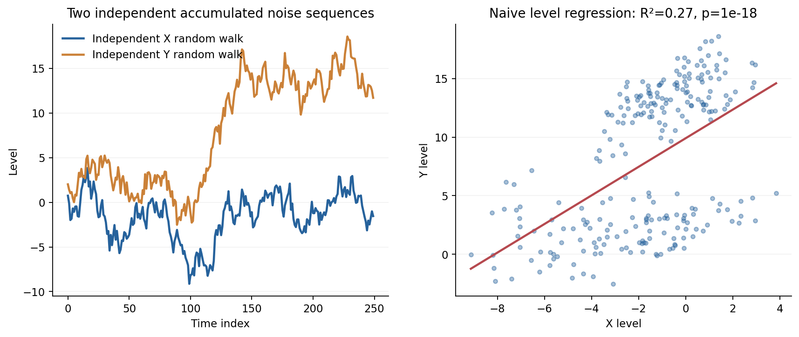
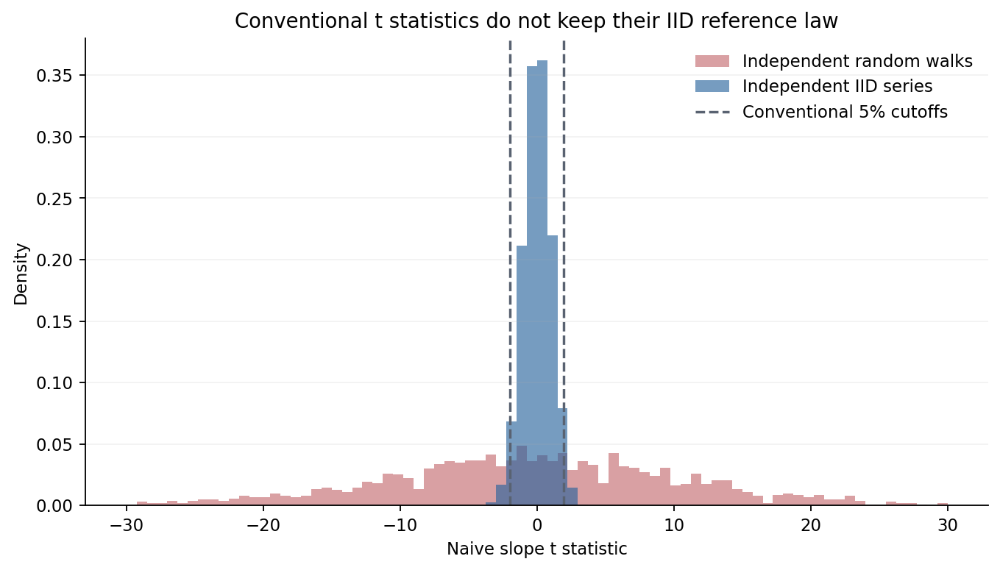
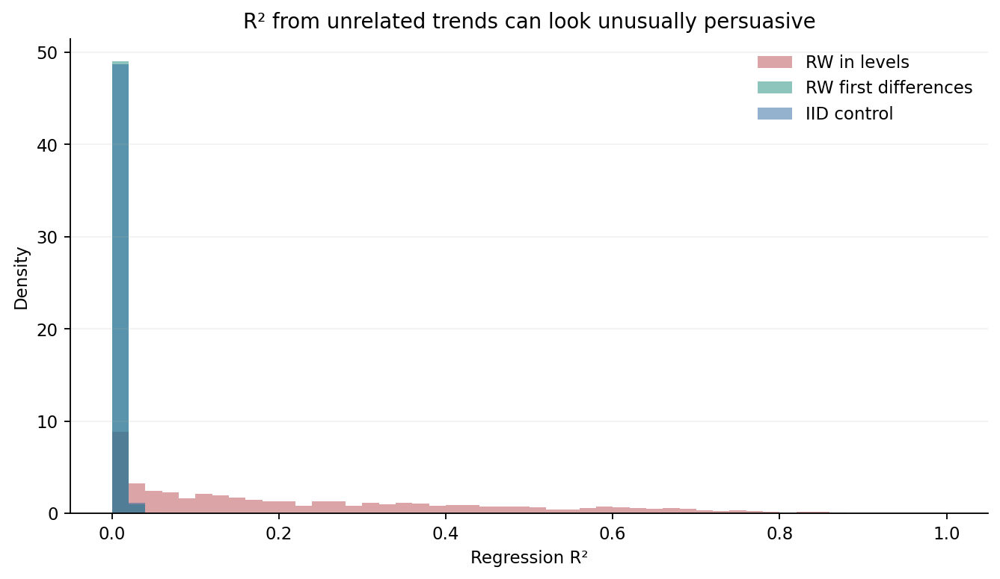
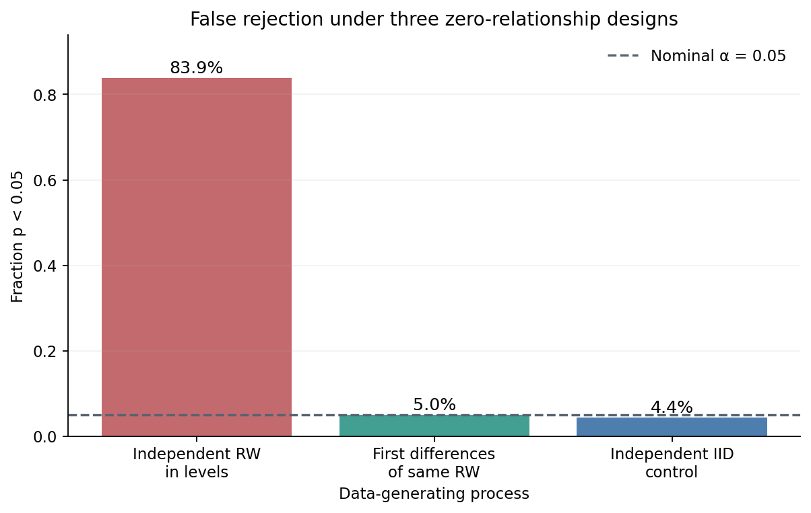
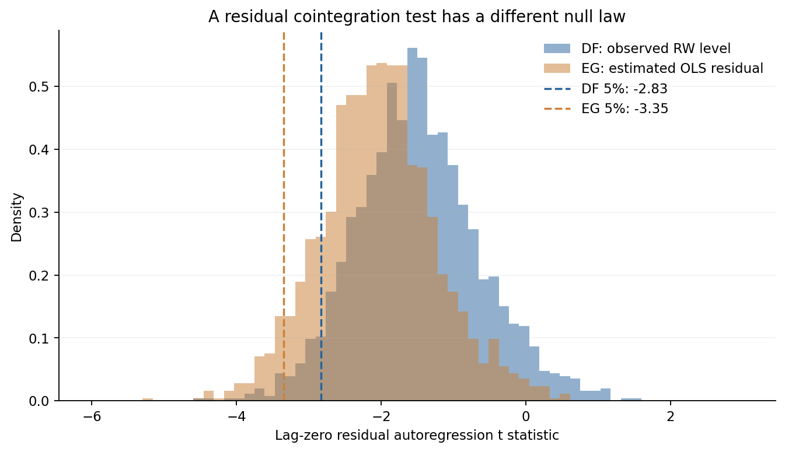
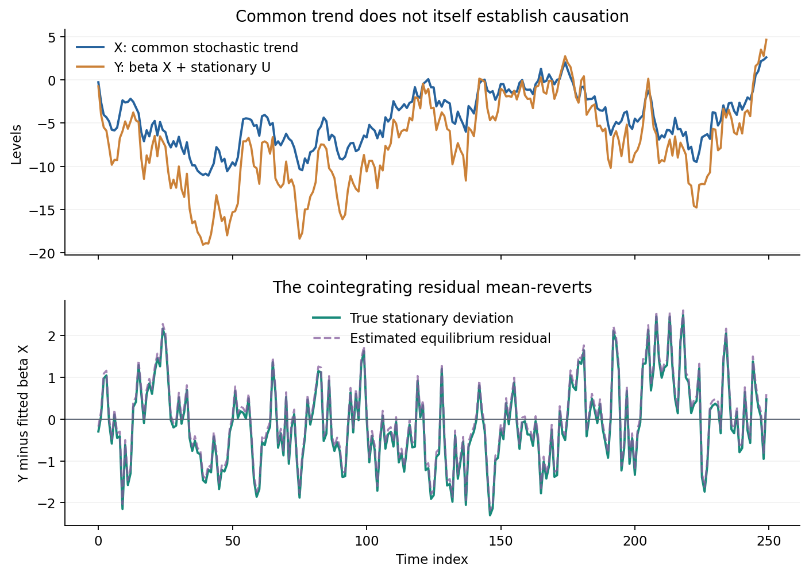
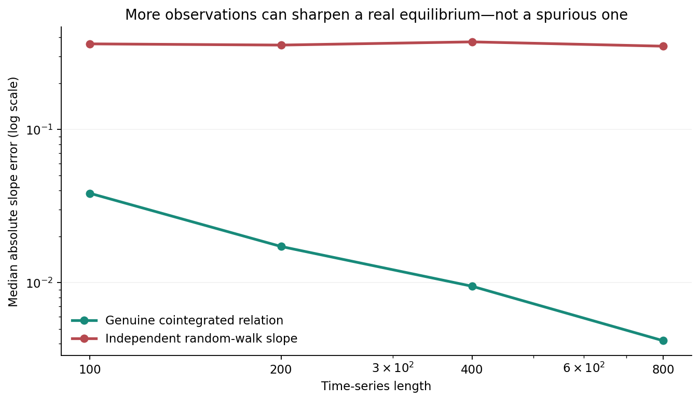
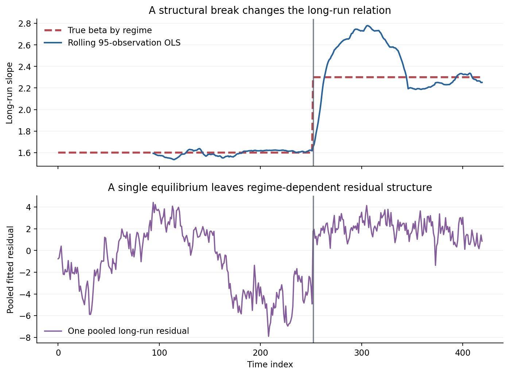

# A High R² Is Not a Long-Run Relationship: Spurious Regression, Unit Roots, and Cointegration

*Why Two Trending Series Can Mislead Us, and When Error Correction Is Real*

Diogo Ribeiro | October 2026

*A mathematical and computational essay. The data in the figures are simulated; no figure is presented as an empirical finding about a country, market, or company. Code, numerical outputs, verification tests, and a notebook accompany this text.*

## The resemblance that fooled the regression

Two measurements rise through the years. One might be the number of electric vehicles on the road and the other the number of university degrees awarded. Their plots look like they share a destination. Their correlation may exceed 0.9, and a conventional least-squares regression may print a slope with a spectacular t statistic. Put that regression in a report, describe the p-value as decisive, and it begins to look like a scientific result. None of these steps establishes that one variable explains the other. In some circumstances they do not even establish the narrower proposition that the variables share a statistically meaningful long-run relationship.

This is a problem about the structure of random variation, not a problem about an unusually dishonest plotting technique. Two independent stochastic processes can be made to look as if they follow the same path merely by accumulating their own innovations. A regression that has been designed to interpret independent, stationary errors can then generate misleading uncertainty statements. Increasing the number of observations need not rescue it. In fact, under the classic independent-random-walk experiment, apparently strong t statistics become easier to obtain as the observation window grows.

Clive Granger and Paul Newbold made the phenomenon famous in their 1974 paper *Spurious Regressions in Econometrics*. Peter Phillips subsequently provided a mathematical account of the nonstandard asymptotic behaviour. The important insight is not simply that a correlation can be misleading. It is that **the familiar null reference distribution of a regression statistic can be the wrong distribution for the data at hand**. A printed p-value can have an accurate number of decimal places and still answer the wrong probability question.

The story does not end with a warning never to regress trending data. Some nonstationary variables genuinely share a stable equilibrium. Two prices of closely related goods may be driven by a common stochastic trend while the price difference remains bounded; an exchange rate and a corresponding price-level relationship may be investigated in the same way, although empirical validity is another matter. Cointegration supplies the statistical vocabulary for such a relationship. Error correction connects that long-run equilibrium to changes observed from one period to the next.

But cointegration is not a certificate of economic causation, and it is not an unconditional property of any two series that happen to pass a test. Its meaning depends on their integration orders, the deterministic components allowed in the model, the treatment of serial dependence, the sample, and the stability of the relationship through time.

This essay develops those distinctions from first principles. The accompanying Python experiment constructs unrelated random walks, calibrates two different unit-root testing problems using their own null simulations, creates a system with genuine cointegration, studies the accuracy of its long-run slope, and finally breaks that relationship deliberately. Eight figures and fifteen CSV evidence tables can be regenerated without any external dataset. The simulations are a controlled numerical laboratory, not estimates of the world.

## 1. What does stationarity buy us?

The ordinary linear-regression model is often introduced in the form

\[
Y_t=\alpha+\beta X_t+\varepsilon_t,
\qquad t=1,\ldots,T.
\]

The equation by itself is an algebraic decomposition. Nothing about writing it guarantees that \(\beta\) is identifiable as a structural effect, or even that the usual OLS standard errors are appropriate. To reason about uncertainty we must also specify how \(X_t\) and \(\varepsilon_t\) behave, including their dependence through time.

For a weakly stationary process \(Z_t\), assuming finite second moments, its mean is constant, its variance is finite and constant, and its covariance between observations is a function only of their separation:

\[
\mathbb E[Z_t]=\mu,
\quad \operatorname{Var}(Z_t)=\sigma^2,
\quad \operatorname{Cov}(Z_t,Z_{t-h})=\gamma(h).
\]

This definition is weaker than strict stationarity, which demands that all finite-dimensional distributions are invariant to a shift in time. Either definition is about the probabilistic law of the sequence, not about whether a particular plot looks horizontal. A stationary series can have long runs above its mean, a temporary increase, or an apparently directional segment. The distributional distinction matters because standard large-sample arguments for many estimators rely on averaging sufficiently weakly dependent observations from a stable process.

Now consider a random walk:

\[
X_t=X_{t-1}+\eta_t,\qquad
\eta_t\overset{\mathrm{iid}}\sim N(0,\sigma_\eta^2),
\quad X_0=0.
\]

Expanding the recurrence gives \(X_t=\sum_{j=1}^{t}\eta_j\). The mean is zero, but its variance is \(t\sigma_\eta^2\), which depends on the date. The covariance of two levels is \(\sigma_\eta^2\min(s,t)\). This series is not stationary. On the other hand, its first difference is simply \(\Delta X_t=\eta_t\), a stationary innovation sequence. We say that the level is integrated of order one, written \(X_t\sim I(1)\), and its first difference is \(I(0)\).

An \(I(0)\) series does not have to be independent white noise. For example, the stationary autoregressive system

\[
U_t=\rho U_{t-1}+\xi_t,
\qquad |\rho|<1,
\qquad \xi_t\overset{\mathrm{iid}}\sim N(0,\sigma_\xi^2)
\]

has variance \(\sigma_\xi^2/(1-\rho^2)\) if initialized in its stationary distribution, and autocovariance that decays geometrically. Its mean reverts in the probabilistic sense that its dependence on an earlier displacement fades with horizon. It can nevertheless remain visibly above zero for a long spell when \(\rho\) is close to one. The difference between \(I(0)\) and \(I(1)\) is thus not a simplistic classification of smooth versus jagged graphs. It is about persistent versus nonpersistent stochastic shocks.

This distinction is useful whenever the question is about a long-run relation. If a shock has a permanent effect on the level of one variable, ordinary stationary-regression reasoning cannot automatically be carried across to that variable. An error process that has not forgotten a shock after many observations cannot be treated as a fresh, independent draw merely because we collected a longer spreadsheet.

## 2. An experiment in artificial conviction

Let two separate generators produce independent innovations:

\[
X_t=\sum_{j=1}^{t}\eta_j,
\qquad
Y_t=\sum_{j=1}^{t}\zeta_j,
\qquad
\eta_j\perp\!\!\!\perp\zeta_k\ \text{for all }j,k.
\]

Both innovation sequences are independent standard normal white noise. There is no shared latent factor, no common stochastic trend introduced by the data-generating mechanism, no directional influence from \(X\) to \(Y\), and no genuine equilibrium that ties their levels together. Their sample paths can nonetheless spend decades wandering in roughly the same direction. The visual reason is simple: an accumulation of positive or negative innovations persists. The observer sees the accumulated history rather than the independent increments that produced it.

We fit the ordinary levels regression \(Y_t=\alpha+\beta X_t+e_t\) with an intercept, ignoring everything we know about the series. Its least-squares slope is

\[
\widehat\beta
=\frac{\sum_t(X_t-\overline X)(Y_t-\overline Y)}
       {\sum_t(X_t-\overline X)^2},
\]

and the familiar t statistic divides this value by an estimated standard error based on an IID-residual formula. Its associated two-sided p-value is computed from the Student t distribution with \(T-2\) degrees of freedom. That p-value **is not a calibrated test for independent random-walk levels**. We retain it precisely to show the failure of that interpretation.

*Figure 1.* An illustrative false story. The right-hand panel uses one pair of independent random walks selected from successive draws to have a naïve p-value below \(10^{-5}\) and \(R^2>0.25\). The selection rule and attempt count are preserved in `illustrative_null_path.csv`. **This particular illustration is intentionally selected for visual clarity**. It is not a random sample from the null, and it does not enter any rejection-rate calculation. Cherry-picking is part of what the graphic demonstrates; it is never silently used as evidence about frequency.

One plot cannot estimate a sampling distribution. For that we repeat the complete experiment 1,400 times, drawing fresh independent random walks of length 250 for each repetition. We also calculate the levels regression on 1,400 pairs of independent stationary white-noise series, and the regression of \(\Delta Y_t\) on \(\Delta X_t\) for each original random-walk pair. Those are three distinct regressions under a known zero-relationship data-generating mechanism.

For a conventional significance test with nominal size \(\alpha=0.05\), a properly calibrated null procedure should reject in roughly 5% of independent repetitions, subject to Monte Carlo error. For an estimated rejection fraction \(\widehat p\) from \(M\) draws, a rough Monte Carlo standard error is \(\sqrt{\widehat p(1-\widehat p)/M}\). This standard error measures the uncertainty of our simulation estimate, not the error rate of the test in a real-world application.

*Figure 2.* The usual t distribution is a defensible reference for the independent white-noise control under its model assumptions; it is not a defensible reference for the independent random-walk levels. The histogram is cropped to \([-30,30]\) to keep the central comparison readable, so the plot does not show every extreme value. The raw, uncropped statistics are in `null_regression_replicates.csv`.

The remarkable feature is not a subtle change in the tails. The scale of the statistic is wrong. Under independent random-walk levels, the OLS coefficient and the quantities used to calculate its standard error have nonstandard asymptotic behaviour. Their ratio does not converge to the standard normal reference of a correctly specified stationary regression. The precise limiting expression involves functionals of Brownian motions; Phillips's 1986 analysis makes clear why a conventional textbook t-test is fundamentally unsuitable for this experiment.

The statistic can therefore appear more decisive when more observations are added without any new true relationship being created. This is a direct counterexample to the comforting intuition that a large sample always cures model misspecification. A larger sample reduces uncertainty when the assumptions under the inference justify the reduction. It does not make an invalid reference distribution valid.

*Figure 3.* An \(R^2\) measures the fraction of the *observed sample variation* fitted by a linear projection. It does not tell us why the variation was predictable. For unrelated trending levels, matching their accumulated trajectories can produce comparatively high \(R^2\) values. Differenced random walks and independent IID controls usually yield much smaller sample \(R^2\) values under this construction.

*Figure 4.* The bars show empirical rejection fractions from independent repetitions. The dashed line is the nominal 5% threshold. These are rejection rates under the **known simulated null**, so every significance claim is a false rejection in the sense that no relationship was generated. We do not use the term *false-discovery rate* in its technical multiple-testing sense \(\mathbb E[V/\max(R,1)]\); here the plotted quantity is the probability of rejection under a single true null.

For the fixed seed and full-sample design, the accompanying `null_regression_summary.csv` records the estimated rejection rate, mean and median \(R^2\), the average Durbin–Watson statistic, and the median absolute naïve t statistic for each case. The Durbin–Watson statistic,

\[
DW=\frac{\sum_{t=2}^{T}(\widehat e_t-\widehat e_{t-1})^2}
        {\sum_{t=1}^{T}\widehat e_t^2},
\]

is another useful warning: strongly positively autocorrelated residuals generally yield a small value. It is not a magical correction, and its usual testing theory also has assumptions. The point is to look at the serial structure that the regression is trying to hide behind a single coefficient estimate.

Notice what differencing achieved in this narrowly specified experiment. Because the constructed random walks are sums of mutually independent Gaussian innovations, \(\Delta X_t\) and \(\Delta Y_t\) are independent stationary series. Their regression has a meaningful ordinary null calibration. That result **does not prove** that differencing any two economic variables resolves confounding, measurement error, reverse causality, serial correlation, or an omitted common cause. It solves the particular nonstationarity problem engineered here. It can also discard an economically important long-run relation if such a relation actually exists.

## 3. Why the functional limit is different

There is a mathematical reason that the random-walk regression is pathological. It is worth understanding it even if we never use the formal limit to calculate a number. Under a functional central limit theorem, an appropriately scaled random walk behaves like Brownian motion on the unit interval. With unit innovation variance and time fraction \(r\in[0,1]\), write heuristically

\[
T^{-1/2}X_{\lfloor Tr\rfloor}\Rightarrow W_x(r),
\qquad
T^{-1/2}Y_{\lfloor Tr\rfloor}\Rightarrow W_y(r),
\]

where \(W_x\) and \(W_y\) are independent Brownian motions and \(\Rightarrow\) means weak convergence as random functions, under appropriate regularity conditions. Adding a regression intercept corresponds to subtracting sample means from the series. In the limit, the random-walk slope takes a nondegenerate random form resembling

\[
\widehat\beta
\Rightarrow
\frac{\int_0^1 W_x^c(r)W_y^c(r)\,dr}
     {\int_0^1[W_x^c(r)]^2\,dr},
\qquad
W^c(r)=W(r)-\int_0^1W(s)\,ds.
\]

The right-hand side is random, although the structural relationship is exactly zero. In particular, the slope need not concentrate at zero merely because the sample gets longer. This is unlike the familiar consistency story for a simple regression between independent stationary variables with well-behaved moments. The centring matters; a regression without an intercept has a different limit.

The normal-equation numerator and denominator both accumulate persistent low-frequency variation. A conventional OLS formula for the slope's uncertainty ignores that scale. It counts highly dependent level observations as though they supplied much more independent information about a relationship than they actually do. That discrepancy produces the inflated t statistics and implausibly small p-values in the simulation. We have not invoked a strange noise distribution, an outlier, a multiple-testing search, or a machine-learning model. Independent standard Gaussian innovations are sufficient.

Nor should we mistake this result for the claim that *every* regression between nonstationary variables is spurious. Some systems contain a shared stochastic trend with a stable cancellation mechanism. What separates a stable equilibrium from a visually plausible coincidence is the behaviour of the residual in a correctly specified long-run combination, not simply the size of \(R^2\).

## 4. A unit root is a hypothesis about persistence

The simplest autoregressive diagnostic considers

\[
Z_t=\phi Z_{t-1}+\varepsilon_t.
\]

When \(|\phi|<1\), and the innovations and initial conditions satisfy suitable restrictions, the process can be stationary. When \(\phi=1\), we have a unit root and shocks accumulate into the level. Subtracting \(Z_{t-1}\) from both sides yields

\[
\Delta Z_t=(\phi-1)Z_{t-1}+\varepsilon_t
=\gamma Z_{t-1}+\varepsilon_t.
\]

Testing \(H_0:\gamma=0\) against \(H_1:\gamma<0\) seems like a conventional test of a regression coefficient. It is not. Under the unit-root null, the lagged regressor is nonstationary and the ordinary Student t critical values do not apply. Dickey and Fuller developed the nonstandard theory that makes the test usable. The exact reference distribution changes when we include an intercept, a linear trend, or neither. Lagged differences may also be required to handle serial correlation in the innovations, giving the augmented Dickey–Fuller construction. An automatic software setting is not a neutral choice: it encodes a stochastic specification.

We examine one deliberately narrow version. For a series \(Z\) that is a Gaussian random walk with no deterministic drift, estimate

\[
\Delta Z_t=c+\gamma Z_{t-1}+\epsilon_t,
\qquad t=2,\ldots,250,
\]

and record the *coefficient t statistic* for \(\widehat\gamma\). The regression includes an intercept and zero lagged differences. We do not claim that an intercept must be present for every random walk, or that zero lags is a generally valid automatic setting. We use it because the experiment is completely specified and its null distribution can be calibrated under those exact conditions.

Now attempt a seemingly similar hypothesis test on the residuals of the levels regression between two independent random walks. In the first step, estimate

\[
Y_t=\widehat\alpha+\widehat\beta X_t+\widehat u_t.
\]

In the second step, estimate the residual regression

\[
\Delta\widehat u_t=\gamma\widehat u_{t-1}+v_t
\]

without an intercept and again without lagged differences. The zero intercept in the residual regression follows the illustrated two-step specification; it is not a general assertion that all residual-based cointegration tests must omit deterministic terms in the first-stage relation. We record the coefficient t statistic for \(\gamma\), seeking negative values that suggest mean reversion in the residual.

The crucial point is that \(\widehat u_t\) is **estimated**, not a directly observed independent random walk. Its construction has already selected a linear combination of the two underlying series that minimizes sample squared errors. Under the null of no cointegration, this estimation changes the distribution of the subsequent residual statistic. Using ordinary Dickey–Fuller critical values for the residual test generally produces incorrect inference. Engle and Granger's two-step framework and the subsequent residual-based testing literature, including Phillips and Ouliaris, address this distinction with cointegration-specific null distributions.

We demonstrate the difference rather than merely repeating the warning. Generate 1,800 fresh independent random-walk pairs of length 250 under the no-cointegration null. For each repetition compute (i) the level-series Dickey–Fuller t statistic with intercept, and (ii) the first-stage-estimated-residual t statistic with no intercept. The empirical lower 5% quantile of each distribution is a separate Monte Carlo reference for its corresponding experiment. We do not reuse the same reference across the two tests.

*Figure 5.* The distributions differ because they ask different questions with different estimated objects and deterministic specifications. Vertical dashed lines are separate simulated 5% lower-tail critical values. Their precise numbers come from `calibrated_critical_values.csv` rather than a table quoted without regard to the model. The experiment's 1,800 repetitions also introduce finite Monte Carlo error into the estimated cutoffs.

These cutoffs are **design-specific empirical quantiles**, not official ADF or Engle–Granger critical-value tables. They are valid only for the experiment's assumed Gaussian independent increments, horizon, two-variable first-stage OLS with an intercept, lag-zero second-stage regression, and the deterministic terms stated here. No general procedure for lag selection, drift, trends, serially correlated increments, conditional heteroskedasticity, or breaks is calibrated by this calculation. In empirical work, we would choose a coherent specification and obtain appropriate reference values or p-values from a validated implementation, with sensitivity checks.

The hypothesis test also has an asymmetry worth keeping in mind. Failure to reject a unit root is not proof of a unit root. Near-unit-root stationary processes can be difficult to distinguish from truly integrated processes over a limited horizon. Likewise, rejection by one specification need not survive a defensible alternative specification. Kwiatkowski, Phillips, Schmidt, and Shin (KPSS) proposed tests with stationarity as the null, providing a complementary, rather than logically interchangeable, direction of evidence. Disagreement between a unit-root-null test and a stationarity-null test should prompt investigation into power, deterministic terms, and structural change; it is not an invitation to vote for whichever p-value we prefer.

Finally, differencing and a residual-based test answer different scientific questions. Differencing asks whether the *changes* are stationary or associated. Cointegration asks whether a particular combination of *levels* removes a common stochastic trend and creates a stationary deviation. Both can be relevant in the same analysis. Conflating them leads either to spurious level relationships or to models that discard a genuine adjustment mechanism.

## 5. What a real long-run equilibrium looks like

Consider a data-generating system constructed so that a stable long-run combination exists:

\[
X_t=X_{t-1}+\eta_t,
\qquad
U_t=\rho U_{t-1}+\xi_t,
\qquad
Y_t=\beta X_t+U_t,
\]

with \(\eta_t\overset{\mathrm{iid}}\sim N(0,1)\), \(\xi_t\overset{\mathrm{iid}}\sim N(0,0.7^2)\), independent innovation streams, \(\rho=0.65\), and \(\beta=1.6\). The initial \(U_0\) is sampled from its stationary distribution. Thus \(X\) and \(Y\) are individually \(I(1)\), but

\[
Y_t-\beta X_t=U_t\sim I(0).
\]

This is the defining idea of cointegration for these two \(I(1)\) variables. There exists a nonzero vector \((1,-\beta)\) such that a linear combination of the integrated levels has a lower order of integration. We sometimes call \(Y_t-\beta X_t\) the *equilibrium error*. The label is shorthand for a stochastic property: deviations have finite stationary dispersion and a stable mean-reverting law. It does not mean that an economic agent consciously optimizes this equation or that a market must return to it after every shock.

Why can this happen? The levels carry the same underlying accumulated innovation \(\eta_t\) with different coefficients. Subtraction cancels that common nonstationary component. A shock to \(X\) appears permanently in both levels, but the difference \(Y-1.6X\) continues to behave like an AR(1) series. The relation is stable because the construction makes it stable, not because a high sample correlation commands it to be.

*Figure 6.* In the upper panel the levels wander, and simple visual inspection cannot distinguish their relation from a fortunate pair of random walks. The lower panel shows the difference: a true stationary deviation and the residual obtained by estimating the long-run levels slope. The true residual is observable in the simulation because we built it; in empirical data the true \(\beta\) and latent residual would be unknown. The estimated residual is not identical to the latent residual in a finite sample.

The constructed equilibrium also supplies an exact error-correction identity. Take first differences of \(Y_t=\beta X_t+U_t\), replace \(U_t\) by its AR(1) dynamics, and rearrange:

\[
\begin{aligned}
\Delta Y_t
&=\beta\Delta X_t+(U_t-U_{t-1})\\
&=\beta\Delta X_t+(\rho-1)U_{t-1}+\xi_t\\
&=\beta\Delta X_t+(\rho-1)
   (Y_{t-1}-\beta X_{t-1})+\xi_t.
\end{aligned}
\]

With \(\rho=0.65\), the true adjustment coefficient is \(\lambda=\rho-1=-0.35\). If last period's \(Y\) was above the long-run relation, so that \(Y_{t-1}-\beta X_{t-1}>0\), the adjustment term pushes today's change in \(Y\) downward, all else equal. If it was below, the same term pushes upward. In this particular construction \(Y\) carries the error-correction response and \(X\) evolves as an exogenous random walk, because that is how we programmed the joint law. A general cointegrated system need not have one variable that alone adjusts; the vector error-correction formulation can distribute adjustment across several variables.

To estimate the illustration, first fit the long-run levels regression and obtain \(\widehat u_t=Y_t-\widehat\alpha-\widehat\beta X_t\). Then regress short-run changes on the current \(X\) change and the lagged estimated equilibrium deviation:

\[
\Delta Y_t=c+b\Delta X_t+\lambda\widehat u_{t-1}+e_t.
\]

The fitted coefficients, the true generating parameters, the estimated residual scale, the second-stage \(R^2\), and the simulated residual-based test statistic are saved to `cointegration_diagnostics.csv`. A finite-sample estimate of \(\lambda\) will not exactly equal \(-0.35\). The first-stage long-run slope also incurs estimation error. Those discrepancies are a reason to quantify uncertainty, not to conclude that the stochastic identity is approximate.

This is the logic behind the Engle–Granger representation theorem: under suitable conditions, cointegrated variables have an error-correction representation. The theorem is not a licence to infer a structural intervention effect from the regression coefficient \(b\). To read \(\beta\) or the adjustment term as causal parameters, one needs additional identifying assumptions grounded in the data-generating mechanism or a research design. Shared permanent shocks, accounting identities, coordinated policy decisions, omitted factors, and simultaneous responses can all produce stable relations without the direction of causality an analyst wants to assert.

It is helpful to separate three statements that are too often bundled together:

1. **Prediction:** the historical values of \(X\), \(Y\), and their lagged deviations help forecast a short-run change under a sufficiently stable data-generating regime.
2. **Long-run statistical restriction:** a linear combination of the levels behaves like a stationary process, within the specified period and model.
3. **Causal interpretation:** changing \(X\) through a well-defined intervention changes \(Y\) by some interpretable amount, under explicit identification assumptions.

The first can be useful without the second, the second may hold without the third, and the third is not established solely by the first two. This separation is relevant to policy analysis, risk modelling, financial economics, and operational forecasting. It prevents a forecasting result from silently becoming an intervention recommendation.

## 6. Does a longer series improve the long-run estimate?

The fourth experiment addresses estimation rather than just hypothesis testing. Under the cointegrated model \(Y_t=1.6X_t+U_t\), increasing the horizon provides more information about the coefficient needed to eliminate the common stochastic trend. Under unrelated random walks, increasing the horizon does not create a constant true slope relating the levels. Even if the nominal structural slope is labelled zero in the latter design, the fitted levels coefficient need not converge to zero under the spurious-regression asymptotics.

We simulate 260 fresh independent replicates at each horizon \(T\in\{100,200,400,800\}\). For the genuinely cointegrated system we calculate \(|\widehat\beta-1.6|\). For the independent random-walk system, where no cross-series relation is generated, we calculate \(|\widehat\beta|\). These are deliberately different targets: the first measures error in estimating a real long-run slope, while the second measures the magnitude of a slope the data-generating mechanism does not contain. We summarize each distribution using its median, mean, and 90th percentile. A single unusually lucky estimated slope should not decide the conclusion.

*Figure 7.* Both axes use logarithmic spacing. The cointegrated system's slope error generally contracts with increasing horizon, whereas the unrelated levels regression does not acquire a reliable zero coefficient from simply observing more accumulated noise. The exact finite-sample medians appear in `slope_scaling_summary.csv`, and every replicate appears in `slope_scaling_replicates.csv`.

There is a useful theoretical qualification. In a correctly specified cointegrating regression, a long-run coefficient estimator can be *superconsistent*, converging at a faster rate than an ordinary stationary regression slope under suitable assumptions. That is a statement about the long-run coefficient, not a blanket statement that all conventional OLS standard errors, t-tests, or causal conclusions are justified. Correlation between the cointegration error and the innovations driving the regressors, serial dependence, deterministic trends, and finite-sample bias can still matter for efficient estimation and inference. Methods such as fully modified OLS, dynamic OLS, and system approaches address particular aspects of that problem; we do not implement or benchmark them in this limited simulation.

The comparison is also not a proof that one can identify cointegration merely by plotting a sequence of estimates that appears to stabilize. A slowly changing spurious coefficient may look stable over several nested samples, especially when their data heavily overlap. Formal diagnostics, model assumptions, and independent substantive reasoning remain necessary. The experiment has a known truth, while a real application almost never does.

## 7. The equilibrium can move while we keep estimating it

Suppose we estimated a stable relationship in the past and the process subsequently changes. A commodity-market reform affects pricing rules; a common accounting definition is revised; a regulator imposes a new constraint; a technology alters the cost structure. A long-run relationship that was a useful approximation in one regime may no longer be valid in another. An analyst who pools all dates under one constant coefficient can manufacture a compromise slope that corresponds to neither regime.

To isolate the issue, we create a second artificial cointegrated system of length 420. Its underlying process \(X\) is still a random walk and its latent deviation \(U\) remains a stationary AR(1). But the coefficient connecting the observed levels changes once:

\[
Y_t=\beta_tX_t+U_t,
\qquad
\beta_t=\begin{cases}
1.6,&t<252,\\
2.3,&t\ge252.
\end{cases}
\]

This is intentionally abrupt. At the break, \(Y\) can jump by an amount proportional to the contemporaneous level of \(X\). It is a model of a regime-dependent measurement or structural relationship, not a physical conservation law requiring continuity at the breakpoint. Each regime has a stationary deviation relative to its own coefficient. Yet one fixed slope may be inadequate across both regimes. Whether an entire process is treated as cointegrated under a regime-shifting definition depends on the expanded specification; ordinary single-vector cointegration should not simply be declared true for the pooled period.

We estimate one pooled long-run OLS slope and calculate its residual. Independently, we move a 95-observation window through the series and estimate the local slope at each end date. The rolling estimate is retrospective and uses overlapping windows. It is not a forecast of the break, and no procedure here detects the exact break date from information available only before it occurs. A rolling window that straddles the change mixes two parameter regimes and can overshoot both true slopes.

*Figure 8.* The dashed line shows the true relation before and after the break. The estimated 95-point rolling slope adjusts with delay and can overshoot. The pooled residual exhibits structure that is not well described by a single stationary error-correction relation. That pattern is a diagnostic, not an automatically calibrated break test. The exact paths and windows are in `broken_relation_path.csv` and `rolling_break_estimates.csv`.

We also repeat the break experiment 300 times, maintaining the same fixed break date and generating fresh paths. The average separate-regime slopes in this seed are approximately 1.600 and 2.301, with regime-specific root mean squared errors approximately 0.025 and 0.033. Those results show that the local data can recover each slope reasonably well *when the break date is known*. We have not solved the harder problem of locating an unknown break, accounting for searching over dates, or assessing the uncertainty in the number of regimes.

For illustration, we apply the single-relation residual test statistic to the pooled, broken samples and compare it with the cutoff calibrated under a stable no-cointegration null. In this simulation it rejects in about 53% of repetitions. That number is **not a validated power estimate for a structural-break cointegration test**. The pooled broken system violates the stable-parameter alternatives against which the conventional statistic is ordinarily interpreted; its behaviour depends on the break magnitude, timing, innovation laws, and sample length. We report the numerical frequency to demonstrate sensitivity and ambiguity, not to recommend that procedure for detecting breaks.

Gregory and Hansen's work on residual-based tests allowing a regime shift illustrates a more coherent route when a break is part of the scientific hypothesis. In other applications, one could consider a stability test, multiple-break model, rolling diagnostics with separately calibrated uncertainty, or a system cointegration analysis with appropriate regime terms. All of these add specification decisions and uncertainty. An apparent failure of a standard two-step test in the presence of a break is not definitive evidence that no meaningful equilibrium has ever existed.

The broader lesson is about *invariance*. When an analyst proposes a long-run relation, they are proposing some degree of stability under the natural evolution of the system. They should ask: stable over which dates, geographical units, institutions, measurement definitions, and interventions? A model may be statistically coherent within one window and unusable as an external policy extrapolation. A changing slope can be economically informative rather than merely inconvenient noise. Ignoring the possibility can contaminate both estimated equilibrium levels and subsequent error-correction signals.

## 8. The numerical results, without the plot rhetoric

Here is the complete experiment reduced to a few checks. All statistics below come from the **full** execution of `analysis.py`, with the fixed seed 20261031, not from its lower-replication `--quick` mode. The text deliberately reports approximate rounded values; the CSVs preserve the unrounded numbers.

| Quantity | Simulation result | Interpretation within the specified design |
| --- | ---: | --- |
| Unrelated random-walk levels: naïve 5% rejection | **83.93%** | The familiar IID t-test grossly fails its nominal calibration |
| First differences of unrelated walks: naïve 5% rejection | **5.00%** | Increments satisfy this experiment's stationary independent control |
| Independent IID levels: naïve 5% rejection | **4.43%** | Ordinary stationary benchmark remains near nominal size |
| Mean \(R^2\), unrelated random-walk levels | **0.2383** | A substantial fitted fraction can arise under complete independence |
| Empirical 5% critical value, DF on level with intercept | **−2.831** | Specific lower-tail reference for the simulated level test |
| Empirical 5% critical value, estimated EG residual without intercept | **−3.349** | The residual test needs its distinct null calibration |
| Residual EG statistic in the genuine cointegration illustration | **−7.495** | Far below its simulated no-cointegration cutoff in this draw |
| Fitted ECM adjustment coefficient | **−0.370** | Close to the generating value \(−0.35\), not identical |
| Fitted short-run coefficient on \(\Delta X\) | **1.604** | Close to the generating long-run and contemporaneous value \(1.6\) |
| Mean early/late slope in 300 break replicates | **1.600 / 2.301** | Known-break separate fits recover their regime parameters |

The false-rejection numbers make the core contrast concrete. A 5% significance rule applied to the wrong level-regression distribution rejected in approximately five out of six unrelated-random-walk experiments. Applying a comparable regression to truly independent stationary increments did not show the same pathology. The simulated lower-tail critical values for the two test statistics differed by about half a t-statistic unit, enough to change decisions near the boundary. The cointegrated system, by construction, had an explicitly stationary deviation and an adjustment coefficient near its theoretical value.

There are limits to how much one can infer from these numbers. The 1,400 null repetitions yield a Monte Carlo standard error of approximately 0.98 percentage points for an 83.93% rejection fraction and approximately 0.58 percentage points for a 5% fraction. These are useful precision indications, not confidence intervals for a population rate in a real economy. With 1,800 repetitions, the estimated 5% critical quantile is also subject to sampling uncertainty, particularly because an extreme quantile is estimated from a relatively small fraction of the simulations. Re-running under a new seed will change the last digits, and reasonable finite-sample choices can change the actual critical value. That fragility is a reason to publish the complete design and results.

The slope-scaling experiment shows another informative contrast. At 100 observations, the median absolute long-run slope error in the genuinely cointegrated system is about 0.0383; at 800 it falls to approximately 0.0042. Across the same horizons, the independent-random-walk slope's median absolute magnitude changes only from approximately 0.361 to 0.349, with intermediate values not monotonically decreasing. The exact pattern is finite-sample evidence compatible with the theoretical distinction, rather than an empirical proof of a universal rate of convergence. It is more informative than displaying a single coefficient from a single favourable draw.

## 9. What I would do with real trending data

A useful workflow begins *before* selecting the regression method. First write down the substantive measurement process. Are the observations an economic stock, a flow, an accumulated count, a deflated price, a policy index, a rate, or a derived ratio? A cumulative count mechanically trends even if its daily increments are unrelated to another growing cumulative count. An observed trend can also be deterministic: the distinction between a deterministic linear trend plus stationary noise and a stochastic trend matters for testing and forecasting. A structural revision to a measurement definition may resemble a permanent shock but require a data-cleaning decision, not an economic theory.

Second, inspect the time-series properties in levels and changes. Plot each series, differences, autocorrelation, and relevant transformation choices. Compare stochastic specifications with and without deterministic terms where defensible. Use unit-root and stationarity tests as complementary evidence while acknowledging their limited finite-sample power. A series that looks stationary after differencing may be \(I(1)\), but a combination of broken deterministic trend and stationary noise can also mislead a simple unit-root procedure. Do not label a process \(I(1)\) merely because a plotting library draws a line that slopes upward.

Third, define the scientific hypothesis about the long-run relation *before* optimising the result. Which variables plausibly share a stochastic trend? Why should their relationship remain stable? Does an accounting identity or a known market-clearing mechanism restrict the sign or approximate magnitude of a cointegrating vector? Could the apparent relation be due to a common unobserved macroeconomic driver? How would the interpretation change if the level relation exists but neither variable causes the other? These questions cannot be answered by a statistical critical value.

Fourth, choose a coherent modelling family. If the series are stationary after appropriate transformations and the question concerns short-run variation, a stationary time-series regression with a defensible error structure may suffice. If integrated levels plausibly share a stable relation, a residual-based two-step test can provide one diagnostic, or a system approach can handle several variables and potentially multiple cointegrating vectors. Johansen's likelihood-based analysis is a classic reference for the multivariate setting. The residual test's lag choices, intercept, trend, and cointegration rank assumptions should be documented. A software function's default cannot substitute for a model specification.

Fifth, challenge the fitted relation. Inspect the equilibrium residual and its changes. Explore parameter stability, breaks, plausible outliers, and heteroskedasticity. Ask whether the proposed combination behaves similarly before and after major policy shifts. If the series overlap in definitions or contain measurement revisions, investigate whether these produce mechanical agreement. Test sensitivity to sample endpoints and lag specifications, but avoid silently selecting the one that produces the most attractive significance. Selection changes the inferential problem.

Sixth, separate predictive utility from interpretation. An error-correction model may forecast well out of sample because it exploits a recurring adjustment pattern. That is a valuable result even when it is not structural. Conversely, a cointegrated long-run relation may be too slow to improve the specific operational forecast. Assess prediction through time-ordered validation, keeping all model and transformation choices inside each training window. Randomly shuffling time observations would destroy the chronological information that makes the problem difficult in the first place.

Finally, do not make a policy claim unless there is an independent identification argument. A stable long-run relation between house prices and incomes, for instance, does not by itself identify the intervention effect of raising wages, changing interest rates, or building housing. Each policy may alter the stochastic process or the very equilibrium coefficient being estimated. An instrumental variable, natural experiment, structural model, or other identification strategy would be a separate addition to the evidence. The right statistical question is a prerequisite for good analysis, but it is not a substitute for knowing what intervention is being proposed.

## 10. Reproducibility is part of the argument

The accompanying project has an explicit design and a single command to regenerate its canonical evidence. `analysis.py` fixes a random seed, uses NumPy's generator for independent innovation streams, computes OLS using least-squares linear algebra, and calculates two lag-zero autoregressive t statistics without silently delegating model choices to an econometrics package. It saves the eight original figures and fifteen CSV tables with well-defined field names, plus a concise study summary. All outputs are generated locally and require no API access, external data, paid subscription, or credential.

The repository also contains a notebook that explains and exercises the construction from a fresh Python kernel, unit tests for stochastic identities and statistical invariants, and a GitHub Actions workflow that installs dependencies, executes the tests, and regenerates reduced-cost smoke-test evidence. The canonical artifacts, however, come from the full counts listed in the methodology. Quick-mode artifacts receive a distinct `_quick` suffix so that a smoke test cannot silently overwrite the full study. The published figure PNGs are not merely placeholders for an unavailable external analysis: their numerical inputs are available as CSV files, and the code defines the plots.

This design makes claims falsifiable in several senses. A reader can verify that two innovation streams are generated independently by separate random draws, confirm that the regression p-value really uses the conventional Student t reference, inspect the raw null statistics rather than trusting the histogram, change the Monte Carlo count, modify the integration order, introduce serial correlation, or ask how a larger break affects the rolling and pooled estimates. The experiments do not use hidden manual figure editing. Numerical reproducibility does not prove that the simulation assumptions describe the world, but it makes the mathematical claims about the simulated world inspectable.

The companion is intentionally modest about what is *not* implemented: this is not an ADF lag-selection benchmark, an econometric model-selection library, a structural-break detection package, a panel cointegration analysis, or a causal inference system. No significance value in this article should be copied into a real empirical study without rebuilding the reference distribution for that study's model. The simulated evidence supports a conceptual point and illustrates the associated mathematics. It is not a universal test with magically portable numerical cutoffs.

## 11. The conclusion I would defend

An apparently convincing regression can be entirely an artefact of how persistence enters two unrelated series. The danger is not merely that an analyst selected two amusing upward-sloping charts. It is that the familiar standard-error formula measures uncertainty under a law different from the law that generated the observations. A small p-value computed from that formula can therefore be a highly precise answer to a misspecified statistical question.

Cointegration introduces a more disciplined possibility: the nonstationary components may cancel in a stable linear combination, permitting a meaningful long-run statistical restriction and an error-correction representation. But the residual-based test has its own reference distribution because the residual is estimated. The relation may change across regimes. Its predictive value and its causal interpretation are separate questions.

I would summarize the practical distinction in one sentence: **a large \(R^2\) tells us that a line followed the observed levels; cointegration asks whether a stable combination cancels their stochastic trends. Neither tells us, without further evidence, what would happen if we intervened on one variable.**

That is a smaller conclusion than many regression reports would prefer. It is also a more useful one.

---

## References and further reading

1. Granger, C. W. J., and Newbold, P. (1974). “Spurious Regressions in Econometrics.” *Journal of Econometrics*, 2(2), 111–120. [https://doi.org/10.1016/0304-4076(74)90034-7](https://doi.org/10.1016/0304-4076(74)90034-7). The canonical warning about regressions between unrelated persistent series.
2. Phillips, P. C. B. (1986). “Understanding Spurious Regressions in Econometrics.” *Journal of Econometrics*, 33(3), 311–340. [https://doi.org/10.1016/0304-4076(86)90001-1](https://doi.org/10.1016/0304-4076(86)90001-1). A formal asymptotic account of why usual regression diagnostics fail for unrelated integrated processes.
3. Dickey, D. A., and Fuller, W. A. (1979). “Distribution of the Estimators for Autoregressive Time Series with a Unit Root.” *Journal of the American Statistical Association*, 74(366a), 427–431. [https://doi.org/10.1080/01621459.1979.10482531](https://doi.org/10.1080/01621459.1979.10482531). The foundational unit-root reference distribution.
4. Engle, R. F., and Granger, C. W. J. (1987). “Co-Integration and Error Correction: Representation, Estimation, and Testing.” *Econometrica*, 55(2), 251–276. [https://doi.org/10.2307/1913236](https://doi.org/10.2307/1913236). The representation and two-step approach central to the article.
5. Phillips, P. C. B., and Ouliaris, S. (1990). “Asymptotic Properties of Residual Based Tests for Cointegration.” *Econometrica*, 58(1), 165–193. [https://doi.org/10.2307/2938339](https://doi.org/10.2307/2938339). Explains why first-stage-estimated residual tests require distinct reference theory.
6. Johansen, S. (1988). “Statistical Analysis of Cointegration Vectors.” *Journal of Economic Dynamics and Control*, 12(2–3), 231–254. [https://doi.org/10.1016/0165-1889(88)90041-3](https://doi.org/10.1016/0165-1889(88)90041-3). The multivariate-system perspective.
7. Kwiatkowski, D., Phillips, P. C. B., Schmidt, P., and Shin, Y. (1992). “Testing the Null Hypothesis of Stationarity Against the Alternative of a Unit Root.” *Journal of Econometrics*, 54(1–3), 159–178. [https://doi.org/10.1016/0304-4076(92)90104-Y](https://doi.org/10.1016/0304-4076(92)90104-Y). A complementary stationarity-null diagnostic.
8. Gregory, A. W., and Hansen, B. E. (1996). “Residual-Based Tests for Cointegration in Models with Regime Shifts.” *Journal of Econometrics*, 70(1), 99–126. [Author-hosted paper](https://users.ssc.wisc.edu/~behansen/papers/joe_96.pdf). Structural change is part of the hypothesis, not an afterthought.

### Companion materials

- [Simulation code](analysis.py) and [reproduction instructions](README.md).
- [Executable notebook](spurious_regression_cointegration.ipynb).
- [Numerical evidence](results/study_summary.csv), [full null simulation](results/null_regression_replicates.csv), and [test calibration](results/calibrated_critical_values.csv).
- [All figures](figures/) and [all CSV tables](results/).

*All code, figure design, simulated data, and explanatory writing in this companion are original for this article. The historical and theoretical results attributed to other researchers are cited above.*

