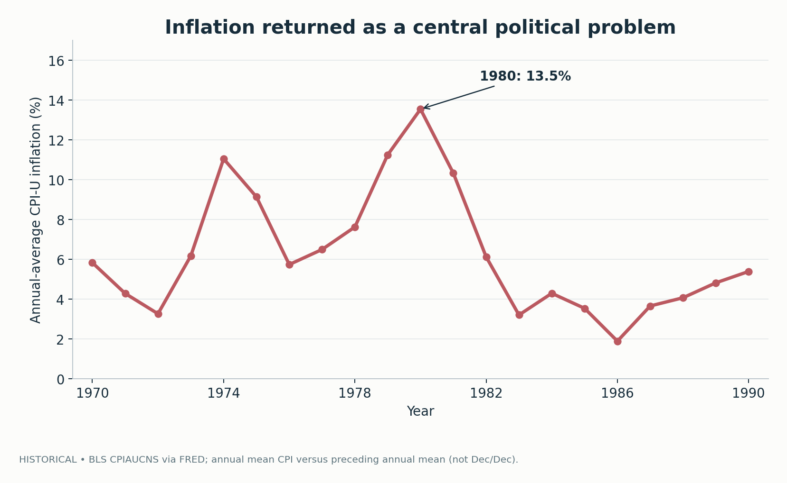
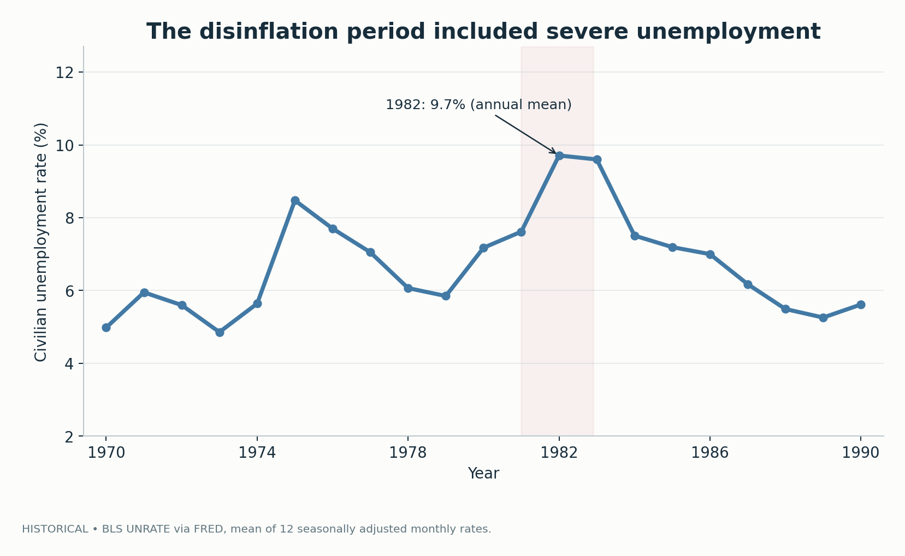
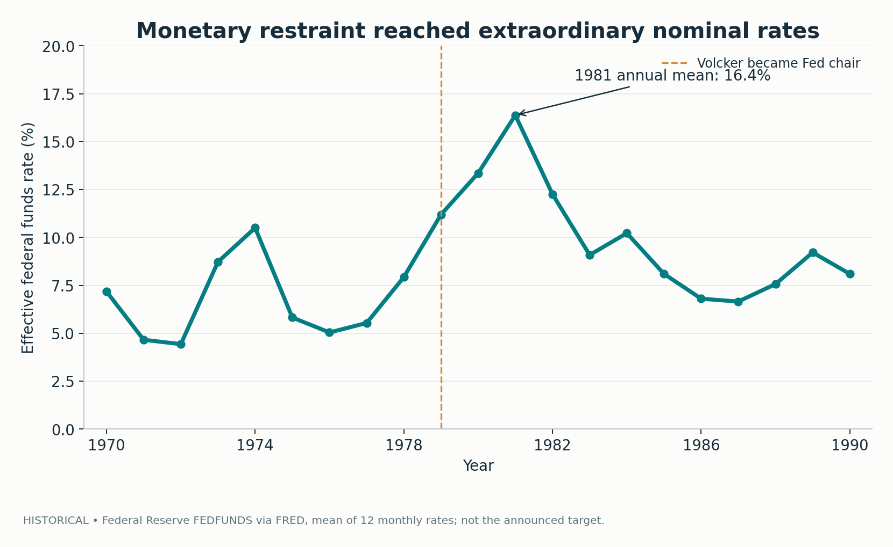
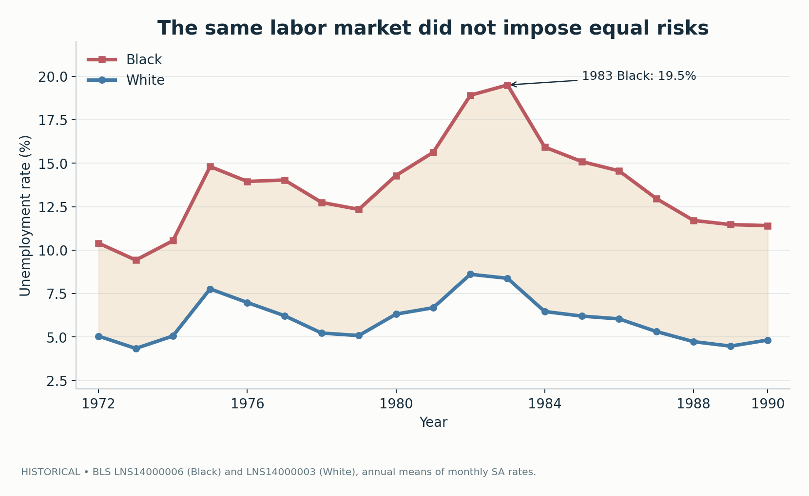
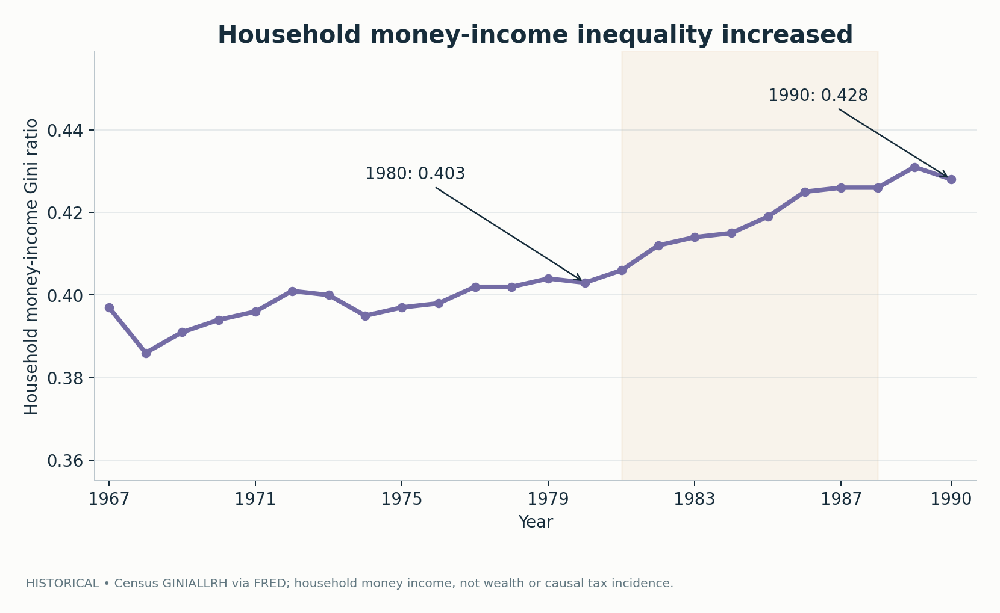
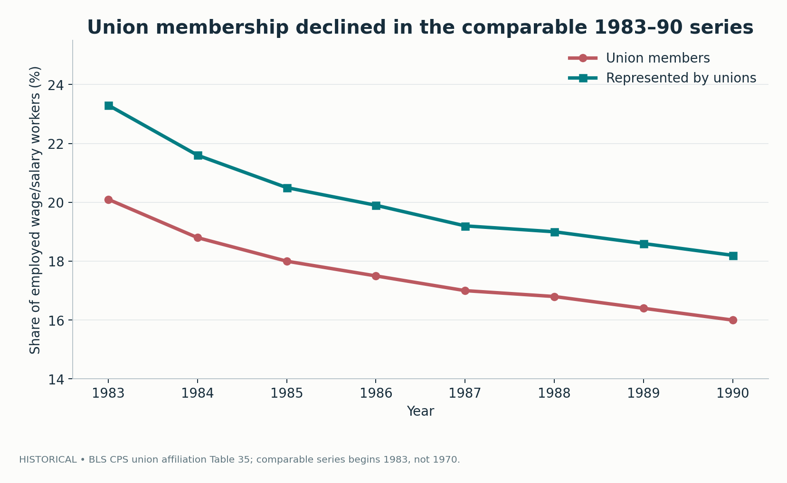
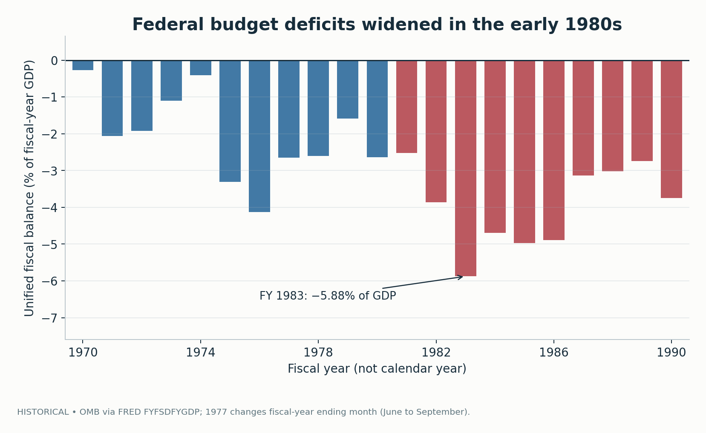
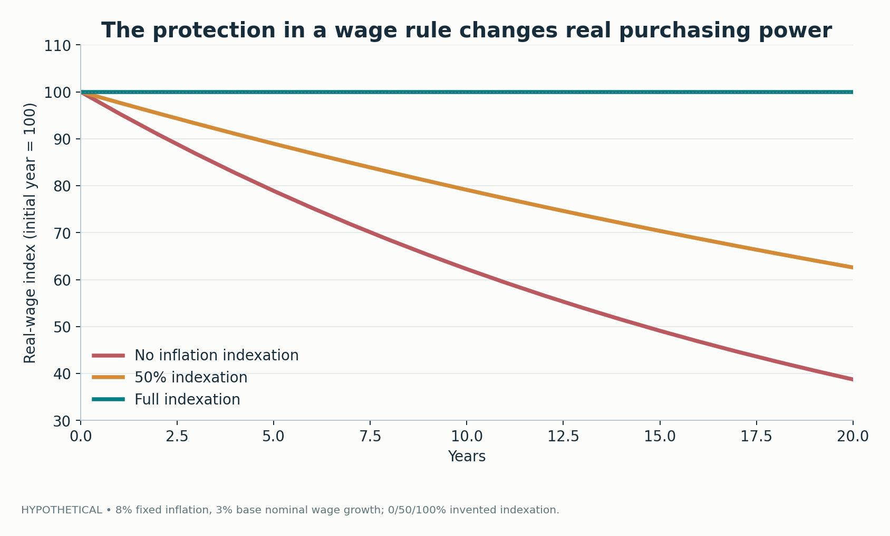

# The Price of Stability Was Not Shared Equally

## Stagflation, Volcker, Reagan, and America's Market Turn, 1970–1990

*A quantitative history of inflation, unemployment, monetary restraint, tax reform, labor power, and the institutional choices that shaped the United States after the Great Society.*

---

Every economic policy is an argument about time. Inflation asks how much the money received today will purchase tomorrow. Unemployment asks how long someone can survive without selling their labor. Credit asks how much future income must be promised in order to act now. Social insurance asks how society will share risks that appear at different points in a person's life. A tax system asks how public costs will be divided across people who possess different kinds of income and wealth.

The United States entered the 1970s with a newly enlarged architecture of civil rights, public health insurance, and anti-poverty programs. It entered the 1990s with a markedly different political language: inflation control, competitiveness, deregulation, lower marginal income-tax rates, budget discipline, and markets as preferred instruments of coordination. The second world did not simply erase the first. Medicare remained. Social Security remained. Civil-rights protections remained contested but foundational. Nevertheless, the assumptions governing economic policy had changed.

An overly tidy story says that the New Deal and Great Society created an expansive state, that the state produced inflation and stagnation, and that Reagan restored prosperity by setting markets free. Its rival says that the 1980s were nothing but a transfer of power to employers and wealthy taxpayers, in which every apparent economic gain was either illusory or stolen from workers. Both stories are stronger as political identities than as comprehensive historical explanations.

To understand the period, we need to separate events that unfolded together. The dollar's convertibility into gold ended in 1971. Oil shocks destabilized prices in 1973–74 and 1978–79. Inflation accelerated, and unemployment rose even while prices were increasing. The Federal Reserve under Paul Volcker adopted forceful monetary restraint, contributing to a severe disinflation alongside deep recessions. Jimmy Carter supported significant transport deregulation and appointed Volcker. Ronald Reagan advanced large tax changes, supported the disinflation, confronted an illegal federal air-traffic-controller strike, and gave market-oriented policy a durable political identity. Income inequality increased, union membership declined, and federal deficits widened during much of the 1980s.

Those sentences describe chronology and institutions. They do not yet allocate causal responsibility. A presidential term is not an experimental treatment. An inflation series is not a moral verdict. A falling unionization rate is not a standalone explanation of wage inequality. And a household-income Gini coefficient cannot tell us the after-tax incidence of legislation it does not directly measure.

This essay builds on earlier work about the [Gilded Age](../gilded-age-political-economy/article.md), the [Progressive Era](../progressive-era-reform-gap/article.md), the [New Deal](../new-deal-social-contract/article.md), and [civil rights and the Great Society](../civil-rights-great-society/article.md). The recurring question is how public institutions change who can claim security, who can bargain, and who bears the costs of collective decisions. The new question is what happened when price stability itself became an overriding economic priority.

Seven of the eight figures reproduce descriptive original-source series from the Bureau of Labor Statistics, Federal Reserve, Census Bureau, and Office of Management and Budget. Their scope and definitions are identified in captions and source notes. The eighth figure uses a deliberately invented mathematical model to illustrate the difference between nominal wage increases and real purchasing power. No figure establishes the causal effect of Reagan, Volcker, a tax act, or an individual strike.

The central conclusion is more exact than either partisan slogan: the disinflation was a consequential achievement, and its immediate costs were substantial; changing market rules created opportunities while altering the distribution of bargaining power; and the gains and losses of the period were distributed unevenly. A stable price level is a public good. It is not a complete account of a good political economy.

## 1. A social state faced a new economic problem

The previous decade had concentrated on a set of problems inherited from the early twentieth century: legal exclusion, old-age medical insecurity, inadequate access to education, and poverty. The Great Society did not solve all those problems, but it changed the powers and responsibilities of the federal government. The Voting Rights Act confronted administrative exclusion from the franchise. The Civil Rights Act established federal antidiscrimination channels. Medicare and Medicaid extended medical-financing arrangements, and education legislation supported schools serving disadvantaged children.

Economic policy operated in an environment that was changing for reasons beyond those laws. The long postwar expansion had depended on international monetary institutions, domestic investment, expanding productivity, a changing industrial structure, and particular relationships among workers, employers, and government. The 1970s brought new pressures: declining room for easy productivity gains in some sectors, growing international competition, geopolitical disruptions to energy supplies, and difficulty coordinating wages and prices during inflation.

It would be historically careless to assert that the Great Society itself caused stagflation. That would require a documented mechanism and credible comparison sufficient to separate its effects from external energy shocks, monetary conditions, expectations, productivity changes, and global transformations. No such inference follows from placing one decade after another.

It would also be careless to treat social programs as entirely independent of macroeconomic conditions. Inflation changes real benefit values unless programs are indexed. Higher interest rates change the cost of public borrowing. Recessions alter tax revenue and demand for unemployment support. Fiscal policy and monetary policy interact, although their mechanisms and authorities are different. The enlarged social state had to operate through a more turbulent economy than many of its architects had expected.

The conflict was intellectual as well as administrative. In the early postwar period, many economists and policymakers had become accustomed to thinking that demand management could stabilize unemployment and output. By the 1970s, high inflation coexisted with weak employment in ways that made a simple, stable tradeoff between the two increasingly implausible. Expectations mattered. Supply shocks mattered. Wage bargaining and price-setting institutions mattered. A government that attempted to buy permanently lower unemployment through surprise inflation risked discovering that the surprise could not be repeated indefinitely.

The new problem was therefore not simply “too much government” or “too little government.” It was the interaction of nominal instability, real shocks, and institutions that distributed the shock. Price controls, interest-rate policy, trade regulation, taxation, labor law, and social insurance each operated on a different margin. If we lump them into a single public-versus-private scale, we lose the distinctions needed to evaluate their performance.

The period also demonstrates why economic indicators cannot be treated as votes in a moral referendum. Inflation can undermine a worker's purchasing power, especially if wages adjust slowly. But disinflation brought about through high interest rates can impose concentrated losses on workers who are laid off, people who depend on construction or manufacturing, households with expensive variable-rate debt, and communities with fewer alternative employers. The ethical question concerns both the result and the distribution of the transition cost.

## 2. The inflation record has more than one peak

The first figure shows annual-average U.S. consumer-price inflation from 1970 through 1990. It uses the Bureau of Labor Statistics' non-seasonally-adjusted CPI-U all-items index, [CPIAUCNS](https://fred.stlouisfed.org/series/CPIAUCNS), distributed through the Federal Reserve Bank of St. Louis's FRED service. Each year's value is the average of the twelve monthly price-index observations. The inflation rate is then calculated as the percentage change from the previous calendar year's average CPI.

That definition is important. An annual-average inflation rate is not the December-to-December rate. It compares mean price levels across years, so its timing can differ from a twelve-month rate observed at a particular date. The source transcription includes 1969 as the denominator for the first 1970 inflation observation. The code reproduces the calculation rather than copying rounded rates from an unverified chart.

*Figure 1 — Historical descriptive series: annual-average CPI-U inflation, computed from BLS non-seasonally-adjusted monthly CPI levels via FRED. This is annual-average to annual-average inflation, not a December-to-December rate.*

Inflation was approximately 5.8% in 1970. It slowed to about 3.3% in 1972, then climbed to 11.1% in 1974. It eased after the mid-decade recession but accelerated again: roughly 11.3% in 1979 and 13.5% in 1980. By 1983 the annual-average rate had fallen to about 3.2%. It did not remain that low in every later year; the chart shows roughly 5.4% by 1990.

The two major inflation episodes matter because they discourage a single-cause explanation. They occurred in different international and domestic environments, with different shocks and policy responses. The 1973–74 oil crisis followed the collapse of the earlier exchange-rate order and an international energy-price disruption. The late-1970s acceleration also involved energy prices, expectations, monetary policy, and institutions that had been trying to manage inflation without inducing an intolerable recession. The [Federal Reserve's account of the Great Inflation](https://www.federalreservehistory.org/essays/great-inflation) emphasizes this interaction rather than a solitary presidential decision.

An inflation rate is the change in a price index, not the level of the index itself. If inflation falls from 13.5% to 3.2%, prices are still rising, just more slowly. Disinflation is not deflation. The distinction matters for how the public evaluates policy. Someone who remembers a product costing much less several years earlier may feel no relief when the annual increase decelerates. Yet the reduction in ongoing inflation is economically meaningful because it changes uncertainty, future contracts, and the erosion of fixed nominal values.

It is also wrong to assume that inflation harms everyone identically. People holding cash or fixed nominal claims can lose purchasing power when inflation unexpectedly rises. Debtors with fixed-rate liabilities may experience an unanticipated reduction in the real value of what they owe, while lenders face the other side of that transfer. Workers whose wages are adjusted infrequently may lose real earnings; workers protected by strong cost-of-living agreements may fare differently. Benefit recipients may be protected or exposed depending on indexation rules. Businesses with market power may pass on costs more readily than small firms facing intense competition.

This distributional question is not a reason to tolerate unlimited inflation. It is a reason to reject a fiction in which the only policy objective is the aggregate price index and all other consequences disappear. The figure establishes when inflation rose and fell. It does not explain whose living standards changed, and it does not identify which policy intervention deserves a particular share of the credit or blame.

## 3. Unemployment refused to follow a simple script

The standard unemployment series gives another view of the same period. The [BLS civilian unemployment rate, UNRATE](https://fred.stlouisfed.org/series/UNRATE), is seasonally adjusted and reported monthly for people aged 16 or older in the civilian labor force. Figure 2 takes the arithmetic mean of the twelve monthly rates for each year from 1970 to 1990. It is an annual mean of rates, not the same thing as an unemployment count and not a measure of the cumulative number of individuals who experienced unemployment during that year.

*Figure 2 — Historical descriptive series: annual mean of the twelve monthly seasonally-adjusted BLS unemployment rates. The shaded early-1980s interval highlights an episode of recession, not an estimated policy treatment window.*

Unemployment averaged about 5.0% in 1970, climbed above 8% in 1975, then declined to about 5.9% in 1979. In 1980 it rose again. The average reached 9.7% in 1982 and remained around 9.6% in 1983 before falling through much of the later decade. That pattern is enough to defeat a story in which the inflation problem was solved without substantial labor-market disruption.

But the figure cannot establish that every job lost during the period was caused by the Federal Reserve. Oil shocks, earlier investment patterns, trade, sectoral restructuring, fiscal decisions, expectations, and labor-market institutions also mattered. The monetary contraction was a major force in the recession, as [Federal Reserve historical research](https://www.federalreservehistory.org/essays/recession-of-1981-82) describes. A rigorous causal decomposition would require more than drawing a line through the annual national series.

There is a second complication. Unemployment is a stock at a point in time, whereas the human experience of joblessness involves flows into and out of work, durations, and repeated spells. Two economies can have the same annual average unemployment rate with different degrees of hardship. One may involve short transitions among many workers; another may involve long-term exclusion for a smaller group. Regional concentration matters, as does whether available jobs provide comparable wages and opportunities.

The same average can also conceal who is most exposed. Construction and other interest-sensitive activities can respond strongly to expensive credit. Industrial communities dependent on a few employers may suffer long-lasting consequences even after national employment recovers. Older workers and younger entrants may face different prospects. A household with savings and a second earner has a different capacity to absorb a job loss from one with little liquidity or access to support.

For historical comparison, we should therefore resist describing the cost of disinflation as merely “a few percentage points of unemployment.” That phrase transforms people into a temporary distance from a macroeconomic target. It can be analytically useful to speak of output gaps or unemployment gaps, but the policy burden is borne through concrete episodes: cancelled investment, reduced hours, layoffs, foreclosures, interrupted careers, lost training, and weakened bargaining positions.

At the same time, the falling unemployment rate after 1983 must not be erased to preserve an argument about recession costs. The subsequent recovery was substantial. An honest account describes both the contraction and the recovery, then asks who gained access to the new jobs, what wages they paid, and what the distribution of economic security looked like afterward.

## 4. Stagflation broke the simple Phillips-curve bargain

The word *stagflation* describes the politically difficult coexistence of inflation and weak economic performance. It challenged an overly mechanical reading of the Phillips curve, which had been used to express a short-run relationship between wage or price inflation and unemployment. The historical difficulty was not that inflation and unemployment could never move inversely. It was that a government could not count on a stable, permanent menu from which to select its preferred combination.

A stylized expectations-augmented expression helps clarify the problem:

\[
\pi_t=\pi_t^{e}-\alpha (u_t-u_t^*)+s_t,
\qquad \alpha>0.
\]

Here `π_t` is inflation, `π_t^e` expected inflation, `u_t` observed unemployment, `u_t^*` a not-directly-observed benchmark for sustainable unemployment, and `s_t` a supply or cost-push disturbance. This expression is a pedagogical relationship, **not a fitted model of the 1970s**. The variables are difficult to measure, the parameters may change, and a national annual series does not establish the assumptions under which the coefficients could be estimated causally.

The conceptual point is straightforward. If people revise their inflation expectations upward, a given unemployment rate may be associated with higher price inflation. If energy prices suddenly increase, the shock can raise production costs and consumer prices while reducing real output. A policy intended to stimulate demand may then face an uncomfortable choice: it can temporarily support employment while risking further inflation, or restrain inflation while accepting a near-term loss of output and jobs.

The model is not a license to treat unemployment as a natural constant fixed by physics. The benchmark `u_t^*` is uncertain and can depend on labor-market institutions, matching processes, bargaining, and structural change. A policy that permanently weakens labor's bargaining power may influence wage inflation without necessarily improving workers' welfare. A policy that increases productivity or labor supply may change the feasible tradeoffs themselves. Structural reforms, social insurance, and demand management cannot be reduced to the same parameter.

The historical debate also concerned credibility. If workers, firms, and investors believe the central bank will eventually accommodate high inflation, they may write contracts and set prices accordingly. A central bank that demonstrates willingness to impose costly restraint can alter expectations. But credibility is not free: gaining it can involve severe, unevenly distributed economic losses. The fact that a strategy works on a nominal target does not settle the political judgment about its transition path.

This is where the concept of moderation becomes unexpectedly relevant again. Moderate policy language often promises a balance between inflation and unemployment. Yet a demand to bring inflation down rapidly implicitly chooses a distribution of adjustment costs. So does a demand to delay restraint. The relevant comparison is not between a morally pure inflation target and an irresponsible tolerance of inflation. It is between plausible paths with different risks, different expected benefits, and different burdens.

A scientific evaluation would estimate effects under specified counterfactual policies, report uncertainty in inflation expectations and the underlying unemployment benchmark, and examine subgroup consequences. Figures 1 and 2 provide indispensable descriptive information; they do not deliver that counterfactual analysis by themselves.

## 5. The monetary system changed before Reagan

The story of the 1980s market turn begins well before Ronald Reagan's inauguration. In August 1971 President Richard Nixon ended the conversion of U.S. dollars into gold for foreign monetary authorities, closing the so-called gold window. His administration also announced wage and price controls. The [Federal Reserve's historical account](https://www.federalreservehistory.org/essays/gold-convertibility-ends) places these decisions in the crisis of the Bretton Woods monetary arrangements.

The collapse of the earlier exchange-rate system mattered because international monetary institutions influence the environment in which national policy is made. The dollar's role, capital flows, foreign reserve holdings, exchange-rate expectations, and the constraints on monetary policy were changing. These transformations cannot be summarized as a routine domestic choice between federal regulation and free enterprise.

It would be a mistake, however, to suggest that abandoning gold convertibility mechanically produced the entire subsequent inflation. The Great Inflation had already been developing, and multiple demand, supply, and policy factors were involved. One cannot prove the effect of an international monetary regime change merely by pointing to an inflation peak several years later. The relevant questions concern transmission channels, institutional commitments, shocks, and credible alternative paths.

The contemporaneous wage and price controls complicate any simplistic claim that Republicans uniformly supported deregulated markets while Democrats uniformly supported administrative control. Nixon's policies were a pragmatic and sometimes contradictory response to inflation and external pressure. The controls temporarily altered how price changes could appear, but suppressing the visible price of a good does not eliminate the underlying scarcity, cost pressure, or incentive to adjust quantities and quality. Shortages and distortions can emerge when measured prices are prevented from responding.

Nor was the 1970s institutional change limited to monetary rules. Financial markets, global competition, energy supply chains, and industrial organization were changing. The United States faced the rise of new producers and a different international balance of economic power. Old assumptions about predictable wage growth, industrial demand, and the ability to stabilize the macroeconomy through familiar instruments became harder to maintain.

In that environment, the appeal of a more market-centered political program was not inexplicable. Many citizens experienced rising prices, economic uncertainty, and disappointing results from interventions that claimed to provide stability. The desire for institutions capable of preserving the value of money and reducing arbitrary economic constraints had a genuine basis. The disputed question was how that desire should be translated into rules governing labor, taxes, public services, competition, and the distribution of risk.

The chronology matters here because historical labels can shift responsibility. The gold-window closure occurred under Nixon. Airline deregulation accelerated under Carter. Volcker was appointed by Carter and continued under Reagan. The 1981 and 1986 tax acts were central achievements of the Reagan era. Reducing everything to “Reaganomics” would make the period easier to remember but harder to understand.

## 6. Energy shocks reached far beyond gasoline queues

The [U.S. State Department's history of the 1973–74 oil embargo](https://history.state.gov/milestones/1969-1976/oil-embargo) records the geopolitical origins of the shock and its interaction with an already changing energy market. Arab oil producers restricted exports to the United States and other countries following the 1973 Arab–Israeli War. Oil supply and pricing relations had been under strain before the embargo, while industrial economies had become highly dependent on imported petroleum.

An energy shock is not simply a rise in one consumer price. Energy enters production, transport, heating, and the operation of machinery. Higher imported-energy costs can reduce the real resources available for domestic consumption and investment. Firms face changed input costs, households face reduced purchasing power, and governments must decide how to distribute the adjustment. The shock can contribute to rising prices while simultaneously depressing activity.

The [Federal Reserve's history of the later 1978–79 oil shock](https://www.federalreservehistory.org/essays/oil-shock-of-1978-79) describes another disruption, this time in the context of revolution and instability in Iran and broader concerns about inflation. The two episodes occurred within a decade, leaving policymakers little room to treat the first as an isolated anomaly. Their interaction with monetary expectations and domestic pricing institutions mattered for the path of inflation.

This history challenges an argument sometimes made in debates about social spending: if inflation accelerated during the period following major welfare legislation, welfare legislation must have caused it. That does not follow. Supply constraints and geopolitical price shocks provide important alternative mechanisms. Conversely, it is not enough to say that oil explains everything. Monetary accommodation, wage-price responses, and other macroeconomic dynamics can amplify or dampen a supply shock.

We can clarify the mechanism with a simple input-output example. Suppose an economy produces goods using labor, capital, and imported energy. If the unit cost of energy increases unexpectedly and substitution is difficult in the short run, the feasible quantity of domestic consumption can fall even if workers are just as productive at their previous tasks. A nominal policy that attempts to preserve every pre-shock spending claim may confront a real resource constraint. The adjustment has to appear somewhere: prices, wages, profits, employment, investment, or public transfers.

This example is conceptual rather than an empirical decomposition. To identify the separate contributions of energy, expectations, and monetary policy to 1970s inflation, one would need a structural model or a credible empirical strategy that addresses simultaneity and anticipatory responses. A coincident increase in oil prices and CPI is evidence of a relationship worth investigating, not a complete causal calculation.

Energy insecurity also changed policy outside the inflation debate. It encouraged fuel-efficiency standards, conservation measures, and discussion of domestic production. These were different forms of state action from wage and price controls. The resulting policy mix was not a simple march toward deregulation: some markets were liberalized while other areas gained new standards and public intervention.

The lesson extends to modern supply shocks. Price stability cannot always be restored through painless adjustments in expectations alone. When the real production possibilities of an economy change, someone must absorb the loss or bear the cost of adaptation. Economic policy decides how quickly that happens and through which institutions the burden travels.

## 7. Volcker's disinflation: the nominal instrument and the real economy

Paul Volcker became chair of the Federal Reserve in 1979, appointed by President Carter. The Fed's [historical account of the October 1979 anti-inflation measures](https://www.federalreservehistory.org/essays/anti-inflation-measures) describes a change in operating procedures intended to restrain monetary expansion and inflation. The precise implementation and subsequent adjustments were more complicated than simply choosing a fixed interest rate, but market rates rose to extraordinary levels.

Figure 3 shows the annual average of the monthly [effective federal funds rate, FEDFUNDS](https://fred.stlouisfed.org/series/FEDFUNDS). It is a market measure, not the same thing as the announced policy target or the cost of every loan in the economy. Averaging twelve months also conceals sharper intra-year movements.

*Figure 3 — Historical descriptive series: annual mean of twelve monthly effective federal funds rates, Board of Governors via FRED. The 1979 marker indicates Volcker's appointment, not a fitted intervention breakpoint.*

The annual average was about 11.2% in 1979, 13.4% in 1980, and **16.4% in 1981**. Those rates describe a historically unusual tightening environment. Rates then fell, though they did not immediately return to the low levels of the early 1970s. Figures 1–3 together document inflation falling amid severe monetary restraint and a deep recession.

The Federal Reserve's own research describes the [1981–82 recession](https://www.federalreservehistory.org/essays/recession-of-1981-82) as strongly affected by high interest rates, particularly in sectors sensitive to borrowing costs. The resulting unemployment was not an accounting curiosity. It was a major social cost of the disinflation process. The [St. Louis Fed's historical overview](https://www.stlouisfed.org/publications/page-one-economics/2012/10/01/the-great-inflation-a-historical-overview-and-lessons-learned) also emphasizes the scale of the contraction and its connection to the policy strategy.

It is essential to distinguish nominal rates from real borrowing costs. A nominal rate of 16% during high inflation does not necessarily imply a 16% expected real rate. The relevant forward-looking real cost depends on expected inflation over the contract's horizon and on risk, maturity, credit spreads, and institutional details. Subtracting the year's realized CPI inflation from the year's average federal funds rate can produce a rough ex post difference, but it is not a direct measure of what borrowers and lenders expected when decisions were made.

We must also distinguish instrument from outcome. The federal funds rate is a policy-sensitive market price for overnight funds. Unemployment is an economic outcome involving many decisions. Inflation is a rate of change in a broad consumer price index. The causal channels among them involve aggregate demand, credit, exchange rates, investment, expectations, wages, and more. A graph placing them side by side is informative; it is not an identified structural model.

The role of political support deserves attention. Volcker's appointment occurred under Carter. Reagan subsequently backed the anti-inflation policy despite the recession's political costs. That continuity helped make the disinflation a cross-administration episode, even though the two presidents had different agendas elsewhere. It is therefore inaccurate to describe the decline in inflation as a policy designed entirely after Reagan took office.

The historical verdict must hold two propositions together. Inflation was brought down substantially, and that reduction improved the predictability of many long-term economic decisions. The transition also imposed severe and concentrated losses. Whether an alternative path could have reduced inflation at a lower social cost is a legitimate research question, not something settled by hindsight alone.

## 8. Stabilization has winners, losers, and counterfactuals

The success of disinflation cannot be evaluated solely from the perspective of a worker who retained a stable job. Neither can it be evaluated solely from the perspective of someone who lost one. A stable monetary environment can support contracts, investment, and planning over time. Yet the path to that environment can disproportionately burden people with limited reserves, less labor-market mobility, or employment in cyclical industries.

The distributional issue is more complicated than an opposition between “workers” and “capital.” A retiree with fixed nominal income can suffer under inflation. A young household with a large fixed-rate mortgage may benefit unexpectedly from inflation if nominal wages keep pace. A bank can be harmed by unexpected inflation on fixed-rate assets and helped by an increase in some lending spreads. A highly leveraged business may suffer acutely when interest rates rise. Outcomes depend on balance sheets and contract structures, not merely labels.

Macroeconomic statistics compress these differences. The annual unemployment rate records the share of the labor force without work on average, not the loss of skills and community institutions in a town where a major factory closes. CPI inflation records average consumer-price movements, not the personal consumption basket or purchasing power of every household. The interest rate series records one market rate, not the borrowing terms faced by a household excluded from credit or by a firm facing a recession-induced risk premium.

An ethical evaluation should therefore be explicit about its objective function. Are we minimizing the variability of consumer prices, the cumulative unemployment burden, expected household welfare loss, the risk of extreme deprivation, or some combination? How do we value an improvement that arrives years later relative to a loss concentrated in the present? What role should unemployment insurance, retraining, regional investment, or automatic fiscal stabilizers play in reducing transition costs?

One might formalize the tradeoff as a social objective with inflation deviations and output gaps, but that still leaves normative choices about weights and distribution. A quadratic loss function is a useful device for policy analysis; it does not derive the correct social priorities from mathematics alone. If two people bear sharply different unemployment risks, the same aggregate output gap can imply different social losses depending on how those risks are weighted.

This brings the argument back to institutional capacity. A government committed to price stability need not be indifferent to the people displaced by its pursuit. Social insurance and public services can reduce the harm of adjustment even if they do not eliminate it. The question is not whether monetary policy should be controlled by elected officials on a daily basis; it is how an accountable political system should define and support the distributional conditions under which monetary stabilization occurs.

The empirical challenge remains. We do not observe the path inflation and employment would have taken without Volcker's policies. A serious counterfactual study would model expectations, contemporaneous shocks, and the behavior of the central bank under alternative rules. Figures 1–3 set the historical coordinates and prevent misleading chronological claims. They do not estimate the counterfactual sacrifice ratio on their own.

## 9. A national recession was not a racially uniform event

The labor-market distribution looks starkly different when unemployment is disaggregated by race. The BLS publishes seasonally adjusted monthly unemployment rates for Black and White workers, available in the FRED series [LNS14000006](https://fred.stlouisfed.org/series/LNS14000006) and [LNS14000003](https://fred.stlouisfed.org/series/LNS14000003). Figure 4 uses their annual means from 1972 through 1990. The Black series used here does not provide comparable monthly rates before 1972, so this plot begins there rather than manufacturing values for 1970–71.

*Figure 4 — Historical descriptive series: annual means of BLS seasonally adjusted Black and White unemployment rates. The shaded difference is in percentage points, not a causal estimate of any policy's racial effect.*

In 1972, the displayed Black annual unemployment rate was 10.4% and the White rate approximately 5.1%. In 1983, Black unemployment averaged **19.5%** and White unemployment about **8.4%**, an absolute difference of approximately **11.1 percentage points**. By 1990, the rates were around 11.4% and 4.8%. Both groups experienced a decline from the early-1980s peak, but the levels remained unequal.

These disparities are not simply a technical detail appended to national unemployment. They alter how we interpret the social cost of disinflation. When the national rate rises, the burden is not necessarily distributed in proportion to population. Existing differences in occupational access, educational opportunity, discrimination, industry, geography, and labor-market networks may amplify or redirect the impact. A policy judged against the national average can understate the exposure of a group already facing higher unemployment.

The graph does not show that monetary policy was consciously designed to impose a larger burden on Black workers. Nor can it separately identify the contribution of discrimination, sectoral composition, labor-market entry, or structural change. The correct interpretation is descriptive and nevertheless important: the labor market transmitted the economic crisis through unequal baseline conditions.

This is where the previous article on [civil rights and the Great Society](../civil-rights-great-society/article.md) connects directly. Formal protection against employment discrimination was a major institutional change. But the existence of a legal right did not equalize the risks imposed by a national recession. A worker may be legally entitled to nondiscriminatory hiring and still face worse opportunities because of economic geography, accumulated disadvantage, or other mechanisms. Civil rights law addresses vital channels of exclusion without making all socioeconomic outcomes identical.

The same caution applies to recovery. A falling national unemployment rate can be genuine progress while particular communities continue to experience high joblessness. The choice of whether to report one national average or a distribution across groups changes what the audience sees. It can also change what policymakers regard as the unfinished part of an economic recovery.

This raises a general statistical lesson: aggregates can improve while subgroup disparities remain large, or even widen. Analysts should report both level changes and differences, test the stability of category definitions, and explain who is included in the denominator. An absolute Black–White gap in unemployment percentage points is not a statement that one rate is a particular percentage of the other. Precision in units is a small form of respect for the people behind the numbers.

## 10. Carter, Reagan, and the temptation of a clean turning point

Histories of political economy are commonly organized around elections because presidents provide convenient dates and recognizable names. The method has a drawback: complex changes in institutions and economic behavior are made to look as though they began when a new administration took office. The late 1970s and 1980s are particularly vulnerable to this simplification.

Jimmy Carter's administration supported significant changes to the regulation of transport markets. The [Airline Deregulation Act of 1978](https://www.transportation.gov/policy/aviation-policy/airline-rules-fares) reduced federal control over fares, routes, and market entry. Carter also appointed Volcker to the Federal Reserve in 1979. These decisions predate Reagan's presidency, even though subsequent political rhetoric increasingly associated market-oriented reform and monetary toughness with Reaganism.

Reagan did make consequential choices. His administration advocated supply-side tax changes, maintained support for disinflation, placed a strong emphasis on market competition and a smaller role for some forms of economic regulation, and took a decisive position in the federal air-traffic-controller dispute. But policy continuity and policy change must be distinguished. Reagan inherited a disinflation already under way. He did not originate airline deregulation. He did not repeal the institutions established in the entire New Deal and Great Society.

The difference matters for causal inference. Treating January 1981 as a magical discontinuity in an annual time series ignores anticipatory changes and policies initiated before that date. The recession of 1980 and the later 1981–82 recession were not a single event with a simple partisan origin. The state of the economy influenced electoral outcomes, and electoral outcomes influenced policy. We are looking at a system of reciprocal causation rather than a clean experiment.

One reason political narratives prefer a clean turning point is that it makes credit and blame easier to allocate. Inflation fell during Reagan's first term, so the entire decline is assigned to his tax and regulatory agenda. Inequality increased during the 1980s, so the entire increase is assigned to his presidency. These assertions cannot both be treated as causal merely because the dates are convenient. A policy can contribute to an outcome, but attribution requires evidence about its channel and the counterfactual.

This is not an argument for ignoring political leadership. Presidential appointments, legislative bargaining, public rhetoric, and enforcement priorities can change the functioning of institutions. The analytic improvement is to identify the particular decision instead of treating a person's name as the variable that did everything. In the rest of the essay, the market turn is understood as a collection of choices and pressures, not as the action of one individual.

The historical stakes are substantial. If deregulation began before Reagan, an assessment of its consequences cannot assume that every reform was a partisan reversal of Carter's administration. If Volcker's policy was continuous across administrations, disinflation should be studied as a monetary and institutional episode. If tax changes were legislated in distinct acts with different objectives and provisions, they should be assessed separately. Accurate chronology is a form of analytic independence.

## 11. Inequality rose, but the statistic has a definition

One of the most frequently invoked claims about the 1980s is that inequality increased. The broad direction is supported by official descriptive evidence, although the precise magnitude depends on what is measured. Figure 5 uses the [U.S. Census Bureau's household money-income Gini series, GINIALLRH](https://fred.stlouisfed.org/series/GINIALLRH), distributed through FRED. It runs from 1967 to 1990 in the displayed interval.

*Figure 5 — Historical descriptive series: Census Gini ratio for household money income. It is not a measure of wealth, post-tax-and-transfer disposable income, or the causal incidence of a tax act.*

The Gini coefficient summarizes inequality in a distribution. With a conventional nonnegative resource variable, a value near zero corresponds to greater equality, and higher values indicate greater concentration according to the particular measure. It does not tell us the exact share held by the top one percent, the distribution of wealth, or the mechanisms generating the result.

The published household money-income Gini was **0.394 in 1970**, **0.403 in 1980**, and **0.428 in 1990**. The increase from 1980 to 1990 was 0.025 on the Gini scale. The path was not strictly increasing every year; the series rose from a late-1960s level around 0.39 to the low 0.40s by 1980 and increased further during much of the following decade.

That is meaningful descriptive evidence of a more unequal distribution of measured household money income. It is not a direct observation of a president transferring a given dollar amount from one social class to another. Households changed in size and composition. Labor earnings changed across occupations and skill groups. The distribution of household participation in employment changed. Cash income and the Gini statistic respond to all these processes, as well as to policy and macroeconomic conditions.

The resource definition requires special care. Census money income is primarily a **pre-tax cash-income concept**. It is not wealth and generally does not subtract federal income tax liabilities to calculate disposable resources. The 1981 and 1986 tax reforms changed marginal rates and elements of the tax base, but their direct after-tax distributional consequences cannot be read from Figure 5 alone. Taxes may influence pre-tax behavior indirectly; that is a distinct empirical question requiring identification.

This is the same measurement discipline that was necessary when examining Great Society poverty trends. A measure can be informative and relevant without being universal. If we want to evaluate the distribution of disposable income, a post-tax-and-transfer measure is needed. If we want to evaluate concentrated ownership of productive assets, a wealth distribution is required. If we want to know how wage structures changed across skills and occupations, the appropriate unit may be individual workers rather than households.

The Gini can also move because of changes within a group, differences between groups, or group population shares. A single number does not isolate them. Nor does it specify how inequality is experienced: income volatility, access to housing, insecurity, inherited advantage, and the position of the lower tail can be politically important even when a scalar index changes only slightly.

The conclusion should nevertheless not be diluted into agnosticism. The official series shows a rise in measured household money-income inequality across the period. What remains to be established is the decomposition of that rise and the causal contribution of particular policies. The statistical distinction preserves the fact while preventing the fact from being used to claim more than it can support.

## 12. Wage inequality has several competing explanations

Research on the U.S. wage structure of the 1970s and 1980s has long examined changes in the returns to education, age and experience, industry, gender, and skill. Original studies such as [*Changes in Wage Inequality, 1970–1990*](https://www.nber.org/papers/w5823) and [*Changes in the Structure of Wages During the 1980s*](https://www.nber.org/papers/w2983) show why the underlying story cannot be collapsed into one law or election. Different parts of the wage distribution moved differently, and researchers continue to weigh technology, institutional change, relative labor supply, and demand.

One family of explanations emphasizes technological change and the growing value of certain skills. If production becomes more complementary with highly educated labor, the relative demand for those workers can rise. Another family emphasizes institutions: collective bargaining, minimum wages, employment rules, and the distribution of rents within firms. Trade and international competition can also change the fortunes of industries and groups, although their effects depend on exposure and adjustment mechanisms.

These explanations are not necessarily mutually exclusive. Technology can alter the outside options available to workers. International competition can change the bargaining position of firms and unions. Policy can change the wage-setting institutions through which productivity gains are distributed. Changes in education and labor-force composition can affect measured wage gaps. A model that includes only one channel risks assigning its effects to processes with which it is correlated.

Nor is a productivity increase automatically a wage increase for every worker. Productivity is usually measured for a sector or economy, while wages are paid to particular workers under contracts in particular labor markets. Converting output-per-hour changes into a claim about median compensation requires attention to prices, hours, nonwage benefits, the composition of workers, and the appropriate price deflator. Misaligned definitions can manufacture a dramatic “productivity–pay gap” or conceal a genuine one.

This is one reason the companion figures do not splice together incompatible compensation and output indexes for a visually dramatic comparison. Such a graph can be useful if the construction is fully documented and the concepts are aligned. But an attractive pair of indexed lines is not evidence of exploitation, technological neutrality, or the absence of a problem without those details.

The practical research task would be to estimate how wage distributions changed within comparable populations, then examine possible mechanisms separately. We would want repeated surveys, consistent definitions, occupation and industry information, and careful attention to selection into employment. We would also distinguish changes in hourly wages from changes in annual household income, since work hours, multiple earners, and family composition matter.

The Gini trend is therefore a reason to investigate labor and tax institutions, not a shortcut that makes the investigation unnecessary. The next figure concerns one such institution: collective bargaining.

## 13. Union membership declined—and the comparable series starts late

The [Bureau of Labor Statistics' historical union affiliation table](https://www.bls.gov/cps/wlftable35-2010.htm) provides a consistent comparison from **1983 onward** for union membership and representation among employed wage and salary workers. Figure 6 presents the annual 1983–1990 observations. It deliberately does not attach an invented 1970 point from another definition or claim that the exact same series extends unchanged through the entire 1970s.

*Figure 6 — Historical descriptive series: BLS CPS union membership and representation rates among employed wage and salary workers, 1983–1990. Comparable membership data in this source begin in 1983.*

In 1983, **20.1%** of employed wage and salary workers were union members. In 1990, the corresponding share was **16.0%**. The proportion represented by unions, including some nonmembers, fell from **23.3%** to **18.2%**. These are declines of 4.1 and 5.1 percentage points, respectively, over the displayed interval.

The underlying counts add an important nuance. The BLS tabulation shows approximately **17.717 million** union members among **88.290 million** employed wage and salary workers in 1983. In 1990, it shows approximately **16.776 million** members among **104.876 million** employed wage and salary workers. The membership share declined partly because the total employed wage and salary workforce grew substantially while the member count did not keep pace. The rate alone does not distinguish changes in the numerator from changes in the denominator.

Union representation is not synonymous with union membership. Workers covered by a union's bargaining relationship need not all be dues-paying or recorded members. The two lines in the figure therefore address different, related concepts. A discussion that casually substitutes “unionized,” “represented,” and “member” can obscure real institutional differences.

Unionization matters economically because collective bargaining can alter how wages, benefits, employment conditions, and workplace disputes are negotiated. It may change workers' bargaining power, the distribution of firm rents, and the terms of employment beyond a single worker's wage. But the causal effect of a union depends on the workplace, industry, period, and institutional setting. There can be productivity, wage, employment, and distributional consequences whose signs and sizes must be measured rather than assumed.

The decline also has competing explanations. Changes in industrial composition, growth of sectors with historically lower unionization, changes in employer strategies, labor law enforcement, international competition, and workers' attitudes may all matter. The figure documents the movement of an aggregate rate. It does not decompose those channels.

It would be especially misleading to say that unionization fell from its 1983 level to the 1990 level solely because of an event in August 1981. That event, the PATCO strike, was symbolically consequential, but a causal explanation of national union decline needs a much broader evidentiary base. A single dispute involving federal air traffic controllers cannot mechanically determine private-sector bargaining rates across the national economy.

Still, institutional signals can matter even when they are not sufficient explanations. Governments influence the expectations of employers and workers through appointments, enforcement decisions, public rhetoric, and willingness to intervene. The challenge is to distinguish a symbolic turning point from an identified quantitative contribution.

## 14. PATCO and the limits of symbolic explanations

In August 1981, members of the Professional Air Traffic Controllers Organization began a strike against the federal government. The [Federal Aviation Administration's historical account](https://www.faa.gov/about/history/brief_history) describes the contract dispute, the illegal strike, Reagan's ultimatum that striking controllers return to work, and the dismissals that followed. The government reorganized operations and eventually rebuilt its controller workforce.

The event has often been used as a shorthand for a new labor-management era. Its symbolic meaning is understandable: an administration that presented itself as willing to confront organized labor did so in a highly public dispute involving an essential public service. The decision conveyed how the government would enforce the law in that particular federal employment setting.

But analysis requires the full legal and institutional context. Federal employees were subject to specific rules restricting strikes. The government also had obligations concerning the continuity and safety of air-traffic operations. The PATCO dispute cannot be understood by treating it as legally identical to a private-sector strike under the National Labor Relations Act. The relevant rights, legal restrictions, and public-service responsibilities differed.

The event should also not be romanticized on either side. A major disruption to air-traffic control raised serious operational concerns, while dismissal of experienced workers imposed substantial costs and forced an exceptional rebuilding of institutional capacity. The FAA's [research on workforce recovery](https://www.faa.gov/data_research/research/med_humanfacs/oamtechreports/1990s/1998/9823) shows that rebuilding skilled labor was an administrative problem in its own right.

The causal question is whether this widely visible confrontation altered employer behavior, union strategies, or public expectations elsewhere, and by how much. Those are plausible mechanisms, but Figure 6 does not identify them. We would need evidence about firms, bargaining outcomes, labor-law enforcement, and comparable labor markets before and after the event. Symbolic importance and a measurable national effect are related hypotheses, not the same statement.

The contrast with the Great Society is instructive. Laws and enforcement capacity made formal rights usable. In the 1980s, enforcement priorities and political signals could also affect how workers understood the practical value of collective institutions. Whether a specific action strengthened or weakened labor's position must be examined within the correct legal and economic domain.

One lesson survives this caution: economic power is never exercised in a state-free environment. The rules allowing or restricting a strike, the remedies available to workers and employers, and the administrative capacity to enforce a decision are all political institutions. The phrase “letting markets work” does not eliminate the government; it describes a choice about which legal powers the government will exercise and which bargains it will leave to private actors.

## 15. Tax cuts are not a single number

Reagan-era tax reform is another area where an appealing headline hides a complicated institutional structure. The [Economic Recovery Tax Act of 1981](https://www.congress.gov/97/statute/STATUTE-95/STATUTE-95-Pg172.pdf), Public Law 97-34, reduced individual tax rates, changed the treatment of some capital income, and introduced or modified rules affecting investment and savings. The law altered both households' potential liabilities and businesses' tax incentives.

The top statutory individual marginal income-tax rate was reduced from 70% to 50% under the 1981 legislation. But even that widely cited statement requires qualification. Before the reform, earned income was subject to a separate maximum-rate provision, so the 70% headline did not mean that every additional dollar earned by a high-income worker from wages was taxed at 70%. Marginal tax rates describe the treatment of an additional unit of taxable income within a specified set of rules; they are not the share of total gross income paid in tax.

The [Tax Reform Act of 1986](https://apps.irs.gov/app/understandingTaxes/teacher/whys_thm02_les06.jsp), Public Law 99-514, made another major change. The top statutory rate was lowered from 50% to a basic 28% bracket under the simplified structure for 1988, while the law also broadened parts of the tax base by removing or restricting various preferences. The reform had transition provisions and an upper-income surcharge mechanism that could produce a higher effective marginal rate over particular ranges. Therefore, the phrase “taxes fell from 70% to 28%” is a chronology of selected top statutory rates, not a complete description of actual effective liabilities or the burden borne by every taxpayer.

This distinction matters for both defenders and critics. A lower statutory marginal rate can change incentives for earning, reporting, saving, investing, or shifting income into different tax categories. A broader tax base can offset some rate reductions by reducing deductions and exclusions. The distributional effect depends on the interaction of these provisions with actual household income, family circumstances, asset ownership, and behavioral responses.

Nor can the historical effectiveness of supply-side tax policy be inferred solely from GDP growth or inequality during the 1980s. The economy was recovering from a severe recession as inflation fell and monetary conditions changed. Tax policy was one influence among many. An analysis that compares the late 1980s with the trough of 1982 without a credible counterfactual risks attributing normal cyclical recovery to tax legislation. An analysis that assigns all subsequent inequality to tax cuts without a measure of tax incidence makes the symmetrical error.

For distributional assessment, we would want evidence on taxes paid across comparable income groups under clearly defined resource concepts, both before and after changes in legislation. We would need to distinguish statutory marginal rates, average effective tax rates, capital gains treatment, corporate incidence, and indirect behavioral effects. We would also want to know whether any observed change would have occurred under the previous tax system as the economy recovered.

The Census household money-income Gini in Figure 5 cannot do all that work. Because it does not directly measure households' post-tax disposable income, it cannot tell us mechanically how the 1986 tax reform redistributed after-tax resources. It can motivate a distributional question. It is not the answer to that question.

There is a further institutional point. Tax reform is not equivalent to an escape from the state. The government still decides which income is taxable, when a gain is realized, how businesses recover investment costs, which expenses receive deductions, and what enforcement rules apply. A market-oriented tax code is as much a system of legal definitions and incentives as a more progressive one. The dispute concerns the allocation of burdens and opportunities within that system.

## 16. Fiscal arithmetic complicates the small-government story

If a political program is described simply as reducing the economic role of government, one might expect federal borrowing requirements to fall automatically. The historical budget record complicates that expectation. Figure 7 plots the unified federal surplus or deficit as a percentage of fiscal-year GDP from the [Office of Management and Budget's series](https://fred.stlouisfed.org/series/FYFSDFYGDP), distributed by FRED. Negative values indicate deficits. The denominator and budget balance are defined on a **fiscal-year basis**, not calendar-year basis.

*Figure 7 — Historical descriptive series: OMB unified fiscal surplus/deficit as a share of fiscal-year GDP. Values are negative for deficits. Fiscal-year end dates changed between 1976 and 1977; this is not a calendar-year comparison with Figures 1–4.*

The deficit was approximately **2.64% of fiscal-year GDP in FY 1980**, **3.86% in FY 1982**, and **5.88% in FY 1983**. It narrowed later in the decade but remained around **3.75% in FY 1990**. The early-1980s deficits were substantial relative to the displayed previous years, although deficits also appeared during the mid-1970s recession.

The fiscal-year qualification is not bureaucratic trivia. Before the late-1970s transition, the federal fiscal year ended in June; it subsequently ended in September. The series is constructed to provide comparable fiscal-year observations, but it cannot be silently placed over calendar-year inflation and unemployment as though all points covered exactly the same months. A careful analysis acknowledges the mismatch before estimating contemporaneous relationships.

It would be incorrect to attribute the entire increase in the deficit to the 1981 tax cuts. Recessions reduce income and other tax bases while raising spending through automatic stabilizers. Defense spending, entitlement spending, interest obligations, and other legislative choices also change the fiscal balance. The budget is a difference between flows that respond to one another and to the economy. A primary-source retrospective from the [Government Accountability Office](https://www.gao.gov/products/132229) describes the combined fiscal pressures of the period.

Nor does the fiscal deficit by itself prove that tax cuts failed to stimulate economic activity. A deficit can be affected by both policy choices and macroeconomic conditions, and fiscal effects may occur with lags. The empirical question would compare observed revenue, spending, output, and financing to plausible counterfactual paths, with care about the business cycle and interest-rate environment. A one-variable time series cannot settle that debate.

What the figure does refute is the easy assertion that a political commitment to smaller government automatically meant smaller unified federal deficits. Economic policy can combine lower tax rates with high spending or borrowing. It can move responsibilities between levels of government while leaving national program commitments in place. It can cut some civilian functions and expand others. Rhetoric should be compared with the actual fiscal architecture.

The relationship to monetary policy is also nontrivial. Large deficits can influence credit markets, but their effect on interest rates depends on monetary conditions, private saving and investment, expectations, and international capital flows. During the Volcker disinflation the Federal Reserve was pursuing monetary restraint while fiscal policy and economic recovery were changing. A serious account of the 1980s must resist treating these as entirely separate worlds or attributing every rate movement to one of them.

Finally, debt and deficit are different quantities. A deficit is a flow over a period; public debt is an accumulated stock affected by past deficits and other transactions. A deficit-to-GDP ratio can fall even while nominal debt continues to rise, depending on growth and financing. The distinction matters whenever political argument moves rapidly from “this year's deficit” to claims about future generations.

## 17. Deregulation did not mean the disappearance of rules

The market turn also included changes to the legal environment in which firms competed. Airline deregulation is especially useful because it began in the Carter years and demonstrates that a reduction in one form of regulation can create demand for another kind of public intervention. The [Department of Transportation's explanation](https://www.transportation.gov/aviation-analysis/standard-industry-fare-level) describes how the 1978 act reduced the Civil Aeronautics Board's authority over domestic fares and market entry.

The economic case for deregulation was that administrative controls over prices and routes could restrict competition, protect established firms, and limit consumers' choices. A market with more entry and fare flexibility can potentially offer lower prices and greater variety in certain routes. But the effects are not uniform by construction: markets differ in demand, scale, access to airport infrastructure, and the capacity for viable competition.

The concern that smaller communities might lose scheduled service was serious enough that the legislation also established the [Essential Air Service program](https://www.transportation.gov/policy/aviation-policy/small-community-rural-air-service/essential-air-service). That program provided a continuing mechanism to support qualifying communities where the market alone might not supply the desired level of air links. The reform therefore did not simply replace government with freedom. It changed the scope of entry and price regulation while preserving or creating other public obligations.

This is an example of the institutional content hidden by the word *market*. Markets require property rights, contract enforcement, standards, competition rules, transport infrastructure, safety regulation, and procedures for resolving disputes. Changing the structure of price regulation does not eliminate these arrangements. The relevant policy question is whether particular rules improve consumer welfare and social opportunity, given their effects on firms, workers, communities, and public finance.

One should be wary of transferring an evaluation across industries. Airlines have network economies, high fixed costs, safety requirements, and geographically differentiated markets. Financial services, telecommunications, electricity, housing, and labor markets have different risk structures and externalities. A deregulatory change that works well for one margin cannot be declared universally beneficial or universally harmful without evidence appropriate to the sector.

There is also a distinction between market entry and market power. Removing an entry restriction can strengthen competition, but firms may still acquire concentration through scale, mergers, control of infrastructure, or network advantages. A public authority that stops setting prices may still need to enforce competition law. A coherent market-oriented program can therefore require capable antitrust institutions rather than indiscriminate withdrawal of the state.

The same logic applies to labor. Changing the rules around bargaining does not remove political power from employment relations; it redistributes practical leverage among workers, firms, and public agencies. In that sense, deregulation and civil rights share a structural feature: both are legal reorganizations of a market or institution. The question is which claims become enforceable and whose discretion expands.

What changed in the 1970s and 1980s was not whether the state had a role in markets. It was the preferred combination of direct controls, competitive discipline, public obligations, and enforcement. The historical task is to evaluate that combination rather than reifying a slogan.

## 18. A mathematical illustration: wage indexation and inflation

The political economy of inflation becomes clearer when nominal and real wages are separated. A worker is paid in nominal dollars but purchases a basket of goods and services whose price changes over time. A nominal pay increase can coexist with a decline in purchasing power when prices rise faster than wages. Conversely, an indexed contract can protect purchasing power without guaranteeing an increase in real productivity or living standards.

Consider an **invented** twenty-year environment with constant 8% annual inflation. Suppose the worker would otherwise receive a 3% annual nominal wage increase. Let `a` between zero and one represent a hypothetical fraction of the difference between inflation and the baseline raise that is incorporated into the wage increase. Define

\[
g(a)=(1-a)\,0.03+a\,0.08.
\]

If `a=0`, the worker receives 3% nominal growth. If `a=0.5`, nominal growth is 5.5%. If `a=1`, nominal pay rises 8% annually. Starting from a real-wage index of 100, the indexed purchasing-power path after `t` whole years is

\[
W_t^{\mathrm{real}}(a)=100
\left(\frac{1+g(a)}{1+0.08}\right)^t.
\]

This is a mathematical thought experiment, not an estimate of wage bargaining in the United States. It assumes a constant inflation rate, a constant nominal wage rule, no employment interruptions, no taxes, no benefits, no productivity response, and no heterogeneity in consumption baskets. The model is deliberately too simple to claim an equilibrium outcome.

*Figure 8 — Hypothetical deterministic model: fixed 8% inflation, baseline 3% nominal wage growth, and 0%, 50%, or 100% invented indexation. This is not a historical real-wage series.*

With no indexation, the real-wage index falls each year because 3% nominal growth does not keep pace with 8% inflation. With half indexation, the purchasing-power decline is smaller. With full indexation, the wage and price level grow at the same proportional rate, so the model's real-wage index remains exactly 100. That last result is true by algebraic construction, not because any economy can promise full indexation without consequences.

The illustration captures one channel through which bargaining institutions matter. Workers who can negotiate cost-of-living adjustments may face a different short-run inflation burden from those whose nominal wages adjust slowly. Such arrangements can influence negotiations, expectations, and price-setting behavior. They can also change the distribution of the real shock between wages and profits. But the existence of an indexation formula does not establish whether it is optimal or feasible for a particular economy under a supply shock.

If energy imports become more expensive and real domestic resources decline, every group cannot necessarily preserve exactly the same real consumption claims without adjusting something else. Full indexation for some nominal contracts may change the amount of adjustment required in other prices, wages, employment, or public budgets. This is why wage-price dynamics cannot be understood solely by plotting one worker's indexed purchasing power.

The model also makes an empirical danger visible. If an analyst uses a historical CPI path but invents an unobserved nominal wage path, the resulting “real wage” is still hypothetical. A reproducible mathematical calculation does not convert invented inputs into historical evidence. The accompanying Python code and result tables keep the model in a separate evidence class from the BLS and Census observations.

The political conclusion is limited but valuable: the same rate of inflation can have different consequences under different wage-setting institutions. A policy debate that identifies inflation only as a scalar macroeconomic target may miss who is able to negotiate protection from it.

## 19. What can actually be identified from these data?

The historical figures establish a series of facts: inflation rose sharply twice and fell after 1980; unemployment rose severely during the disinflation; the funds rate reached exceptional levels; Black workers faced markedly higher unemployment; household money-income inequality increased; union membership declined in the comparable 1983–90 data; and federal budget deficits widened in the early 1980s. These are important observations. They are not seven independent causal experiments.

Consider a regression that uses the national household Gini as the dependent variable and a dummy for the Reagan presidency as the treatment. It would encounter a small number of annual observations, overlapping macroeconomic shocks, changing household composition, trends already in progress, and policies affecting different groups at different times. The coefficient would not acquire causal meaning merely because a statistical package produced a standard error.

A stronger study of tax changes might exploit differential exposure among comparable taxpayers, taking account of brackets, capital income, deductions, filing behavior, and changes in the economic environment. A study of union bargaining might use variation in institutions, firms, or legal rules, while asking whether the supposedly untreated comparison is affected by spillovers. A study of monetary policy might use a structural identification strategy or external instruments based on policy surprises, then examine distributional effects with appropriate microdata.

Each strategy has tradeoffs. Differential tax exposure may be correlated with income trends. Firms may adjust hiring or wage setting in anticipation of changes in labor law. Monetary announcements occur in a world where the central bank responds to economic information, so simple correlations between interest rates and output can reverse the apparent causal direction. Externally credible instruments can address some endogeneity but raise questions about exclusion restrictions and what local effects they identify.

The counterfactual also matters for normative claims. If disinflation would eventually have occurred under a different strategy with lower unemployment costs, the observed decline in prices does not prove the chosen path was optimal. If a different strategy would have left long-run inflation expectations unstable and produced repeated recessions, the transition cost has to be weighed against that alternative. Neither hypothetical path can be treated as an observed fact.

The same discipline applies to inequality. One can legitimately criticize a social arrangement in which opportunity and bargaining power are distributed unequally without pretending that every part of the inequality increase was caused by a particular tax act. Conversely, one can acknowledge that market competition and disinflation produced valuable outcomes without claiming that the resulting distribution was necessarily fair or that the improvement could not have been achieved with more protection for vulnerable workers.

A data-science approach should therefore state four objects separately: the descriptive outcome, the hypothesized mechanism, the counterfactual intervention, and the welfare criterion. The accompanying code performs only the first and, in the final figure, an explicitly labeled mathematical illustration of a mechanism. It does not pretend to estimate the missing causal objects.

## 20. The social state survived the market turn

It is common to describe the period as a transition from government to markets. Yet the institutional state did not disappear. Social Security and Medicare continued to define large national commitments. Civil-rights law remained part of the legal framework. The federal government continued to regulate safety, enforce contracts, administer taxes, maintain monetary institutions, and finance public obligations. Some programs and enforcement priorities changed, but the United States did not simply return to an imagined pre-New Deal order.

The market turn altered the **terms on which public authority was used**. Stronger emphasis was placed on price stability and competitive discipline. Changes in tax law affected the treatment of different incomes and investments. Deregulation changed access and price-setting in selected industries. Government decisions about labor disputes and labor-law enforcement influenced the environment of collective bargaining. These choices interacted with technological, global, and demographic changes.

The distinction between a smaller state and a differently directed state is important. A government can reduce some constraints on business while simultaneously using public power to enforce property rights, protect market entry, regulate safety, or condition the behavior of public-sector workers. A central bank that aggressively restrains inflation exercises powerful public authority. A tax act that reshapes incentives is a form of economic intervention. A fiscal deficit is a claim on future financing capacity, whatever the rhetoric that surrounds it.

Thus the question is not whether we prefer a state or a market. It is which institutional rules define a market, who can participate effectively, how economic risks are pooled, and who has recourse when the system fails. Those were the questions raised by the Gilded Age, answered incompletely by the Progressive Era and New Deal, and reopened in the Great Society and the 1970s.

There is a deeper continuity in the politics. Calls for moderation often ask people experiencing an unequal arrangement to accept a slower schedule of change. Calls for economic discipline can ask particular groups to accept immediate costs for a collective future benefit. Such demands are not inherently illegitimate. A functioning society often requires restraint and difficult adjustment. But they should specify whose sacrifice is being requested, why it is necessary, what alternatives were considered, and whether institutions offer protection to those bearing the most risk.

An inflation target has a legitimate economic purpose. It does not authorize indifference to long-term unemployment. A preference for competition can improve outcomes in particular markets. It does not prove that all workers possess equal bargaining options or that services with public-good characteristics will be adequately supplied. A tax system can be designed to encourage investment. It still has distributional and fiscal consequences that deserve measurement.

The market turn is best understood as a contested restructuring of the rules of economic coordination. Some changes corrected rigidities. Others exposed or intensified vulnerabilities. Several effects remain disputed because the available evidence and identification strategies do not agree on a single counterfactual. A serious account can acknowledge this uncertainty without pretending that every public value is equally well served by whichever rules happened to prevail.

## 21. A conclusion without the comforting binary

By 1990, the United States had experienced a major reduction in inflation from its 1980 peak, a severe recession and subsequent expansion, significant changes to income-tax rules and selected markets, a declining union membership share, larger measured household income inequality, and continuing racial disparity in labor-market outcomes. These statements can be made from the official records presented here, with the definitions specified.

They do not imply that Volcker's disinflation was a mistake. They do not imply that Reagan's tax policy created every gain or every hardship of the decade. They do not imply that regulation always protects the public or that deregulation always improves competition. Most of all, they do not imply that a lower inflation rate automatically produces a fair distribution of economic security.

The market-centered politics of the 1980s responded to genuine difficulties. High and unstable inflation had made long-term planning harder and undermined purchasing power in ways that were damaging for many households. A credible commitment to price stability had benefits. But the institutional route to those benefits mattered: unemployment and financial stress were concentrated, and the policies adopted alongside disinflation changed the bargaining environment in which recovery occurred.

The distributional record deserves to stand beside the nominal one. The country could achieve lower inflation while remaining divided by unequal unemployment risks. It could recover jobs while union representation contracted. It could lower selected marginal tax rates while maintaining large federal deficits. It could liberalize one market while continuing to subsidize services in places where competition alone did not guarantee access. Contradiction is not a statistical error here; it is part of the history.

The appropriate standard of evaluation is therefore multidimensional. Did prices stabilize? Did employment recover? How many people experienced prolonged joblessness? Who gained bargaining power? Which households obtained the benefits of growth? Were public finances sustainable? Which institutional reforms improved welfare, and which created new vulnerabilities? These questions require different data and, when causal answers are sought, different identification strategies.

The enduring lesson is this: **economic stability and economic justice are related goals, but one is not proof of the other.** Markets are organized through institutions, and institutions allocate economic risks. We should judge policy by what it enables, whom it protects, and what it costs—not by the ideological category attached to it.

Inflation was brought down. That mattered. So did the people who paid for the transition. A responsible history has room for both facts, and a responsible political economy begins by refusing to erase either one.

---

## Sources and reproducibility notes

**Original statistical series**

1. Bureau of Labor Statistics through Federal Reserve Economic Data, [CPIAUCNS: Consumer Price Index for All Urban Consumers, not seasonally adjusted](https://fred.stlouisfed.org/series/CPIAUCNS). Figure 1 is the change in consecutive *calendar-year means* of monthly CPI; its 1969 source value permits calculation of the first 1970 rate. Not the December/December inflation convention.
2. BLS via FRED, [UNRATE: civilian unemployment rate, seasonally adjusted](https://fred.stlouisfed.org/series/UNRATE). Figure 2 averages twelve monthly rates for each calendar year, 1970–1990.
3. Board of Governors of the Federal Reserve System via FRED, [FEDFUNDS: effective federal funds rate](https://fred.stlouisfed.org/series/FEDFUNDS). Figure 3 averages twelve monthly effective rates; it is not the announced target rate or a long-term borrowing rate.
4. BLS via FRED, [LNS14000006: Black unemployment rate](https://fred.stlouisfed.org/series/LNS14000006) and [LNS14000003: White unemployment rate](https://fred.stlouisfed.org/series/LNS14000003), monthly seasonally adjusted. Figure 4 uses calendar-year means from 1972–1990. Pre-1972 Black entries are **unavailable in this source**, so no 1970–71 Black values are fabricated.
5. U.S. Census Bureau via FRED, [GINIALLRH: household money-income Gini ratio](https://fred.stlouisfed.org/series/GINIALLRH), annual, not seasonally adjusted. Figure 5 uses 1967–1990; it is **not** household wealth or post-tax disposable income.
6. U.S. Bureau of Labor Statistics, [Table 35: Union affiliation of employed wage and salary workers, annual averages, 1983–2009](https://www.bls.gov/cps/wlftable35-2010.htm). Figure 6 transcribes 1983–90 member and represented rates and their underlying worker counts. The comparable series starts in 1983.
7. U.S. Office of Management and Budget through FRED, [FYFSDFYGDP: Federal surplus or deficit as percent of fiscal-year GDP](https://fred.stlouisfed.org/series/FYFSDFYGDP). Figure 7 uses fiscal years 1970–1990, with negative values for deficits. The fiscal-year end shifted from June to September after 1976; these values are not aligned directly by month with the calendar-year macro series.

**Primary institutional and legislative sources**

8. Federal Reserve History, [*The Great Inflation*](https://www.federalreservehistory.org/essays/great-inflation), [the 1971 gold-window and controls decision](https://www.federalreservehistory.org/essays/gold-convertibility-ends), [the 1978–79 oil shock](https://www.federalreservehistory.org/essays/oil-shock-of-1978-79), [the October 1979 measures](https://www.federalreservehistory.org/essays/anti-inflation-measures), and [the 1981–82 recession](https://www.federalreservehistory.org/essays/recession-of-1981-82).
9. U.S. Department of State, Office of the Historian, [*Oil Embargo, 1973–1974*](https://history.state.gov/milestones/1969-1976/oil-embargo).
10. Federal Reserve Bank of St. Louis, [historical review of the Great Inflation](https://www.stlouisfed.org/publications/page-one-economics/2012/10/01/the-great-inflation-a-historical-overview-and-lessons-learned).
11. U.S. Department of Transportation, [Airline Deregulation Act and domestic fare rules](https://www.transportation.gov/policy/aviation-policy/airline-rules-fares), [economic deregulation history](https://www.transportation.gov/aviation-analysis/standard-industry-fare-level), and [Essential Air Service](https://www.transportation.gov/policy/aviation-policy/small-community-rural-air-service/essential-air-service).
12. Federal Aviation Administration, [brief institutional history, including PATCO 1981](https://www.faa.gov/about/history/brief_history), and [workforce recovery study](https://www.faa.gov/data_research/research/med_humanfacs/oamtechreports/1990s/1998/9823).
13. U.S. Congress, [Public Law 97-34: Economic Recovery Tax Act of 1981](https://www.congress.gov/97/statute/STATUTE-95/STATUTE-95-Pg172.pdf); Internal Revenue Service, [history of the Tax Reform Act of 1986](https://apps.irs.gov/app/understandingTaxes/teacher/whys_thm02_les06.jsp). Selected statutory top rates must not be confused with taxpayer-average effective rates or final tax burdens.
14. U.S. Government Accountability Office, [contemporary review of federal budget pressures](https://www.gao.gov/products/132229), for the context of fiscal deficits.

**Original research on distribution and interpretation**

15. [*Changes in Wage Inequality, 1970–1990*](https://www.nber.org/papers/w5823), NBER Working Paper 5823.
16. [*Changes in the Structure of Wages During the 1980s: An Evaluation of Alternative Explanations*](https://www.nber.org/papers/w2983), NBER Working Paper 2983.
17. [*Did Wages Reflect Growth in Productivity?*](https://www.nber.org/papers/w13953), NBER Working Paper 13953, on how measurement choices influence productivity–compensation comparisons.

**What the figures do and do not show**

- Figures **1–7** are original plots of **published descriptive historical records**, not inferred effects of an administration or law. The inputs are transcribed into small local CSV files with exact source series identifiers. The code regenerates calculations and images without fetching any live data.
- Annual CPI inflation is calculated from **monthly non-seasonally-adjusted CPI levels averaged by calendar year**. Annual unemployment and federal funds values are means of monthly series with their own adjustment conventions; averaging rates is not identical to aggregating underlying population counts.
- Figure 4 uses Black and White BLS monthly rate series beginning **1972** for the Black group. The transcription preserves empty cells for Black 1969–71, and no visualization interprets these as zero.
- Figure 5 measures **money-income inequality among households**. It must not be used as a direct estimate of the after-tax incidence of the 1981 or 1986 tax laws; household wealth, disposable income, and personal wages are separate concepts.
- Figure 6 uses a **comparable 1983–1990** union series. Membership and representation are not interchangeable categories, and neither is causally attributed to the PATCO dispute by the plot.
- Figure 7 uses **fiscal-year**, not calendar-year, budget values. Negative signs denote deficits; the fiscal balance is a flow and federal debt a stock.
- Figure **8** is an **invented** constant-inflation wage-indexation illustration, never a historical reconstruction. Its formula, parameter validation, and evidence class are explicit in the [analysis code](analysis.py), [result tables](results/hypothetical_real_wage_paths.csv), and [README](README.md).
- Source vintage, statistical revisions, group definitions, and historical policy timing affect comparability. No causal conclusions are obtained by attaching a policy name to an observed trend.

