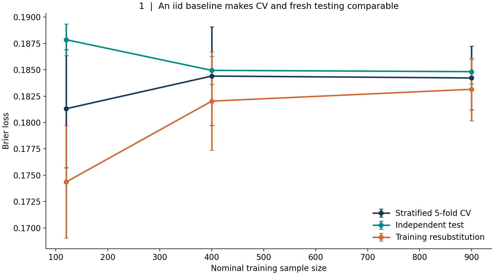
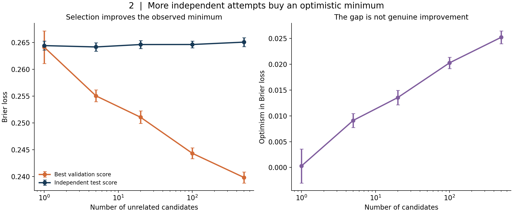
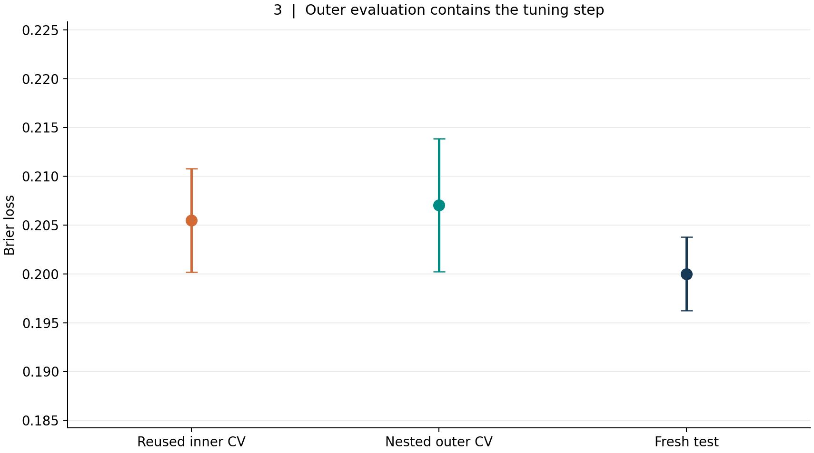
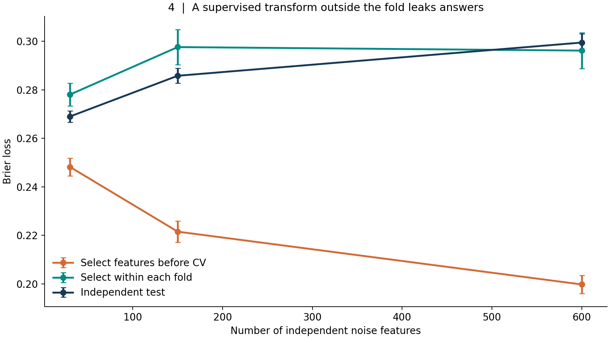
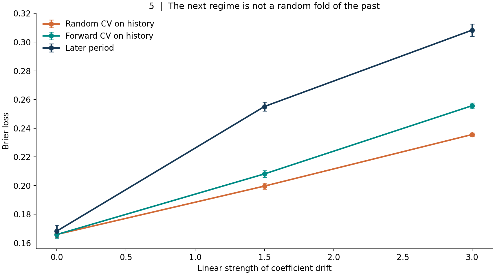
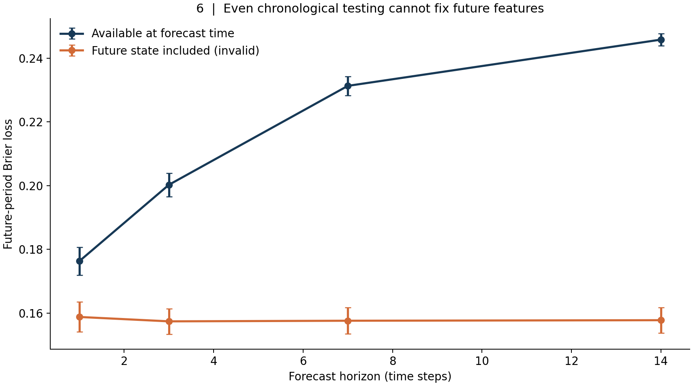
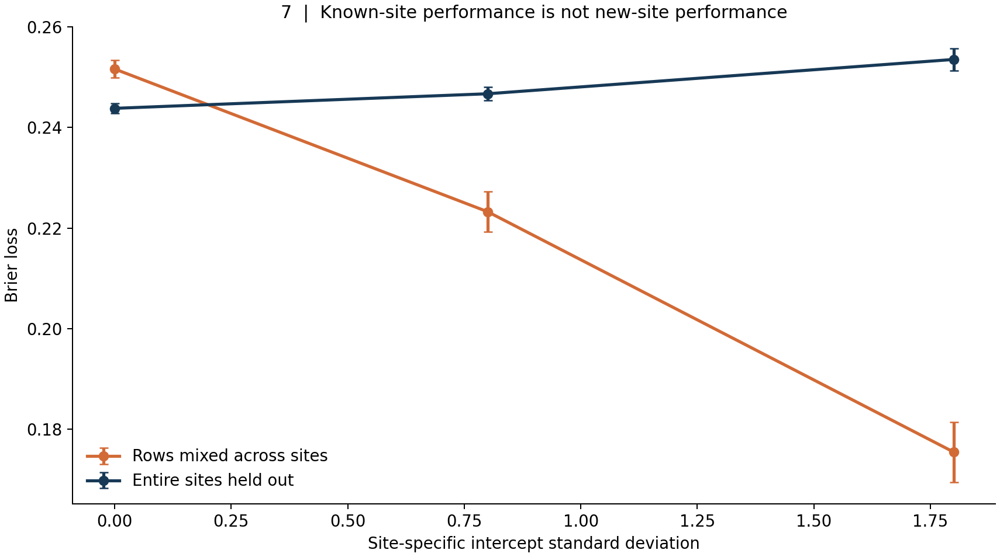
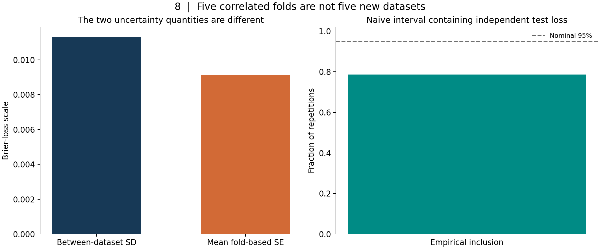
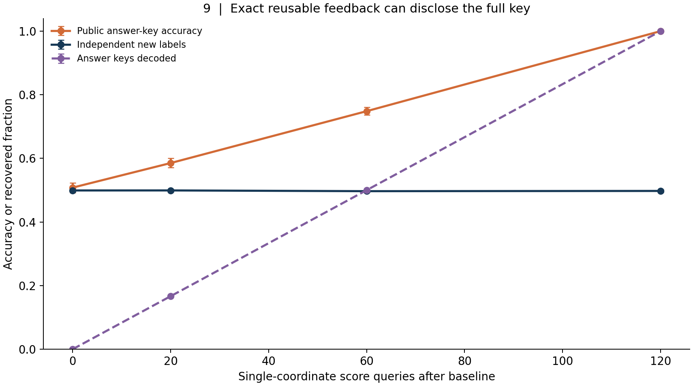

# The Test Set Is Not an Oracle: Selection Bias, Leakage, Temporal Splits, and Adaptive Model Evaluation

*Article #33 in the Medium-Blog long-form series*

## The score that stopped measuring what we thought it measured

Imagine a team predicting which customers will leave a subscription service. The first model receives an excellent result on a held-out set. A second model does slightly better, so it becomes the new baseline. Someone tries additional features, then a different preprocessing method, then a dozen parameter grids. Each experiment ends with another visit to the same held-out data. Eventually the team reports an impressive number, perhaps with a tiny confidence interval and an attractive leaderboard rank. The final model may genuinely be better. But something more basic has changed: the supposedly independent test set has become part of the model-development process.

The error is easy to miss because no one necessarily trained a gradient descent algorithm on those test labels. The team may have followed every mechanical instruction in a familiar tutorial: put aside twenty percent of the rows, never include those rows in the training matrix, fit the classifier on the other eighty percent, and report accuracy on the reserved rows. Yet the organization used the reported accuracy to choose among pipelines. In a meaningful statistical sense, information flowed backward from the test set into the selected model. The final performance estimate no longer has the simple interpretation that the team wants it to have.

There is a second, less obvious version of this problem. Perhaps the team does not inspect the final test set repeatedly. Instead, it chooses features from the entire development table, performs cross-validation only afterward, and reports the cross-validation mean. The held-out fold was never presented to the estimator's fitting method, but its labels determined which columns were available. Or perhaps the team keeps its chronological split immaculate while inadvertently using tomorrow's transaction count in a prediction issued today. Or perhaps the train/test split is random across patients, and the model learns each hospital's local baseline rather than the relationship that will hold at a new hospital.

The common failure is not a particular software API. It is a mismatch between the question the evaluation procedure actually answers and the question the deployment decision requires. A number can be computed exactly and still represent the wrong estimand. A confidence interval can be calculated carefully around an estimator whose independence assumptions are false. A completely untouched test set can tell us little about a future distribution that no longer resembles the data used to construct it.

This article develops nine controlled synthetic experiments that make those distinctions concrete. They are accompanied by a deterministic Python analysis, a runnable notebook, nine original figures, and raw replication-level tables. The experiments use deliberately simple data-generating mechanisms, so we can identify which part of an evaluation design causes an apparent improvement. Their numbers are demonstrations under specified assumptions, not estimates of the prevalence of leakage in the real world. Whenever I say that a method fails in an experiment, I mean that it fails to answer that experiment's stated target—not that the method is categorically invalid in every problem.

The practical question throughout is: **What information would a model-development team have had when making this decision, and what population, time, unit, and procedure is the reported score meant to describe?**

## 1. The object being evaluated is a procedure, not a single fitted object

We need a modest amount of notation. Let \(D\) be the observed dataset, drawn from some population \(P\). A learning algorithm \(A\), including its preprocessing and tuning steps, maps a training dataset to a fitted predictor \(f=A(D)\). For loss \(L\), the conditional generalization risk of this fitted predictor is

\[
R_P(f)=\mathbb E_{Z\sim P}\big[L(f,Z)\mid f\big].
\]

The conditioning reminds us that a particular fitted predictor is already fixed when a genuinely fresh example arrives. Another target is the expected risk of the entire training procedure over possible datasets of size \(n\):

\[
\mathcal R_n(A)=\mathbb E_{D\sim P^n}\mathbb E_{Z\sim P}
\big[L(A(D),Z)\big].
\]

These are related but not identical quantities. A test set estimates the performance of the specific fitted predictor, provided it is independent of the choices that produced that predictor and representative of the intended target. Cross-validation ordinarily concerns the average predictive behavior of a training procedure evaluated on held-out folds, with each fitted model trained on fewer than \(n\) examples. For ordinary \(K\)-fold CV, that training size is approximately \(n(K-1)/K\), not \(n\). This distinction is central to the careful discussion of cross-validation targets and uncertainty by Bates, Hastie, and Tibshirani.

For a fixed algorithm \(A\) and folds \(V_1,\ldots,V_K\), the familiar cross-validation estimate is

\[
\widehat R_{\mathrm{CV}}(A)=
\frac{1}{K}\sum_{k=1}^K
\frac{1}{|V_k|}\sum_{i\in V_k}
L\big(A(D\setminus V_k),Z_i\big).
\]

This expression is not a promise of unbiasedness for every sampling design. Its validity depends on how folds are constructed, what dependencies they preserve or break, and whether the procedure inside each fold matches what would have been done without access to the fold's outcomes. The formula alone cannot certify that a test is honest.

Now introduce selection. Suppose there are \(M\) candidate procedures \(A_1,\ldots,A_M\). If we evaluate all of them using the same validation outcomes and select

\[
\widehat j=\arg\min_{j\in\{1,\ldots,M\}}\widehat R_j,
\]

then \(\widehat R_{\widehat j}\) is an optimistically selected statistic. The selection mechanism matters even if each \(\widehat R_j\) would have been a reasonable performance estimate for a candidate named in advance. Conditional on being the winner, a candidate is more likely to have benefited from a lucky downward fluctuation. The recorded minimum is not interchangeable with an independent estimate for the selected procedure.

The seminal discussions by Cawley and Talbot, and by Varma and Simon, show why this effect can be important in model and hyperparameter selection. The problem is not confined to high-capacity models. A flexible *search process* can overfit an otherwise sensible selection criterion. As the development process grows, the effective number of opportunities to exploit noise includes discarded models, unsuccessful features, manual decisions, and analyses that never made it into the final notebook.

We will use the **Brier score** for the first eight experiments involving binary probability forecasts:

\[
\operatorname{Brier}(p,y)=(p-y)^2,\qquad y\in\{0,1\},\quad 0\leq p\leq1.
\]

Lower is better. Unlike a thresholded accuracy score, it registers changes in probability quality, including overconfident predictions. It remains a finite, interpretable measure for synthetic experiments. Nothing in the main selection-bias argument, however, is unique to the Brier score. Replacing it with a carefully defined log loss, error rate, or another noisy estimate changes magnitudes, not the logic of selecting a favorable error.

Our simulations explicitly separate *three* sources of randomness: the data used to learn, the data used to choose, and the data used to assess the resulting choice. Some designs deliberately collapse those boundaries to show what goes wrong. Each experiment also distinguishes the uncertainty in a Monte Carlo average across independent synthetic replications from uncertainty about the performance of a single real model. Those are different claims, and treating one as the other would reproduce the very confusion we want to investigate.

## 2. Experiment one: first establish what an honest comparison looks like

We begin with a relatively benign reference. Generate independent observations from a two-feature logistic population, where the outcome probability depends smoothly on the observed predictors. Fit a regularized logistic regression. Compare its performance in three places: on its own training observations, in stratified five-fold cross-validation, and on a fresh independent test draw from the same generating process. Repeat this for nominal training sample sizes of 120, 400, and 900; repeat the complete synthetic experiment thirty times.

There is no hyperparameter search over the validation results in this experiment. The data distribution stays the same between development and testing. Features are available when predictions are made. The split respects the natural independent observational unit. Those choices make the comparison intelligible. They do not make cross-validation perfect, but they remove several mechanisms that will complicate later experiments.

At 900 training examples, the simulation gives mean cross-validation Brier loss **0.1842** and mean fresh-test loss **0.1848**. The two numbers are close. Training resubstitution is lower because the same observations helped determine the coefficients and are then scored by those coefficients. At smaller sample sizes, the three curves fluctuate more, and CV and fresh testing need not coincide in any particular repetition. Five-fold CV also trains each fold model on only four-fifths of the development sample, whereas the fresh test evaluates a model fitted on the entire development sample.

This is a useful benchmark for intuition. A healthy evaluation procedure does not produce identical scores across resamples, and its trustworthiness does not require that every CV score be greater than every independent-test score. Good evidence is a property of the procedure and its assumptions, not of whether the plotted points align in a pleasing order. The fresh test estimates performance for the final fitted model on this same population. CV is an estimate involving repeated training on reduced samples. We should not erase those distinctions merely because their numerical answers are similar here.

One tempting but mistaken response is to take this experiment as proof that five-fold CV works. It proves no such universal claim. This deliberately easy design uses independent rows, stable feature relationships, reasonable sample sizes, a fixed regularized model, and a separate sample from the same distribution. Change the definition of a row, the timing of an observation, the way tuning is performed, or the future population, and the target can move. The following experiments each change one such condition while retaining enough simplicity to diagnose the effect.

The lesson is procedural: before arguing about the last decimal place of a score, make the intended deployment experiment explicit. Who or what will be sampled again? What will be known when the forecast is issued? Which parts of the procedure will be rerun? Will the model operate at an existing site or a new one? An honest split can only imitate a deployment question after that question has been stated.

## 3. Experiment two: an increasingly impressive winner among models with no signal

Suppose we manufacture 500 candidate probability-scoring systems. None sees information about the binary target. Each simply produces a noisy score centered near one-half. On one fixed validation set of 220 independent balanced-label observations, measure the Brier loss of all 500 candidates. For a search budget of \(M\), select the best candidate among the first \(M\). Evaluate the corresponding *null scoring mechanism* on an independent synthetic sample. Repeat the process thirty-six times.

This is intentionally more abstract than fitting 500 real classifiers. The candidates are unrelated noise predictors and have the same predictive information: zero. We do not need to simulate a complex training routine to demonstrate the elementary selection effect. The model-search decision only sees validation noise; the independent test draw comes from the same null prediction mechanism and has no reason to inherit the lucky validation fluctuation. The simulation should not be read as a study of a particular algorithm's fitted coefficients or stability.

With one candidate, average selected validation Brier loss is about **0.2641**. With 500, the best reported validation loss falls to **0.2398**. Meanwhile the fresh independent loss for the null mechanism remains around **0.2651** at the 500-candidate setting. The apparent improvement in the selected validation statistic is about 0.025 Brier points, but our data-generating design provides no genuine new predictive signal. The improvement comes from selecting the smallest among many noisy estimates.

The mathematical core is the minimum operator. If \(\widehat R_1,\ldots,\widehat R_M\) estimate comparable fixed candidate risks, then

\[
\mathbb E\left[\min_j\widehat R_j\right]
\leq \min_j\mathbb E[\widehat R_j].
\]

The inequality follows because \(\min_j\widehat R_j\leq\widehat R_k\) for each fixed \(k\), before expectations are taken. It does not require independence of estimates, and equality can hold in special cases. The amount of optimism depends on their spread and dependence, the search structure, and any genuine differences in risk among candidates. We should not import the synthetic gap of 0.025 into an unrelated project as a generic correction factor.

Real searches are often more complicated than an initial fixed grid. A researcher may inspect the first twenty candidates and invent the twenty-first based on which patterns appeared promising. After looking at feature importances, they might add interactions. A product team may decide to exclude a difficult user subgroup because it depresses the score. Even when nobody explicitly says “optimize the validation score,” the decisions can make the final specification a function of its past scores. The model selection procedure must be treated as part of the statistical object being evaluated.

The consequences also depend on *which* statistic is being selected. A team may choose based on overall AUC while later reporting calibration, or choose based on a specific subgroup but emphasize global accuracy. These different metrics can carry dependent noise, so the direction and size of the secondary bias are not given by the simple minimum inequality. The broader causal question remains: could the evaluation sample have influenced the reported model, reportable population, threshold, or metric?

We can preserve a genuine external evaluation by defining the search algorithm before seeing the external sample and then executing that algorithm entirely within development data. The final external sample must not decide the hyperparameter grid, the feature inventory, the operational threshold, or whether a result is pleasing enough to publish. If the team subsequently makes changes after viewing the external result, that result becomes part of development history and a new independent assessment is needed for the new procedure.

The distinction is not moralistic. Exploring models is exactly what applied research requires. Our job is to acknowledge that exploration changes what a particular number can claim. A validation set can be a useful steering wheel without also being an impartial final judge. Confusing those roles is how a perfectly competent search process produces a performance story that does not survive contact with new data.

## 4. Experiment three: nested cross-validation evaluates the selection procedure

The obvious response to search optimism is to reserve an additional evaluation layer. Nested cross-validation formalizes that division. In each *outer* fold, we pretend that the held-out outer data has not yet been observed. The remaining outer-training data is used for every decision that belongs to model development, including hyperparameter search. An *inner* CV procedure chooses settings using only that outer-training portion. We refit the chosen procedure on the outer-training data and score it once on the untouched outer fold. Finally, the outer scores are combined.

For this experiment, generate 175 training cases with sixteen features from a logistic population. The candidate pipeline is logistic regression with one of six regularization values: \(C\in\{0.001,0.01,0.1,1,10,100\}\). We compare three recorded numbers across twenty independent repetitions: the best inner three-fold CV score when the selection process sees the whole development sample; three-fold outer CV in which the complete search is repeated in each training split; and a fresh test of the final tuned model fitted on the full development sample.

The simulation produces mean selected inner CV loss **0.2055**, mean nested outer CV loss **0.2070**, and mean fresh-test loss **0.2000**. The selected inner value is lower than the outer value, consistent with some selection optimism. But the fresh test is lower than both. This is not a contradiction, and it is not evidence that the external test leaked into training. The final model is refitted with all 175 cases; the outer fitted models see only their outer-training portions. An independent test score also has Monte Carlo variability. Nested CV provides a more appropriate assessment of the *selection procedure* than reporting its best reused inner score, but it does not guarantee a numerical bound on every future evaluation of the final full-data model.

The operational sequence matters more than a particular library name:

1. Partition the development data into outer folds that represent the intended deployment unit and time.
2. For each outer split, take only outer-training rows and perform all candidate generation, feature selection, transformations, regularization choices, calibration, and threshold selection there.
3. Where a step uses outcomes or statistical characteristics of the data, fit that step again within each relevant inner training fold.
4. Select the inner winner according to a declared metric and refit the selected complete pipeline on the outer-training set.
5. Predict the outer held-out rows once, retaining the identity of each held-out unit and the score that was issued.
6. Combine outer predictions according to the deployment estimand, inspect prespecified groups, and report the search space and uncertainty separately.

Step two is especially demanding in practice. If a person reads an outer-fold result and changes the feature-generation logic, the conceptual procedure has used outer feedback to improve itself. Merely nesting a grid-search class does not protect against manual changes performed outside that class. A truly nested comparison evaluates whatever adaptive decisions were actually allowed by the procedure. When those decisions cannot be represented or frozen, an untouched prospective evaluation becomes more important.

There are also computational costs. A three-fold outer CV and three-fold inner search over six values can require many fits, depending on refitting and implementation. That expense buys a particular form of independence. If the data are scarce, nested CV may be a better use of observations than carving out a small test set and repeatedly consulting it. If the deployment system allows a final prospective test, the two approaches can complement each other: use nested or development-only validation to choose the procedure, freeze the complete specification, and evaluate the final frozen artifact prospectively.

What nested CV does not do is magically resolve a poorly designed split. If a person contributes observations to both outer training and outer testing, the estimate may still describe recognition of known people rather than generalization to new ones. If tomorrow's labels are available to today's feature engineering, the outer fold is already compromised. And if the future covariate relationship changes after the available data end, no number of inner folds can observe that future change. Nested CV solves an important *selection and evaluation separation* problem, but every layer must still respect the data's structure and the target population.

These nuances are why the classic papers by Cawley and Talbot, and Varma and Simon, should be read as arguments for assessing the entire selection algorithm, not as blanket endorsements of any arrangement called “nested.” Their practical claim is subtle: estimate the performance of a process that includes model selection using observations that did not participate in that process.

## 5. Experiment four: selection before splitting is label leakage

Now consider a problem with 230 rows and hundreds of candidate features. The labels are independent fair coin flips. Every feature is independent Gaussian noise. There is no true relationship to discover. We nevertheless ask an algorithm to select the ten variables most associated with the labels and fit logistic regression on them. With enough possible variables, some will look associated purely by chance. That does not itself make the feature-selection algorithm invalid; the important question is where selection occurs relative to evaluation.

We compare two paths. The first, deliberately wrong, calculates univariate supervised feature-selection statistics using *all* 230 outcomes, selects ten columns once, and then cross-validates a classifier on those columns. The second places feature selection inside a pipeline and refits the selector independently within every training fold. A fresh sample of 2,400 noise-feature rows, with independent labels, tests the model fitted by the correct full-development pipeline. We vary the number of available noise features: 30, 150, and 600, and repeat twenty-five times.

For 600 noise features, the globally selected, leaked CV reports mean Brier loss **0.1998**. Fold-safe CV reports **0.2962**, close to the independently tested **0.2995** for a fitted model that has learned unstable noise patterns. Lower loss is better, so the contaminated number makes a genuinely uninformative modeling strategy appear dramatically superior. The gap is not a tiny mathematical technicality. It changes the apparent practical conclusion of the experiment.

Why does putting the classifier itself inside CV fail to protect the first approach? Because the feature-selector's output already depended on the labels in the held-out fold. Conditional on selecting these columns, the fold's outcomes are no longer independent of the feature representation. When the classifier trains on the other folds, the representation it receives has been curated using the supposedly unknown answers. We can describe the resulting information path as

\[
\text{held-out labels}
\longrightarrow\text{selected columns}
\longrightarrow\text{fold model}
\longrightarrow\text{reported fold score}.
\]

No explicit call to fit the classifier on held-out labels is necessary. Leakage occurs upstream, where the experimental feature space is chosen. This mechanism underlies classic selection-bias analyses in microarray classification, including Ambroise and McLachlan's work on gene extraction. High-dimensional data make the failure easy to demonstrate because large feature inventories supply many accidental correlations to harvest.

The correct implementation is more than a piece of syntax. It is a statement of which observations may influence which operation. For each fold, the supervised selector is learned from the training fold alone. The fitted selector then transforms the validation fold without recalculating rankings using validation outcomes. The classifier is fitted only after that fold-specific selection. In production, the whole selector-classifier pipeline is fitted again on the full permitted development set. The fresh test then measures that final pipeline without influencing either selection or tuning.

One counterintuitive detail deserves emphasis: a correct evaluation can return a *worse-than-baseline* loss. Here the null data provide no predictive information, yet feature selection followed by a flexible classifier can produce overconfident probabilities on independent observations. A constant one-half forecast has Brier loss approximately 0.25 for balanced independent labels. A fitted model that chases random associations can be worse than that. The honest fold-safe and fresh-test scores near 0.30 are not a bug in the validation algorithm; they expose an overfitting tendency of the modeling procedure itself. The leaked score near 0.20 conceals that tendency.

Label-dependent selection is the cleanest failure mode, but a broader feature-engineering audit is needed. A scaler fitted on all rows, an imputer that sees future distributions, a target encoder computed before splitting, or a cohort filter selected after inspecting outcomes can introduce different forms of dependence. Some unsupervised transformations of independent observations may have smaller or differently interpretable effects than supervised target leakage. We should not claim all full-table transformations create the same bias. The reliable discipline is to classify each transformation by the information it consumes, the time at which that information becomes available, and the intended generalization unit. If a step would need unavailable data in deployment, or would have to be learned afresh on the training portion of a simulated deployment, that step belongs inside the corresponding training boundary.

This has direct implications for AutoML systems and extensive feature stores. The pipeline is not just the estimator object. It includes missingness rules, joins, label construction, sampling logic, text vocabulary creation, feature screening, calibration, postprocessing, and business thresholds. Validation estimates the procedure implemented, not the smaller piece of it that happens to expose a prediction method.

## 6. Experiment five: random historical folds do not answer a future-period question

Many datasets have a time axis even when the training code ignores it. A fraud model sees changing payment behavior. A medical model sees a population affected by new clinical practice. A forecast sees seasonal regimes, policy changes, and delayed labels. Random splits across such records can estimate performance for a historical mixture while failing to approximate a subsequent period.

In our temporal experiment, observations arrive at equally spaced times between zero and one. The predictor \(X_t\) is Gaussian. The binary outcome is generated from

\[
\Pr(Y_t=1\mid X_t)=\operatorname{logit}^{-1}
\big((1.7-\delta t)X_t\big),
\]

where \(\delta\) controls how strongly the relationship changes over the timeline. At \(\delta=0\), the coefficient is stable. At \(\delta=3\), it moves from strongly positive early in the series to negative near the end. We use the first 72 percent of the timeline as historical development data and reserve the final 28 percent as the later period. Within the history we compare shuffled stratified CV against forward-growing time-series splits. Separately, we fit on the entire history and score the later period. Repeat the experiment thirty times.

When the coefficient does not drift, the historical and future performance estimates are broadly comparable. Under strong drift, however, mean random historical CV loss is **0.2356**, forward-history CV loss is **0.2557**, and later-period loss is **0.3083**. The random split averages over a historical mixture, so it has relatively little reason to penalize a procedure for the later regime. The forward splits impose a more realistic ordering and register greater difficulty, but their validation windows still lie inside the observed history. They cannot see a future coefficient reversal that has not yet occurred within their simulation of deployment.

It is tempting to turn this into a slogan: “Never use random CV for time series.” That would be inaccurate. Whether random CV is valid depends on the target and assumptions. Bergmeir, Hyndman, and Koo analyze conditions under which cross-validation can be appropriate in autoregressive forecasting settings. A stationary process, properly defined prediction target, valid feature construction, and dependence structure may support approaches that would be invalid under nonstationary drift or overlapping forecast horizons. The important question is not whether a timestamp column exists, but what kind of deployment is being simulated.

Roberts and colleagues give a broader treatment of temporal, spatial, hierarchical, and related dependencies, showing why split design must follow the structure of the data and the transfer task. Our temporal simulation changes the outcome mechanism itself over time, so exchangeability across dates is the problematic assumption. A shuffled historical fold estimates a different mixture from the later deployment period. A blocked or rolling evaluation is a closer rehearsal, but no historical resampling method can guarantee anticipation of a novel future regime.

A robust temporal plan specifies the prediction origin, lead time, training lookback, validation window, and potential gap between them. The gap can matter when labels are delayed or when overlapping future windows would make nominally separate examples share outcomes. If a loan defaults six months after its issue date, the data available on a particular evaluation cutoff may not yet contain that label. Treating the late label as if it were known at the cutoff creates an impossible historical decision. Similar issues arise with overlapping events, rolling features, and revised external data.

Repeated backtests may also overfit in a familiar way. If a researcher tries many feature sets against a fixed collection of historical windows, those windows become a selection resource, just like the validation set in experiment two. Their temporal order does not exempt them from selection bias. Time-aware nesting, predeclared decision rules, and an untouched later period can be useful. A production shadow evaluation may supply stronger evidence when labels mature, though it introduces operational constraints of its own.

Finally, consider what “future performance” means when the future distribution is unknown. It might mean average loss over next month, worst-case loss during a policy transition, calibration conditional on a new region, or service-level utility under a changing intervention. Each target implies a different evaluation design. A single historical score cannot stand in for all of them. The honest response to an unanticipated shift is not to declare that CV failed universally; it is to say that the original historical estimand no longer equals the deployment estimand.

## 7. Experiment six: chronological splitting cannot repair an impossible feature

A different kind of temporal leakage survives even the most scrupulous chronological train/test division. It arises when the test row contains information that would not exist at the time the model is supposed to issue its prediction. This is sometimes called look-ahead leakage, but the phrase risks making the failure seem obvious. In real systems, the feature may arrive under a plausible business name, through a slowly updated warehouse table, or via a data correction that silently overwrites an earlier observation.

To isolate the mechanism, simulate a stationary first-order autoregressive process,

\[
X_t=\rho X_{t-1}+\sqrt{1-\rho^2}\epsilon_t,\qquad
\rho=0.9,\quad \epsilon_t\sim N(0,1).
\]

At time \(t\), the desired outcome describes an event at horizon \(h\). We generate its probability from a future value:

\[
\Pr(Y_{t,h}=1\mid X_{t+h})=
\operatorname{logit}^{-1}(1.8X_{t+h}).
\]

The legitimate forecast at time \(t\) has only the present and previous process values, \(X_t\) and \(X_{t-1}\). A deliberately leaked competitor gets those features *plus* \(X_{t+h}\), a quantity that cannot be observed when the forecast is due. Both models use the same chronological first-72-percent training period and final-28-percent test period. We vary the horizon across 1, 3, 7, and 14 steps and repeat twenty-five times.

At the fourteen-step horizon, the causal model has mean Brier loss **0.2458**. The model with the impossible future feature has mean loss **0.1578**. Its apparent advantage is real *conditional on receiving the future feature*. The experiment does not depend on contaminating the test labels through cross-validation. It fails because the input contract is impossible at prediction time. The chronological split has preserved the order of rows, but it has not preserved the information set available to the decision-maker.

The AR(1) structure makes the mechanism particularly interpretable. With a persistence parameter of 0.9, the present carries some information about the near future. As the horizon grows, that information decays. Access to the exact future process value remains strongly predictive because the outcome was generated from it. Thus, the illegitimate competitor can retain substantial apparent predictive power while the honest forecast approaches the uncertainty of an uninformed prediction. The size of this gap is specific to the chosen process and outcome mechanism.

What would this look like outside a simulation? Imagine a dataset of payment attempts with a column called “account balance at close of day.” If a decision is made at 10:00 a.m., that value may incorporate transfers occurring after the decision. An offline table joined by calendar date could make it look like an ordinary same-day feature. Or consider a hospitalization prediction made at admission using the final discharge diagnosis, a code assigned only at the end of the stay. A random split and even a chronological split can faithfully preserve such a column and produce a reassuring score. Neither split addresses the temporal impossibility.

The correct safeguard is to define an *as-of* view for each individual prediction. An event-time timestamp answers when something happened; a processing-time timestamp answers when the system learned about it. Both may matter. A feature measured yesterday but entered into the warehouse next week was not available for today's operational prediction. Conversely, a revision made later can retroactively improve historical data quality while making replayed backtests unrealistically clean. Validation should reconstruct which feature values were actually visible at the decision origin, including reporting delays and revisions.

This is a stronger requirement than sorting by date. We must state the forecast origin, outcome horizon, feature availability times, label maturity, join keys, and permitted historical state. Then the validation process needs to reproduce that state for every held-out decision. The necessary engineering can be substantial, but it is logically prior to debating whether a model is underfitting or which cross-validation splitter to import.

There is also a distinction between an impossible feature and a legitimate proxy. \(X_t\) is a valid forecast feature even though it correlates with the future target-generating value. Predictive correlations are the point of forecasting. The invalid feature is \(X_{t+h}\), because its timestamp places it outside the available information set. We should not “fix” leakage by deleting every variable associated with the outcome. We should fix the information contract and then assess the legitimate predictors within it.

## 8. Experiment seven: the observational unit is not necessarily the row

Consider a dataset collected at thirty sites. Each site contributes thirty-four observations. A person's predictors may matter, but the sites also have different baseline outcome propensities. A model that sees previous rows from a particular site can learn that site's characteristic intercept. This may be appropriate if deployment means predicting *more rows from known sites*. It can be seriously misleading if the project promises reliable predictions at sites that have never provided training outcomes.

Our generator makes the distinction explicit. Each site \(g\) receives a random intercept \(b_g\sim N(0,\sigma_b^2)\). For an individual \(i\) within that site, the outcome probability is

\[
\Pr(Y_{ig}=1\mid X_{ig},b_g)
=\operatorname{logit}^{-1}(0.35X_{ig}+b_g).
\]

The model receives the individual predictor and a one-hot site identifier. We evaluate it using random row-level stratified CV and, separately, group CV that holds out entire sites. Site-intercept standard deviation takes values 0, 0.8, and 1.8. The twenty-five independent repetitions regenerate sites, intercepts, rows, and outcomes. The encoding scheme is fixed before validation and never uses outcomes itself; the issue is how training access to site-specific labels changes the task.

With strong site heterogeneity, \(\sigma_b=1.8\), mean random-row CV Brier loss is **0.1755**, whereas mean unseen-site CV loss is **0.2535**. A procedure that benefits from learning site-specific history looks much better when validation rows share site identities with training rows. For an entirely new site, the one-hot column corresponding to that site has no learned site-specific coefficient from outcomes. The model falls back toward a generic baseline, and its performance is substantially different.

This is not automatically “leakage.” If the genuine deployment target is future observations from those same known sites, using existing site history can be legitimate. In that case, group CV may evaluate an unnecessarily difficult transfer problem. Conversely, if the contract is to expand to new clinics, new employers, new users, new machines, or new households, random row CV can answer the wrong question. The failure is a target mismatch, and the appropriate split depends on the decision the score must support.

Notice another important nuance from the experiment: when \(\sigma_b=0\), entire-site CV can produce a lower loss than random-row CV in the finite simulation. Grouping is not a mathematical device that guarantees a worse score. It changes which units may appear on both sides of the split and the effective training sample composition. The curves need not be ordered in a universal way. A validation design is justified by its correspondence to deployment, not by the direction in which it moves a metric.

Dependence also affects uncertainty. Thirty sites are not equivalent to 1,020 independent site-level environments. Even if individual outcomes are independent conditional on their site effects, the marginal observations share a common source of variation. Treating every row as an independent draw for a standard error can make the evidence appear more precise than the number of truly independent environments supports. Cluster bootstrap, hierarchical models, and explicit site-level summaries may be more appropriate, depending on the estimand and number of clusters. With very few clusters, uncertainty can remain substantial regardless of the total row count.

Other structures produce similar problems without a variable literally called “site.” Repeated images from the same patient, transactions from the same account, samples from a manufacturing batch, documents from the same author, and spatially neighboring measurements can carry shared latent information. A random record split may put nearly duplicate observations or highly correlated contexts on both sides. Sometimes that describes the actual use case; often it does not. The unit of independence must be inferred from how data are generated and how new decisions arrive, not simply from the dataframe index.

A good validation report states whether its target is a new record, a new time period, a new individual, a new organization, or a combination. Sometimes several scores should coexist. For example, a medical system might report performance on future patients at existing hospitals and on new hospitals, with each score derived from a corresponding held-out design. Such a report is more informative than one global metric that silently mixes the two deployment scenarios.

## 9. Experiment eight: five folds do not give five independent replicas of a study

After computing CV, people often calculate the standard deviation of the five fold scores, divide by \(\sqrt{5}\), and attach a familiar 95-percent interval to the mean. That is an attractive shortcut, especially when the training pipeline is expensive. But the five fold results are neither independent experiments nor exchangeable estimates of every quantity we might care about. Their training sets overlap extensively, their fitted models are correlated, and they arise from one finite observed dataset.

Our eighth study makes a modest diagnostic comparison, not a comprehensive theory of CV confidence intervals. Generate 320 logistic examples, run stratified five-fold CV, and record the five Brier scores. Compute the naive fold-based standard error,

\[
\widehat{\operatorname{SE}}_{\mathrm{fold}}=
\frac{\operatorname{SD}(\widehat R_1,\ldots,\widehat R_5)}
{\sqrt{5}}.
\]

Fit a final model on all 320 examples and measure it on 8,500 fresh synthetic observations. Repeat the complete dataset-generation process seventy times. We then compare the mean naive standard error with the empirical standard deviation of the CV means *across independently regenerated development datasets*. We also ask how often the naive interval around CV contains the independently measured fresh-test loss.

The average naive fold-based standard error is **0.0091**. Across new datasets, the empirical standard deviation of CV means is **0.0113**. The interval formed as CV mean plus or minus \(1.96\) times the naive fold standard error contains the independent-test loss in about **78.6%** of repetitions, below a nominal 95 percent. This is a warning that the simple interval is not automatically calibrated for the comparison people often intend it to make.

We should be precise about what the 78.6 percent is and is not. It is a Monte Carlo fraction in this specific generator, involving an interval around CV and an external risk *estimate* for a model trained on all development examples. The CV fold models train on smaller sets, so the external comparison does not have exactly the same training-size target. The external test itself also has finite-sample error, although it is relatively large here. The diagnostic is therefore not a pure, controlled coverage study for a single fixed mathematical parameter. Its purpose is to expose how much can be swept under the rug when a fold score is casually treated as an independent replication.

There are several uncertainties to keep apart. First is randomness from sampling a new development dataset. Second is randomness from splitting one fixed dataset into folds; reshuffling folds does not regenerate the subjects or environments. Third is uncertainty about the conditional risk of the particular final fitted model. Fourth is shift uncertainty about how a future population might differ. A fifth quantity is Monte Carlo error from running a simulation a finite number of times. All can be called “uncertainty,” but they require different evidence and assumptions.

Bates, Hastie, and Tibshirani discuss what cross-validation estimates and how well it does so, including fundamental complications around uncertainty. A practical consequence is that there is no single universal correction that turns five fold losses into a trustworthy interval for any chosen estimand. Repeated CV can stabilize estimates with respect to split randomness, but repetition on the same observed rows does not create new independent datasets. A bootstrap may help estimate some sampling components under appropriate independence assumptions; it does not automatically repair temporal or group dependence. Nested evaluation may handle selection but cannot infer future distribution shift from absent data.

When uncertainty matters to a deployment decision, write down the target before choosing the interval. Are we estimating the mean risk of a training algorithm over new datasets? The risk of a final fixed model? A change in performance between two algorithms on the same future individuals? A lower performance bound for a particularly important subgroup? The design and resampling unit differ. A paired comparison can be more precise than comparing two unrelated marginal intervals because both models see the same held-out observations. A cluster-level comparison can be less precise than a row-level one because the effective independent unit is larger. Both observations follow from the target, not from a desire to obtain a small error bar.

There is an honest alternative when uncertainty cannot be estimated well: report the measured effect, evaluation units, number of independent groups, time span, model-search history, and plausible failure modes, then say the interval is uncertain. False precision is not better communication than a carefully bounded claim. A score can be useful as one piece of evidence without pretending that five correlated folds establish the behavior of every future system.

## 10. Experiment nine: exact repeated feedback can disclose the answer key

The final experiment concerns a stronger form of adaptive reuse. A fixed holdout has 120 independent binary labels. A hypothetical public evaluation service accepts a vector of binary predictions and returns its *exact* accuracy on those same 120 labels. We begin with an all-zero prediction vector and record the baseline score. Then we submit a new vector that differs only in its prediction at one coordinate. The change in exact accuracy is either \(+1/120\) or \(-1/120\), revealing the label at that coordinate. Repeat for every position.

After one baseline request and 120 one-coordinate probes, the entire fixed answer key is known. We can submit the reconstructed labels as predictions and achieve perfect public accuracy. But our prediction vector has learned nothing about a separate set of independent fair-coin labels. In the simulation, we record public accuracy and fresh independent accuracy after 0, 20, 60, and 120 probes, repeating the process thirty times.

After 121 total score queries, public holdout accuracy is **100%**. Accuracy on independent fresh labels is about **49.8%**, near the **50%** chance level. The contrast is extreme because the feedback mechanism deliberately exposes an exact numerical response and permits adversarially chosen queries. No real benchmark, leaderboard, customer dataset, or service is accessed in this experiment. It is a mathematical demonstration of an information channel, not an accusation that every public leaderboard can be attacked this way.

To see the reconstruction algebraically, let \(y_j\in\{0,1\}\) be the unknown label at coordinate \(j\), and let \(a_0\) be the accuracy of the all-zero predictions. Flipping just prediction \(j\) from zero to one changes the number of correct answers by \(+1\) when \(y_j=1\) and \(-1\) when \(y_j=0\). Therefore,

\[
a_j-a_0=\frac{2y_j-1}{120}.
\]

Given the exact difference, the label can be recovered as

\[
y_j=\frac{1+120(a_j-a_0)}{2}.
\]

The reconstruction uses the held-out labels indirectly through feedback, even though the service never returns a label vector. In the experiment the “model” is simply an index-to-label memory; it has no transferable relationship to the independent target distribution. This is overfitting to a fixed evaluation sample in its most transparent form.

Real systems impose other constraints. They may return rounded scores, add noise, limit submissions, aggregate across tasks, evaluate on newly drawn samples, keep portions of the test set private, or screen for suspicious queries. Those choices can substantially change what feedback reveals. Rounding alone is not a universal security guarantee, and a submission limit alone is not a complete theory of statistical validity. The point is to recognize that repeated evaluation supplies information, and that the amount and form of information matter.

Dwork and collaborators' work on adaptive data analysis and the reusable holdout addresses this broader statistical challenge. Reusing data is not intrinsically forbidden; the difficulty is retaining valid inference when later queries depend on earlier answers. Privacy-inspired mechanisms, carefully controlled feedback, and other adaptive analysis techniques can provide formal protections under stated assumptions. Ordinary model-development workflows may not need a formal reusable-holdout mechanism, but they need to manage the same underlying information flow.

This experiment also clarifies the limits of the slogan “never train on the test set.” A system can adapt to test labels without receiving them directly. Rank changes, error examples, subgroup dashboards, thresholds adjusted after inspecting performance, and public leaderboard scores can all influence later choices. They may be useful for development, but their use changes the status of the sample. An evaluation sample is held out for a *particular decision process*, not for a particular file access pattern.

The scientific consequence is not that we should hide every diagnostic. Sometimes inspecting errors is the best way to improve a model. The consequence is to account for the stage at which inspection occurs. If we use a sample to diagnose and modify the pipeline, it is now development evidence. When the revised pipeline needs an independent performance claim, we need another sample, a well-controlled adaptive-evaluation method, or an explicitly qualified conclusion. Transparency about reuse protects the interpretation of the reported score.

## 11. A practical protocol: define the decision before choosing the split

The nine figures point toward a common operational approach. Evaluation begins with the decision that the model will support, not with a data science library's default splitter. That decision has a time, an information boundary, a target population, and a loss attached to it. Without those definitions, “generalizes well” is too broad a claim to test.

**First, write an evaluation contract.** A useful contract describes the unit receiving a prediction, the event being predicted, the time the prediction is issued, and the horizon at which success or failure will be known. It identifies which entities are present during training and which may be entirely new during deployment. It states whether we want risk on the same stable population, on a later period, on different organizations, or under a specified mixture of scenarios. It fixes the primary metric and important secondary diagnostics before looking at the final evaluation results.

For example, the contract for a customer-retention model might say: “At the beginning of each week, predict whether an active account will cancel within the following four weeks using only events available before the weekly cutoff; the metric is Brier loss across the next quarter's eligible accounts, with calibration and error monitored by tenure group.” That is a much more testable claim than “predict churn.” It tells engineers how to reconstruct features, analysts how to define labels and maturity, and reviewers what the evaluation set must contain.

**Second, map every information dependency.** The model's input matrix is rarely the only thing that can leak. A complete map includes label generation, cohort selection, feature joins, normalization, imputation, dimensionality reduction, feature screening, class-imbalance treatment, sampling, threshold optimization, calibration, and manual exclusions. Record whether each operation uses outcomes, other rows, future data, or information about the eventual test population. Then classify the operation as fixed in advance, learnable from the allowed training portion, or genuinely available at the decision origin.

This is the right moment to inspect timestamps. For each derived feature, ask when the underlying information became available, not merely which date was assigned to the row. If the feature store retains revised historical values, build an as-of reconstruction or declare that retrospective performance may be optimistic. For each label, determine when it matures. If the outcomes for recent observations are only partly known, a chronological holdout with incomplete labels can be biased for a different reason from look-ahead features.

**Third, establish the independence unit and split accordingly.** If deployment will involve new people, keep those people out of development folds. If it involves new sites, hold out sites. If it involves a later time window, validate on later windows with an appropriate gap or embargo for overlapping events. If it involves future observations at known sites, a combination of site and time structure may be appropriate. When there are multiple intended deployment environments, evaluate them separately rather than hoping one split addresses every question.

The group and temporal experiments show why a split cannot be judged without its intended target. A random split may be defensible for a genuinely exchangeable population of new independent rows. It is a poor surrogate for a first-time hospital deployment when each hospital has a strong baseline effect. Similarly, forward validation answers a historical sequence of prospective questions, but it does not make an unseen regime shift observable. The evaluation contract should distinguish what the observed data can test from what remains an assumption.

**Fourth, choose the selection metric and permitted search process.** Decide what exactly will be optimized and on what evidence. A probability model's Brier score evaluates probability quality, while a deployment decision may additionally depend on action cost, capacity, and subgroup constraints. If a threshold is chosen to maximize downstream utility, that threshold choice is itself part of model development. It belongs inside the selection loop. Choosing a threshold on the final test set and then reporting the resulting utility as a pristine independent score repeats the selection error in a different form.

Predeclare enough about the candidate space to make the eventual score interpretable. It may be reasonable to add candidates after inspecting *development* errors, but record that expansion and reserve independent evaluation accordingly. Keep an experiment ledger of attempts, metrics inspected, feature revisions, and data exclusions. This ledger is not an exercise in bureaucratic completeness; it is evidence about how much adaptive information the procedure consumed. If a result has been repeatedly optimized against one score, the number of nominal data rows alone will not reveal the true selection pressure.

**Fifth, nest all learned components inside honest development folds.** In each inner fit, supervised transformations must learn only from inner training observations. Time-dependent features must be constructed as they would have been at the relevant prediction origins. Group identifiers must respect the intended transfer unit. If preprocessing includes target encoding, calibration, or oversampling, their fit boundaries require particular attention. The fold is a complete rehearsal of the learning procedure, not just a mask applied to a previously engineered matrix.

The word “complete” matters. A pipeline that cross-validates logistic regression but chooses the vocabulary on all labeled documents is not a cross-validation of the whole learning procedure. Nor is a pipeline that selects model architecture from outer-fold results and then claims the same outer folds are independent. Every choice informed by fold scores becomes part of the search history. Nested selection gives us a concrete way to maintain an evaluation layer separate from the choices being evaluated, as long as manual interventions are not smuggled across that boundary.

**Sixth, maintain a genuinely independent final evaluation when the stakes justify it.** Freeze the candidate procedure, data logic, threshold rule, metric definitions, and reporting plan before accessing the final holdout. Evaluate once for the intended final claim. If the score exposes a problem and the team fixes that problem, celebrate the new understanding—but recognize that the previously held-out data have been used in development. A fresh prospective evaluation or another independent sample is needed to assess the revised specification without the same selection history.

The practical meaning of “once” deserves care. A report may include multiple prespecified metrics, subgroup tables, and diagnostics from a single frozen evaluation; one metric is rarely sufficient. The issue is whether those results subsequently influence which model or claim is selected. A prespecified evaluation bundle is different from a sequence of tests in which each disappointing number triggers another adjustment. When repeated feedback is unavoidable, formal adaptive-analysis mechanisms or explicit multiplicity and reuse accounting become part of the design.

**Seventh, report uncertainty for the target actually estimated.** If the goal is performance on future independent individuals, construct uncertainty around that target with the individual sampling scheme in mind. If observations cluster by site, account for site dependence. If the question concerns performance next quarter, consider the uncertainty from temporal variation and acknowledge that unobserved future regimes cannot be learned from historical bootstrap samples. If comparing two models on the same cases, retain pairing. Avoid presenting the variance across five overlapping fold scores as though it automatically described every source of generalization uncertainty.

The confidence interval should be paired with information it cannot compress. Include sample sizes at both the record and independent-unit level, time coverage, event prevalence, any shift relative to training, exact metric definition, subgroup behavior, the selection procedure, and what was excluded. For probability models, show calibration as well as discrimination if the downstream action depends on probabilities. AUC can remain unchanged while probabilities become miscalibrated; conversely, a lower Brier score does not by itself show that a proposed decision policy is economically better. Evaluation must be matched to both the predictive task and the intended action.

**Eighth, make the claim falsifiable.** Say which observations would cause the team to reconsider deployment. Define acceptable risk ranges, monitoring windows, alert thresholds, and rollback criteria. Specify when labels become available to test those criteria. Plan for degraded performance on newly introduced entities or regimes, even if no historical evaluation can quantify the exact failure probability. A defensible score is the beginning of a monitoring process, not a perpetual guarantee stamped onto the model.

This protocol is demanding, but it also prevents wasted work. Teams routinely spend days debating small differences in model metrics while leaving the prediction origin undefined or the validation unit wrong. Once the evaluation contract is explicit, many disputes become concrete engineering questions: “Would this feature exist on that date?” “Were any of those accounts present in the training period?” “Did this threshold come from the validation folds?” “Does this interval account for sites?” Those questions usually matter more than a fourth decimal place.

## 12. Six questions that expose a misleading evaluation

When reviewing someone else's model report, I find it useful to ask six short questions and insist on operational answers.

1. **What exactly is new in the test set?** New rows, new people, new accounts, new sites, or a genuinely later period are not interchangeable. If the response is simply “twenty percent of the dataframe,” the evaluation target is underspecified.
2. **When could each feature have been known?** A chronological split means little if a later update to the warehouse appears in an earlier row. The answer should include information availability, not just observation timestamps.
3. **What choices did the score influence?** Ask for the history of model candidates, feature revisions, selected metrics, thresholds, and subgroup exclusions. An independent test becomes development feedback once it drives these choices.
4. **Was the entire pipeline refitted inside every fold?** Check target encoding, supervised feature selection, imputation where relevant, calibration, and other fitted transformations. Cross-validating only the final estimator may leave upstream leakage intact.
5. **What quantity does the uncertainty interval describe?** A standard deviation over folds, a bootstrap across rows, a variation across sites, and a Monte Carlo interval over simulation repetitions are not interchangeable. The report should name the estimated quantity.
6. **What would a failure look like after deployment?** Ask for the intended time horizon, new environments, label delay, drift monitoring, and conditions that would trigger re-evaluation. A score without an operational boundary is easy to overinterpret.

These questions help even when a report shows excellent results. They are not allegations of dishonesty. Often the original team simply inherited a dataset or an evaluation convention whose meaning was never recorded. A rigorous review makes the assumption visible so that engineers and domain experts can decide whether it matches the intended use.

The questions also prevent the opposite mistake: declaring all successful experiments invalid because some possible leakage mechanism exists. A selected test result might be biased, but that conclusion requires a particular information path. Group CV is not always the right choice. Time-aware CV is not a mystical cure for future drift. A legitimate present-time proxy is not the same as an impossible future feature. Technical skepticism is useful only when it identifies the violated assumption and the direction in which the target changes.

## 13. What these simulations establish—and what they do not

The results are designed to be reproducible demonstrations of nine mechanisms. Their strength is that the synthetic truth and the information boundary are known. In the noise-search study, we know candidates have no signal. In the feature-selection study, we know all covariates are independent of the label. In the look-ahead study, we know the illegal variable occurs after the prediction origin. In the adaptive study, we control the feedback channel and can verify exactly how many queries recover the labels. Those facts make the mechanisms easier to isolate than they would be in observational data.

The same control limits external generalization. The data are not actual customers, patients, transactions, hospitals, or benchmark submissions. Real feature spaces can contain dependence, nonlinear effects, missingness, unobserved confounding, interventions, and reporting delays absent from these generators. The particular Brier differences are not universal effect sizes. A result of 0.1998 under leaked preprocessing does not imply a typical leakage penalty of 0.10 in another field. A 78.6-percent inclusion rate is not a theorem about every CV interval.

Several comparisons intentionally do not isolate a single mathematical estimand. In nested CV, inner and outer procedures use different training sample sizes, and the final fit uses all development cases. In the fold-uncertainty experiment, the external risk estimate is obtained from a final fit while fold models use smaller training sets. These differences are reported rather than hidden, because interpreting the numbers as exact apples-to-apples estimates would create a false conclusion. The simulations are strong evidence for the *mechanisms* they instantiate, not shortcuts around the formal conditions needed for statistical inference.

The model-search experiment also deserves a special qualification. Its fresh test predictions are a new draw from the same null scoring process, not an evaluation of stored parameters from a fitted real classifier. This is legitimate for the deliberately constructed no-signal thought experiment, in which candidate identity supplies no transferable information. It does not model the full dependence structure of a realistic hyperparameter search. The minimum-statistic argument explains the general selection effect; the observed gap quantifies only this controlled design.

The adaptive holdout example is similarly specialized. An exact accuracy oracle over a fixed list of 120 bits is deliberately easy to reconstruct. Real services may protect their data using coarsened results, hidden subsets, feedback restrictions, or other methods. The example shows that query responses themselves can transmit test information; it does not show that any specific external benchmark is vulnerable. Distinguishing a demonstration from an operational security claim is part of responsible interpretation.

Finally, no offline evaluation can observe every future change. Even a beautifully nested, group-aware, timestamp-correct process rests on assumptions about what will stay stable and which populations the model will encounter. Good evaluation does not remove uncertainty from a changing world. It makes our evidential claim narrow enough to be useful and explicit enough to be revised when reality disagrees.

## 14. Reproduce, audit, and extend the evidence

The complete companion lives in the directory accompanying this manuscript. It has one analysis entry point, a deterministic notebook builder, an unexecuted notebook, a requirements file with pinned scientific-library versions, a path-scoped continuous-integration workflow, and automated tests. Nine experiment functions produce nine figures and eighteen CSV files: one replication table and one summary table for each study. The canonical random seed is **20261102**.

Each replication CSV includes the study condition, metric, zero-based repetition index, numeric value, and any theoretical reference. The summary CSV records the count, arithmetic mean, across-repetition standard deviation, Monte Carlo standard error, and an interval equal to the mean plus or minus \(1.96\) Monte Carlo standard errors. These summary intervals describe the precision of our simulated *average over synthetic repetitions*. They are not real-world model-performance confidence intervals. The tests check explicit condition-and-metric inventories, finite numbers, replication completeness, formulas, PNG signatures, and the correspondence of the archived tables to the declared experiment design.

To regenerate the figures from a checkout, install the Python 3.12 dependencies listed in the companion requirements file and run the analysis module. The full canonical run writes the publication evidence. A separate quick mode uses three repetitions and reduced synthetic sample sizes, writes only files with a quick suffix, and never overwrites canonical CSVs or figures. A full run with a different seed requires a separate output location, preventing accidental substitution of unreviewed evidence for the numbers discussed here.

The notebook is generated reproducibly and intentionally contains no cached outputs. It imports the experiment module and executes quick versions of all nine studies inside an isolated temporary output directory, displaying the resulting figures. It works when launched from the article directory or the repository root; an explicit environment-variable path supports execution from an unrelated working directory. Fresh-kernel tests exercise these locations without relying on an invisible notebook metadata setting. The workflow runs the full test suite and the quick analysis on changes affecting this article or its workflow.

The experiments are invitations to make assumptions more explicit. One useful extension would tune a candidate pipeline under a genuine nested group-and-time split, then compare with a final later-site holdout. Another would vary the amount of leaderboard feedback, including rounding and submission limits, to measure what can be recovered under different feedback policies. A third would compare uncertainty procedures for the *same* clearly specified risk estimand under clustered observations. Such extensions would need fresh tests and evidence, and the current archive should remain intact so readers can reproduce the original conclusions.

## 15. Source audit and further reading

This article's mathematical and methodological claims draw on the following primary research. The linked works support the general principles; the numeric values, plot shapes, implementation details, and nine synthetic designs above are generated by this article's companion code, not copied from those studies.

1. **Cawley, G. C., and Talbot, N. L. C. (2010).** “On Over-fitting in Model Selection and Subsequent Selection Bias in Performance Evaluation.” *Journal of Machine Learning Research*, 11, 2079–2107. [Original JMLR paper](https://jmlr.csail.mit.edu/papers/volume11/cawley10a/cawley10a.pdf). A foundational account of how flexible model selection can overfit selection criteria and why evaluation must include the selection procedure.
2. **Varma, S., and Simon, R. (2006).** “Bias in error estimation when using cross-validation for model selection.” *BMC Bioinformatics*, 7, article 91. [Original open-access article](https://doi.org/10.1186/1471-2105-7-91). A direct investigation of bias from reusing cross-validation results to select a model and estimate its prediction error.
3. **Ambroise, C., and McLachlan, G. J. (2002).** “Selection bias in gene extraction on the basis of microarray gene-expression data.” *Proceedings of the National Academy of Sciences*, 99, 6562–6566. [Original research article](https://doi.org/10.1073/pnas.102102699). A classic high-dimensional demonstration of supervised feature-selection bias.
4. **Roberts, D. R., et al. (2017).** “Cross-validation strategies for data with temporal, spatial, hierarchical, or phylogenetic structure.” *Ecography*, 40, 913–929. [Journal DOI](https://doi.org/10.1111/ecog.02881). A framework for split design when observations are structured rather than exchangeable rows.
5. **Bergmeir, C., Hyndman, R. J., and Koo, B. (2018).** “A note on the validity of cross-validation for evaluating autoregressive time series prediction.” *Computational Statistics & Data Analysis*, 120, 70–83. [Journal DOI](https://doi.org/10.1016/j.csda.2017.11.003). An important qualification to overly categorical claims about cross-validation in stationary autoregressive settings.
6. **Bates, S., Hastie, T., and Tibshirani, R. (2024).** “Cross-Validation: What Does It Estimate and How Well Does It Do It?” *Journal of the American Statistical Association*, 119(546), 1434–1445. [Journal DOI](https://doi.org/10.1080/01621459.2023.2197686). A careful treatment of the estimation targets and uncertainty associated with CV.
7. **Dwork, C., Feldman, V., Hardt, M., Pitassi, T., Reingold, O., and Roth, A. (2015).** “The reusable holdout: Preserving validity in adaptive data analysis.” *Science*. [PubMed record](https://pubmed.ncbi.nlm.nih.gov/26250683/). The adaptive-analysis context for protecting holdout validity under repeated information-seeking queries.
8. **Dwork, C., Feldman, V., Hardt, M., Pitassi, T., Reingold, O., and Roth, A. (2014, revised subsequently).** “Preserving Statistical Validity in Adaptive Data Analysis.” [Original arXiv manuscript](https://arxiv.org/abs/1411.2664). A fuller theoretical account of why adaptivity complicates statistical validity.

The source links and claims have deliberately different roles. The selection-bias papers explain the reuse of a noisy selection criterion; the feature-selection paper addresses leakage from supervised screening; the structured-validation literature informs temporal and group targets; the uncertainty paper clarifies what CV estimates; and the adaptive-analysis literature motivates feedback governance. None of these sources claims that the synthetic figures above represent external empirical benchmarks. That boundary is necessary for the article to be scientifically honest.

## Conclusion: a held-out sample is independent only relative to a decision process

A test set is often described as if independence were a physical property of a file: put some rows aside and the file becomes an oracle that reveals the truth about generalization. The nine experiments show why that picture is too simple. Independence can be broken by repeated selection, supervised preprocessing outside folds, inappropriate shared entities, or feedback that reveals held-out answers. Even when independence survives, a score may target the wrong period, ignore the model's actual information boundary, or carry an uncertainty interval constructed for the wrong quantity.

There is no single splitter, model family, or confidence-interval formula that removes all these concerns. A defensible evaluation is a carefully specified experiment: a frozen decision process makes predictions using information it would genuinely possess, on units that represent the intended deployment, with an analysis that distinguishes what was selected from what was independently assessed.

That sounds stricter than simply reporting the best score. It is also more useful. We do not need an oracle. We need evidence whose limitations we understand well enough to make the next decision.

