# The Suburb Is Not an Escape: How Housing Unaffordability Can Spread Across a Metropolitan Area

*A mathematical and data-driven examination of spatial displacement, rent pressure, housing supply, and the hidden cost of moving farther away*

Diogo Ribeiro | October 2026

*Evidence note.* Six of the eight original figures in this article are descriptive transformations of an INE-derived municipal panel for the 17 municipalities of the Porto Metropolitan Area (AMP). Two figures are deliberately hypothetical calculations, not estimates for Porto. Neither the panel nor the illustrations establish that displaced Porto households caused price increases elsewhere. This essay develops that mechanism as a testable hypothesis. The [reproducible companion](README.md) contains the exact source snapshot, calculations, figures, tests, and research protocol.

## 1. An apparently reasonable instruction

There is a recurring answer to the housing crisis that sounds practical until we ask what would happen if everybody followed it. If the city centre is too expensive, move to the suburbs. If the first ring of suburbs becomes expensive, move farther out. If rents near railway stations rise, look for somewhere that requires a car. The advice is often presented as evidence of personal responsibility, as though affordability were principally a matter of choosing the right location and accepting a longer journey.

For an individual household, moving can be a rational decision. A family may find a larger dwelling, a lower rent, or a neighbourhood that better fits its needs. People have always exchanged some of the advantages of central locations for the advantages of peripheral ones. The objection is not to movement. It is to the claim that movement, by itself, solves a shortage of affordable housing in a metropolitan system.

Consider a simple thought experiment. A central district has 1,000 households unable to renew their tenancies at the prevailing rent. An adjacent municipality has 100 dwellings genuinely available at prices those households can pay. Telling all 1,000 households to relocate there does not create another 900 dwellings. It creates competition for a scarce resource. Some households obtain a place. Others bid for alternatives, delay household formation, share accommodation, or search in a third location. The geographic scale of the problem expands.

That is the elementary difference between an individual recommendation and a metropolitan policy. A feasible choice for one person is not necessarily feasible for an entire population. Economists call that a *fallacy of composition*: it is invalid to infer that an action which benefits an individual when few others take it will confer the same benefit when everybody takes it. Housing makes the distinction unusually concrete. Dwellings occupy land, construction takes time, households differ in income, and access to jobs and services is unevenly distributed.

There is also a temporal dimension. The advice may be temporarily effective, because a comparatively affordable location exists *now*. But a location's price reflects an equilibrium between people trying to live there and the homes available. When demand changes, the equilibrium changes. A cheaper neighbourhood is not a warehouse of permanently discounted homes waiting for everyone who has been priced out elsewhere.

The spatial consequence resembles a wave. Demand pressure emerges in one location, moves along the channels connecting it to other locations, and can eventually affect places that once looked insulated from the original crisis. We should be careful with the analogy. A housing market is not an infectious disease, residents are not pathogens, and a price increase is not automatically transmitted from one municipality to the next. Yet the mathematics of flows through a network provides a disciplined way to ask whether a disturbance can propagate, how far, and under which conditions it stops.

This article starts with the mechanism, examines real data for the Porto Metropolitan Area, and then develops a mathematical framework for the research that remains to be done. Its governing question is deliberately narrower than the political slogan: **when housing becomes unaffordable in one part of a metropolitan area, under what conditions does the resulting demand pressure raise costs elsewhere?**

## 2. Why a city is not a collection of independent housing markets

One mistake in discussions of urban housing is to imagine municipalities as sealed containers. Porto sets its prices, Matosinhos sets its prices, Gondomar sets its prices, and the markets have little to do with one another. But households often search across municipal boundaries. They compare rents, schools, family networks, commuting time, public transport, available jobs, proximity to care responsibilities, and what kind of dwelling they can afford.

The relevant economic geography is therefore neither identical to a city's administrative boundary nor reducible to concentric circles around its historical centre. A journey between two well-connected points may be cheaper and faster than a shorter journey with poor transport. A municipality may contain both highly accessible, expensive neighbourhoods and peripheral areas with very different conditions. Rivers, topography, bridges, railways, road congestion and public transport schedules all shape what households regard as reasonable alternatives.

The official [Porto Metropolitan Area institution](https://www.amp.pt/en/amp-instituicao/area-metropolitana-do-porto-or-lei-no-752013/) lists 17 constituent municipalities. They include Porto, Vila Nova de Gaia, Matosinhos, Maia, Gondomar, Valongo, Paredes, Vila do Conde, Póvoa de Varzim and more distant places such as Arouca and Vale de Cambra. That administrative perimeter is convenient for an initial descriptive study; it is not automatically the correct boundary of every household's housing search.

Indeed, the national statistics office distinguishes cities from *functional urban areas*. In its [2022 account of cities and commuting areas](https://www.ine.pt/ine_novidades/BME_jul_2022/), INE describes functional urban areas by reference to a city and its surrounding commuting zone. The distinction matters. If the mechanism of interest is relocation by workers who must keep reaching a central labour market, a transport-linked functional geography may be more informative than a polygon that includes every municipality in a metropolitan authority.

The housing stock is also heterogeneous. A one-bedroom rental near a train station and a large detached house in a remote municipality are not interchangeable merely because both are listed as dwellings. Credit constraints may exclude purchases even when sale prices appear comparatively modest. Rent regulation and existing contracts can create large gaps between the rents paid by incumbent tenants and the rents advertised or agreed by new tenants. A family with children may face different search constraints from a recent graduate or a retired couple.

Once these distinctions are recognised, the statement "move to the suburbs" loses much of its apparent precision. Which suburbs? For which households? At what transport cost? With which available dwellings? For how long? How many other households are expected to make the same decision? And what happens to the people who already live in the destination?

The last question is especially important. A policy argument that treats an affordable municipality merely as a destination for households from an expensive municipality can make its existing residents invisible. The workers, pensioners and families who live there are not passive scenery. They also enter the housing market, renew contracts, form households, and compete for suitable homes. If the area's price distribution shifts upward, they bear part of the consequences, whether or not they have ever lived in the city centre.

Spatial economics therefore has to be distributional economics. A metropolitan average may improve while vulnerable households deteriorate. One municipality can gain population and investment while long-term residents face eviction risk or exclusion from the new-contract market. It is possible to praise a new transport connection and still examine whether some of its benefits are capitalised into land values rather than received by the people who use it.

## 3. The economic mechanism: a shock, a search, and a response

Let us separate three different events that political rhetoric often compresses into one. First, a shock can make housing in an origin location less affordable. Second, some households respond by changing where they search or live. Third, destination housing markets respond to the extra demand, depending on their available supply and the behaviour of other buyers and renters.

The first shock need not be a mass eviction. It could arise from higher demand for central housing, growth in high-income employment, more expensive mortgages, a reduction in homes available for long-term rental, changes in the attractiveness of a location, or an interaction of several factors. A household may remain in place but postpone moving to a larger home. Someone attempting to establish a new household may never secure a central address in the first place. These are forms of *exclusionary displacement* even when no moving van appears in the data.

The second event is a choice under constraints. Not everyone who faces rising rent can move. Moving requires a deposit, transport, information, time to search, perhaps documentation, and sometimes a change of school or care arrangements. The people with the fewest financial resources may be least able to execute the simple instruction to relocate. Some make an expensive move; others accept an increasingly burdensome tenancy; some crowd into shared accommodation; others leave the metropolitan labour market entirely.

The third event concerns price formation. When additional households begin competing for a limited stock of suitable properties in the same destination, owners and developers may respond in different ways. Landlords may receive more applications and raise new-contract rents. Builders may increase construction if sites, financing, permissions and expected returns allow it. Some vacant dwellings may enter use. Other households may respond by searching elsewhere, creating another round of changes.

There is no logical theorem stating that every demand increase raises every rent. The price response depends on how easily supply expands, how substitutable locations are, how demand changes with price, and what happens in adjacent markets. A neighbourhood with abundant available homes can accommodate newcomers without the same pressure as one with an acute shortage. New homes can even alleviate pressure in neighbouring areas. In their [study of new market-rate housing](https://research.upjohn.org/up_workingpapers/316/), Asquith, Mast and Reed find lower nearby rents relative to comparison locations in the settings they study. That is an essential counterweight to any simplistic claim that all urban change automatically worsens affordability.

The central point survives that qualification. **Relocation redistributes demand; it does not, by itself, expand the aggregate stock of suitable housing.** Whether redistribution produces another price shock is an empirical and structural question. It must be measured, not assumed. The proposition is most plausible when a significant number of households are redirected toward destinations with limited vacant stock and limited ability to build.

Research on the price dynamics of gentrification provides a stronger theoretical foundation than an unsupported epidemic metaphor. Guerrieri, Hartley and Hurst's [model of endogenous gentrification](https://www.nber.org/papers/w16237) links neighbourhood price movements during citywide demand shocks. Couture and co-authors' [work on urban spatial sorting](https://www.nber.org/papers/w26142) examines how income growth and changes in neighbourhood desirability can redistribute households and welfare between urban centres and suburbs. These papers do not prove that the specific outward cascade described here occurred in Porto. They show why neighbourhoods cannot be analysed independently when the object is metropolitan equilibrium.

The empirical challenge is to distinguish a propagated shock from a common shock. If interest rates, credit conditions or national housing demand affect every municipality at about the same time, prices may rise together without one municipality displacing households into another. Two parallel price lines are not a migration matrix. The same visual pattern can arise from very different mechanisms. Our analysis must preserve that distinction from the start.

## 4. What the available Portuguese data actually measure

Before displaying a chart, we need to be exact about its numerator and denominator. The dataset used for this article is a fixed extract of an existing, reproducible housing project, [portugal-housing-generations](https://github.com/DiogoRibeiro7/portugal-housing-generations). That project assembles INE-derived municipality-year observations alongside population, construction and income series, while tracking their underlying publications and methodological vintages. For this article, the upstream source is pinned to commit **0407faed1f08209b3d7682e19fc57e7120e62879**. We extract its 17 Porto Metropolitan Area municipalities for 2019–2025, giving exactly 119 municipality-year rows.

Five distinctions are crucial.

First, the sale-price variable is a **median price per square metre of dwellings sold**. It is not an average of all dwellings, not a constant-quality house-price index, and not the price of the same property repeatedly observed through time. Transactions change in composition: different streets, property sizes, new and existing dwellings, renovation quality, and market segments enter the sample. A rise in the municipality median can partly reflect a change in which dwellings sold. The national statistical office's [documentation on local housing prices](https://www.ine.pt/ine_novidades/semin/INEWS38/files/assets/common/downloads/publication.pdf) explains the administrative information on which these statistics are based.

Second, the rental variable is the **median rent per square metre in new tenancy contracts**. It does not measure the rent paid by all existing tenants. A tenant with a long-established contract may pay far less than somebody signing a new contract in the same municipality. For the decision to move, a new-contract measure is highly relevant; for an estimate of the cost borne by all households, it is insufficient. INE's [local rental publications](https://www.ine.pt/ine_novidades/BME_set_2022/14/) make this distinction explicit.

Third, the income series in the integrated panel concerns median annual gross income of fiscal households. Fiscal households are not identical to every kind of household recorded in a census, and gross declared income is not necessarily disposable income after housing-related payments. Therefore, any ratio between a hypothetical dwelling value and this income statistic is a descriptive *proxy*, not a bank affordability assessment and not the experience of a representative person.

Fourth, population changes are resident-population estimates, not observed movements from one specific origin to one specific destination. When the population of a municipality grows, the increase may reflect births, deaths, domestic mobility, international mobility and revisions to administrative estimation. Population data alone cannot identify that a household came from central Porto because of unaffordable rent. An origin–destination matrix, and ideally information about reasons for moving, would be needed for that claim.

Fifth, completions and permits cannot be treated as a complete measure of immediately available dwellings. A building permit is not a completed dwelling. A completed dwelling may already be sold, occupied, unsuitable or unaffordable for a particular household. The existing housing stock includes second homes, non-market dwellings, empty units and properties awaiting renovation. Official census measures and construction-flow statistics must be kept distinct.

The time coverage also matters. The fixed extract has municipality sale-price and population observations from 2019 through 2025, new-contract rent observations from 2020 through 2025, and the fiscal-household income observations necessary for our comparison through 2024. We do not invent new-rent values for 2019 or fiscal-income values for 2025. Every chart states its actual comparison period.

This is an unusually important discipline in a politically contentious subject. It is easy to produce a dramatic statistic by selecting whichever years and measures yield the largest percentage. It is harder, and more valuable, to show exactly what the data identify, what they leave out, and how their measurement changes influence a conclusion. A credible housing argument should survive a reader opening the data file.

## 5. The 2019–2025 sale-price record: pressure across the whole metropolitan area

Figure 1 displays the percentage change in median dwelling sale price per square metre between 2019 and 2025 for all 17 municipalities. Each bar uses the price in the same municipality at the beginning and end of the interval. It is not a cumulative metropolitan average and does not weight municipalities by population or transaction volume.

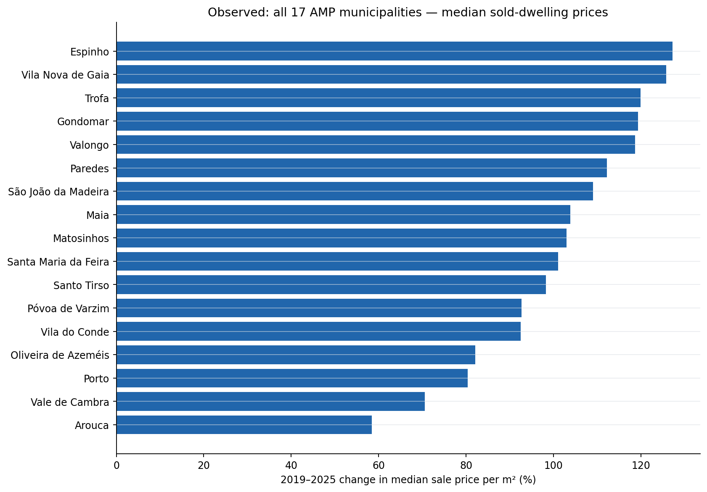

*Figure 1.* Observational data, derived from the pinned INE-based municipal panel. Percentage changes in municipality median sold-dwelling prices per square metre. Differences in dwelling mix and transaction composition remain possible; no causation or moving-household origin is identified.

The result is broad-based: each of the 17 municipalities has a higher reported median sale price in 2025 than in 2019. The median of the **17 municipal percentage increases** is approximately **103.0%**. That statistic describes the middle municipality in a ranking of growth rates. It is not the growth rate of a pooled metropolitan sales-price median, which would require transaction-level data or appropriate aggregation.

Porto itself rises from **€1,856/m²** in 2019 to **€3,347/m²** in 2025, an increase of approximately **80.3%**. Its 2025 absolute median is high, but its proportional increase is among the smaller in this particular set. Vila Nova de Gaia rises from **€1,096/m²** to **€2,474/m²**, or **125.7%**. Espinho rises from **€1,190/m²** to **€2,703/m²**, or **127.1%**. Arouca, at the lower end of this growth ranking, still records an increase of about **58.5%**.

These comparisons challenge the comforting notion that affordability problems remain confined to the historic city centre. If the debate is about whether metropolitan peripheries have become more expensive, the evidence is unambiguous in direction. But the change in *percentage* prices is not the same as a change in accessibility for a household. The starting level matters, as do income, financing and commuting requirements. An inexpensive municipality can have rapid percentage growth while remaining cheaper in absolute euros than Porto; a costly municipality can have slower percentage growth while remaining effectively inaccessible to many households.

The figures also do not reveal a chronological wave on their own. Two endpoint observations cannot tell us whether prices rose first in Porto and only later elsewhere, or whether all places responded to a common period of low interest rates, tight construction supply, demographic change and changing demand. The apparent metaphor of a spreading wave requires temporal evidence that is not contained in an endpoint bar chart.

Still, there is a political implication of these descriptive results. The claim that low-income households can simply relocate to a permanently cheap ring of outer municipalities is a claim about the *future equilibrium* of those locations. An observed record in which prices have risen substantially across the area warns against assuming that such a ring remains stable. The warning is not causal identification, but neither is it speculation without data.

## 6. Rents: the price faced by the next entrant

Sales prices are not enough. Some households cannot obtain a mortgage; others do not want to buy; still others cannot accumulate a deposit. For these groups, the rent required to sign a new lease may be the decisive constraint. Figure 2 uses the panel's median new-contract rent per square metre, comparing 2020 with 2025.

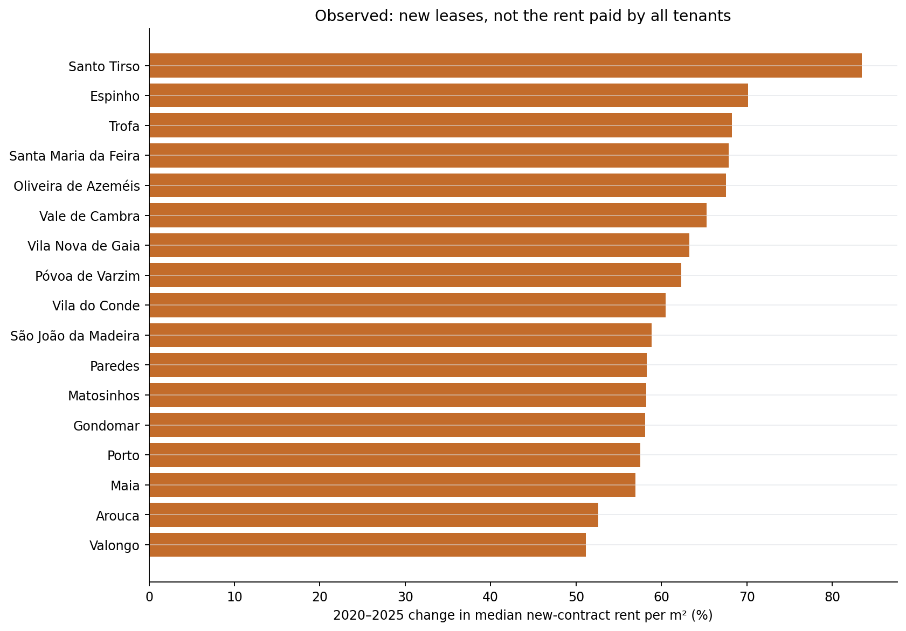

*Figure 2.* Observational data. Growth of median rents per square metre in newly agreed contracts, 2020–2025. Existing-contract rents, vacancy rates, tenant turnover and contract-level distributional changes are not observed in this comparison.

All 17 municipalities record higher new-contract rent medians at the end of the period. The median of municipal percentage growth rates is approximately **60.5%**. The range matters: Valongo records roughly **51.1%**, while Santo Tirso reaches about **83.4%** in this extract. The statistic is a change in the median *new lease*, not an annual rent increase automatically applied to a continuing tenant.

For Porto municipality, the new-contract median rises from **€8.97/m²** in 2020 to **€14.13/m²** in 2025, an increase of approximately **57.5%**. In Vila Nova de Gaia, it rises from **€6.51/m²** to **€10.63/m²**, approximately **63.3%**. A new tenant may therefore confront materially different market conditions from those faced by someone who signed a contract several years earlier. The distinction can create an *incumbent–entrant divide*: relative security for some existing tenants and a high entry barrier for new households.

This division changes the interpretation of mobility. A family considering a move out of Porto cannot always compare its current monthly rent with the current rent paid by a long-term tenant in Gaia. It needs to compare the costs of actually *obtaining a new contract* in Gaia. The affordable alternative may be much less attractive than the average rent statistic initially suggests, particularly after deposits, agency fees, moving costs and transport are included.

Conversely, high new-contract rents do not mean that every person in a municipality is paying them. Public discussion often slides from the observed price of marginal transactions to statements about all residents' budgets. We should not make that error. The appropriate outcome for one hypothesis is the price faced by a new entrant. For another, it is the full distribution of housing expenditure among residents. Those require different data.

The difference also complicates a narrative of a one-way flight from the centre. Households moving between suburbs are themselves part of the new-contract market. International arrivals, students, people forming households, divorcees, and those changing employment can all affect that market without having been priced out of Porto. Increases in new-contract rent provide evidence of rising market prices in multiple destinations, not direct evidence of the identities or motives of the bidders.

We should nevertheless take the metropolitan breadth seriously. If an individual is told to search ever farther away to find a lower monthly payment, and the rents of new contracts rise throughout the region, then the relevant option set is changing while the search continues. Affordability is not a static geographical map. It is a moving constraint.

## 7. Time trajectories, common shocks, and an honest description of co-movement

An endpoint comparison loses the chronology. Figure 3 uses annual observations to index the median sold-dwelling price in each municipality to 100 in 2019. Porto is highlighted; the other 16 municipalities appear as separate, muted trajectories. It is a visual comparison of municipality-specific series, not an estimated metropolitan price index.

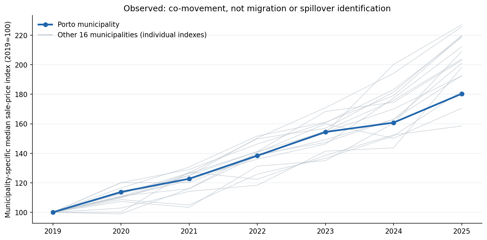

*Figure 3.* Observational data. Each municipality is independently normalised to its own 2019 median sale price. The light lines are individual municipalities, not an average or an uncertainty band. Parallel or divergent lines are descriptive and cannot identify migration or causal spillovers.

The value of the figure lies partly in its limitations. Several areas can move in the same direction because of a common macroeconomic driver. Mortgage credit, interest-rate expectations, construction costs, households' savings, national tax rules, or changes in demand among investors can produce simultaneous or near-simultaneous appreciation. If we label that co-movement "contagion" without further evidence, we have merely assigned a metaphor to a correlation.

At annual resolution, the ordering of price changes is difficult to establish precisely. A transaction registered early in one year and a transaction registered late in the previous year may respond to the same economic circumstances. Municipal medians are themselves noisy summaries of changing transaction samples. With only seven annual sale-price observations per municipality, mechanically fitting a model with many lags and spatial coefficients would be statistically unconvincing.

This is why a rigorous empirical programme should begin with descriptive and diagnostic comparisons, then seek higher-frequency data and plausibly exogenous variation if it intends to estimate transmission effects. The research question is not simply whether neighbouring prices correlate. It is whether a change in affordability in an origin municipality alters the subsequent demand and price equilibrium elsewhere, after accounting for shocks that affect both.

The necessary distinction is familiar from time-series analysis. When two series trend upward, their level correlation can be large even if no meaningful causal relationship joins them. Indexing and differencing may help show timing, but they do not create identification. Including a common time effect can absorb a national shock, yet it can also leave local confounding, reverse causality or spatially correlated measurement errors. A coefficient on a neighbouring price is not automatically an estimate of households moving.

Urban prices also respond to *expectations*. A developer may buy land in a peripheral area because a new public transport project is announced, years before the households eventually arrive. New supply may be scheduled where demand is already expected to grow. A sudden price change near a proposed station might reflect anticipated accessibility, not displaced households. Temporal precedence is useful evidence, but temporal precedence without a credible mechanism remains insufficient.

In the broader literature, the [OECD's study of changes in the geography of housing demand](https://www.oecd.org/en/publications/bricks-taxes-and-spending_7a22f9a6-en/full-report/component-4.html) is a reminder that demand can move within and between metropolitan areas as employment and work-from-home arrangements change. The shock can originate in preferences, work practices, transport or income, not only in forced displacement. Any model of Porto needs to allow for those competing explanations.

## 8. Affordability is not just a house-price chart

It is tempting to divide a typical dwelling's advertised price by a typical wage and call the result affordability. The calculation can be informative, but it combines distributions that may describe different people and different transactions. In Figure 4, we construct an explicit proxy: 100 square metres multiplied by the municipality's median sold-dwelling price per square metre, divided by the annual median gross fiscal-household income in that municipality. We compare 2019 with 2024 because the income series in this snapshot does not cover 2025.

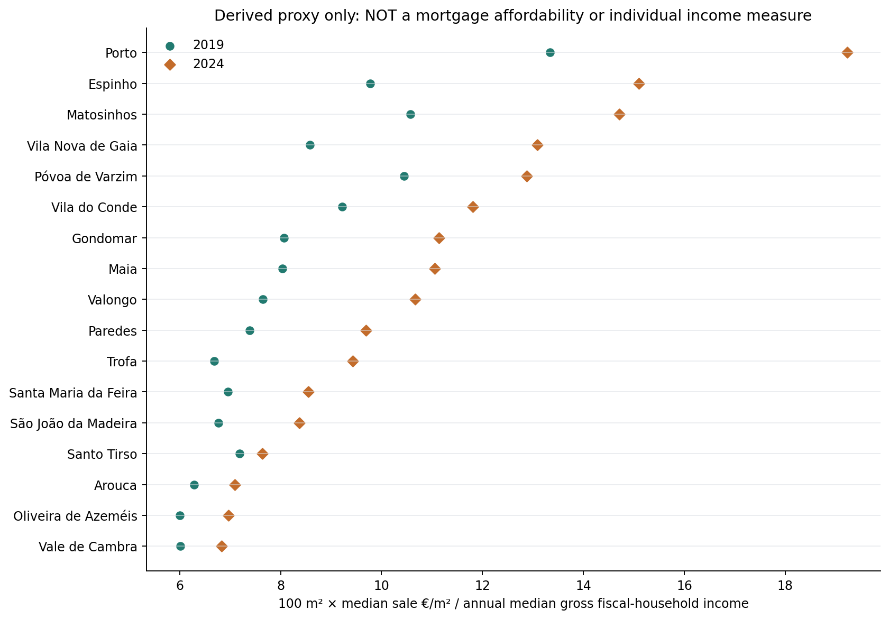

*Figure 4.* **Derived descriptive proxy.** Hypothetical 100 m² dwelling value divided by annual median gross fiscal-household income, for the same municipality in 2019 and 2024. This is neither mortgage eligibility nor household-level observed burden. It ignores deposits, financing, dwelling quality, age structure and the pairing of specific incomes with specific properties.

The reason to display the measure with such a prominent warning is that the arithmetic and the interpretation must be separated. The arithmetic is exact conditional on the two published medians and the assumed 100 m² reference dwelling. The behavioural conclusion is not. A municipality's median buyer may have an income very different from the median fiscal household. Some homes are purchased by households with accumulated equity or gifts; some by investors; some by newcomers whose income is not represented by the destination's existing taxpayer distribution.

The ratio also does not tell us whether a bank would grant a mortgage. That requires interest rates, loan terms, repayment-to-income rules, down-payment requirements, existing debt and the actual household's resources. Two households with the same gross income may have radically different financial constraints. One may own a home outright and use the proceeds to purchase another; the other may have little savings and high monthly commitments.

There is a further spatial selection issue. When higher-income households move into a municipality, the observed income distribution may rise alongside property prices. A simple median-price-to-median-income ratio might then appear more stable, even if the original low-income residents have become less able to secure new housing there. Composition can make an affordability indicator look reassuring while a subgroup experiences severe pressure.

For renters, the relevant burden is usually a rent-to-disposable-income ratio, adjusted for utilities and household size, with transport costs separately considered. For prospective owners, a payment-to-income ratio under consistent interest-rate and loan assumptions may be more meaningful than a sale-price-to-gross-income measure. For older owner-occupiers, the relevant pressure may concern taxes, maintenance, utilities, accessibility and the cost of supporting relatives rather than mortgage payments.

The policy argument must therefore specify *whose* affordability is in question. We cannot infer that a city is affordable because average income has risen, nor conclude that every household became worse off because a median transaction price doubled. The study of displacement is ultimately a study of people who face binding constraints, and medians are only the beginning of that analysis.

## 9. The rental trajectories reveal a second kind of geographic constraint

Figure 5 follows the annual medians for new rental contracts in six selected municipalities between 2020 and 2025: Porto, Matosinhos, Vila Nova de Gaia, Maia, Valongo and Póvoa de Varzim. They are selected to show differing starting levels and plausible commuting alternatives, not to imply that the specific households moving from Porto chose these destinations. Each line represents the median of the new contracts observed in one municipality for the corresponding year.

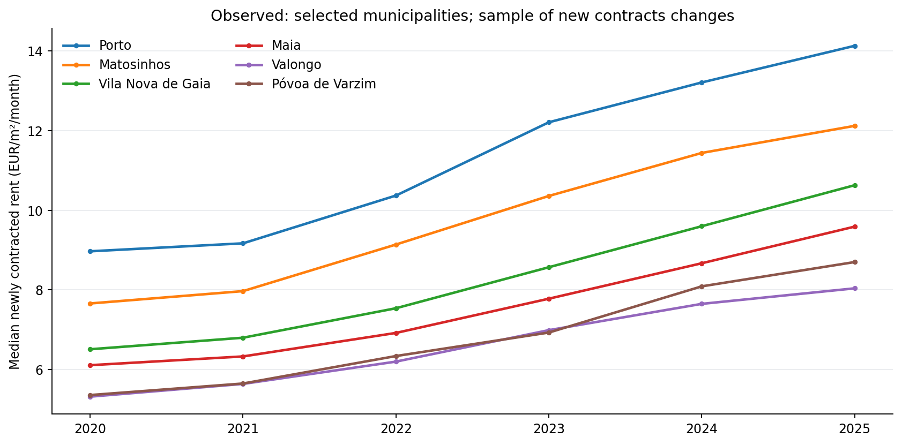

*Figure 5.* Observational data. Municipal median new-contract rents per square metre per month, 2020–2025. These series are not a matched panel of properties or households. No line is an observed migration flow.

The relative price structure is visible. Porto begins from a comparatively expensive position, while other municipalities offer lower median rates. That difference explains why a household might consider relocation. Yet the trajectories also rise in each selected place. The apparent saving depends on *when* the household enters the destination market, what particular dwelling it can find, and which costs it must incur to remain connected to employment and family.

An important feature of a displacement cascade is that it need not equalise rents everywhere. A transport network and the distribution of amenities generate a hierarchy of location values. Central housing can remain substantially more expensive than peripheral housing while peripheral rents still increase sharply. The crisis is not solved merely because a positive centre–suburb price differential survives. For a household with limited income, an additional euro of rent can matter greatly even if the destination is still cheaper than the centre.

The time evolution of new-contract medians also reveals the limits of advice based on a retrospective snapshot. Suppose that a household was advised in 2020 to search in a municipality where the median new rent was €5 per square metre. A policy document that repeats the same advice in 2025 without updating the market conditions may be recommending a place whose entrance price is now much higher. Housing search is a sequential decision under uncertainty, not a fixed menu of independently priced goods.

One consequence is potentially unequal mobility. Relatively affluent households can preserve access to central jobs while choosing peripheral homes with better transport, more rooms or private amenities. Lower-income households may have to choose among worse connected properties, crowded accommodation, or the loss of access to work. The same move "outward" can therefore represent a lifestyle preference for one household and a costly constraint for another.

The next empirical step is to observe household movements, not just their possible destinations. Registration changes, suitably anonymised housing histories, Census information, or longitudinal household survey data could reveal how many people moved and in which directions. None should be accepted without examining coverage, selectivity, privacy and the definition of the moving unit. An observed increase in new rents can motivate a mobility study; it cannot substitute for one.

## 10. Population growth is not a movement from the centre

A natural reaction to the price findings is to compare housing appreciation with population growth. If municipalities with increasing populations also have rising prices, perhaps there is evidence of people being pushed out of the centre. Figure 6 makes that comparison for the 17 municipalities, using changes in estimated resident population and median sale prices between 2019 and 2025.

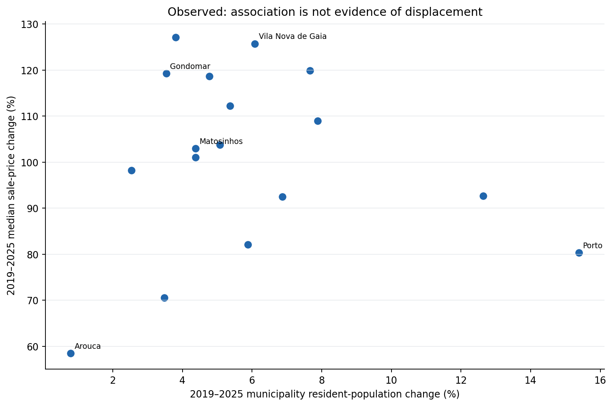

*Figure 6.* Observational data. Two endpoint changes for each municipality. These are not origin–destination flows. The plot does not control for household formation, dwelling quality, common shocks or the supply response.

The figure illustrates an identification trap rather than resolving it. A municipality can see prices rise rapidly without large population growth. This can happen because the number of households grows faster than population, because average household size falls, because income or credit availability changes, or because the properties changing hands differ from earlier sales. Investors may purchase dwellings that do not enter long-term residential use. Alternatively, some households may be excluded from the market while demand from wealthier households keeps prices elevated.

Population can also grow for reasons unrelated to displacement from Porto. International immigration, births, changes in survival, and movement from other parts of Portugal all affect the resident count. A person may move to Maia to take a new job there, not because a tenancy in Porto became unaffordable. Another household may move from Vila Nova de Gaia to Porto for proximity to work. A metropolitan economy contains cross-cutting movements, and annual population totals conceal them.

Even a perfectly measured net population increase is not a gross migration count. If 2,000 people leave a municipality and 3,000 arrive, the net change is 1,000 before births and deaths. The observed count does not tell us who left, where they went, or why. If the question concerns a cascade, gross bilateral movement matters far more than a single municipality's net balance.

Nor should we automatically equate population with housing demand. The relevant unit can be an individual, a family, a fiscal household, a private household, or a dwelling. A growing share of one-person households can increase the number of homes needed while the total population changes little. Conversely, increased crowding can allow population to rise without a proportional increase in occupied dwellings, while reducing residents' welfare.

For these reasons, our first reproducible study stops at the descriptive comparison. It does not label any point in Figure 6 as a displaced population, nor fit a causal slope from the cross-section. To infer the displacement channel, one would need an independently constructed origin–destination measure and a design capable of distinguishing affordability-driven moves from other motivations.

That restraint strengthens the argument. We do not need to invent the answer to show that the familiar instruction to "move farther out" is an incomplete policy. We need a model that respects capacity, commuting and equilibrium, and data that allow us to test the model's predictions rather than simply restate them.

## 11. A first mathematical model of spatial housing demand

Let a metropolitan area contain \(n\) locations indexed by \(i=1,\ldots,n\). At time \(t\), location \(i\) has a stock of suitable housing \(K_i(t)\), market demand \(D_i(p_i,t)\) and price \(p_i(t)\). For the moment we take the number of households as given, recognise that homes differ in type, and assume that market clearing approximately relates occupied units to available units. These are simplifying assumptions, not a description of the entire Portuguese housing system.

Let \(q_i\) denote the quantity of housing services traded locally, and \(\varepsilon_i^D<0\) and \(\varepsilon_i^S\geq0\) the local demand and supply elasticities. Consider a small additional demand shift \(\Delta A_i\), expressed in housing-service units, holding other demand determinants fixed for this comparative-static exercise.

\[
\Delta \ln p_i
\;\approx\;
\frac{\Delta A_i/q_i}{\varepsilon_i^S+|\varepsilon_i^D|}.
\]

This is a local linear approximation, not a fitted equation for Porto. The derivation comes from differentiating the demand–supply equilibrium: an outward demand shift is absorbed partly by higher prices, which reduce the quantity demanded, and partly by an increase in quantity supplied. When the denominator is small, the price response can be large. The magnitude depends on the relevant elasticities and the baseline market size.

Now let \(M_{ij}(t)\) count households relocating from location \(i\) to location \(j\) during period \(t\). With \(H_i(t)\) denoting residential households, a stock–flow identity takes the form

\[
H_i(t+1)=H_i(t)+\sum_{j\ne i}M_{ji}(t)-\sum_{j\ne i}M_{ij}(t)+B_i(t),
\]

where \(B_i(t)\) collects household formation, dissolution, and migration across the boundary of the system. The term is essential. Omitting it would imply that the number of households is fixed everywhere, although the data do not justify that assumption.

The moving households in the first term become potential demand in destination \(i\). But net additions need not correspond one-for-one to additional dwellings demanded. Some households double up; some move into vacant properties; some arrive with greater purchasing power than incumbents and replace an existing tenant; others purchase a home previously held for occasional use. The housing market clears through several margins, not prices alone.

We therefore need a function mapping market conditions into relocation decisions. In a simple discrete-choice representation, household \(h\) assigns utility to location \(i\):

\[
U_{hi}=Y_h-R_{hi}-T_{hi}-V_{hi}+A_{hi}+\eta_{hi},
\]

where \(Y_h\) is available income, \(R_{hi}\) the housing cost appropriate to that household, \(T_{hi}\) monetary transport cost, \(V_{hi}\) the opportunity cost of time, \(A_{hi}\) an amenity and social-network term, and \(\eta_{hi}\) other unobserved preferences. The symbols are deliberately household-specific; a citywide median does not determine any one family's choice.

The model predicts that an increase in central rent, holding all else fixed, can redirect some households to alternative locations. But the redirected flows depend on how many households find the alternatives suitable, on their resources, and on the changing prices of the alternatives themselves. The new choice changes the equilibrium the next household faces.

To make this a real structural model we would need to estimate taste parameters, outside options, supply elasticities, vacancy capacity, amenity effects and a time-consistent transport network. That is a substantial empirical programme. The point of writing down the equations is to make the missing quantities explicit, rather than disguise them with confident prose.

## 12. A network, not necessarily a set of concentric rings

The epidemic metaphor suggests a useful piece of mathematics: the geography of a disturbance can depend on the links through which it travels. But city space differs from the contact network in an epidemic. A household can compare several municipalities at once; households have incomes and preferences; a newly built flat is a supply response; and municipal borders do not represent absolute barriers.

Let \(W_{ij}\) be a potential-relocation weight from origin \(i\) to destination \(j\), after excluding locations that are infeasible for the household group being considered. A row-stochastic matrix \(W\) has nonnegative entries and rows summing to one for locations with available options. The weights may depend on commuting time, available homes, housing cost, schools and social connections. They must not be obtained merely by drawing lines between neighbouring municipal polygons and calling those lines migration.

Suppose a one-off shock displaces a hypothetical group of households. At each destination, a fraction \(a_i\) can be absorbed by available suitable housing, and the remainder must continue searching. In vector notation, a highly simplified linear network process could be written as

\[
\mathbf f_{t+1}
=W^\top \operatorname{diag}(1-\mathbf a)\,\mathbf f_t,
\]

where \(\mathbf f_t\) is a vector of incoming households requiring accommodation in the next stage. Provided the spectral radius of the transition matrix is below one, the total expected visitation vector has the geometric-series form

\[
\sum_{t=0}^{\infty}\mathbf f_t
=
\left[I-W^\top\operatorname{diag}(1-\mathbf a)\right]^{-1}\mathbf f_0.
\]

This equation is a *conceptual approximation*, not a calibrated model of the AMP. It also requires an interpretation of households leaving the model boundary and a mechanism preventing repeated loops from being counted as independent real moves. In a fully specified equilibrium model, absorption rates, the destination set and prices are endogenous rather than fixed.

The spectral-radius condition is nevertheless instructive. A process that dissipates as vacancies are filled and households settle behaves differently from one in which repeated scarcity continually redirects demand. The strength of outward pressure depends on the network and the capacity to absorb arrivals. Building more homes or making more existing homes available can reduce that pressure, though local induced demand and expectations may complicate the net response.

For real Porto research, the network should not be assumed from an illustrative diagram. One possible version would use geographic adjacency; a second, independently constructed version would use actual travel times by public transport; a third could use observed commuting flows; and a fourth would use observed residential origin–destination movements if accessible. The comparison matters because a spatial effect can look very different under alternative definitions of closeness.

A location next to Porto geographically may have a poor journey to a particular employment centre. Another location farther away may be strongly connected by rail. Treating every municipality within 20 kilometres as equally connected would ignore the very feature that makes metropolitan relocation economically meaningful. One of the strongest objections to casual spatial modelling is that it mistakes geographic distance for effective access.

This is also why the administrative AMP boundary should be tested rather than worshipped. Some relevant housing choices cross its boundary. Some municipalities inside it may be weak substitutes for housing in central Porto. The data extract is a reproducible starting population of 17 municipalities, but the appropriate functional market may require a different geographic sample and finer spatial units.

## 13. A deliberately hypothetical cascade experiment

Our first numerical illustration avoids pretending to have the relocation data that we lack. Imagine that a housing-market shock causes **1,000 hypothetical households** to search outside their origin. These are *not* 1,000 observed households leaving Porto. We then represent three abstract tiers of potential destinations. At each tier, some fraction of arriving households finds a suitable home; the rest continue to the next tier.

Two scenarios illustrate the role of capacity. In the constrained-absorption case, the three tiers accommodate 20%, 20% and 25% of their respective arrivals. In the more responsive case, they accommodate 55%, 60% and 75%. The fractions are chosen transparently to contrast assumptions; they have not been measured, estimated, fitted, or inferred from the municipal data.

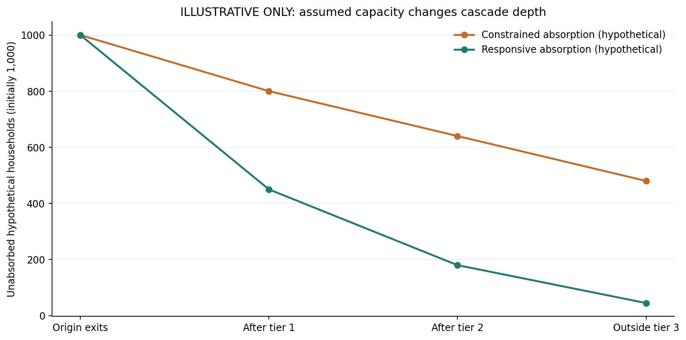

*Figure 7.* **Hypothetical model, not an estimate for Porto.** Starting from 1,000 assumed searching households, the constrained scenario leaves 480 unabsorbed beyond the third tier, versus 45 in the more responsive scenario. The calculation conserves the initial households exactly; it assumes no new households, return migration or price feedback.

The accounting is straightforward. In the constrained scenario, the first tier absorbs 200 and redirects 800. The second absorbs 160 and redirects 640. The third absorbs 160 and leaves 480 looking beyond the represented network. In the responsive scenario, the corresponding residuals are 450, 180 and 45. Because the calculation is deterministic and completely specified, a reader can reproduce every number with a few lines of code.

The experiment establishes a conditional result: **if capacity to absorb incoming households is higher, fewer households need to continue searching outward**, holding the original shock and the specified search path constant. It does not prove that construction will always reduce rents in every municipality or that a particular increase in building will produce one of the assumed fractions. Nor does it assign the tiers to specific towns. Those would be empirical claims, for which we have not supplied evidence.

This simple model also reveals why the disease metaphor must be handled carefully. In an epidemic, the number of newly infected people can grow because infected people generate new cases. In the static housing experiment, households do not multiply when they move. The 1,000 initial households are redistributed or remain unabsorbed. A price feedback could trigger *additional* households to move, but that requires a separate behavioural rule, not the duplication of a headcount at every tier.

One can write a more complicated model in which rising rents cause incumbent households to enter the search process, thereby creating secondary displacement. To calibrate it, we would need estimates of rent-burden distributions, tenancy stability, household income and the probability of moving as a function of a price change. Without those quantities, assigning a "reproduction number" to displacement would borrow scientific language without earning its empirical meaning.

The better lesson is about propagation with conservation, capacity and boundaries. A shock can move through a network, but it is constrained by resources and choices. Its reach is conditional, not automatic. A model that can also produce *no cascade* under adequate capacity is more useful than one designed to guarantee the desired political conclusion.

## 14. The distance trap: rent is not the full price of living somewhere

Suppose a household manages to find a lower rent farther away. Its housing expenditure falls, so the move appears successful. But the family still needs to reach work, health care, schools, shops, relatives and social services. Transport requires money. Travel consumes time. The proper comparison is not rent alone, but generalised household expenditure:

\[
C_{hi}=R_{hi}+T_{hi}+v_h\tau_{hi}+F_{hi},
\]

where \(R\) is housing expenditure, \(T\) direct transport expenditure, \(\tau\) commuting and other necessary travel time, \(v_h\) its opportunity-cost value, and \(F\) other relevant location-specific costs. The equation is an accounting framework. No single value of \(v_h\) applies to every person, and some costs resist conversion into euros.

A worker who spends two additional hours travelling each day may incur a large welfare loss even if the transport pass is cheap. Someone providing unpaid care may find the move practically impossible. A parent might need additional childcare hours; a person with a disability might lose access to services; a household without a car may be excluded from homes that appear affordable on a listing website.

Figure 8 constructs a *hypothetical* cost curve. Rent begins at €1,100 per month and falls with distance toward an assumed lower limit. Transport expenditure is set to €35 plus €4 per one-way kilometre of a modelled journey each month, and the monetary value of travel time to €5.50 per kilometre. These are deliberately simplified, arbitrary coefficients; they are not tariffs, measured commute costs, or survey estimates for Porto.

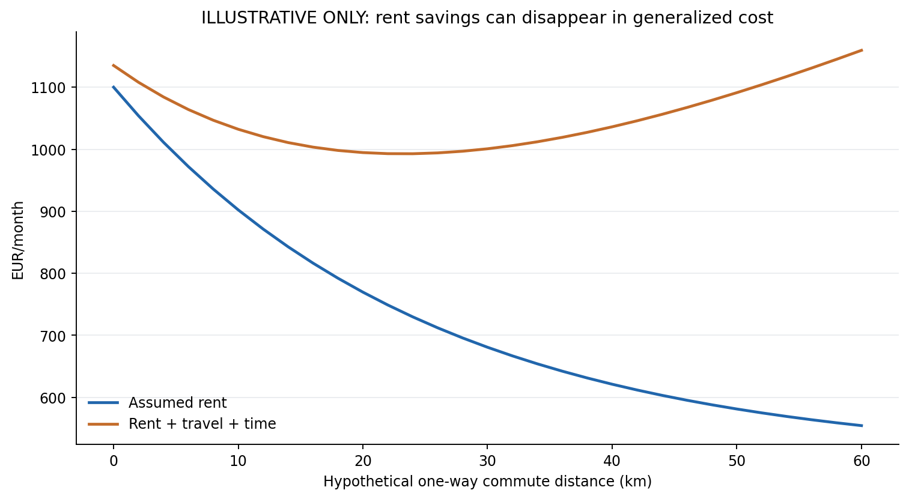

*Figure 8.* **Hypothetical illustration.** The assumed rent initially falls with distance, but generalized cost includes monetary transport and time. The shape is generated by declared assumptions, not an estimate of Porto household expenditure or an actual accessibility surface.

The graph illustrates a general possibility. At short distances, rent savings may exceed additional transport and time costs. Farther out, the latter can dominate. In the model, total cost is therefore not monotonically decreasing as one moves away from the centre. A policy that measures only the rent in the destination can recommend a move that makes the household economically worse off.

This is closely related to classical urban economic theory. In a simple monocentric city model, households trade housing costs against commuting costs, producing a spatial gradient of land rents. The gradient depends on income, preferences and transport technology. Modern metropolitan economies are often polycentric, with multiple jobs centres and transport options, but the basic tradeoff remains. A cheap dwelling is not necessarily a cheap life.

Transport improvements can change that tradeoff. A reliable and frequent metro service may expand the set of accessible locations, improve welfare and make some peripheral homes genuinely viable. Yet improved accessibility may also increase willingness to pay for land near stations. Some of the transport benefit can be capitalised into property prices or rents. Both effects can occur, and whether existing residents gain depends on tenure, supply and the timing of changes.

The fairness problem becomes sharper when the people asked to move are the people whose work keeps the centre functioning. Nurses, cleaners, service workers, public employees, technicians, teachers and retail workers cannot all perform their jobs remotely. If wages remain tied to one labour market while housing costs force workers farther away, society may be shifting a significant share of the cost of urban growth onto those who provide its essential services.

The transport calculation therefore belongs inside the housing analysis, not in an appendix. A serious measure of affordability should combine money, time, reliability and accessibility, distinguish between one-way and round-trip journeys, and estimate the burden for different kinds of households. A public transport map alone is not evidence that every household can commute at a reasonable cost.

## 15. The causal question is harder than a sequence of maps

After viewing the charts, a reader may reasonably ask whether increases in Porto's prices led those in Gaia, Maia, Valongo or Gondomar. Our first answer must be that the present descriptive dataset cannot settle that question. The fact that peripheral prices increased faster in percentage terms over one interval is consistent with several explanations, not just outward displacement.

One alternative is a common demand shock. If mortgage rates fall or credit conditions improve nationally, households in many municipalities may bid more for property at the same time. Another is construction scarcity. If housing supply responds slowly across the entire metropolitan area, a broad increase in demand can raise prices everywhere without requiring a sequential chain of residents leaving the centre.

A third alternative is compositional change. Increases in the proportion of new dwellings sold, or a shift toward higher-quality locations, may alter municipal median prices even if the price of a fixed-quality property moves differently. Fourth, population and income growth may be correlated with the location of expanding employment. Fifth, major public works or planning decisions can affect expectations and prices in several municipalities at once.

Reverse causality is an additional problem. Households may consider Porto because neighbouring areas have become more expensive, not only move outward because Porto has. Developers may concentrate new construction in municipalities where prices were already expected to rise. Higher property prices can attract investment and amenities, which further change demand. A graph of municipalities connected by commuting routes is an equilibrium system with many simultaneous decisions.

The empirical model must therefore distinguish three questions. The first is descriptive: did a given indicator change in one municipality before it changed in another? The second is predictive: do measures of affordability in one place improve forecasts of outcomes in another, beyond local history and common conditions? The third is causal: would the destination's housing costs have followed a different path if the origin's affordability shock had not occurred?

Answering the first does not answer the second; answering the second does not answer the third. An out-of-sample predictive improvement would be useful for planning, even without identifying displacement. A causal effect would be more directly relevant to evaluating a policy intervention. But it requires stronger assumptions and often a more informative source of variation than ordinary annual municipality price series provide.

Granger-predictive tests, spatial autocorrelation measures or geographically weighted regressions can be useful diagnostics. They are not, by themselves, valid instruments for causal interpretation. A spatial lag of a dependent variable is generally endogenous when outcomes are jointly determined. Fixed effects absorb some stable differences and common time shocks, but they do not remove every spatially correlated omitted variable.

The peer-reviewed work on [housing market spillovers after rent-control removal in Cambridge](https://www.nber.org/papers/w18125) demonstrates the kind of institutional shock that can help isolate a particular mechanism. Its estimated effects are not transferable as numerical forecasts for Porto. The research lesson is methodological: credible spatial causal evidence comes from specific variation, a defensible counterfactual and careful measurement, not from a visually persuasive map.

## 16. A research design for Greater Porto

The immediate empirical task is to define the study population, indicators and hypotheses in advance. We begin with the AMP's 17 municipalities because the official institution defines that perimeter and the existing panel already passes source and coverage checks. The final analysis should also test a functionally defined commuting market and, if data permit, freguesia-level or grid-cell alternatives. Aggregating everything to the municipality level risks hiding the very neighbourhood transitions we want to study.

The core hypotheses are:

**H1 — Price-pressure propagation.** Conditional on common national and metropolitan shocks and pre-existing local trends, a plausibly exogenous deterioration in origin affordability is associated with later increased demand and price pressure in destinations that are viable substitutes.

**H2 — Network mediation.** The relationship should be stronger along genuinely accessible commuting or residential-mobility links than across pairs connected only by geographic proximity.

**H3 — Capacity moderation.** Destinations with greater suitable vacant capacity or a more responsive supply should, other things equal, show weaker price responses and less onward displacement.

**H4 — Total-cost redistribution.** Households moving outward should not automatically be classified as better off. Some may pay lower rent but bear greater transport, travel-time or access costs.

An initial data table would include local new-contract rents, sale prices, the number of new leases and transactions where available, dwellings built, property stock and vacancy measures, population, fiscal income, employment and transport accessibility. The [IHRU Housing Observatory](https://www.portaldahabitacao.pt/report_dinamicas-imobiliarias) provides a useful official route to comparable territorial indicators, while INE remains the underlying statistical publisher for many of them. Every downloaded vintage should be archived with retrieval date, source identifier, geography and checksum.

An origin–destination component is non-negotiable for the strongest form of H1. We should seek official Census residential-mobility and commuting tables, carefully distinguishing *movement of residence* from *daily commuting*. A commuting matrix tells us which municipalities are functionally linked; it is not evidence that a particular person relocated because of rent. If administrative data cannot provide credible housing moves by origin and destination, the study must narrow its claims to price co-movement and potential accessibility.

For descriptive analysis, we can compute changes in real as well as nominal prices, measures of price convergence and divergence, neighbourhood correlations, supply-response delays and distributions of rent burden. For prediction, an explicit time-ordered validation design can compare local-only and spatially augmented forecasts. All models must be evaluated against simple baselines, with forecast horizons fixed before fitting.

For causal analysis, the most credible candidate would be a clearly dated local intervention or shock with defensible exposure, control municipalities, placebo tests and pre-trend assessment. Depending on the intervention, a difference-in-differences, event study, synthetic control or instrumental-variable strategy might be considered. None is automatically valid. A new metro station, for example, may affect prices through accessibility even without displacement; it is not a valid instrument for migration merely because it changes commuting opportunities.

A panel specification useful as a *descriptive starting point* is:

\[
\Delta \ln R_{it}=\alpha_i+\lambda_t+
\sum_{\ell=1}^{L}\beta_\ell
\sum_{j\ne i}w_{ij}\Delta\ln R_{j,t-\ell}
+X_{it}'\gamma+\epsilon_{it}.
\]

Here \(R_{it}\) is a clearly defined rental outcome, \(\alpha_i\) municipality effects, \(\lambda_t\) year effects, and \(w_{ij}\) a pre-specified network. The lagged neighbouring outcome is not an exogenous shock, so the \(\beta_\ell\) coefficients are not causal spillover effects without further identification assumptions. We would compare this specification with a local history baseline and multiple alternative network matrices rather than privilege one attractive coefficient.

Uncertainty needs particular attention. With only 17 municipalities and few years, conventional independent-observation standard errors are likely inadequate. Spatial dependence, temporal persistence and common shocks make the effective amount of information much smaller than the raw number of municipality-years might imply. Cluster-robust inference, block or spatial bootstrap approaches and permutation/placebo designs are candidates, but their validity and finite-sample properties should be tested rather than assumed.

The protocol should be registered before investigating hundreds of lag choices or distance thresholds. We would specify primary outcomes, source vintages, expected signs, negative controls, a family of sensitivity checks and explicit stopping conditions. If the strongest result disappears when the definition of adjacency changes, that is a scientific finding about fragility, not an inconvenience to be hidden.

## 17. What would actually falsify the cascade story?

A useful hypothesis must be capable of failing. For the outward displacement story, several observations would weaken or refute particular versions of the mechanism. If official origin–destination records show no meaningful movement from expensive origins toward the proposed destinations, the relocation channel is not supported in those data. If prices rise simultaneously across disconnected municipalities, a common shock becomes more plausible than a directional wave. If supply expands quickly where demand arrives, with little effect on rents and no evidence of onward displacement, the cascade may be strongly attenuated.

We should also be prepared for counterintuitive findings. Some newly developed neighbourhoods may attract higher-income residents and increase nearby amenities while simultaneously providing enough additional dwellings to reduce local rental pressure relative to a credible comparison. Other interventions may protect particular incumbent tenants but restrict mobility or have unintended distributional consequences. The evidence from Asquith, Mast and Reed shows why "new development necessarily displaces everyone" is no more defensible as a universal claim than "just move elsewhere."

Likewise, a housing crisis may have more than one spatial form. One municipality may be experiencing a shortage of small rentals, another a shortage of family-sized dwellings, and a third an affordability problem driven primarily by low wages or transport exclusion. A statistical model that treats all homes as identical and all households as equally mobile may fit average prices while missing the mechanism most relevant to public policy.

Timing can also defeat naive inference. If developers anticipate a demand shift and complete homes before a measured population increase, the price trajectory may not display the expected lag. If landlords anticipate transport improvements, rents may rise before the service starts. If incumbent households remain under older contracts, displacement may appear as a failure of new household formation rather than a large observed outflow. A narrow outcome definition can therefore make a real welfare problem statistically invisible.

An especially important falsification exercise concerns the choice of spatial weights. Suppose an apparent effect is strong when municipalities are arranged by arbitrary geographic rings but disappears when adjacency is replaced by observed commuting links. That does not necessarily disprove every spatial influence, but it directly challenges the proposed transport-mediated mechanism. We should have sufficient intellectual honesty to report it.

The same applies to the cost model. If measured time and travel costs remain small relative to rent savings for relevant household groups, then relocation may genuinely reduce total cost for those groups. It would be wrong to insist otherwise simply because the political argument was irritating. The correct conclusion would distinguish those who benefit from those who do not.

Scientific criticism is strongest when it avoids replacing one slogan with another. The argument here is not that every move to a suburb is bad. It is that a decentralised series of individual moves cannot be presumed to solve a systemic affordability constraint. The strength, direction and distribution of secondary effects must be studied.

## 18. A policy argument must operate at metropolitan scale

What follows from the economics if the data eventually support a substantial spillover mechanism? First, housing policy cannot be designed as though each municipality were responsible only for its current residents. Development permissions, transit, employment and social housing cross local boundaries in practice, even when budgets and political incentives are fragmented.

Second, expanding suitable housing supply matters, especially in locations with strong employment access. That need not mean one homogeneous construction programme. A mix of rental and owner-occupied units, different dwelling sizes, reuse of existing stock, accessible housing, infill development and predictable planning decisions may be necessary. How a municipality builds and who can afford the result matter as much as headline unit counts.

Third, non-market and below-market housing can protect access for households who would otherwise be excluded by prevailing prices. Public or cooperative housing may provide stability in high-access locations without forcing every low-income household into a long commute. It also raises difficult implementation questions: land, procurement, financing, maintenance, allocation rules, tenancy mobility and the tradeoff between immediate assistance and long-term capacity. Those should be analysed openly.

Fourth, existing tenants require consideration alongside prospective entrants. Policies that protect incumbents can mitigate sudden forced moves and provide security. At the same time, strict rationing or poorly designed exemptions can affect the allocation of scarce housing. Rather than treating tenancy security and supply as irreconcilable ideological camps, analysis should examine how the instruments interact and who gains or loses.

Fifth, transport is a complement to housing policy, not a substitute for it. A reliable metro line or bus network can expand access to jobs, lower the time cost of a move and reduce car dependence. Yet if available homes near the improved line remain scarce, part of the benefit may be reflected in higher land values. Coordinating transport investment with housing production and affordability provisions can help distribute those benefits more broadly.

Sixth, a serious metropolitan response needs a measurement system. Policy should follow a basket of indicators rather than a single average price: new-contract rents, incumbent rents where available, household burden distributions, housing completions and vacancies, travel-time accessibility, residential mobility, household formation, homelessness, waiting lists and the distribution of incomes. No one indicator is a sufficient welfare measure.

The governance dimension is not abstract. The [Porto Metropolitan Area has itself discussed a coordinated housing strategy](https://www.amp.pt/noticia/amp-defende-uma-estrategia-metropolitana-para-a-habitacao-e-mais-competencias-para-os-municipios/), recognising the significance of coordination among its 17 municipalities. A metropolitan perspective is essential when the outcome of interest is pressure moving through a connected labour and housing market. This article does not assess the effectiveness of any proposed AMP measure; it identifies why coordination is analytically relevant.

There is also a distributive question that should not be delegated to a market-equilibrium coefficient. Who should bear the cost of urban economic growth? If a metropolitan centre benefits from concentrated employment, tourism, knowledge exchange and public investment, should essential workers be expected to absorb all the resulting housing and commuting costs privately? That is partly a normative and political choice, not something a regression will settle.

Economics can show the tradeoffs more clearly. It can estimate whether a supply intervention reduced rents relative to a comparison, whether transport improvements changed access, whether price pressure moved across boundaries, and which households were affected. But a model does not choose society's objective function. It does not decide how much weight to place on stability, equality, freedom of movement, public budgets or community continuity.

A credible policy debate therefore needs both a positive argument about mechanisms and an explicit normative argument about goals. The positive part can be falsified and improved with data. The normative part should be openly defended rather than disguised as a law of nature.

## 19. What this first study establishes—and what it does not

We can now state the results without overstating them.

The fixed observational dataset contains 119 municipality-year rows, representing the 17 AMP municipalities in 2019–2025. All 17 have higher median sold-dwelling prices per square metre in 2025 than in 2019. All 17 have higher median rents in newly agreed contracts in 2025 than in 2020. The median of municipality-specific sale-price growth rates is approximately 103.0%; the corresponding median new-contract rent growth rate is approximately 60.5%. These are not household-weighted, property-weighted or constant-quality metropolitan indices.

Porto's sale-price median increased by about 80.3%, while selected surrounding municipalities recorded larger percentage increases from lower initial prices. The result supports the descriptive statement that cost pressure is not restricted to Porto municipality. It does not show that Porto's price changes caused the others, nor that every resident suffered the same welfare loss.

The six observational figures provide distributions of price growth, rental growth, price trajectories, a clearly labelled price-to-income proxy, selected rental trajectories and a population-price comparison. They make no claim to measure residential origin–destination flows. The two hypothetical figures show that the depth of an assumed relocation chain depends on absorption capacity, and that declining rent can coexist with rising generalised living cost. Their parameters are illustrative and are not estimated from Portuguese households.

One deliberate limitation is temporal length. A seven-year annual panel is insufficient for a convincing multi-lag spatial causal model with heterogeneous municipal effects. A second is geographic aggregation. Municipality averages and medians can conceal neighbourhood patterns, income-specific burdens, and proximity to actual transport access points. A third is outcome composition: prices of sold properties and new tenancy contracts need not represent the cost of a fixed dwelling over time.

A fourth limitation is that we have not merged origin–destination mobility observations or direct commuting-cost measurements into this first release. The transport figure is a numerical explanation of a mechanism, not a geographical accessibility map. A fifth is that we do not estimate new supply's causal elasticity from the permits or completions series. Those variables are available for subsequent research but do not identify a supply response by themselves.

The code deliberately records these boundaries in machine-readable provenance metadata. The observational source is pinned to an upstream commit and blob, the 17-member administrative perimeter is explicit, the two known gaps in temporal coverage are not silently imputed, and the hypothetical model outputs are marked separately. Unit tests check the panel grid, specific reference values, accounting conservation, parameter bounds and reproducibility of all eight figures.

This is an appropriate first release for a research programme. A result that identifies all the limits of available evidence is more valuable than a confident but unreplicable coefficient. The next stage should seek actual flows, reconstruct a time-consistent transport network, test alternative spatial definitions, and develop a pre-specified identification strategy for a genuine causal question.

## 20. The city cannot export its shortage indefinitely

The instruction to move away from expensive city centres rests on a partial truth. Households do have locational choices. Some can reduce their housing costs by moving. Suburbs and peripheral towns can offer attractive places to live, sometimes with more space and more amenities at a lower price. Denying that would be as careless as claiming that relocation solves the housing crisis.

But a city is part of a connected metropolitan economy. When many households pursue the same cheaper locations, they change demand in those locations. If suitable supply is slow to respond, price pressure may spread. If transport access is uneven, the burden of moving can be concentrated on those least able to afford it. If the next location becomes unaffordable, another household may face a further move. It is a coherent mechanism, and one that can be studied mathematically.

The empirical record for Greater Porto gives us a reason to investigate: substantial increases in observed sale-price medians and new-contract rents have occurred across its 17 municipalities. The record does not establish a chain of actual displacement. That distinction is not a technicality. It is the difference between discovering a mechanism in data and assuming the conclusion because it fits a political narrative.

The most constructive response is not to surrender the argument but to make it sharper. Define affordability for specific households. Measure genuinely available housing and actual entry prices. Include commuting money and time. Observe movement between origins and destinations. Distinguish simultaneous shocks from sequential transmission. Estimate uncertainty. Test conditions under which the apparent wave dissipates.

If the cascade is found, coordinated housing and transport policy will be required to address it. If the cascade is weaker than expected, that will inform which instruments have the greatest leverage. Either way, the individual instruction to move cannot stand in for a metropolitan housing strategy.

The central lesson is a straightforward one:

> A cheaper suburb can be an answer for one household. It is not an inexhaustible answer for every household excluded from the centre.

Housing scarcity does not disappear when we draw a wider circle on a map. We have to measure how the costs move, identify the constraints, and decide what kind of metropolitan area we want people to be able to inhabit.

## Postscript: What two additional 2021 mobility datasets reveal

After completing the original municipality-price analysis, I added two
observational companions. One describes interactions between places for work
and study. The other describes where Porto's 2021 residents had lived on a
previous reference date. They are related to housing-market geography, but
they answer different statistical questions. Neither can be relabelled as a
count of residents pushed outward by expensive housing.

The first companion is a Census 2021 municipal work/study interaction matrix,
derived from a published workbook attributed to INE indicator 0012340. For
the 17 municipalities in the legal Porto Metropolitan Area, the matrix is
exactly symmetric: every pair appears once in each direction with the same
number, and every diagonal cell is zero. We therefore retain **136 unique
unordered pairs**, representing **339,378 reported pair interactions** after
counting each pair only once. Porto–Vila Nova de Gaia is the strongest pair
in this subset, with 39,960 reported interactions. Those are not 39,960
households moving from Porto to Gaia. The extracted table does not establish
the direction of commuting, much less changes in residence. Its topology is
shown in [Figure 9](figures/fig9_2021_commuting_interactions.png).

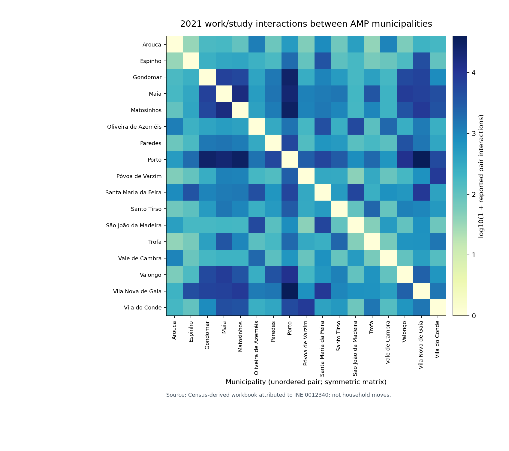

As a descriptive spatial check, I calculated global Moran's I with these
observed pair counts as a fixed weight matrix, using municipality-specific
sale-price growth from 2019 to 2025 and new-contract rent growth from 2020
to 2025. With 9,999 reproducible random-label permutations, the raw-weight
sale-price statistic was −0.197 (two-sided p = 0.303); the new-rent statistic
was +0.156 (two-sided p = 0.114). [Figure 10](figures/fig10_commuting_moran_null.png)
shows the reference distributions. Neither primary result is compelling
evidence of spatial transmission. The conclusion is additionally sensitive to
weight transformations and to excluding Porto: the sign of the sale-price
association changes in that sensitivity. The network is observed in 2021,
*during* the period whose changes are being compared. It cannot establish
that the network preceded a shock. A correlation in a set of linked places is
not an estimate of the response to an exogenous shock in another place.

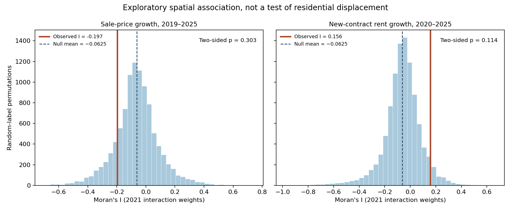

The second companion is closer to the actual movement question. The Porto
open-data portal redistributes an INE Census 2021 spreadsheet of residents'
*local de proveniência*: where each enumerated resident was living on
**31 December 2019**. The question appears directly in the Census 2021
individual questionnaire, whose reference date is 19 April 2021. This is a
retrospective window of more than a year, not an annual migration series.
Its categories distinguish people who had not yet been born, those remaining
in the same home, moves within a parish, moves from another parish within
the same municipality, moves from another municipality, and moves from
abroad. The data include Portugal, Norte, AMP, Porto municipality, and
**all seven Porto parishes**, but not every municipality in the AMP.

Porto had 231,800 residents at the Census reference date. Of these, 2,073
had not yet been born on 31 December 2019, leaving a precisely specified
eligible denominator of 229,727 current residents. **15,724 people, or
6.84% of that denominator, had resided in another Portuguese municipality**
on the earlier date; another 4,345, or 1.89%, had lived abroad. In this
published table, all seven parishes reconcile exactly to Porto's totals
for each residence-origin count. These are observed in-mover counts among
Porto's residents, not out-movers who left Porto.

The parish variation is substantial enough to justify further investigation.
In the present-day union of Cedofeita, Santo Ildefonso, Sé, Miragaia, São
Nicolau and Vitória, 8.40% of eligible 2021 residents had lived in a different
municipality on the earlier date. In Campanhã, the corresponding share was
5.94%. Across all reasons and origins for a change of residence, the shares
who had moved were 20.60% and 11.53%, respectively. Figure 11 shows the
intermunicipal-origin shares, with Porto (6.84%) and the overlapping AMP
(7.24%) as descriptive benchmarks. Figure 12 answers a different question:
*among movers only*, how did previous-residence categories contribute to the
total? Its stacked percentages must not be mistaken for shares of all
residents.

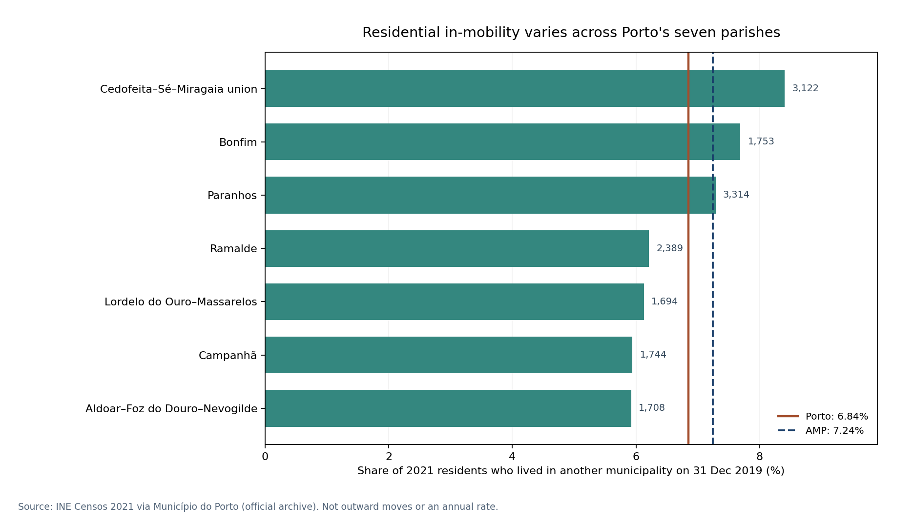

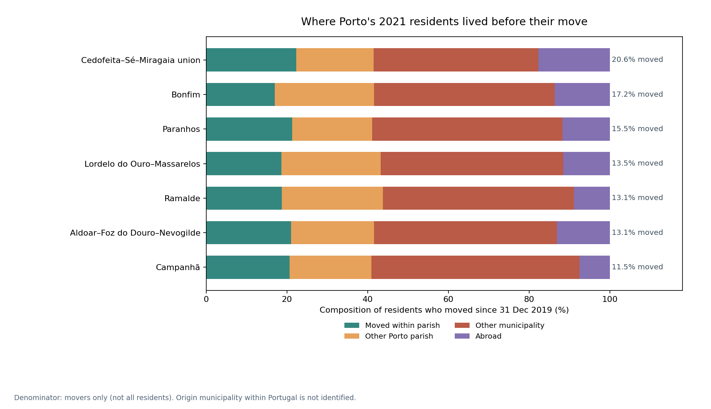

These parish contrasts have several competing explanations. They can reflect
age composition, household formation, the availability of rental units,
international arrivals, students, job changes, neighbourhood redevelopment,
and changing boundaries of opportunity. A higher observed share of movers
into the historic centre does not imply the centre is affordable, nor does
it contradict the possibility of displacement. Some people are arriving;
others may be leaving. The provided aggregate table records the former among
current residents, not the latter among people who no longer live there.
It does not identify the specific municipality from which an in-mover came,
and it does not link movers to incomes, rents, or reasons for relocation.

The result is a more useful statement of the research gap. We can describe
observed housing costs across 17 municipalities, the relative strength of
commuting interactions, and residential change among the current residents
of Porto's seven parishes. We **still cannot trace a Porto resident's move
to a named suburban municipality** or attribute it to a price increase.
That requires an appropriately protected directed residential
origin–destination table or a longitudinal household survey, alongside an
identification design. The Census questions show that the earlier-residence
information was collected. Whether the required cross-tabulation can be
released at this geographic resolution remains an empirical data-access
question. Until then, the cascade is a hypothesis, not a measured epidemic.

## Methodological note: even the direction of the exchange is unidentified

We can now go a step further than saying that an origin–destination table is
missing. Using only the official Census margins already available, we can
prove that the direction of the residential exchange between Porto and the
surrounding municipalities is *not statistically identified*. This is not a
claim that there was no outward movement. It is a precise statement about
what the published observations do and do not determine.

Take the 2021 Census category of people who lived in **another Portuguese
municipality on 31 December 2019**. The official table reports 124,618 such
current residents for the Porto Metropolitan Area (AMP). Of these, 15,724
were living in Porto in April 2021. Since the Porto figure is included in
the metropolitan total, simple subtraction leaves **108,894 current
residents of the other 16 AMP municipalities** whose earlier residence was
in a different municipality. This is an observable difference between
two nested *destination margins*. It is not itself a measured flow *from*
Porto to those municipalities.

Let \(x\) be the unknown number of those 108,894 people who previously lived
in Porto. Let \(y\) be the unknown number of Porto's 15,724 intermunicipal
in-movers who previously lived in one of the other 16 AMP municipalities.
Both numbers refer to changes of usual residence between the same Census
reference dates. They describe individuals who were living somewhere in
the AMP in 2021, not every person who departed from a municipality in the
intervening period. Then the observations impose only the following
restrictions:

\[
0\leq x\leq108{,}894,\qquad 0\leq y\leq15{,}724.
\]

If we define *net exchange towards the other 16 municipalities* as
\(N=x-y\), the mathematically valid interval is therefore

\[
\boxed{-15{,}724\leq N\leq108{,}894}.
\]

These are **sharp logical bounds conditional on the two observed destination
margins**, not a confidence interval or a forecast. To see why they are
sharp, choose any nonnegative integers \(x\) and \(y\) inside the stated
ranges. Allocate \(x\) of the intermunicipal in-movers in other AMP
municipalities to a previous Porto residence, and allocate \(y\) of Porto's
in-movers to a previous residence elsewhere in the AMP. The remaining
\(108{,}894-x\) and \(15{,}724-y\) people can have previous residences in
other municipalities not identified by the table. Both observed destination
totals still reconcile. No point in that rectangle is ruled out by the
published origin categories alone.

For example, consider two deliberately hypothetical allocations:

- **World A:** 25,000 people moved from Porto to another AMP municipality,
  while 5,000 moved in the opposite direction. The net exchange is 20,000
  towards the surrounding municipalities.
- **World B:** 5,000 people moved from Porto to another AMP municipality,
  while 12,000 moved in the opposite direction. The net exchange is 7,000
  towards Porto.

Both worlds produce *exactly the same* published metropolitan and Porto
residential-origin margins. The second does not refute the first, nor does
the first provide evidence for the price-displacement hypothesis. It is
possible to construct other worlds with zero exchange or either extreme of
the interval. The source does not assign probabilities to these worlds.
The [reproducible companion calculation](residential_identifiability.py)
rejects invalid allocations, checks both destination accounting identities,
and exports each example with an explicit *hypothetical* label.

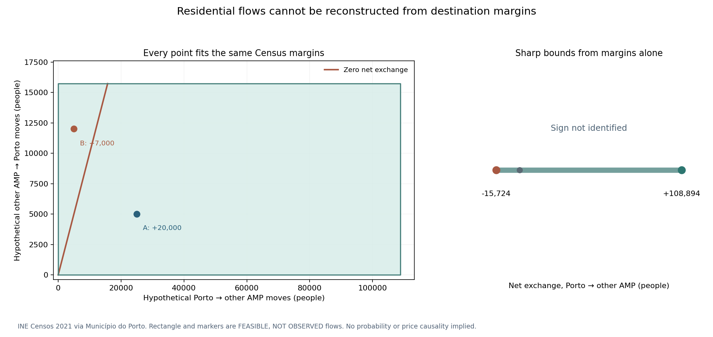

Figure 13 makes the problem visible. Each point in the shaded rectangle
represents a distinct hypothetical pair of directional flows. The diagonal
marks zero net exchange; points on either side imply opposite directions.
The narrower panel shows the entire range of feasible net differences.
The area of the rectangle is **not a probability distribution**. Its right
endpoint must not be reported as the number of people forced out of Porto.
The bounds omit departures to places outside the AMP, deaths and other
unobserved population changes; neither residence change nor the difference
of residence changes directly measures housing stress.

The distinction matters for empirical modelling. A symmetric commuting
interaction matrix cannot repair this missing residential direction.
Neither can a municipal net migration estimate be used to infer who moved
to which named municipality. The [INE Census 2021 migration indicator
0011631](https://www.ine.pt/xurl/indx/0011631/PT) groups current residents
by place, sex and migration *category*, but its public catalog metadata
does not describe a two-municipality origin–destination dimension. The
[INE's population-estimates methodology](https://www.pordata.pt/sites/default/files/methodological_documentation/Documento_metodologico_estimativas_anuais_da_populacao_residente_113.pdf)
explains that annual internal migration estimates are based partly on
Census previous-residence structures. Such a balance is different from a
pair-level mover register. These are the inspected public routes, not proof
that no restricted or unpublished cross-tabulation exists.

The useful next request to the statistical authority is therefore quite
specific: a privacy-safe matrix with municipality of residence on
31 December 2019 as rows, municipality of residence on 19 April 2021 as
columns, stable official geographic codes, a clearly stated population
universe, treatment of suppressed cells and reproducible aggregation to
the AMP. A household panel linking housing costs, tenure and reasons for
moving would answer a deeper question. Even a true residential OD matrix
would establish *where people moved*, not necessarily *why*. Estimating
whether unaffordability displaced them would still require a credible
causal strategy and information about their economic circumstances.

The conclusion is not pessimistic. It prevents an attractive narrative from
becoming an unearned empirical claim. The strong result we can presently
defend is about **non-identification**: the same observed 2021 Census
counts are compatible with sharply different metropolitan residential
exchanges. The housing cascade remains a testable hypothesis. The needed
test has become more precise.

## Data-access note: from an unidentified flow to a testable one

The next research step should begin with a request for data, not a more
elaborate migration model. A closer inspection of the **original English
version of the Census 2021 individual questionnaire** establishes a
particularly useful fact: [question 10](https://censos.ine.pt/scripts/censos_css_js/quest/EN_Q_IND_Censos2021_EN_v03.pdf)
did not merely ask whether a person had lived in another municipality on
31 December 2019. It requested the **name of that municipality and its
parish**. The statistical system therefore collected more detailed
residential-origin information than the published aggregate table makes
available. This does not establish that every response has been successfully
geocoded or that the information can safely be released in cross-tabular
form, but it makes a targeted data request reasonable.

For the Porto question, the minimum useful release is small: 17 destination
municipalities, each of the 17 Porto Metropolitan Area municipalities as
potential origins, plus a single group representing every other Portuguese
municipality. That is an 18-by-17 table of *aggregate person counts*, not
an individual-level dataset. The 17 same-municipality diagonal cells are
excluded by the definition of arriving from another municipality. With
matching definitions and no confidentiality adjustment, the sum of these
counts should agree with the independently observed **124,618** people in
the metropolitan area who previously lived in another municipality. The
Porto destination column should agree with **15,724**. Publishing an
explicit suppression flag for protected cells would be more informative
and honest than silently reporting them as zero.

Two official access routes are documented. First, INE has described a
[statistical-information request service](https://www.ine.pt/ine_novidades/semin/FI_RIIBES_47/files/assets/basic-html/page10.html)
for custom tabulations, including Census questions. The historical form
link was not available during this work, so its current operation and
possible cost need confirmation. Second, an [INE–FCT–DGEEC scientific
research arrangement](https://www.ine.pt/ine_novidades/semin/FI_RIIBES_51/files/assets/basic-html/page6.html)
has provided options for authorized researchers, including approved
anonymized statistical tabulations and secure access. INE's
[April 2026 research-infrastructure report](https://www.ine.pt/ine_novidades/semin/INEWS65/index.html)
confirms ongoing safe-centre activity, including in Porto. Neither route
guarantees access to this Census variable or automatic eligibility for
an applicant. It is sensible to ask first about a no-cost research option
and permissible redistribution before commissioning anything.

The [companion source-request protocol](OD_DATA_ACCESS.md) now defines the
universe, geographic codes, dates, confidentiality questions and exact
reconciliation totals. It also contains a reviewable Portuguese-language
request to INE, **not sent as part of this research**. The companion
intake validator checks any future approved aggregate table for source
identity, missing or duplicated cells, correct arithmetic, and suppressed
values. It can preserve logically valid bounds if some flows are hidden.
Its tests generate artificial tables only in temporary directories; these
are software test fixtures, not Portuguese relocation measurements.

Even once an authentic residential origin–destination table arrives, the
research question will not be finished. It would establish movements
between municipalities by people residing in the metropolitan area at
the Census date, while the causal question concerns *which households were
priced out*, when, and under what alternatives. Reasons for moving,
household tenure, economic circumstances and a credible exposure design
would still matter. The statistical data-access task is a necessary step
towards that analysis, not a substitute for it.

## A chronology check: did housing pressure move outward from Porto?

The housing cascade argument contains a temporal claim as well as a spatial
one. It implies that housing prices or rents become difficult in the core,
then that pressure is transmitted to plausible alternatives, and eventually
that alternatives farther away become difficult too. The previous sections
show why an actual *residential* origin–destination matrix is necessary to
test the movement mechanism. But we can still ask two narrower questions
using the published annual medians: **which municipalities crossed comparable
nominal price-growth thresholds first**, and **does an observed spatial
interaction network improve forecasts of subsequent housing-price changes?**

Both questions are descriptive or predictive. Neither can by itself show
that a tenant left Porto because of a rent increase, or that an outward
move then caused higher rents in the destination. They are nonetheless
worth pursuing: a cascade story should be compared with a common
metropolitan shock, and a network should have to earn its place in a
predictive model rather than be treated as confirmation by construction.

### First-passage years from the observed annual series

Consider each municipality's median **sold dwelling price per square
metre** relative to its own 2019 value and its median **new-contract rent
per square metre** relative to its own 2020 value. For a threshold of
25%, 50%, 75% or 100% nominal cumulative growth, where available, identify
the first **published calendar year** at or above that threshold. The
choice of round-number thresholds is a transparent descriptive comparison,
not a theory-derived definition of unaffordability. If a threshold is not
reached by 2025, mark it *not yet* rather than making up a crossing date.
The 2019 rent observation is missing from this source and is never
interpolated. A municipal median is not the price trajectory of one
unchanged property or the rent paid by an incumbent household.

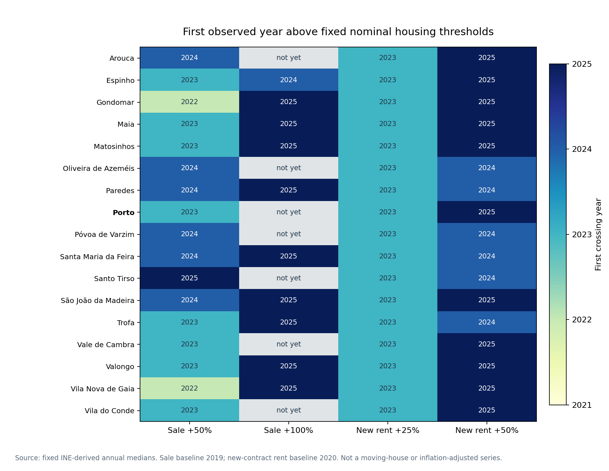

The chronology is striking, but not in the direction of a simple outward
wave. All **17 municipalities** first crossed a **25% increase in median
new-contract rents relative to 2020 in 2023**. At a 50% rent threshold,
six crossed in 2024 and eleven in 2025, including Porto. At the 50%
**sold-price** threshold, two had crossed by 2022, eight more in 2023,
six in 2024 and the last one in 2025. Porto's sale median first passed
+50% in **2023**, later than Gondomar and Vila Nova de Gaia, and had
not yet doubled relative to 2019 by 2025. Ten other municipalities had
reached the +100% sale threshold by then; seven, including Porto, had not.

This cannot establish that the surrounding municipalities became
unaffordable before Porto. Growth measured against each municipality's
different starting level need not track whether an actual household can
afford to live there. Nor does an annual first-passage record establish
the order of changes *within* 2023. Broad inflation, financing costs,
housing-market composition, local supply and correlated demand could all
contribute. The honest result is that the observed crossing dates **do
not support a clear sequence of Porto first and every suburb later**.
The shared 2023 rent crossing looks more like a synchronized annual
pattern than a resolved municipality-by-municipality chain.

### Does yesterday's commuting network help forecast tomorrow's prices?

An even stricter diagnostic asks whether the fixed 2021 work/study
interaction network adds anything to a simple forecast, **after including
a metropolitan-wide lag**. Define the observed annual growth outcome for
municipality (i) as

\[
g_{i,t}=100\log\left(\frac{P_{i,t}}{P_{i,t-1}}\right),
\]

where (P) denotes a published sale or new-contract rental median,
analysed separately. The baseline model predicts (g_{i,t}) with the
municipality's own prior-year change (g_{i,t-1}) and the mean prior-year
change over all 17 AMP municipalities, \(\bar g_{t-1}\). The network-augmented
model adds exactly one extra feature:

\[
x^{W}_{i,t-1}
=\frac{\sum_{j\ne i}W_{ij}g_{j,t-1}}{\sum_{j\ne i}W_{ij}}
-\bar g_{t-1}.
\]

Here (W_{ij}) is the *symmetric*, source-pinned count of 2021 work/study
interactions between municipalities. The zero diagonal excludes the
municipality's own growth from its neighbor term. Subtracting the AMP
prior-year mean makes the additional predictor a **network-specific
deviation from common metropolitan growth**. This distinction matters
in a dense network where every municipality pair has a positive reported
interaction: simply feeding the same broad metropolitan trend into a
model twice would not isolate a useful connectivity signal.

Both models use a simple ridge regression with a fixed penalty of 1.0,
an unpenalized intercept, and predictor standardization estimated *only
on the training years*. The first target in training is 2022, whose
features come from 2021. For the 2023 held-out test, the model uses 2022
as its only target-year training block; for 2024, it uses 2022–2023;
and for 2025, 2022–2024. This is **rolling-origin, one-year-ahead**
validation, not an in-sample fit. The 2021 network was measured before
all forecast target years, but was **not** measured before the entire
housing observation period, so it is not an instrument or causal shock.

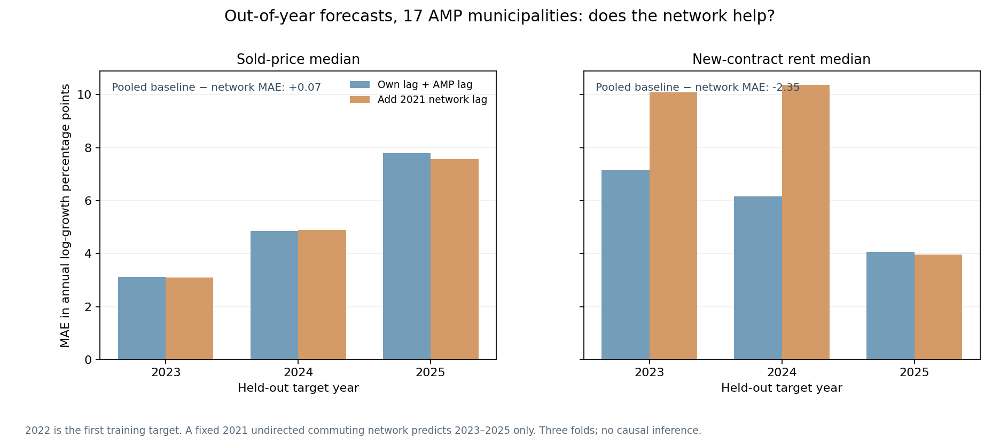

Across the three held-out years there are **51 municipality-year
predictions per outcome**. For median **sold prices**, the average
absolute prediction error falls from **5.257** to **5.188** annual
log-growth percentage points with the network feature: an improvement
of just **0.069 point**. The feature helps slightly in 2023 and 2025
but worsens the 2024 fold. For median **new-contract rents**, the error
instead rises from **5.790 to 8.141 points**: the network feature
*hurts* overall forecast accuracy by **2.351 points**, especially in
the 2023 and 2024 folds. It helps rents only marginally in 2025.
That is a clear warning against interpreting the interaction network as
an automatically informative channel of rental-price transmission.

Changing the network weighting does not rescue a strong prediction
claim. Square-root-transformed weights and a network retaining unions
of each municipality's three strongest partners produce pooled sold-price
MAE improvements of only **0.057** and **0.043 points**, respectively.
Their new-rent improvements are **negative** at **−2.817** and
**−1.654 points**. A reproducible 999-draw shuffle of municipality labels
on the network provides an informal comparison: **9.4%** of shuffled
assignments have at least the observed sold-price improvement, versus
**98.9%** for the observed rent improvement, which is unusually poor.
Those fractions are **not formal p-values**. Municipalities are not
exchangeable random treatment assignments, the shuffle is not a causal
design, and three test years provide a very small time dimension.

Equally important, the 51 predictions within each housing outcome are
correlated in time and metropolitan space; they are not 51 independent
replications of a causal effect. The models omit many potential common
drivers, and their extra feature is a **commuting-interaction** lag,
not a flow of households changing their residence. The output
therefore neither proves that a cascade happened nor disproves that
some people were displaced. It says something more specific: within this
short annual panel, **the observed network has no consistent added
forecasting advantage over local history and a common metropolitan lag**.

The combined result refines the opening argument. Telling priced-out
households to move outward does not magically create additional housing
capacity; widespread scarcity and onward price pressure are economically
plausible. Yet plausibility is not evidence of an epidemic moving in a
particular direction. The annual nominal rent thresholds moved together,
not in a resolved outward succession, and an extra connectivity feature
failed to improve rental prediction. The next decisive empirical input
remains an authorized, genuinely directed residential origin–destination
table, followed by evidence on tenure, affordability and why moves occurred.

---

## Sources and reproducibility

The original eight figures and three tabular outputs, four observed mobility figures, one sharp non-identification figure and **two new annual timing/prediction figures** with companion CSV results can be regenerated using the commands in the [study README](README.md). The new directed-OD intake suite is software-only until a genuine aggregate table is released. The [fixed 17-municipality input](data/amp_municipal_panel_2019_2025.csv) is a derived extract from [DiogoRibeiro7/portugal-housing-generations](https://github.com/DiogoRibeiro7/portugal-housing-generations), pinned to [upstream commit 0407fae](https://github.com/DiogoRibeiro7/portugal-housing-generations/tree/0407faed1f08209b3d7682e19fc57e7120e62879). It does not assert that 2025 income observations or 2019 new-lease observations exist. The published mobility extracts have separate checksummed source records and distinct limitations.

1. Área Metropolitana do Porto. [Statutory definition and its 17 municipalities](https://www.amp.pt/en/amp-instituicao/area-metropolitana-do-porto-or-lei-no-752013/).
2. Instituto Nacional de Estatística. [Local housing price methodology and geospatial context](https://www.ine.pt/ine_novidades/semin/INEWS38/files/assets/common/downloads/publication.pdf).
3. Instituto Nacional de Estatística. [Local rents in newly signed contracts: statistical bulletin](https://www.ine.pt/ine_novidades/BME_set_2022/14/).
4. Instituto Nacional de Estatística. [Cities, commuting areas and functional urban areas](https://www.ine.pt/ine_novidades/BME_jul_2022/).
5. Instituto da Habitação e da Reabilitação Urbana. [Housing Observatory: property-market dynamics](https://www.portaldahabitacao.pt/report_dinamicas-imobiliarias).
6. Área Metropolitana do Porto. [Metropolitan housing-coordination proposal](https://www.amp.pt/noticia/amp-defende-uma-estrategia-metropolitana-para-a-habitacao-e-mais-competencias-para-os-municipios/).
7. Guerrieri, V., Hartley, D. & Hurst, E. (2010/2013). [Endogenous Gentrification and Housing Price Dynamics](https://www.nber.org/papers/w16237). NBER Working Paper 16237; subsequently published in *Journal of Public Economics*.
8. Couture, V., Gaubert, C., Handbury, J. & Hurst, E. (2019). [Income Growth and the Distributional Effects of Urban Spatial Sorting](https://www.nber.org/papers/w26142). NBER Working Paper 26142.
9. Asquith, B. J., Mast, E. & Reed, D. (2019). [Supply Shock Versus Demand Shock: The Local Effects of New Housing in Low-Income Areas](https://research.upjohn.org/up_workingpapers/316/). W. E. Upjohn Institute Working Paper 19-316.
10. Autor, D., Palmer, C. & Pathak, P. (2012/2014). [Housing Market Spillovers: Evidence from the End of Rent Control in Cambridge, Massachusetts](https://www.nber.org/papers/w18125). NBER Working Paper 18125.
11. OECD (2023). [Changes in the Geography of Housing Demand After the Onset of COVID-19](https://www.oecd.org/en/publications/bricks-taxes-and-spending_7a22f9a6-en/full-report/component-4.html), in *Bricks, Taxes and Spending*.
12. Ribeiro, D. (2026). [Portugal's Housing Market, 2008–2025: A Reproducible Analysis](https://diogo-ribeiro-1975.medium.com/portugals-housing-market-2008-2025-a-reproducible-analysis-of-prices-incomes-construction-and-18c715332adf). Related but separate national evidence, not a causal spatial-displacement study.
13. Instituto Nacional de Estatística. [Censos 2021 individual questionnaire, question 10: residence on 31 December 2019](https://censos.ine.pt/scripts/censos_css_js/quest/PT_Q_Individual_Censos2021_INE.pdf).
14. Município do Porto / INE. [Official open-data archive: Censos 2021 population indicators by parish, municipality and region](https://dadosabertos.cm-porto.pt/dataset/indicadores-relativos-populacao-residente-no-porto-resultados-definitivos-censos-2021). See [the frozen residential data](data/porto_census2021_residential_mobility.csv) and [source metadata](data/porto_census2021_residential_provenance.json).
15. Instituto Nacional de Estatística. [Censos 2021 municipal work/study interaction indicator 0012340](https://www.ine.pt/xurl/indx/0012340/PT), as transcribed in [André Brito's Census-derived workbook](https://github.com/andrebrito0/OD_Data_Portugal_Census_2021). This intermediary extract has not been rechecked against a working official INE API endpoint.
16. Instituto Nacional de Estatística. [Censos 2021 population by municipality of current residence, sex and migration category, indicator 0011631](https://www.ine.pt/xurl/indx/0011631/PT). The inspected public catalog entry does not specify the prior municipality as an independent dimension.
17. Instituto Nacional de Estatística. [Methodological document 113, annual resident population estimates](https://www.pordata.pt/sites/default/files/methodological_documentation/Documento_metodologico_estimativas_anuais_da_populacao_residente_113.pdf), section on estimating internal migration balances from Census previous-residence information.
18. Instituto Nacional de Estatística. [English-language Census 2021 individual questionnaire, question 10](https://censos.ine.pt/scripts/censos_css_js/quest/EN_Q_IND_Censos2021_EN_v03.pdf). For a different previous municipality, it requests its name and parish.
19. Instituto Nacional de Estatística. [Information-service notice on custom statistical tables](https://www.ine.pt/ine_novidades/semin/FI_RIIBES_47/files/assets/basic-html/page10.html). The historic request-form link requires current confirmation.
20. Instituto Nacional de Estatística. [Researcher access under the INE–FCT–DGEEC arrangement](https://www.ine.pt/ine_novidades/semin/FI_RIIBES_51/files/assets/basic-html/page6.html), subject to accreditation and confidentiality terms.
21. Instituto Nacional de Estatística. [INEWS 65 (April 2026), research data infrastructure and safe centres](https://www.ine.pt/ine_novidades/semin/INEWS65/index.html), including Porto.

*Publication status: manuscript prepared for technical review. The reported descriptive statistics refer to the pinned October 2026 source snapshot. No estimates of observed displaced households, spatial transmission coefficients or policy causal effects are claimed.*
